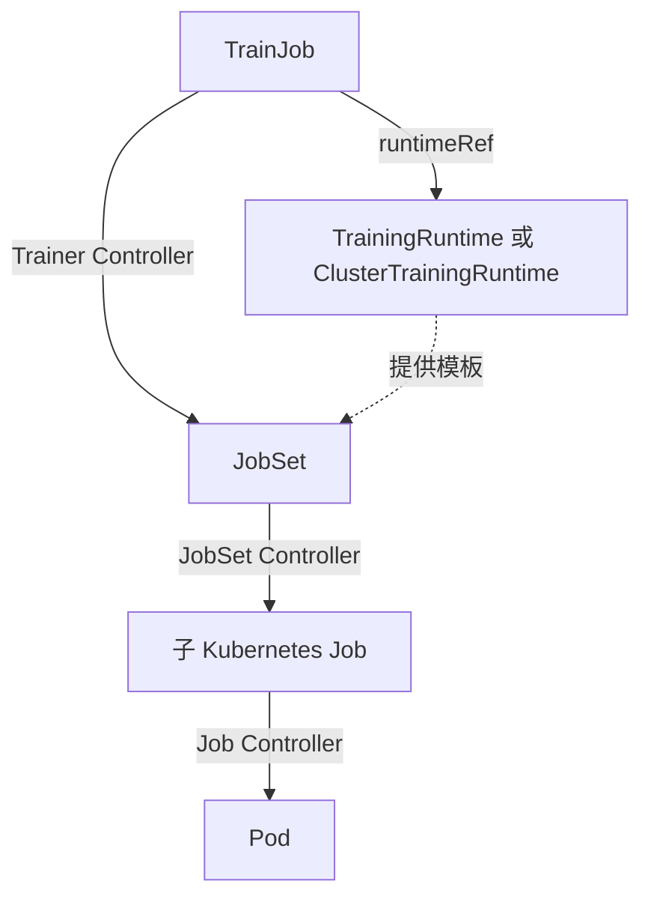

`train-12` 的需求是同时交付三个四卡 worker。使用 VolcanoJob 时，Job Controller 在 Volcano 的 PodGroup 入队后创建成员，Volcano Scheduler 再按组处理绑定。换用 Kubernetes Job 时，可以通过 **Kueue** 管理作业配额和准入。Kueue 会保留额度并通知集成控制器何时可启动作业。在下面的配置中，实际节点绑定交给 Kubernetes 默认调度器。对照采用 Kueue v0.17、Kubernetes v1.36 和 Kueue v1beta2 的字段。 [Kueue v0.17 概览](https://kueue.sigs.k8s.io/v0.17/docs/overview/) · [Kueue v0.17 v1beta2 API](https://kueue.sigs.k8s.io/v0.17/docs/reference/kueue.v1beta2/)

## Workload 配额保留与 Job 解挂

在一个独立快照中，用带索引的 Kubernetes Job 表达原来的三份 worker。每只 Pod 使用同样的四卡、16 CPU、96 GiB 和 1 个 RDMA VF，并使用原来的型号标签和硬性反亲和。以下为 Job 的作业层字段，省略了必需的 Pod 模板和实际启动命令。三个索引用来区分 Pod 角色中的各个实例，训练进程编号由应用会合产生。 [Kubernetes v1.36 Indexed Job](https://v1-36.docs.kubernetes.io/docs/concepts/workloads/controllers/job/#completion-mode) · [Kueue v0.17 Kubernetes Job 集成](https://kueue.sigs.k8s.io/v0.17/docs/tasks/run/jobs/)

```yaml
apiVersion: batch/v1
kind: Job
metadata:
  name: train-12
  namespace: ai-demo
  labels:
    kueue.x-k8s.io/queue-name: train
spec:
  suspend: true
  completionMode: Indexed
  completions: 3
  parallelism: 3
```

1. Job 挂起时，Kubernetes Job Controller 等待启动信号。启用 `batch/job` 集成的 Kueue 为 Job 管理一份 **Workload**，其中一个 **PodSet** 记录同一模板及三个副本的需求。
2. 标签中的 `train` 指向同命名空间的 **LocalQueue**。它指向 **ClusterQueue**，后者维护配额并按 **ResourceFlavor** 区分资源种类，例如为 H100 节点池对应的 flavor 管理 GPU 限额。Flavor 关联的节点标签也可以由集成写入 Pod 模板，影响实际节点筛选。
3. Kueue 为 Workload 保留 12 GPU 等资源额度后，`QuotaReserved` 条件为真。若该队列配置了 **AdmissionCheck**（准入检查），还要等检查通过。随后 `Admitted` 条件为真，Job 集成解除挂起，Kubernetes Job Controller 创建 Pod。
4. 默认调度器筛选、评分和绑定 Pod。查看 `spec.schedulerName` 确认绑定者，再查看当前 Pod 的 `spec.nodeName` 和调度事件。

`.status.admission` 可查看保留额度对应的 ClusterQueue 与 `podSetAssignments`，尚未通过的检查可查 Workload 的 `.status.admissionChecks`。两个状态的时间差能区分额度已经保留和仍需等待外部检查。 [Kueue v0.17 Admission](https://kueue.sigs.k8s.io/v0.17/docs/concepts/admission/) · [ClusterQueue](https://kueue.sigs.k8s.io/v0.17/docs/concepts/cluster_queue/) · [ResourceFlavor](https://kueue.sigs.k8s.io/v0.17/docs/concepts/resource_flavor/) · [WorkloadStatus API](https://kueue.sigs.k8s.io/v0.17/docs/reference/kueue.v1beta2/)

## 同一节点快照下的准入与绑定

假定有一个可用的 H100 flavor，无额外可借额度，其他资源配额充足，且该 flavor 未配置拓扑感知准入。节点余量固定为 `h1/h2/h3 = 8 / 4 / 2 GPU`，其余资源均够，仍有每节点一只的硬性反亲和。依次考虑三份独立教学快照。

| 快照 | Workload 与 Job 的结果 | Pod 的结果 |
| --- | --- | --- |
| 只有 8 GPU 额度 | `8 < 12`，未保留配额，Job 挂起。 | 尚无 worker 可交给调度器。 |
| 有 12 GPU 额度，一项准入检查仍在等 | `QuotaReserved=True`，`Admitted` 尚未为真，Job 仍挂起。 | 查外部检查的状态及消息。 |
| 有 12 GPU 额度，要求的检查皆已通过 | Workload 完成准入，集成可以解除挂起。 | 在普通逐 Pod 放置下可以先绑定两只，第三只因节点余量和反亲和继续等。 |

第三行与相同库存下的 Volcano Gang 形成对照，后者在暂选两个落点时仍未通过三人组的提交条件。Kueue 可为相应 flavor 配置 **Topology-Aware Scheduling**，在配额保留时引入物理拓扑和容量检查，改变准入发生的条件。`waitForPodsReady` 则可以在准入后等待 Pod 就绪，超时撤销准入并重新排队。设置它时，应明确应用的 Ready 条件代表容器、会合还是实际训练进展。 [Kueue v0.17 拓扑感知调度](https://kueue.sigs.k8s.io/v0.17/docs/concepts/topology_aware_scheduling/) · [Kueue v0.17 waitForPodsReady](https://kueue.sigs.k8s.io/v0.17/docs/tasks/manage/setup_wait_for_pods_ready/) · [Volcano v1.16.0 Gang](https://volcano.sh/docs/v1.16.0/scheduler/plugins/gang/)

## 两套调度路径的控制权

两套组件可以服务不同入口的作业。示例中的 `train` 在 Kueue 路径上是 LocalQueue，在 Volcano 路径上是集群级 Queue。若它们共享节点，两套账面可能都承诺同一份物理容量，已准入作业仍会在节点层互相等待。核对实际 Pod 的调度器字段、资源池和两个队列的额度，判断哪个层面正在竞争。 [Kueue v0.17 工作负载集成清单](https://kueue.sigs.k8s.io/v0.17/docs/tasks/run/) · [Kubernetes v1.36 多调度器](https://v1-36.docs.kubernetes.io/docs/tasks/extend-kubernetes/configure-multiple-schedulers/)

| 职责 | VolcanoJob 路径 | Kueue 管理 Kubernetes Job 的路径 |
| --- | --- | --- |
| 作业放行与成员创建 | Volcano Scheduler 更新组的入队状态，Volcano Job Controller 创建成员。 | Kueue 依据 Workload 准入解除 Job 挂起，Kubernetes Job Controller 创建成员。 |
| 额度与放置 | Volcano Queue 核算份额，Volcano Scheduler 使用 PodGroup 等条件检查成组放置。 | Kueue 在 ClusterQueue 保留配额，本例由默认调度器逐 Pod 绑定。 |
| 驱逐与再次尝试 | 调度器的驱逐动作改变占用，Job Policy 决定 VolcanoJob 对相关事件的处理。 | Kueue 可撤销准入并通过作业集成暂停或回排，Kubernetes Job Controller 处理成员生命周期。 |

Kueue v0.17 的官方集成清单未列出 VolcanoJob。若同一份作业需要跨组件交接，先用所采用的集成确认谁写挂起或放行状态，谁保留额度，谁创建组，哪个 scheduler 绑定，以及驱逐后哪个控制器负责清理、回排和重试。Pod 的 owner reference 与 schedulerName 可帮助找到运行中的实际链条。 [Kueue v0.17 工作负载集成清单](https://kueue.sigs.k8s.io/v0.17/docs/tasks/run/) · [VolcanoJob 集成的上游讨论](https://github.com/kubernetes-sigs/kueue/issues/1204)

## JobSet 与 Kubeflow Trainer 的角色组织

如果在原来的三只 worker 之外再加一只独立协调者，**JobSet** 可把不同角色组织为多份 Kubernetes Job。用 `spec.replicatedJobs[]` 为 `coordinator` 指定 `replicas: 1`，为 `worker` 指定 `replicas: 3`，并各提供 Job `template`。如果每个子 Job 的 `parallelism` 和 `completions` 都为 1，共产生四个子 Job，每个生成一只 Pod。这份变体新增了一个协调者，请求总量还要加上它自己的模板资源。JobSet Controller 负责组织子 Job 和依照 `failurePolicy` 处理失败，Kubernetes Job Controller 负责子 Job 的 Pod。直接提交 JobSet 且启用 Kueue 的 JobSet 集成时，检查父 JobSet 的队列标签和挂起状态。 [JobSet v1alpha2 API](https://jobset.sigs.k8s.io/docs/reference/jobset.v1alpha2/) · [JobSet Failure Policy](https://jobset.sigs.k8s.io/docs/tasks/failure_policy/) · [Kueue v0.17 JobSet 集成](https://kueue.sigs.k8s.io/v0.17/docs/tasks/run/jobsets/)

**Kubeflow Trainer v2**（训练控制器）用 TrainJob 描述一次训练。TrainJob 的 `spec.runtimeRef` 选择命名空间内的 TrainingRuntime 或集群级 ClusterTrainingRuntime。Runtime 提供训练框架对应的模板与运行规则。这次训练的节点数可通过 `spec.trainer.numNodes` 写成 3。在采用 JobSet 的 Runtime 中，Trainer 生成 JobSet，再依次生成子 Job 和 Pod。用 Kueue v0.17 的 TrainJob 集成时，Trainer 需要 v2.0.0 或更高，并启用该集成。教学场景以 TrainJob 的队列标签和 `spec.suspend` 为准入入口。 [Kubeflow Trainer 概览](https://www.kubeflow.org/docs/components/trainer/overview/) · [Kueue v0.17 TrainJob 集成](https://kueue.sigs.k8s.io/v0.17/docs/tasks/run/trainjobs/)



看到一个尚未开始的 TrainJob，先确认其 Runtime 与 Workload，沿 owner reference 追到实际生成的成员，再用 Pod 的调度器字段或绑定位置信息定位后续阶段。同样的追踪方法适用于 Volcano，只需从它的作业对象、PodGroup 与 Queue 开始。
