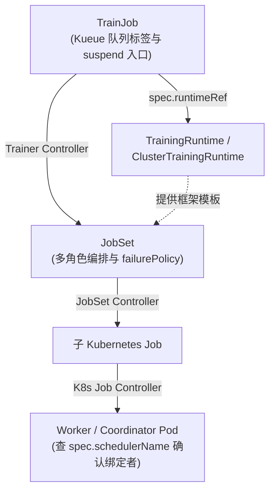

# Kueue 准入与作业控制器

前面五篇，我们用 Volcano 走通了整套批处理调度链路。但在很多生产集群里，团队已经广泛运行着标准 Kubernetes `Job`、`Deployment`、`JobSet`、`LeaderWorkerSet` 或 `Kubeflow Trainer`，并不想把集群默认的 `kube-scheduler` 整体替换掉。

这时候，就需要一个站在调度器之上的“纯门禁总控台”——**Kueue**（Kubernetes 官方 SIG Apps 维护的作业排队与配额准入控制器）。

如果说 **Volcano 是“门卫 + 领位员一体”**（既管配额放行，又亲自挑选具体物理节点完成成组绑定），那么 **Kueue 则是“纯粹的门卫与配额总账”**：作业提交后先保持挂起，Kueue 算清多租户额度、借用和准入条件后再抬杆解挂；至于解挂后怎么选节点绑定，则继续交给底层调度器（如默认 `kube-scheduler`）。

以下对照基于 **Kueue `v0.17`（`kueue.x-k8s.io/v1beta2` API）** 与 **Kubernetes `v1.36`**。

## 一、Kueue 核心对象与 `Indexed Job` 准入流程

把同样的三节点需求 `train-12`（每只 worker 需 `4` GPU、`16` CPU、`96 GiB`、`1` VF，带卡型选择和硬性反亲和）改写成带索引的 Kubernetes `Job`，只需加上队列标签和挂起开关（下例省略 Pod 模板详情）：

```yaml
apiVersion: batch/v1
kind: Job
metadata:
  name: train-12
  namespace: ai-demo
  labels:
    kueue.x-k8s.io/queue-name: train  # 指向同命名空间的 LocalQueue
spec:
  suspend: true                       # 提交时先挂起，等待 Kueue 批准后自动改写为 false
  completionMode: Indexed             # 索引模式：给 3 只 Pod 分配 0/1/2 固定序号
  completions: 3                      # 需要 3 个成功完成的成员
  parallelism: 3                      # 并行启动 3 只 worker Pod
```

这里的三个索引用来区分各个 Pod 实例，而训练进程的全局 Rank 仍由应用会合产生。作业提交后，Kueue 按四步完成配额准入：

1. **生成 `Workload` 与 `PodSet`**：Job 处于 `suspend: true` 时，Kubernetes Job Controller 暂停建 Pod；启用了 `batch/job` 集成的 Kueue 为其创建对应的 **`Workload`**，用一个 **`PodSet`** 汇总模板和 3 副本总需求（`12` GPU 等）。
2. **沿队列定位配额与 `ResourceFlavor`**：标签中的 `train` 指向命名空间内的 **`LocalQueue`**，后者对接集群级 **`ClusterQueue`**。`ClusterQueue` 按 **`ResourceFlavor`**（资源风味，如对应 H100 节点池）核算配额，并在准入时把 Flavor 关联的节点选择器注入 Pod 模板。
3. **保留额度并通过 `AdmissionCheck`**：Kueue 锁定 12 GPU 额度后将 `QuotaReserved` 置为 `True`；若队列配了外部准入检查则等其全过，随后 `Admitted` 变真并解除 Job 挂起。
4. **建 Pod 与底层绑定**：Kubernetes Job Controller 看到解挂后创建 3 只 worker Pod，交由默认 `kube-scheduler` 筛选、打分并绑定到物理节点。

排查进度时，查 `Workload` 的 `.status.admission`（可看绑定的 `ClusterQueue` 与 `podSetAssignments`）与 `.status.admissionChecks`，就能一眼分辨卡在“没额度”还是“等外部检查”。

## 二、同一节点快照下的准入与绑定对照

沿用第 02 篇最经典的物理库存快照：三台节点 `node-1`–`node-3` 分别剩余 `8 / 4 / 2` GPU（其余资源充足，硬性反亲和限定每节点 1 只 worker）。假定 H100 `ResourceFlavor` 无额外可借额度，也未启用拓扑感知准入，比较三组独立情形：

| 队列额度与检查快照 | `Workload` 与 `Job` 状态 | 物理节点上的 `Pod` 结果 |
| --- | --- | --- |
| 仅有 `8` GPU 额度 | `8 < 12`，未通过配额保留；`Job` 保持 `suspend: true`。 | 尚未创建任何 worker Pod。 |
| 有 `12` GPU 额度，但一项 `AdmissionCheck` 仍在等待 | `QuotaReserved=True`，`Admitted=False`；`Job` 仍挂起。 | 尚无 Pod；需排查对应外部检查控制器的消息。 |
| 有 `12` GPU 额度，且全部检查均已通过 | `Admitted=True`，Kueue 解挂 `Job`，控制器建出 3 只 Pod。 | 默认调度器逐 Pod 绑定：**先绑上 2 只（`node-1/2`），第 3 只卡在 `Pending`**！ |

请把第三行和第 02 篇的 Volcano Gang 放在一起看：面对同一份 `8 / 4 / 2` 节点库存，Volcano 在 `allocate` 阶段发现凑不齐 3 个落点会整组回滚；而单纯靠配额总量放行的 Kueue 解挂了 Job，默认调度器却只绑上了两只 Pod，留下空占 8 卡的半吊子现场。

针对这个缺口，Kueue `v0.17` 提供了两项原生补强机制：

- **Topology-Aware Scheduling（拓扑感知调度）**：在 `ResourceFlavor` 上启用后，Kueue 在保留额度阶段就会结合节点/机架物理拓扑与空槽校验，避免“账面够、实际落不下”的放行。
- **`waitForPodsReady`**：在作业准入后启动超时计时器，若规定时间内全部成员未就绪，自动撤销准入、重新挂起并回排释放占卡（使用前务必明确 Pod 的 Ready 探针代表容器存活、完成会合还是训练已推进）。

## 三、训推混部实战：Kueue 的 `Cohort` 跨队列借还

与 Volcano 的平级 `Queue` 对应，Kueue 通过把多个 `ClusterQueue` 放进同一个 **`Cohort`（共享池）** 来治理在线推理与离线训练的日夜潮汐算力借还。

在 Kueue `v0.17` 中，原生 **`Deployment`** 集成（每个推理副本 Pod 映射为独立 `Workload`，支持秒级弹性扩缩）和 **`LeaderWorkerSet`（LWS）** 集成（将多机 TP 或 PD 分离推理组作为原子单元准入）均已默认启用。

下面是在 4 节点 32 GPU 集群上，使用 `kueue.x-k8s.io/v1beta2` 定义训推混部双队列的核心配置：

```yaml
apiVersion: kueue.x-k8s.io/v1beta2
kind: ClusterQueue
metadata:
  name: infer-online-cq               # 承接在线推理 Deployment / LeaderWorkerSet
spec:
  cohortName: gpu-cluster-cohort      # 加入共享池，允许在空闲时向训练出借算力
  preemption:
    withinClusterQueue: LowerPriority
    reclaimWithinCohort: LowerPriority # 白昼推理扩容时，回收同池低优训练借走的额度
  resourceGroups:
    - coveredResources: ["nvidia.com/gpu"]
      flavors:
        - name: h100-flavor
          resources:
            - name: nvidia.com/gpu
              nominalQuota: "24"      # 推理集群名义配额（白昼高峰主权）
              lendingLimit: "16"      # 夜间最多借出 16 卡，始终为推理留足 8 卡底线
---
apiVersion: kueue.x-k8s.io/v1beta2
kind: ClusterQueue
metadata:
  name: train-offline-cq              # 承接离线训练 Job / JobSet / TrainJob
spec:
  cohortName: gpu-cluster-cohort
  preemption:
    withinClusterQueue: LowerPriority
    reclaimWithinCohort: Never        # 离线队列不允许跨池回收高优推理
    borrowWithinCohort:
      policy: LowerPriority
  resourceGroups:
    - coveredResources: ["nvidia.com/gpu"]
      flavors:
        - name: h100-flavor
          resources:
            - name: nvidia.com/gpu
              nominalQuota: "8"       # 全天候保底训练名义配额
              borrowingLimit: "16"    # 夜间最多向共享池借 16 卡（最高用至 24 卡）
```

对比第 03、04 篇的 Volcano 双队列，两套机制的治理目标完全一致，只是换了字段语言：

- `infer-online-cq` 的 `nominalQuota: 24` 对应 Volcano 的 `deserved: 24`；`lendingLimit: 16` 留出的 `24 - 16 = 8` 卡，则等价于夜间不可外借的 `guarantee: 8`。
- 白昼在线推理 `Deployment` 扩容时，Kueue 触发 `reclaimWithinCohort: LowerPriority`，撤销借卡离线训练 `Workload` 的准入并重新挂起对应作业，优雅清退训练 Pod，迅速把 16 卡还给线上推理。

## 四、Volcano 与 Kueue 的控制权边界

很多团队容易在选型或混用时踩坑：什么时候选 Volcano，什么时候选 Kueue，两者能不能直接共用同一批 GPU 节点？下表划清了两条路线的职责边界：

| 职责维度 | Volcano（`VolcanoJob` / 注解）路径 | Kueue（管理 `Job` / `Deployment` / `JobSet`）路径 |
| --- | --- | --- |
| **作业放行与建 Pod** | Volcano Scheduler 将 `PodGroup` 推进到 `Inqueue`，Job Controller 创建成员。 | Kueue 批准 `Workload` 后改写 `spec.suspend: false`，由原生控制器创建成员。 |
| **配额与节点绑定** | Volcano `Queue` 算账，Volcano Scheduler 用 `PodGroup` 事务做 Gang 成组绑定。 | Kueue 在 `ClusterQueue`/`Cohort` 算账；节点绑定交给 `kube-scheduler`（或配套调度器）。 |
| **驱逐与重新排队** | 调度器 `preempt`/`reclaim` 直接驱逐 Pod，由 Job Policy 决定是否整组重试。 | Kueue 撤销 `Workload` 准入并挂起/回排作业，底层控制器负责清理与重建。 |
| **在线推理适配** | `Deployment` 加队列注解与 `schedulerName: volcano` 接入同一队列账本。 | 原生支持 `Deployment`（单 Pod 弹性）与 `LeaderWorkerSet`（多机推理成组准入）。 |

> [!warning] 常见误区：双账本共享同一批物理节点造成“超卖互卡”
> Kueue 的 `train` 是命名空间内 `LocalQueue`，Volcano 的 `train` 是集群级 `Queue`。如果两套系统管着**同一批未隔离的物理节点**，两者互不知情，可能同时把同一批 GPU 承诺给各自放行的作业，最终让双方都在节点层陷入死等！
>
> 此外，Kueue `v0.17` 官方支持的工作负载集成清单**并未内置 `VolcanoJob`**。如果集群同时运行两套体系，最稳妥的做法是**按节点标签硬切分物理资源池**；排障时先查 Pod 的 `ownerReferences` 与 `spec.schedulerName`，确认当前到底由哪条控制链掌权。

## 五、高层作业控制器：`JobSet` 与 `Kubeflow Trainer v2`

面对多角色训练或标准化框架封装，工程师通常不会手写裸 `Job`，而是借助上层控制器把整套分布式模板抽象出来，再统一交由 Kueue 管控准入：

### 1. `JobSet`：多角色子 Job 编排

`JobSet` 用 `spec.replicatedJobs[]` 把不同角色拆成多份独立的 Kubernetes `Job`。例如在 3 只 worker 之外加 1 只独立协调者，可设 `coordinator`（`replicas: 1`）与 `worker`（`replicas: 3`）。

若每个子 Job 的 `parallelism` 和 `completions` 均为 `1`，则会生成 4 份子 Job 和 4 只 Pod（总配额须计入协调者）。JobSet Controller 按 `failurePolicy` 管理失败重试；接入 Kueue 时，给父 `JobSet` 打队列标签并查其挂起状态。

### 2. `Kubeflow Trainer v2`：面向算法框架的 `TrainJob`

`Kubeflow Trainer v2` 用 **`TrainJob`** 描述训练任务，经 `spec.runtimeRef` 引用 `TrainingRuntime` 或 `ClusterTrainingRuntime` 复用标准启动模板，并用 `spec.trainer.numNodes: 3` 指定节点规模。

在采用 JobSet 的 Runtime 中，Trainer 先生成 `JobSet`，再级联创建子 Job 与 Pod。配合 Kueue `v0.17` 的 `TrainJob` 集成时，Trainer 需为 `v2.0.0+`，准入入口看 `TrainJob` 的队列标签与 `spec.suspend`。



*图 16-06-01：`TrainJob → JobSet → Kubernetes Job → Pod` 的控制权与对象所有权级联链条。*

> [!summary] 核心结论
> 无论顶层是 `VolcanoJob` 还是 `TrainJob`，排查“作业为何还没跑起来”的方法论高度一致：**从顶层声明出发，先查准入/队列对象（`PodGroup` 或 `Workload`），再沿 `ownerReferences` 追到真实 Pod，最后用 `spec.schedulerName` 与节点事件锁定落点与运行层**。

下一篇我们进入综合实战检验，用 5 组覆盖 Volcano 与 Kueue 核心推演及训推潮汐回收的离线考题，把整章知识彻底焊牢。

> [!info]- 参考资料
> - **Kueue v0.17 核心概念与 API**：[Kueue v0.17 概览](https://kueue.sigs.k8s.io/v0.17/docs/overview/)、[Kueue v0.17 v1beta2 API 参考](https://kueue.sigs.k8s.io/v0.17/docs/reference/kueue.v1beta2/)、[Admission 概念](https://kueue.sigs.k8s.io/v0.17/docs/concepts/admission/)、[ClusterQueue 概念](https://kueue.sigs.k8s.io/v0.17/docs/concepts/cluster_queue/)、[ResourceFlavor 概念](https://kueue.sigs.k8s.io/v0.17/docs/concepts/resource_flavor/)
> - **Kueue 工作负载集成与补强能力**：[Kueue v0.17 工作负载集成清单](https://kueue.sigs.k8s.io/v0.17/docs/tasks/run/)、[Kubernetes Job 集成](https://kueue.sigs.k8s.io/v0.17/docs/tasks/run/jobs/)、[JobSet 集成](https://kueue.sigs.k8s.io/v0.17/docs/tasks/run/jobsets/)、[TrainJob 集成](https://kueue.sigs.k8s.io/v0.17/docs/tasks/run/trainjobs/)、[拓扑感知调度（TAS）](https://kueue.sigs.k8s.io/v0.17/docs/concepts/topology_aware_scheduling/)、[waitForPodsReady 配置](https://kueue.sigs.k8s.io/v0.17/docs/tasks/manage/setup_wait_for_pods_ready/)、[VolcanoJob 集成上游讨论](https://github.com/kubernetes-sigs/kueue/issues/1204)
> - **JobSet、Kubeflow Trainer 与 Kubernetes 调度**：[JobSet v1alpha2 API](https://jobset.sigs.k8s.io/docs/reference/jobset.v1alpha2/)、[JobSet Failure Policy](https://jobset.sigs.k8s.io/docs/tasks/failure_policy/)、[Kubeflow Trainer 概览](https://www.kubeflow.org/docs/components/trainer/overview/)、[Kubernetes v1.36 Indexed Job](https://v1-36.docs.kubernetes.io/docs/concepts/workloads/controllers/job/#completion-mode)、[Kubernetes v1.36 多调度器配置](https://v1-36.docs.kubernetes.io/docs/tasks/extend-kubernetes/configure-multiple-schedulers/)、[Volcano v1.16.0 Gang 插件](https://volcano.sh/docs/v1.16.0/scheduler/plugins/gang/)
