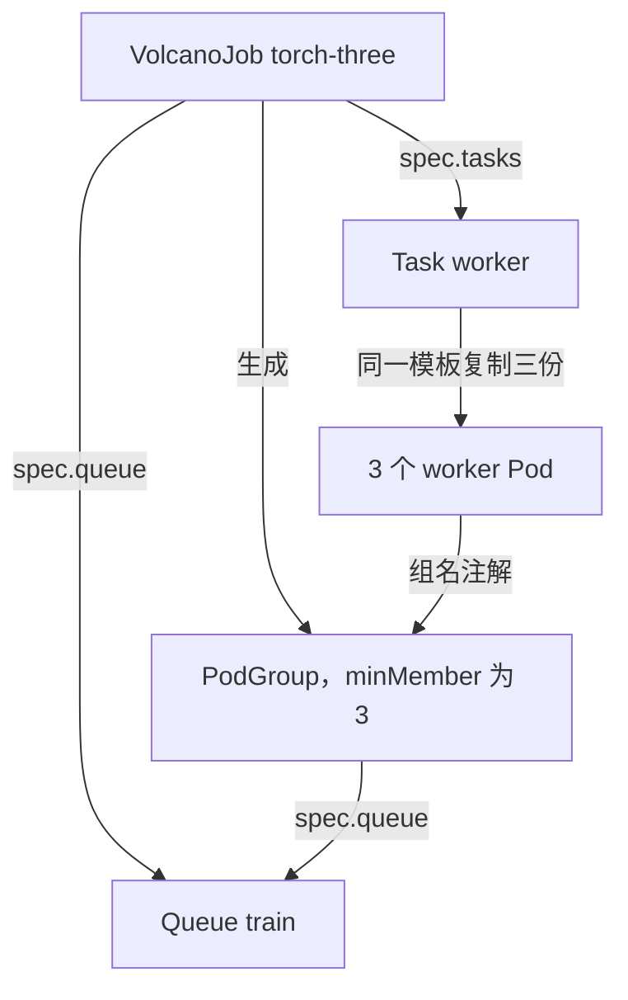
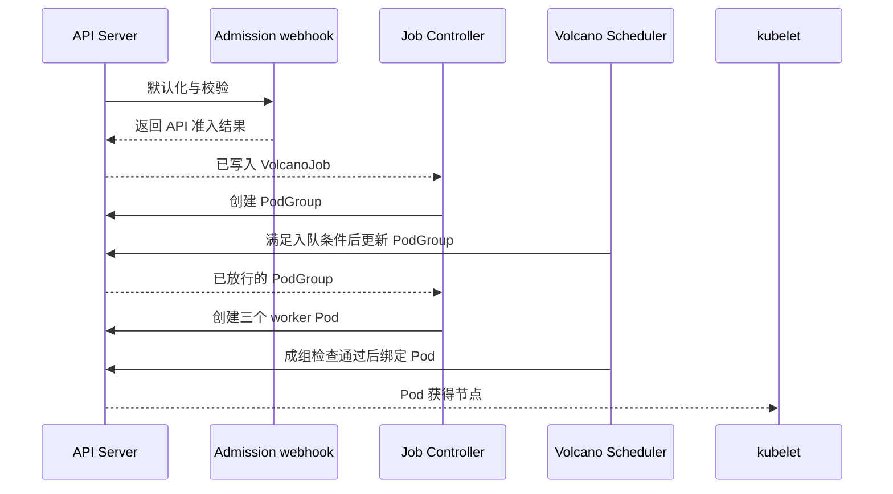

# Volcano 对象、组件与调度配置

单个 Pod 的 YAML 就能说明容器要什么资源。一份分布式训练作业还要说明有几份 Pod 模板、各复制多少次、哪批 Pod 要一起安排、从哪个队列取得资源。用 Volcano 时，这些信息分布在 VolcanoJob、PodGroup 和 Queue 中。本文以 Kubernetes v1.36 与 Volcano v1.16.0 为基线，配置片段和资源量均为教学示例。Volcano v1.16.0 的发布说明确认支持 Kubernetes v1.36，并以 Kubernetes v1.36.1 为构建依赖。 [Volcano v1.16.0 发布说明](https://github.com/volcano-sh/volcano/releases/tag/v1.16.0)

## VolcanoJob、Task、PodGroup 与 Queue

先看一份 worker Pod 的模板。容器申请 4 张 GPU、16 CPU、96 GiB 主机内存和 1 个 RDMA VF。这里假定节点上挂的是 H100 80 GB 整卡，GPU 插件发布 `nvidia.com/gpu`，并假定 RDMA 设备插件发布 `example.com/rdma-vf`。API 中的 GPU 请求表达设备数量，节点型号由随后用到的节点池标签限定。 [Kubernetes v1.36 GPU 调度](https://v1-36.docs.kubernetes.io/docs/tasks/manage-gpus/scheduling-gpus/) · [Kubernetes v1.36 Device Plugins](https://v1-36.docs.kubernetes.io/docs/concepts/extend-kubernetes/compute-storage-net/device-plugins/)

把模板放进 `spec.tasks[]`，就得到一个 VolcanoJob 的 Task。一个名为 `worker` 的 Task，配 `replicas: 1` 就产生一个 worker Pod，配 `replicas: 3` 就用同一份模板产生三个 worker Pod。Task 是 VolcanoJob 内的一段规格，三份副本各自有 Pod 名和 UID。下面是固定三副本的核心配置。镜像地址和 RDMA 资源名用于教学，启动命令和节点约束单独展示。 [Volcano v1.16 VolcanoJob](https://volcano.sh/docs/v1.16.0/concepts/volcanojob/) · [v1.16.0 Job Controller 的 Pod 生成](https://github.com/volcano-sh/volcano/blob/v1.16.0/pkg/controllers/job/job_controller_actions.go)

```yaml
apiVersion: batch.volcano.sh/v1alpha1
kind: Job
metadata:
  name: torch-three
  namespace: ai-demo
spec:
  schedulerName: volcano
  queue: train
  minAvailable: 3
  tasks:
    - name: worker
      replicas: 3
      template:
        metadata:
          labels:
            infra.example.com/workload: torch-three
        spec:
          restartPolicy: Never
          containers:
            - name: trainer
              image: example.invalid/training/torch:demo
              resources:
                requests:
                  cpu: "16"
                  memory: 96Gi
                  nvidia.com/gpu: "4"
                  example.com/rdma-vf: "1"
                limits:
                  cpu: "16"
                  memory: 96Gi
                  nvidia.com/gpu: "4"
                  example.com/rdma-vf: "1"
```

| 资源 | 一个 worker 的请求 | 三个 worker 的请求 |
| --- | ---: | ---: |
| GPU 整卡 | 4 | 12 |
| CPU | 16 | 48 |
| 主机内存 | 96 GiB | 288 GiB |
| RDMA VF | 1 | 3 |

`replicas` 给出要创建的副本总数。Job 的 `spec.minAvailable` 给出作业的最低可运行成员数，本例与副本总数同为 3。Job Controller 据此生成 `scheduling.volcano.sh/v1beta1` 的 **PodGroup**，将 `minAvailable` 映射为 `spec.minMember`，并据各模板和门槛计算 `spec.minResources`。本例只有一个模板，三份都必需，所以最低请求就是上表右列。Job 和 PodGroup 的 `spec.queue` 都指向 `train`，这是同一 API 组中的集群级 **Queue**。同一队列可以处理多个命名空间的作业，而本例的 Job、PodGroup 和三个 Pod 都在 `ai-demo` 命名空间。 [Volcano v1.16 PodGroup](https://volcano.sh/docs/v1.16.0/concepts/podgroup/) · [Queue](https://volcano.sh/docs/v1.16.0/concepts/queue/) · [v1.16.0 PodGroup 生成与最低资源计算](https://github.com/volcano-sh/volcano/blob/v1.16.0/pkg/controllers/job/job_controller_actions.go)



判断对象类型时读完整 API 组。VolcanoJob 的 Kind 与 Kubernetes `batch/v1 Job` 同为 `Job`。本章所用的 Volcano PodGroup 也有自己的 API 组，使用它无需打开 Kubernetes v1.36 原生 Workload/PodGroup 的特性开关。 [Volcano v1.16 VolcanoJob](https://volcano.sh/docs/v1.16.0/concepts/volcanojob/) · [Kubernetes v1.36 原生 Workload API](https://kubernetes.io/blog/2026/05/13/kubernetes-v1-36-advancing-workload-aware-scheduling/)

## Admission、Controller 与 Scheduler 的职责

提交作业时，API Server 会在对象写入过程中调用相应的 Volcano Admission webhook。默认化可能填入省略的 Queue 等字段，校验会检查请求是否符合 API 规则。对象写入后，Job Controller 协调作业，创建 PodGroup，并在它通过等待入队的阶段后尝试创建 Pod。Queue Controller 维护队列状态，Scheduler 则根据调度配置处理 PodGroup 和 Pod。绑定以后，由目标节点的 kubelet 准备设备和容器。 [Volcano v1.16 架构](https://volcano.sh/docs/v1.16.0/home/architecture/) · [v1.16.0 Job 默认化 webhook](https://raw.githubusercontent.com/volcano-sh/volcano/v1.16.0/pkg/webhooks/admission/jobs/mutate/mutate_job.go) · [v1.16.0 Job Controller](https://github.com/volcano-sh/volcano/blob/v1.16.0/pkg/controllers/job/job_controller_actions.go) · [Kubernetes v1.36 Pod 生命周期](https://v1-36.docs.kubernetes.io/docs/concepts/workloads/pods/pod-lifecycle/)



核对实际对象时，先在 PodGroup 和 Pod 的 `metadata.ownerReferences` 中确认 VolcanoJob 的 UID。两者都可由 VolcanoJob 拥有，Pod 另带组名注解供调度器认组。若模板中未指定 `schedulerName`，Job Controller 将作业的值传给 Pod。模板显式写了别的调度器时，要以生成的 Pod `spec.schedulerName` 为准。API 请求被拒绝时查 API 返回的错误。Job 已存在但迟迟没有 PodGroup 时查 Job Controller。PodGroup 已存在时，继续看其状态和调度器事件，再判断控制器是否应当创建成员。 [v1.16.0 Job Controller](https://github.com/volcano-sh/volcano/blob/v1.16.0/pkg/controllers/job/job_controller_actions.go) · [v1.16.0 Pod 模板展开与调度器选择](https://raw.githubusercontent.com/volcano-sh/volcano/v1.16.0/pkg/controllers/job/job_controller_util.go)

## Scheduler 调度周期与 actions、tiers、plugins

Volcano Scheduler 基于缓存中的作业、队列、Pod 和节点打开一次调度 session。`actions` 决定每次 session 依次执行哪些步骤。`tiers` 列出参与计算的插件和分层顺序。插件在 session 初始化时注册回调，action 在需要判定或评分时调用相应回调。以作业排序为例，框架按 tier 和插件先后使用启用的排序回调，有一个回调给出先后就可以结束比较。节点打分则由相应的打分回调组合结果。 [Volcano v1.16 调度器配置指南](https://volcano.sh/docs/v1.16.0/userguide/user_guide_how_to_configure_scheduler/) · [v1.16.0 session 插件调用](https://github.com/volcano-sh/volcano/blob/v1.16.0/pkg/scheduler/framework/session_plugins.go)

| Action | 要作的决定 | 本例的相关插件 |
| --- | --- | --- |
| `enqueue` | 这份 PodGroup 当前能否入队，控制器能否继续创建成员 | `capacity` 检查队列上限与入队用量。 |
| `allocate` | 每个 Pod 有哪些候选节点，合在一起能否提交放置方案 | `predicates` 过滤节点，`nodeorder`、`binpack` 参与打分，`gang` 检查最低规模。队列还要允许为候选 Pod 分配资源。 |

Volcano v1.16.0 Helm 配置的 actions 是 `enqueue, allocate, backfill`，该版本的文件列有 `overcommit`、`proportion` 等插件。教学主线只跟有资源请求的 Pod，采用 `enqueue, allocate`。队列使用 `capacity`，教学配置中省略 `proportion` 和 `overcommit`，据此隔离队列上限对入队的影响。下面是 ConfigMap `data["volcano-scheduler.conf"]` 中的内容。后续讨论抢占或回收时，再分别加入对应的 action。 [v1.16.0 Helm 调度配置](https://github.com/volcano-sh/volcano/blob/v1.16.0/installer/helm/chart/volcano/config/volcano-scheduler.conf) · [Volcano v1.16 Actions](https://volcano.sh/docs/v1.16.0/scheduler/actions/) · [Capacity 配置指南](https://volcano.sh/docs/v1.16.0/userguide/user_guide_how_to_use_capacity_plugin/)

```yaml
actions: "enqueue, allocate"
tiers:
  - plugins:
      - name: priority
      - name: gang
        enablePreemptable: false
      - name: conformance
  - plugins:
      - name: drf
        enablePreemptable: false
      - name: predicates
      - name: capacity
      - name: nodeorder
      - name: binpack
```
