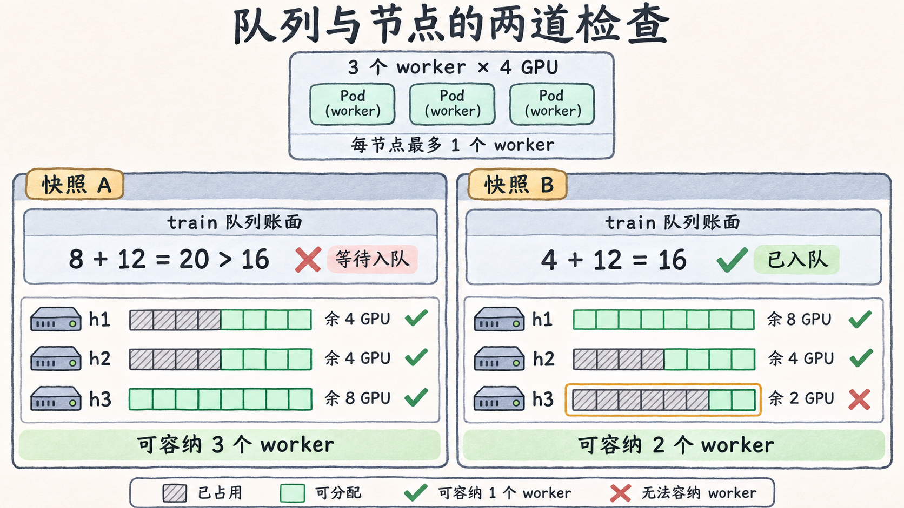

# 入队、成组放置与启动

一个固定规模的 VolcanoJob 申请三个 worker。每个 worker 请求 4 张 H100 整卡、16 CPU、96 GiB 主机内存和 1 个 RDMA VF，最低运行成员数也是 3。本篇以 Volcano v1.16.0、Kubernetes v1.36 和 `enqueue, allocate` 教学配置为基线，启用 `capacity` 与 `gang`。节点余量、队列用量和状态组合均为教学推演。 [Volcano v1.16 Actions](https://volcano.sh/docs/v1.16.0/scheduler/actions/)

## Queue 容量与 enqueue 入队

先看 `train` 队列 GPU 维度的配置。`capability` 给队列设使用上限，其他容量维度在算例中均充足。示例的 `deserved` 是发生共享竞争时用到的应得份额。这里无专属保留，队列处于 `Open`。 [Volcano v1.16 Queue](https://volcano.sh/docs/v1.16.0/concepts/queue/) · [Capacity 配置指南](https://volcano.sh/docs/v1.16.0/userguide/user_guide_how_to_use_capacity_plugin/)

```yaml
apiVersion: scheduling.volcano.sh/v1beta1
kind: Queue
metadata:
  name: train
spec:
  capability:
    nvidia.com/gpu: "16"
  deserved:
    nvidia.com/gpu: "12"
```

API Server 接收 Job 后，Job Controller 创建 PodGroup。本例 `spec.minMember` 为 3，`spec.minResources` 中的 GPU 值是 12。`enqueue` 在调度 session 中处理尚待入队的 PodGroup。对本例的 `capacity` 路径，scheduler 先检查 Queue 是否开放，再检查最低请求加目前分配量和相关在途量是否超过队列有效上限。源码另有 `elastic` 校正项，本例的其他在途需求和该校正量都取 0。检查通过后，`enqueue` 推进 PodGroup 到 `Inqueue`，Job Controller 观察到放行后才尝试创建 worker Pod。 [v1.16.0 enqueue](https://raw.githubusercontent.com/volcano-sh/volcano/v1.16.0/pkg/scheduler/actions/enqueue/enqueue.go) · [v1.16.0 capacity 入队检查](https://github.com/volcano-sh/volcano/blob/v1.16.0/pkg/scheduler/plugins/capacity/capacity.go) · [v1.16.0 Job Controller 同步条件](https://github.com/volcano-sh/volcano/blob/v1.16.0/pkg/controllers/job/job_controller_actions.go)

三台节点 `h1`、`h2`、`h3` 各有 8 个 GPU Allocatable。`train` 的两个旧 Pod 分别在 `h1` 和 `h2`，各占 4 个 GPU 请求。余量是 `4 / 4 / 8`，三个 worker 在卡数上各有一台可选。队列已用 8 GPU，还要加新作业的 12 GPU，`8 + 12 = 20` 超过上限 16，PodGroup 继续等入队，控制器此时尚无须创建 worker。等 `h1` 的旧 Pod 退出且 scheduler 已计入释放，队列账面变为 `4 + 12 = 16`。假定其他入队条件都满足，PodGroup 才可进入 `Inqueue`。

```powershell
kubectl get jobs.batch.volcano.sh torch-three -n ai-demo -o yaml
kubectl get podgroups.scheduling.volcano.sh -n ai-demo -o yaml
kubectl get queues.scheduling.volcano.sh train -o yaml
kubectl get events.events.k8s.io -n ai-demo -o yaml
```

| 观察点 | 如何判断下一步 |
| --- | --- |
| API 请求报错，Job 未创建 | 从提交时的 API 返回查字段校验或 webhook，先确认使用了 `batch.volcano.sh/v1alpha1`。 |
| Job 存在，未找到它拥有的 PodGroup | 看 Job 的 `.status.state.phase` 和控制器事件，按 Job UID 核对生成关系。 |
| PodGroup 尚待入队，没有 worker | 看 PodGroup `.status.phase` 和 `.status.conditions`，Queue `.status.state`、`.status.allocated` 与 `.spec.capability`。若账面看似有余量，核对 scheduler 所见的在途量和最低请求。 |
| PodGroup 已显示 `Inqueue`，随后仍未看到 worker | 查 Job Controller 的 Pod 创建错误或 API 拒绝，按 owner reference 找 Pod，避免把其他作业的同类 Pod 算进来。 |

`.status.allocated` 是 API 中可查询的队列用量，入队还用到 scheduler session 中的其他统计。Volcano v1.16.0 的 `capacity` 源码在较高日志级别提供作业名、最低请求、队列名、有效上限、`allocated`、`inqueue` 与 `elastic`。查事件时用 `regarding.uid` 对准本次 PodGroup，再核对 `reportingController`、`reason`、`note` 和时间。源码在队列有效上限不足时会尝试记录一条 `reason` 为 `Unschedulable` 的 PodGroup 事件。要从 `note` 确认说的是队列资源不足，再对照缺少的资源维度。 [v1.16.0 capacity 源码](https://github.com/volcano-sh/volcano/blob/v1.16.0/pkg/scheduler/plugins/capacity/capacity.go) · [v1.16.0 Queue 与 PodGroup API 类型](https://raw.githubusercontent.com/volcano-sh/volcano/v1.16.0/staging/src/volcano.sh/apis/pkg/apis/scheduling/v1beta1/types.go) · [Kubernetes v1.36 Event API](https://v1-36.docs.kubernetes.io/docs/reference/kubernetes-api/events/event-v1/)

## allocate、Gang 成组放置与 Pod 启动

入队后控制器创建三个 worker。现在用另一份紧接着的快照。假定 `batch` 队列在 `h3` 新占用了 6 GPU，`h2` 上还保留 `train` 的那个 4 卡旧 Pod。节点池同型，CPU、主机内存和 VF 的剩余请求额度也够。节点余量仍按 Allocatable 减已计入的请求计算。

在 VolcanoJob 的 `spec.tasks[0].template.spec` 里，节点选择器筛出 H100 节点。硬性 Pod 反亲和以主机为域，禁止两个同标签的 worker 放到同一节点。模板的 metadata 已带 `infra.example.com/workload: torch-three`，这里只展示选择器和反亲和字段。 [Kubernetes v1.36 节点选择和 Pod 反亲和](https://v1-36.docs.kubernetes.io/docs/concepts/scheduling-eviction/assign-pod-node/)

```yaml
nodeSelector:
  infra.example.com/gpu-model: h100-80gb
affinity:
  podAntiAffinity:
    requiredDuringSchedulingIgnoredDuringExecution:
      - labelSelector:
          matchLabels:
            infra.example.com/workload: torch-three
        topologyKey: kubernetes.io/hostname
```

| 节点 | 本轮 GPU 余量 | `h3` 释放 2 GPU 后 | 可放 4 卡 worker 数的变化 |
| --- | ---: | ---: | ---: |
| `h1` | 8 | 8 | 1 → 1 |
| `h2` | 4 | 4 | 1 → 1 |
| `h3` | 2 | 4 | 0 → 1 |
| 合计 | 14 | 16 | 2 → 3 |

`allocate` 为各 Pod 筛候选节点，在可行的节点中打分并尝试分配。`gang` 会检查当前方案能否满足组的门槛。第一次尝试只有两台合格节点，`h1` 虽然有 8 张卡，反亲和仍只准在它上面放一个 worker。这个方案无法达到 `minMember: 3`。待 `h3` 释放 2 张卡，三台各放一个的方案才满足门槛。Volcano 的 `allocate` 在满足组就绪条件时提交放置决定，再由绑定路径将 Pod 交给节点。多角色作业还可以在 PodGroup 的 `minTaskMember` 中表达各角色要求。 [Volcano v1.16 Gang](https://volcano.sh/docs/v1.16.0/scheduler/plugins/gang/) · [v1.16.0 allocate 的提交路径](https://github.com/volcano-sh/volcano/blob/v1.16.0/pkg/scheduler/actions/allocate/allocate.go) · [Volcano v1.16 PodGroup](https://volcano.sh/docs/v1.16.0/concepts/podgroup/)



图 16-02-01　Volcano v1.16.0 教学快照。每个 worker 需 4 张整卡，每台节点最多放一个。左侧三个节点都有候选位置，队列上限挡住了入队。右侧 `train` 已有 4 GPU 用量，加入新作业的 12 GPU 请求后刚好达到上限。此时 `batch` 在 `h3` 占了 6 GPU，只剩 2 GPU，整组仍缺一个候选位置。格子按 Pod 的 GPU 请求计。

绑定发生后，各节点分别拉取镜像、准备设备、启动容器。训练启动器还要通过 Rendezvous 就本轮参与的成员达成一致。三个 worker 使用相同的 Rendezvous 标识和同一个可达端点，每个 worker 预定启动 4 个本地训练进程。全组进程数称为 World Size，本例为 `3 × 4 = 12`，Rank 则是进程在组内的编号。以下命令示意容器内启动参数，执行环境应提供同一轮的 `RDZV_ID`、`RDZV_ENDPOINT` 和训练脚本。若用 Volcano 的 `svc` 插件生成 Headless Service，需选定一个可达的 Rendezvous 端点，例如通过服务发现定位指定 worker 的地址，核对其它 worker 在启动时能解析并连接它。 [Kubernetes v1.36 Pod 生命周期](https://v1-36.docs.kubernetes.io/docs/concepts/workloads/pods/pod-lifecycle/) · [PyTorch 2.14 torchrun](https://docs.pytorch.org/docs/2.14/elastic/run.html) · [Volcano v1.16 SVC 插件](https://volcano.sh/docs/v1.16.0/userguide/user_guide_how_to_use_svc_plugin/)

```bash
torchrun --nnodes=3 --nproc-per-node=4 --rdzv-backend=c10d \
  --rdzv-id="$RDZV_ID" --rdzv-endpoint="$RDZV_ENDPOINT" train.py
```

在同样只有两台合格节点的条件下，可以用一份变体作业，把作业级 `spec.minAvailable` 和 worker Task 的 `minAvailable` 都设为 2，副本数仍为 3。新生成的 PodGroup 最低成员数随之改变，两个成员的放置就可能通过。命令仍要求三台节点，两个启动器仍会等待第三个成员。要确认阻塞的位置，可以按下面的证据顺序检查。 [v1.16.0 Job Controller 的门槛映射](https://github.com/volcano-sh/volcano/blob/v1.16.0/pkg/controllers/job/job_controller_actions.go) · [Volcano v1.16 Gang](https://volcano.sh/docs/v1.16.0/scheduler/plugins/gang/) · [PyTorch 2.14 torchrun](https://docs.pytorch.org/docs/2.14/elastic/run.html)

| 教学快照 | 先观察的证据 | 可判定的阶段 |
| --- | --- | --- |
| 只有两个合格节点 | PodGroup `.status.conditions` 的类型、原因和消息。Pod 的 `.spec.nodeName` 尚未写入。 | 先核对成组门槛与候选节点。 |
| 三个 Pod 已绑定，有容器仍在等待 | Pod 的 `.spec.nodeName`、`PodScheduled` 与 `.status.containerStatuses[].state`。 | 调度已推进，查节点准备、镜像和设备交付。 |
| 容器已启动，应用仍无进度 | 对照启动器收到的 Rendezvous 标识、端点、已见节点数，并在组队后核对 `WORLD_SIZE`。 | 分清成员尚未组齐，还是组齐后在通信或训练阶段等待。 |
