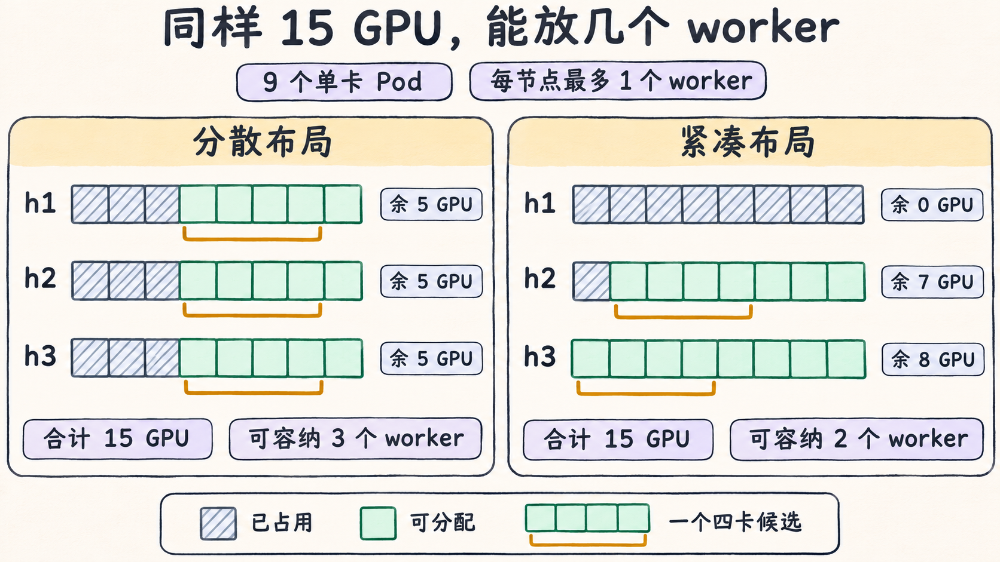
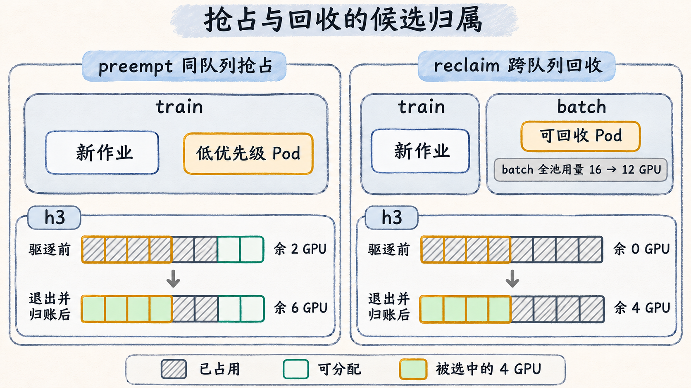

# 资源分配与调度策略

队列账面有多少资源、下一个考虑哪个作业、Pod 落在哪个节点，是 Volcano Scheduler 在不同环节作的决定。本篇以 Volcano v1.16.0 为基线。案例沿用三台各有 8 GPU 的节点和 3 个各需 4 GPU 的固定规模 worker，同一作业在每台主机最多放 1 个 worker。各节使用独立的教学资源快照，除非另行说明，CPU、主机内存、VF 和网络条件均满足，GPU 计 Pod 请求中的整卡数。 [Volcano v1.16 调度器配置指南](https://volcano.sh/docs/v1.16.0/userguide/user_guide_how_to_configure_scheduler/)

## Queue 应得份额、专属保留与资源借用

`capacity` 插件允许管理员逐资源指定队列份额。以平级队列为例，`capability` 决定最多可用多少，`deserved` 给出竞争时使用的应得份额，`guarantee.resource` 把一部分集群容量留给指定队列。队列有需求、其它队列有空闲且上限允许时，用量可以超过自己的 `deserved`。配置了 `guarantee` 的容量即使当下空闲，也要从其它队列的可用上限中扣除。 [Volcano v1.16 Queue](https://volcano.sh/docs/v1.16.0/concepts/queue/) · [队列资源管理](https://volcano.sh/docs/v1.16.0/keyfeatures/queueresourcemanagement/)

| 队列 | `deserved` 中的 GPU | `capability` 中的 GPU | 用到 16 GPU 时 |
| --- | ---: | ---: | --- |
| `train` | 12 | 16 | 超出应得份额 4 GPU，并达到队列上限。 |
| `batch` | 12 | 24 | 超出应得份额 4 GPU，上限还允许增长，实际增长需要集群有余量。 |

表中两行是分别假设各用到 16 GPU 的快照。以 `batch` 为例，集群有 `3 × 8 = 24` GPU，它占 16 GPU 时，全池尚余 8 GPU。若 `train` 出现 12 GPU 的需求，集群总量短缺 4 GPU，正好对应 `batch` 超出应得份额的 4 GPU。此时还要查哪些占用可被驱逐，以及释放发生在哪台节点。队列的额度以资源数量计，最终每个四卡 worker 仍要在一个节点上找到完整的资源组合。 [Capacity 配置指南](https://volcano.sh/docs/v1.16.0/userguide/user_guide_how_to_use_capacity_plugin/)

再看空池变体。给 `train` 配置 `guarantee.resource`，例如以下 `train` 的 `spec` 增量。`batch` 的 GPU 有效上限变为 `min(24, 24 − 4) = 20`。这里的 4 GPU 是队列级保留，以集群资源总量计。某台节点的可放性还要按实际分布计算。 [v1.16.0 capacity 有效上限实现](https://github.com/volcano-sh/volcano/blob/v1.16.0/pkg/scheduler/plugins/capacity/capacity.go)

```yaml
guarantee:
  resource:
    nvidia.com/gpu: "4"
```

`proportion` 是另一种队列资源插件，按队列 `weight` 和可分配的集群资源计算应得份额，并根据队列需求动态调整。以两个参与分配的队列、权重 `1:1`、两边需求充足且无其它约束为例，24 GPU 对应各 12 GPU。节点池扩缩时，按权重计算的份额随资源量变化。`capacity` 中显式设定的 `deserved` 则需要按运维策略维护。两种插件应择一启用。 [Volcano v1.16 队列资源管理](https://volcano.sh/docs/v1.16.0/keyfeatures/queueresourcemanagement/) · [Proportion 插件](https://volcano.sh/docs/v1.16.0/scheduler/plugins/proportion/)

## Priority 优先级与 DRF 公平排序

Scheduler 可以先从候选 Queue 中选队列，再从队列中的作业选作业。两次排序使用各自的回调。本例中 `capacity` 的队列排序使用 Queue 的优先级和相对已用份额。在显式配置了 `deserved` 的队列上，相对份额按各资源的 `已分配量 ÷ 应得份额` 取最大值。作业级的 **Dominant Resource Fairness（DRF）** 使用另一个分母，即集群该资源的总量。它按作业已经分配到的各项资源比例找最大值，优先考虑主导份额较小的作业。 [v1.16.0 capacity 队列排序](https://github.com/volcano-sh/volcano/blob/v1.16.0/pkg/scheduler/plugins/capacity/capacity.go) · [Volcano v1.16 DRF](https://volcano.sh/docs/v1.16.0/scheduler/plugins/drf/) · [v1.16.0 DRF 作业排序](https://github.com/volcano-sh/volcano/blob/v1.16.0/pkg/scheduler/plugins/drf/drf.go)

设总量为 24 GPU 和 96 CPU。有两个同队列、同优先级的作业，都已有成员占用资源，并有成员等待调度。假定它们的其它资源比例不超过表中的主导份额，且在 DRF 之前参与比较的回调均判为相同。

| 作业 | 已分配 GPU 比例 | 已分配 CPU 比例 | DRF 主导份额 |
| --- | ---: | ---: | ---: |
| A，4 GPU 和 16 CPU | `4 / 24` | `16 / 96` | `max(1/6, 1/6) = 1/6` |
| B，4 GPU 和 32 CPU | `4 / 24` | `32 / 96` | `max(1/6, 1/3) = 1/3` |

在这个算例里，`drf` 的作业排序回调先考虑 A。把 B 的 Job `spec.priorityClassName` 指向更高优先级，再用第一层 `priority`、第二层 `drf` 的配置比较，作业优先级回调已经能分出先后，B 会先被考虑。框架依序调用已启用的作业排序回调，遇到首个非零结果就采用它。回调全部打平时才按创建时间等默认规则比较。在现场应同时核对作业及 PodGroup 的 `priorityClassName`、PriorityClass 的 `value`、Pod 的实际 `.spec.priority` 和插件顺序。Pod 模板也可以显式设定自己的优先级类，因此要分别核对作业和成员。单独启用排序只改变谁先被尝试，驱逐还要启用相应 action 并满足驱逐条件。 [Volcano v1.16 Priority](https://volcano.sh/docs/v1.16.0/scheduler/plugins/priority/) · [v1.16.0 priority 源码](https://github.com/volcano-sh/volcano/blob/v1.16.0/pkg/scheduler/plugins/priority/priority.go) · [v1.16.0 session 排序顺序](https://github.com/volcano-sh/volcano/blob/v1.16.0/pkg/scheduler/framework/session_plugins.go) · [v1.16.0 Pod 优先级继承](https://raw.githubusercontent.com/volcano-sh/volcano/v1.16.0/pkg/controllers/job/job_controller_util.go)

## Binpack 节点评分与 GPU 碎片

一轮 `allocate` 先过滤节点，再为合格的节点打分。资源计数、标签和硬性反亲和在过滤时发挥作用。`binpack` 在打分时考虑放入当前 Pod 之后的资源使用比例，相应维度越满，通常越有利于这一项的得分。以一个请求 1 GPU 的 Pod 为例，在其它评分输入相同、两台都是 8 卡且都能容纳它时，已占 3 卡的节点预计到 `4 / 8`，空节点预计到 `1 / 8`，前者的 GPU 项得分更高。最终顺序还会受其它资源维度及其它打分插件影响。 [Volcano v1.16 Binpack](https://volcano.sh/docs/v1.16.0/scheduler/plugins/binpack/) · [v1.16.0 binpack 评分实现](https://raw.githubusercontent.com/volcano-sh/volcano/v1.16.0/pkg/scheduler/plugins/binpack/binpack.go)

在 scheduler 的 `tiers[].plugins` 中可以为 `binpack` 增加 GPU 维度。`binpack.weight` 调整整个插件的权重，`binpack.resources.nvidia.com/gpu` 调整 GPU 项在该插件中的权重。下面从 `binpack` 插件项摘出相关字段。 [Volcano v1.16 Binpack 配置](https://volcano.sh/docs/v1.16.0/scheduler/plugins/binpack/)

```yaml
- name: binpack
  arguments:
    binpack.weight: 1
    binpack.resources: nvidia.com/gpu
    binpack.resources.nvidia.com/gpu: 2
```

下表比较两种假设布局。小 Pod 每个申请 1 GPU，各布局独立从空池开始，其它维度充足。末列按每节点最多一个的规则计数。

| 已放的单卡 Pod 数 | 假设布局 | 三节点 GPU 占用 | 三节点 GPU 余量 | 可放 4 卡 worker 数 |
| ---: | --- | --- | --- | ---: |
| 15 | 分散 | `5 / 5 / 5` | `3 / 3 / 3` | 0 |
| 15 | 紧凑 | `8 / 7 / 0` | `0 / 1 / 8` | 1 |
| 9 | 分散 | `3 / 3 / 3` | `5 / 5 / 5` | 3 |
| 9 | 紧凑 | `8 / 1 / 0` | `0 / 7 / 8` | 2 |

已有 15 个小 Pod 时，两种布局各剩 9 张卡。紧凑布局留出一台完整的 8 卡节点，能放下一个 8 卡 Pod。已有 9 个小 Pod 时，两边各剩 15 张卡，分散布局能放三个四卡 worker，紧凑布局却只有两台符合条件。评估装箱时，把正在等待的作业形状代入余量表再决定权重。调整 binpack 会影响后续候选的打分，已绑定的 Pod 仍要等退出或由单独的迁移机制改变位置。 [Volcano v1.16 Actions](https://volcano.sh/docs/v1.16.0/scheduler/actions/) · [Volcano v1.16 Binpack](https://volcano.sh/docs/v1.16.0/scheduler/plugins/binpack/)



图 16-03-01　九个单卡 Pod 的两种教学布局。每节点最多放一个本作业的 worker，其余放置条件满足时，分散布局可容纳三个四卡 worker，紧凑布局可容纳两个。括线标出同一节点上的四卡候选位置。

## preempt 同队列抢占与 reclaim 跨队列回收

`preempt` 在这里讨论的是同队列作业之间的抢占。在启用了 `priority` 的驱逐回调时，受害作业的优先级要低于发起方。`reclaim` 用于跨队列收回借出的资源。`capacity` 路径会检查发起队列的需求、份额与有效上限，还要看目标 Queue 的 `reclaimable` 和候选 Pod 是否有资格被驱逐。队列有专属保留时，回收要满足对保留量的保护。若启用了相应的 gang 驱逐回调，还要检查移走候选后受害作业能否维持最低规模。 [Volcano v1.16 Actions](https://volcano.sh/docs/v1.16.0/scheduler/actions/) · [v1.16.0 priority](https://github.com/volcano-sh/volcano/blob/v1.16.0/pkg/scheduler/plugins/priority/priority.go) · [v1.16.0 capacity 回收逻辑](https://github.com/volcano-sh/volcano/blob/v1.16.0/pkg/scheduler/plugins/capacity/capacity.go) · [v1.16.0 gang 驱逐回调](https://github.com/volcano-sh/volcano/blob/v1.16.0/pkg/scheduler/plugins/gang/gang.go)

教学变体分别采用 `actions: "enqueue, allocate, preempt"` 或 `actions: "enqueue, allocate, reclaim"`。前一变体让 `priority` 参与审查同队列候选，后一变体保留 `capacity` 并允许 `batch` 被回收。若沿用安装配置的 `gang.enablePreemptable: false` 或 `drf.enablePreemptable: false`，相应插件的抢占筛选在该路径上关闭。排查跨队列回收时要另看 `enableReclaimable` 和 `capacity` 的回收相关回调。下面都假定目标作业已过入队、三个 worker 已生成、候选满足当前所有驱逐规则且无其它约束阻塞。数值按候选的请求已释放并被调度器计入时计算。 [v1.16.0 Helm 调度配置](https://github.com/volcano-sh/volcano/blob/v1.16.0/installer/helm/chart/volcano/config/volcano-scheduler.conf) · [调度器配置指南](https://volcano.sh/docs/v1.16.0/userguide/user_guide_how_to_configure_scheduler/) · [v1.16.0 候选筛选回调](https://github.com/volcano-sh/volcano/blob/v1.16.0/pkg/scheduler/framework/session_plugins.go)

| 路径 | 驱逐前的占用 | 三节点 GPU 余量变化 | 队列账面变化 |
| --- | --- | --- | --- |
| 同队列 `preempt` | `train` 的低优先级作业在 `h3` 占 4 GPU。`batch` 在 `h2 / h3` 分别占 4 和 2 GPU。 | `h3` 的低优先级候选退出后，`8 / 4 / 2` → `8 / 4 / 6`。 | `train` 先释放 4 GPU，随后新作业需 12 GPU，仍在 16 GPU 上限内。 |
| 跨队列 `reclaim` | `train` 用量为 0。`batch` 在三节点占 `4 / 4 / 8`，`h3` 上有一个合格的 4 GPU 候选。 | 候选退出后，`4 / 4 / 0` → `4 / 4 / 4`。 | `batch` 从 16 GPU 降至其 12 GPU 应得份额，为 `train` 的 12 GPU 需求腾出空间。 |

两例中，先释放 `h3` 的候选才能把第三个四卡 worker 放到缺口节点。若在已有位置的 `h1` 或 `h2` 释放同样多的卡，固定一机一副本的约束仍使整组等待。判断候选价值时先模拟新的节点余量。调度器在回收路径中可以暂存候选方案，达到作业的成组流水线条件才提交相关驱逐，已提交的驱逐仍要等待实际资源退出。 [v1.16.0 preempt](https://github.com/volcano-sh/volcano/blob/v1.16.0/pkg/scheduler/actions/preempt/preempt.go) · [v1.16.0 reclaim 的候选与事务提交](https://github.com/volcano-sh/volcano/blob/v1.16.0/pkg/scheduler/actions/reclaim/reclaim.go)



图 16-03-02　Volcano v1.16.0 的两个教学变体。假定新作业已入队、对应 action 已启用，且候选满足驱逐条件。左侧抢占同属 `train` 的低优先级 Pod，右侧从 `batch` 回收借用的资源。下方快照取候选退出且释放已归账的时点，两例都在 `h3` 腾出第三个四卡 worker 的位置。

若 PodGroup 仍被 `enqueue` 挡在 Pending，VolcanoJob 的 worker 可能尚未创建，两条 action 自身也会跳过待入队的作业。这时调高优先级前应先查入队条件，确认有没有实际的待调度成员。驱逐从开始到释放可以分三个时点查证。先找调度器针对受害 Pod UID 发出的事件，核对报告组件、原因和消息。再看该 Pod 的 `.metadata.deletionTimestamp` 或终止状态。最后看调度器用量、队列分配以及下一个 worker 是否实际绑定。节点上的 GPU 利用率下降仅说明设备负载变化，释放的调度资源要从 Pod 请求的计入状态验证。 [Volcano v1.16 Actions](https://volcano.sh/docs/v1.16.0/scheduler/actions/) · [v1.16.0 scheduler 驱逐路径](https://raw.githubusercontent.com/volcano-sh/volcano/v1.16.0/pkg/scheduler/cache/cache.go) · [Kubernetes v1.36 Event API](https://v1-36.docs.kubernetes.io/docs/reference/kubernetes-api/events/event-v1/)
