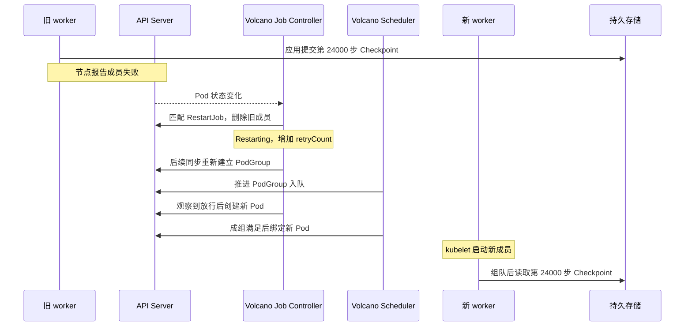

# 作业重试、恢复与资源释放

三个 worker 已完成组队并开始训练。一台节点的训练进程退出后，先要判断故障停在哪一层，再确定由谁重建成员、从哪个进度恢复。下文以 Volcano v1.16.0、Kubernetes v1.36 和 PyTorch 2.14 的固定三节点作业为例，状态路径来自对应版本的源码，训练步数和状态快照是教学推演。

## 作业重试、Checkpoint 恢复与资源释放

### 从进程退出到作业重试

训练进程退出时，`torchrun` 可以按 `--max-restarts` 的配置重新启动 WorkerGroup。这个动作发生在启动器层，Pod UID 可以保持不变，容器的 `restartCount` 也可能不增加。若启动器最终以非零状态退出，本例中 trainer 是唯一容器且 Pod 模板 `restartPolicy: Never`，该容器不由 kubelet 重启，Pod 可进入 `Failed`。在其它模板中，若 kubelet 按容器重启策略重启容器，仍可看到同一个 Pod UID，但容器 `restartCount` 会变化。 [PyTorch 2.14 torchrun 故障处理](https://docs.pytorch.org/docs/2.14/elastic/run.html) · [Kubernetes v1.36 Pod 与容器重启](https://v1-36.docs.kubernetes.io/docs/concepts/workloads/pods/pod-lifecycle/)

下面是 VolcanoJob 的 `spec` 增量。Job 级策略把 `PodFailed` 映射到 `RestartJob`，这次教学故障发生在第一次运行时。若作业也要在驱逐后整组重启，可再为 `PodEvicted` 加相应的映射。两类事件对应不同的观察路径，驱逐时要同时查调度器和被驱逐成员。 [Volcano v1.16 Job Policy](https://volcano.sh/docs/v1.16.0/userguide/user_guide_how_to_use_job_policy/)

```yaml
maxRetry: 3
policies:
  - event: PodFailed
    action: RestartJob
```

在 v1.16.0 的 `Running` 状态中，Job Controller 响应 `RestartJob`，处理整组旧 Pod 并将状态推进到 `Restarting`，同时增加 `status.retryCount`。整组重启路径会删除旧 PodGroup，后续同步再生成组，等成员重新可调度。`Restarting` 状态检查计数是否达到 `maxRetry`，达到就转为 `Failed`。预算尚未耗尽时，状态机还要结合终止中的副本数决定何时转回 `Pending`。本例三副本的最低门槛也是三。最后一次失败路径可能保留已经 Failed 或 Succeeded 的终态 Pod，便于继续看退出信息。 [v1.16.0 Running 状态](https://raw.githubusercontent.com/volcano-sh/volcano/v1.16.0/pkg/controllers/job/state/running.go) · [v1.16.0 Restarting 状态](https://raw.githubusercontent.com/volcano-sh/volcano/v1.16.0/pkg/controllers/job/state/restarting.go) · [v1.16.0 整组终止与 PodGroup 清理](https://github.com/volcano-sh/volcano/blob/v1.16.0/pkg/controllers/job/job_controller_actions.go)



读同名 Pod 时，用 `metadata.uid` 区分对象。控制器按作业、Task 与序号生成名称，所以重建的 worker 可能沿用旧名字，但 UID 不同。Pod 终态记录中查看 `.status.containerStatuses[].state.terminated.exitCode`。若容器在同一个 Pod 中已经重启，可查 `lastState.terminated` 和 `restartCount`。将这些字段与 VolcanoJob 的 `.status.state.phase`、`.status.retryCount` 以及相应时点的事件连起来。Pod 删除前已采集的状态或日志可保留失败证据，只有新 Pod 的状态时，无法从新对象还原旧容器的退出码。 [v1.16.0 Pod 命名与 owner reference](https://raw.githubusercontent.com/volcano-sh/volcano/v1.16.0/pkg/controllers/job/job_controller_util.go) · [Kubernetes v1.36 Pod 生命周期](https://v1-36.docs.kubernetes.io/docs/concepts/workloads/pods/pod-lifecycle/)

### 从新 Pod 到训练进度恢复

新一轮三个 worker 启动后，要使用本轮统一的 Rendezvous 标识和同一个可达端点重新组队。用各成员的启动记录确认它们加入了同一次尝试。再由应用选择上一个已提交、能够完整读取的 Checkpoint。训练脚本通常需要恢复模型、优化器、全局步数，以及续训需要的数据读取位置或其它应用状态。若用 PyTorch Distributed Checkpoint，还要由应用按其模型与状态字典组织保存和加载。Volcano Job Policy 负责重建成员，重新分配 GPU 和启动容器的结果可以从调度与节点状态验证。续训进度要从应用的实际加载结果验证。 [PyTorch 2.14 torchrun](https://docs.pytorch.org/docs/2.14/elastic/run.html) · [PyTorch 2.14 Distributed Checkpoint](https://docs.pytorch.org/docs/2.14/distributed.checkpoint.html)

在同一全局步数口径下，教学假设是第 24,000 步的 Checkpoint 已完整写入共享持久存储，各 Rank 可读。故障前完成到第 24,600 步，中间没有其它可恢复的 Checkpoint。应用从第 24,000 步恢复，需要重做 `24,600 − 24,000 = 600` 步。恢复耗时还包括旧 Pod 退出、重新放置、镜像和设备准备、应用组队与读取存档。排查时按同一轮尝试核对 Checkpoint 路径、完整提交记录与实际恢复步数，避免把某个容器写过的局部文件误算为整组可恢复的进度。

### 确认旧资源何时可再次分配

正常完成分支中，本例的三个 worker 都成功退出，控制器可以把 Job 标为 `Completed`。预算耗尽分支中，状态机将 Job 标为 `Failed`。这两个状态用于判断 Job 的结果。查资源时要沿旧 Pod 继续确认终止或删除、调度器缓存已计入释放、Queue 分配量回落和目标节点出现可放位置。终态 Pod 对象可能留存，用其阶段和 UID 区分它与仍在退出的 Pod。 [v1.16.0 Running 完成判定](https://raw.githubusercontent.com/volcano-sh/volcano/v1.16.0/pkg/controllers/job/state/running.go) · [v1.16.0 Restarting 失败判定](https://raw.githubusercontent.com/volcano-sh/volcano/v1.16.0/pkg/controllers/job/state/restarting.go) · [v1.16.0 scheduler 缓存](https://raw.githubusercontent.com/volcano-sh/volcano/v1.16.0/pkg/scheduler/cache/cache.go)

| 要确认的结果 | 查证方式 |
| --- | --- |
| 旧成员正在退出还是已经终止 | 用旧 Pod UID 对准终止事件、`metadata.deletionTimestamp`、容器退出状态。 |
| 作业的请求已从调度账面扣除 | 查看 Queue 的 `.status.allocated`，按节点的 Allocatable 与仍计入的 Pod 请求复算余量。并发有新作业时要分开归因。 |
| 新作业可以接手这些资源 | 核对新作业的队列、节点筛选和成组条件。需要确认实际重新分配时，查新 Pod 的 `.spec.nodeName` 和节点侧的交付状态。 |

若这 12 GPU 是两份快照之间唯一的用量变化，释放后相应队列的 GPU 分配量应少 12。但若重试的成员随即重新占用，或同队列其他作业同时启动，前后两次 API 查询的净变化可以小于 12。按 Pod UID、状态和请求量对账，才能解释设备已经空闲、队列用量却尚未变化，或者用量刚释放又被分配的情况。
