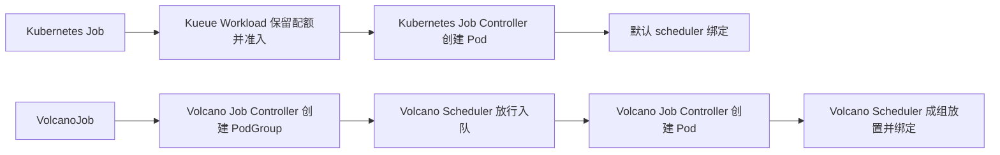
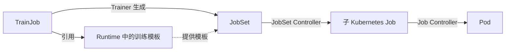

# Kueue 对照与作业组织组件

同一份三节点训练可以由 VolcanoJob 组织，也可以用 Kubernetes Job 组织并交给 Kueue 做作业准入。对比两条路径时，分别看谁拥有作业生命周期、谁核算配额、谁创建成员、谁最终绑定 Pod。本篇取 Kueue v0.17、Kubernetes v1.36 为对照基线，引用 Kueue 的 `kueue.x-k8s.io/v1beta2` 字段。v0.17 的安装文档要求 Kubernetes v1.29 或以上。文中的 GPU 余量和对象状态组合均为教学推演。 [Kueue v0.17 Overview](https://kueue.sigs.k8s.io/v0.17/docs/overview/) · [安装要求](https://kueue.sigs.k8s.io/v0.17/docs/installation/) · [v1beta2 API](https://kueue.sigs.k8s.io/v0.17/docs/reference/kueue.v1beta2/)

## Kueue 配额、作业准入与 Pod 调度

### 从 Job 挂起到 Kueue 准入

以下是 `batch/v1 Job` 的作业层片段。它使用三个 Indexed Job 副本对应三个固定 worker 位置。每个 Pod 模板仍申请 4 GPU、16 CPU、96 GiB 主机内存和 1 个 RDMA VF，用 H100 节点标签和硬性 Pod 反亲和限制每节点最多一个 worker。Pod 模板在片段中省略。作业仍由训练启动器在容器内协调成员。 [Kubernetes v1.36 Indexed Job](https://v1-36.docs.kubernetes.io/docs/concepts/workloads/controllers/job/#completion-mode) · [Kueue v0.17 Kubernetes Job 集成](https://kueue.sigs.k8s.io/v0.17/docs/tasks/run/jobs/)

```yaml
apiVersion: batch/v1
kind: Job
metadata:
  name: torch-three
  namespace: ai-demo
  labels:
    kueue.x-k8s.io/queue-name: train
spec:
  suspend: true
  completionMode: Indexed
  completions: 3
  parallelism: 3
```

Job 处于 `suspend: true` 时，Kubernetes Job Controller 等待放行。启用 `batch/job` 集成的 Kueue 为作业管理一个 Workload，本例的 PodSet 表达同一模板的三个 Pod 及其请求。Job 的队列标签指向本命名空间的 LocalQueue，该队列再以 `spec.clusterQueue` 指向负责共享配额的 ClusterQueue。ClusterQueue 按 **ResourceFlavor** 管理各类资源的额度，例如给带 H100 节点池标签的 flavor 配置 `nvidia.com/gpu` 额度。Flavor 的标签还可以成为集成写入 Pod 模板的节点选择条件。 [Kueue v0.17 Kubernetes Job 集成](https://kueue.sigs.k8s.io/v0.17/docs/tasks/run/jobs/) · [LocalQueue](https://kueue.sigs.k8s.io/v0.17/docs/concepts/local_queue/) · [ClusterQueue](https://kueue.sigs.k8s.io/v0.17/docs/concepts/cluster_queue/) · [ResourceFlavor](https://kueue.sigs.k8s.io/v0.17/docs/concepts/resource_flavor/)

Kueue 先为 Workload 保留配额，再等待该 ClusterQueue 要求的 AdmissionChecks。保留成功时可查看 `QuotaReserved` 条件，`.status.admission.clusterQueue` 和 `.status.admission.podSetAssignments` 记录队列和各 PodSet 的资源分配结果。如果还差一项检查，在 `.status.admissionChecks` 中可见该检查的状态。全部要求达到后，`Admitted` 为 True，Kueue 的 Job 集成解除挂起。Kubernetes Job Controller 随后创建 Pod，默认 scheduler 过滤节点、评分和绑定。 [Kueue v0.17 Admission](https://kueue.sigs.k8s.io/v0.17/docs/concepts/admission/) · [WorkloadStatus API](https://kueue.sigs.k8s.io/v0.17/docs/reference/kueue.v1beta2/) · [Kubernetes v1.36 Job 挂起与恢复](https://v1-36.docs.kubernetes.io/docs/concepts/workloads/controllers/job/#suspending-a-job)

### 配额核算和节点放置的两份快照

设作业需要同一 flavor 的 12 GPU。以下快照假定无额外可借额度、其它资源配额充足，且未启用拓扑感知准入。

| 教学快照 | 配额与准入 | Pod 侧证据 |
| --- | --- | --- |
| H100 flavor 只剩 8 GPU 额度 | `8 < 12`，Workload 未取得配额。检查 `QuotaReserved` 和 Job 的 `.spec.suspend`。 | Job 保持挂起，改调 Pod 的节点选择无法解决额度不足。 |
| H100 flavor 有 12 GPU 额度，要求的检查均通过 | `12 = 12`，配额可保留并完成准入。对照 `QuotaReserved=True`、`Admitted=True` 和 Job 解除挂起。 | 物理余量是 `8 / 4 / 2`，硬反亲和下只有两台能放四卡 worker。默认逐 Pod 调度可能先绑定两个，第三个的 `.spec.nodeName` 仍为空。 |

要确认最后一行，先用 Workload 对准准入时点，再对照 Pod 的 `.spec.schedulerName`、`.spec.nodeName` 和调度事件。启用 **Topology-Aware Scheduling** 的 ResourceFlavor 可以在保留配额时加入物理拓扑和余量检查，参与计算的物理条件会改变这份结果。另一个可选项 `waitForPodsReady` 在准入后等待 Workload 的 Pod 就绪。未在时限内满足条件时，Kueue 可取消准入、挂起 Job 并重新排队。它通过就绪反馈处理启动失败，Volcano 的 Gang 则在放置提交前比较最低成员数。 [Kueue v0.17 Topology-Aware Scheduling](https://kueue.sigs.k8s.io/v0.17/docs/concepts/topology_aware_scheduling/) · [waitForPodsReady](https://kueue.sigs.k8s.io/v0.17/docs/tasks/manage/setup_wait_for_pods_ready/) · [Volcano v1.16 Gang](https://volcano.sh/docs/v1.16.0/scheduler/plugins/gang/)

### Kueue 与 Volcano 共存时的职责

可在同一集群中让 Kubernetes Job 走 Kueue 路径，让 VolcanoJob 走 Volcano 路径。这里的两个 `train` 分别是 Kueue LocalQueue 与 Volcano Queue 的名称，各有自己的资源账面。在这个例子里，两套组件分别作用于不同作业。可从 Pod 的 `spec.schedulerName` 核实它交给了哪个 scheduler。 [Kueue v0.17 工作负载集成清单](https://kueue.sigs.k8s.io/v0.17/docs/tasks/run/) · [Kubernetes v1.36 多调度器](https://v1-36.docs.kubernetes.io/docs/tasks/extend-kubernetes/configure-multiple-schedulers/)



若设计同一作业在两层之间交接，逐项确认由谁写状态、下游等待什么，以及驱逐后由谁收拾状态。Kueue v0.17 的官方工作负载集成清单没有列入 VolcanoJob，相关上游请求已关闭为暂无计划。下面的表用于审查交接边界，实际接入需要选定受支持的作业集成并对应版本验证。 [Kueue v0.17 工作负载集成清单](https://kueue.sigs.k8s.io/v0.17/docs/tasks/run/) · [上游 VolcanoJob 集成请求](https://github.com/kubernetes-sigs/kueue/issues/1204)

| 要确认的职责 | 交接时检查的证据 |
| --- | --- |
| 挂起、放行和创建成员 | 谁写作业的挂起或放行状态，哪个控制器响应它而创建 Pod。用作业状态、成员 owner reference 和控制器事件核对。 |
| 额度与已占资源核算 | 哪一层保留哪份配额，哪一层检查物理资源。共用节点池时，核对 flavor、Queue 上限和已计入的请求，避免两边独立承诺同一份容量。 |
| 成组与绑定 | 若使用 Volcano Gang，确认哪个组件生成对应 PodGroup，Pod 如何加入该组。对生成 Pod 的 `spec.schedulerName` 及绑定结果进行核对。 |
| 驱逐、重排与重试 | 检查哪一层拥有驱逐权，驱逐后由哪一层释放额度、重新排队，由谁重建成员。若多层都启用了驱逐，检查它们会不会为同一次失败重复处理。 |

## JobSet 和 Kubeflow Trainer 的作业组织与调度接口

### JobSet 将多角色规格展开为 Kubernetes Job

若训练作业还需要一个协调者，JobSet 可以用多个 `replicatedJobs` 条目表达角色。下面的 `coordinator` 用一份 Kubernetes Job 模板生成 1 个 Job，`worker` 用另一份模板生成 3 个 Job。各子 Job 在示例中各创建 1 个 Pod。`replicatedJobs[].replicas` 给出子 Job 数，子 Job 自己的 `parallelism` 和 `completions` 再约束 Pod。这里的 YAML 用于辨认角色字段，省略了每份子 Job 中的 Pod 模板。 [JobSet v1alpha2 API](https://jobset.sigs.k8s.io/docs/reference/jobset.v1alpha2/)

```yaml
apiVersion: jobset.x-k8s.io/v1alpha2
kind: JobSet
metadata:
  name: coordinated-training
  namespace: ai-demo
  labels:
    kueue.x-k8s.io/queue-name: train
spec:
  suspend: true
  replicatedJobs:
    - name: coordinator
      replicas: 1
      template:
        spec:
          parallelism: 1
          completions: 1
    - name: worker
      replicas: 3
      template:
        spec:
          parallelism: 1
          completions: 1
```

JobSet Controller 管理子 Job，Kubernetes Job Controller 创建它们的 Pod。若启用 Kueue 的 JobSet 集成，以 JobSet 的队列标签和挂起状态为准，Workload 覆盖 JobSet 计算出的成员请求。发生子 Job 失败时，按 JobSet 的 `failurePolicy` 判断是否重新组织子 Job。Pod 放置仍由其调度路径负责，作业级重启之后的进度由应用恢复。 [Kueue v0.17 JobSet 集成](https://kueue.sigs.k8s.io/v0.17/docs/tasks/run/jobsets/) · [JobSet Failure Policy](https://jobset.sigs.k8s.io/docs/tasks/failure_policy/)

### TrainJob 通过 Runtime 提供训练规格

Kubeflow Trainer v2 用 TrainJob 描述一次训练请求。`spec.runtimeRef` 指向管理员维护的 `TrainingRuntime` 或 `ClusterTrainingRuntime`，其中定义相应框架的作业模板和运行方式。`spec.trainer.numNodes` 则给出这次训练需要的节点数。本例采用生成 JobSet 的 Runtime，Trainer 先生成 JobSet，后续由 JobSet 和 Kubernetes Job 控制器继续建立子 Job 与 Pod。使用 Kueue v0.17 的 TrainJob 集成时要求 Trainer v2.0.0 或更高。示例通过 TrainJob 的队列标签和 `spec.suspend` 接到准入流程。 [Kubeflow Trainer Overview](https://www.kubeflow.org/docs/components/trainer/overview/) · [Kueue v0.17 TrainJob 集成](https://kueue.sigs.k8s.io/v0.17/docs/tasks/run/trainjobs/)

```yaml
apiVersion: trainer.kubeflow.org/v1alpha1
kind: TrainJob
metadata:
  name: torch-three
  namespace: ai-demo
  labels:
    kueue.x-k8s.io/queue-name: train
spec:
  suspend: true
  runtimeRef:
    kind: ClusterTrainingRuntime
    name: torch-distributed
  trainer:
    numNodes: 3
```



直接提交 JobSet 时，检查 JobSet 的 Kueue 集成和它关联的 Workload。使用采用 JobSet 的 TrainJob 时，先检查 TrainJob 的集成和挂起状态，再沿 owner reference 查看生成的 JobSet、子 Job 与 Pod。确认配置的准入入口以后，再用实际 Pod 的 `spec.schedulerName` 找到负责绑定的调度器。这样能区分 Runtime 或控制器还没生成成员、成员还在等配额，以及 Pod 已交给调度器却未找到节点。 [Kueue v0.17 JobSet 集成](https://kueue.sigs.k8s.io/v0.17/docs/tasks/run/jobsets/) · [Kueue v0.17 TrainJob 集成](https://kueue.sigs.k8s.io/v0.17/docs/tasks/run/trainjobs/)
