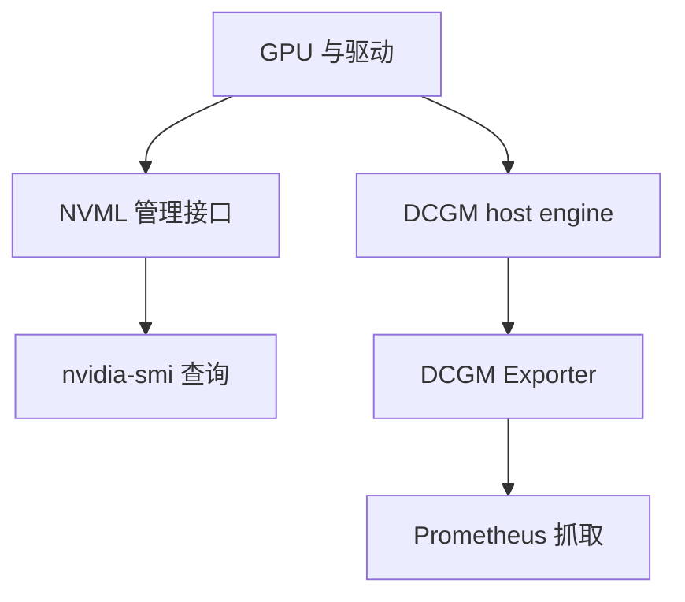

第 16 章的训练作业 `train-12` 已在三台节点上运行。运维中常被问到的不是“现在怎么样”，而是“十分钟前是哪块 GPU 的温度或活动率先变了”。登录节点执行一次 `nvidia-smi` 只能回答当前状态；要回答历史问题，必须在各节点持续取得样本，为每个样本保留观测对象与时间，再汇集到可以查询和保留历史的存储。这种对远程设备进行自动测量、采集并传回观测数据的做法称为**遥测**（telemetry）。本篇先建立 GPU 遥测的采集链路，再说明样本的时间尺度和两种基本类型，后续各篇都在这条链路产生的样本上做判读。

## 从一张整卡的一次查询开始

NVML（NVIDIA Management Library，NVIDIA 管理库）是面向 NVIDIA 设备的管理接口库，借助内核驱动取得设备枚举、温度、显存等信息。`nvidia-smi` 是面向操作者的命令行工具，其中许多功能由 NVML 提供。第 03 章曾把这条**管理支路**与 CUDA 计算路径分开：管理调用只读设备状态，不代表应用能在卡上完成计算。这里在一台主机上查温度，只需管理侧能访问设备。用 UUID（通用唯一标识符）指定卡，可以把这一行与其他工具的观测对齐。 [NVIDIA SMI · 工具与设备标识](https://docs.nvidia.com/deploy/nvidia-smi/index.html) · [NVML R620 · 设备查询](https://docs.nvidia.com/deploy/nvml-api/620/api/group__nvmlDeviceQueries.html)

下面的命令用于在宿主机记录当前设备的标识、PCI 地址和温度。示例地址按域、总线、设备和功能写成 `0000:65:00.0`，称为 PCI BDF（Bus、Device、Function，地址中还带域）。工具可能用不同数量的前导零，对照不同输出时按地址字段的数值对应。

```bash
nvidia-smi --query-gpu=timestamp,uuid,pci.bus_id,temperature.gpu --format=csv
```

教学记录中，节点 `h2` 上的 `GPU-H2-A` 在 10:12 附近查询到 67 °C，BDF 为 `0000:65:00.0`。本章用类似 `GPU-H2-A` 的短写代替真实 UUID。读这行数据时要区分三个标识：卡号只在本次枚举中有意义，BDF 用于同节点的拓扑映射，UUID 用于跨工具、跨时间识别这张物理卡。

一次查询给出一个时点的状态。集群有几十张卡、还要回看历史时，手工查询无法承担，需要一个能在每个节点持续采样并集中暴露的组件，这就是 DCGM 与 Exporter 的职责。

## DCGM、Exporter 与 Prometheus 的分工

DCGM（Data Center GPU Manager，数据中心 GPU 管理工具）提供可编程的设备管理、持续采样、健康监测和诊断能力。它以物理 GPU、MIG 实例等**实体**（entity）区分观测对象，以**字段**（field）区分温度、活动率等观测量。对字段建立 watch（监视）后，DCGM 的 host engine 按监视配置定期更新带时间戳和状态的值。管理员可通过 `dcgmi` 查看实体和字段，也可按选定范围执行诊断；诊断可能主动运行测试负载，应按其测试前提解读，不能与生产采样混为一谈。 [DCGM · 核心服务](https://docs.nvidia.com/datacenter/dcgm/latest/learn/core-services/index.html) · [DCGM · 功能与诊断概览](https://docs.nvidia.com/datacenter/dcgm/latest/user-guide/feature-overview.html)

DCGM Exporter 不直接测量硬件，而是从 DCGM 获取所选字段，把值和标签组织成 Prometheus 指标，通过 HTTP 的 `/metrics` 端点暴露。在 Kubernetes 中，GPU Operator 为符合条件的 GPU 节点以 DaemonSet 方式部署 Exporter，使每个节点都有一个本地采集端点。Prometheus 再按配置定期**抓取**（scrape）各目标，把指标名加上整组标签作为时间序列的身份，将响应中的样本存入时序数据库。例如 GPU 温度字段以 `DCGM_FI_DEV_GPU_TEMP` 暴露，一个温度值结合 `UUID` 与区分节点的标签，就能沿时间观察单卡温度。三方分工可以概括为：DCGM 负责采样与字段缓存，Exporter 负责格式转换与端点暴露，Prometheus 负责抓取、存储和查询。 [DCGM Exporter 4.8.4 字段清单](https://raw.githubusercontent.com/NVIDIA/dcgm-exporter/4.8.4/etc/default-counters.csv) · [Prometheus · 数据模型](https://prometheus.io/docs/concepts/data_model/) · [Prometheus · 抓取目标与实例](https://prometheus.io/docs/concepts/jobs_instances/)

本章采用 Kubernetes v1.36、GPU Operator v26.7.2 的 ClusterPolicy 与 Device Plugin 路径。核对该版本 Helm 值可见：Exporter 默认启用，镜像为 `4.6.1-4.8.4-distroless`，独立 `dcgm` host engine 默认关闭（`dcgm.enabled=false`），因此主例中 Exporter 使用嵌入的 host engine。若部署另有独立的 `nv-hostengine`，Exporter 可改为连接它，需另核连接方式与版本。ServiceMonitor 只是“应抓取谁、按什么间隔抓取”的描述，默认并不随图表强制生效，还必须显式启用并被实际的 Prometheus 实例选中，抓取才会发生；实际抓取间隔以现场 ServiceMonitor 与 Prometheus 配置为准，下一节的 15 秒是教学假设。 [GPU Operator v26.7.2 Helm 值](https://raw.githubusercontent.com/NVIDIA/gpu-operator/v26.7.2/deployments/gpu-operator/values.yaml) · [Exporter 4.8.4 发布记录](https://github.com/NVIDIA/dcgm-exporter/releases/tag/4.8.4) · [Prometheus Operator · ServiceMonitor](https://prometheus-operator.dev/docs/getting-started/design/)



图 17-01-01　箭头表示设备信息传到查询或采集端的方向。左侧管理支路提供一次性当前查询，右侧 DCGM 支路按配置持续监视字段。主例里 host engine 嵌入 Exporter 进程，箭头表达的是职责交接而非两台独立主机。

**替代文本**　GPU 与驱动向 NVML 的命令行查询和 DCGM 的字段采样提供观测，采集支路经 Exporter 暴露后由 Prometheus 定期抓取。

## 瞬时值与累计计数：两类样本的读法

Prometheus 指标按随时间的变化方式分为两类，后续所有字段都要先归入其中一类，才能决定怎么计算。

- **Gauge（瞬时值）**：可以任意上下波动的快照值，读它就是读当前状态，例如温度、功耗、时钟、显存占用量和设备活动率。两个时点的 gauge 不能相减当作“发生量”，它们只是两个独立快照。
- **Counter（累计计数）**：只增不减的累计值，例如驱动加载以来的能耗（mJ）、PCIe 重传次数、ECC 错误总数。要得到单位时间的发生量，需在两个时点间做差分，或用 Prometheus 的 `rate()` 估计窗口平均速率；counter 在进程或驱动重载后会复位，差分前必须识别计数生命周期。

同名字段在不同 Exporter 版本中的类型、单位可能变化。例如 4.8.4 默认清单里 `DCGM_FI_DEV_GPU_UTIL` 是百分比 gauge，而 4.9.0 起改名为 `DCGM_FI_DEV_GPU_UTIL_RATIO` 并以 0–1 的比率表达；显存字段也由 MiB 改为 Bytes。跨版本对比图表时必须同时检查字段名和单位，不能只看图例形状。 [Exporter 4.9.0 字段清单](https://raw.githubusercontent.com/NVIDIA/dcgm-exporter/4.9.0/etc/default-counters.csv)

## 设备采样、缓存刷新与抓取是三个时钟

读样本时还要区分三个时间尺度。设备字段有自己的测量时长，例如活动率按设备定义的区间统计；DCGM 按实际生效的 watch 节奏刷新字段缓存；Exporter 在被抓取时读取缓存；Prometheus 则按自己的间隔发起抓取并为样本赋时。即使两条序列在 10:12:15 都有一个点，底层设备也可能在不同时间完成统计。高频抓取可能重复读到同一底层观测，低频抓取可能漏过短时变化。 [DCGM · 字段与缓存](https://docs.nvidia.com/datacenter/dcgm/latest/learn/core-services/index.html) · [Prometheus · 抓取配置](https://prometheus.io/docs/prometheus/latest/configuration/configuration/#scrape_config)

用一组**教学节录**走完目标检查。假设 Prometheus 每 15 秒抓取 `h2` 的同一目标，`up` 是 Prometheus 为每个目标生成的抓取状态序列。为便于判读，下表按本次响应只列温度字段是否存在，省略其他指标。

| 抓取时刻 | `up` | `GPU-H2-A` 的温度样本 | 读法 |
| --- | ---: | ---: | --- |
| 10:12:00 | 1 | 67 °C | 目标可抓取，且这次响应中有该卡的有效温度。 |
| 10:12:15 | 1 | — | 抓取成功，但该字段或实体未出现在本次响应中。查字段选择、设备选择、字段状态或标签是否改变。 |
| 10:12:30 | 0 | — | 这次抓取失败。先查目标、连接及 Exporter 状态；这一格没有温度证据。 |
| 10:12:45 | 1 | 68 °C | 又取得该卡温度。首尾两个样本只约束这两个时点，中间不能插值成真实曲线。 |

把空白填成 0 会制造一次没有证据的降温。若目标从服务发现中消失，连它的 `up` 序列都不再有新样本，可用预期节点清单找出没有对应目标的节点。若只有带 Pod 标签的序列中断，应先看不带工作负载筛选的设备序列，再查分配记录是否变化。还要注意三层证据各自独立：抓取成功只说明采集链末段可达，字段是否有效取决于 DCGM 与驱动，作业是否推进则只有应用记录能回答。 [Prometheus · 抓取状态](https://prometheus.io/docs/concepts/jobs_instances/) · [Prometheus · 陈旧样本](https://prometheus.io/docs/prometheus/latest/querying/basics/#staleness)

本篇解决了样本如何产生、何时有效。但温度序列只带着物理 UUID，训练日志里写的却是 Rank；在下一篇把设备、Pod、作业与 Rank 的身份接起来之前，任何样本都还不能直接归到某个训练进程。
