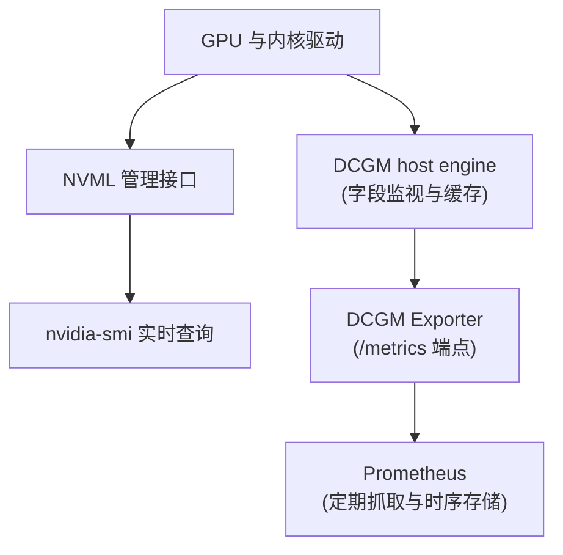

# GPU 遥测的采集链路与时间序列

训练任务跑了一整夜，清晨却发现吞吐曲线在凌晨三点掉了一截。值班工程师马上登录节点敲下 `nvidia-smi`，屏幕上的温度、功耗和利用率此时已经全部恢复正常。

一次命令行查询只能定格“此刻的截面”，回答不了“十分钟前哪张卡先出了异动”。要还原历史轨迹，必须在每台节点上持续采样、保留观测对象与时间，并汇集到时序数据库中——这套自动测量与回传体系，正是**遥测（Telemetry）**。

本篇先打通 GPU 遥测的完整采集链路，正式建立 **DCGM / DCGM Exporter** 与 **Gauge / Counter** 两组核心概念，再理清三个采样时钟和缺测判读方法。

## 从一次实时查询看管理支路

在 [第 03 章](../03_从驱动到CUDA应用的软件依赖/00_内容大纲.md) 我们已经把 GPU 的访问路径一分为二：`nvidia-smi` 底层调用 NVML **管理支路**，通过内核驱动读取设备元数据与健康状态，不触发 CUDA 计算内核。

当我们在宿主机排查单卡状态时，通常会用结构化查询导出关键字段。下面是在目标节点 `node-2` 上执行的一次实时查询与输出片段：

```bash
# 按 CSV 格式读取当前节点各张 GPU 的时间、UUID、PCI 地址、温度、功耗与利用率
nvidia-smi --query-gpu=timestamp,index,uuid,pci.bus_id,temperature.gpu,power.draw,utilization.gpu --format=csv
```

```text
timestamp, index, uuid, pci.bus_id, temperature.gpu, power.draw [W], utilization.gpu [%]
2026/11/20 10:12:00.412, 2, GPU-a1b2c3d4-5678-90ab-cdef-111122223333, 00000000:65:00.0, 67, 398.40 W, 86 %
```

读懂这一行输出，首先要区分其中的三个设备标识：

- **卡号（`index`）**：仅在本次驱动枚举中有效，重启或热插拔后可能漂移，不能用来长期对账。
- **PCI BDF（`pci.bus_id`）**：反映同节点内的物理插槽与拓扑位置。不同工具输出的前导零数量可能不同（如 `0000:65:00.0` 与 `00000000:65:00.0`），比对时按各段十六进制数值对齐即可。
- **物理 UUID（`uuid`）**：出厂固化的全局唯一标识，是跨工具、跨时间段锁定同一张物理卡的基准主键。

手工查卡适合临时排障，但在几十上百张卡的集群里既无法高频执行，也留不下历史曲线。要把单点查询变成集群级持续观测，就需要引入 DCGM 采集链路。

## DCGM、DCGM Exporter 与 Prometheus 的分工

面向大规模 GPU 集群，行业标准做法是把“硬件采样”“格式暴露”和“存储查询”拆给三个各司其职的组件协同完成。

**DCGM（Data Center GPU Manager，数据中心 GPU 管理器）** 是 NVIDIA 面向集群运维提供的核心管理与遥测引擎。它把物理 GPU、MIG 实例等观测对象抽象为**实体（Entity）**，把温度、频率、显存和算力活跃度等指标抽象为**字段（Field）**。

当外部对所需字段注册监视（Watch）后，DCGM 的核心守护进程 `host engine` 就会按周期持续采集硬件状态，将带时间戳和状态码的样本写入内部缓存。

> [!warning] 常见误区：别把被动遥测与主动诊断混为一谈
> 管理员通过 `dcgmi` 命令行既能读取 DCGM 的被动监控字段，也能发起主动硬件诊断（`dcgmi diag`）。但主动诊断会在目标卡上实际运行压力测试负载，必须在空载或隔离窗口执行，其结果不能与生产监控曲线混作一谈。

**DCGM Exporter** 则是衔接 DCGM 与云原生监控栈的翻译官。它本身不直接读取硬件寄存器，而是定期从 DCGM 读取已启用的字段缓存，拼装指标名称与身份标签，通过 HTTP 的 `/metrics` 端点以文本格式向外暴露。

在 Kubernetes 集群中，[第 12 章](../12_GPUOperator如何管理节点软件/00_内容大纲.md) 介绍的 GPU Operator 会以 DaemonSet 形式在每台 GPU 节点上拉起一个 DCGM Exporter Pod，确保每台宿主机都具备本地指标出口。

**Prometheus** 站在采集链最末端，按预设间隔主动向各节点 Exporter 发起 HTTP **抓取（Scrape）**。它把“指标名 + 完整标签集合”合并为一个独立时间序列的唯一身份，落盘保存并供看板和告警查询。



*图 17-01-01：GPU 观测双支路分工。左侧支路提供一次性实时快照；右侧支路持续缓存并暴露时序指标。在默认部署中，DCGM host engine 嵌入 Exporter 进程运行，箭头表示模块职责交接而非跨机通信。*

直接访问某台节点 Exporter 的 `/metrics` 端点，看到的原始暴露格式如下（已精简展示核心指标与关键标签）：

```prometheus
# HELP DCGM_FI_DEV_GPU_TEMP GPU temperature (in C).
# TYPE DCGM_FI_DEV_GPU_TEMP gauge
DCGM_FI_DEV_GPU_TEMP{gpu="2",UUID="GPU-a1b2c3d4-...",pci_bus_id="00000000:65:00.0",Hostname="node-2",namespace="ai-demo",pod="train-12-worker-1",container="trainer"} 67

# HELP DCGM_FI_DEV_GPU_UTIL GPU utilization (in %).
# TYPE DCGM_FI_DEV_GPU_UTIL gauge
DCGM_FI_DEV_GPU_UTIL{gpu="2",UUID="GPU-a1b2c3d4-...",pci_bus_id="00000000:65:00.0",Hostname="node-2",namespace="ai-demo",pod="train-12-worker-1",container="trainer"} 86

# HELP DCGM_FI_PROF_PIPE_TENSOR_ACTIVE Ratio of cycles the tensor (HMMA) pipe is active.
# TYPE DCGM_FI_PROF_PIPE_TENSOR_ACTIVE gauge
DCGM_FI_PROF_PIPE_TENSOR_ACTIVE{gpu="2",UUID="GPU-a1b2c3d4-...",pci_bus_id="00000000:65:00.0",Hostname="node-2",namespace="ai-demo",pod="train-12-worker-1",container="trainer"} 0.68

# HELP DCGM_FI_PROF_DRAM_ACTIVE Ratio of cycles the device memory interface is active sending or receiving data.
# TYPE DCGM_FI_PROF_DRAM_ACTIVE gauge
DCGM_FI_PROF_DRAM_ACTIVE{gpu="2",UUID="GPU-a1b2c3d4-...",pci_bus_id="00000000:65:00.0",Hostname="node-2",namespace="ai-demo",pod="train-12-worker-1",container="trainer"} 0.54

# HELP DCGM_FI_DEV_PCIE_REPLAY_COUNTER Total number of PCIe retries.
# TYPE DCGM_FI_DEV_PCIE_REPLAY_COUNTER counter
DCGM_FI_DEV_PCIE_REPLAY_COUNTER{gpu="2",UUID="GPU-a1b2c3d4-...",pci_bus_id="00000000:65:00.0",Hostname="node-2",namespace="ai-demo",pod="train-12-worker-1",container="trainer"} 40
```

> [!note] 版本与部署架构细节
> - **默认内嵌引擎**：在全书参考栈（Kubernetes `v1.36`、GPU Operator `v26.7.2`、DCGM `4.6.1`、Exporter `4.8.4`）中，`dcgm-exporter` 默认启用（镜像 `4.6.1-4.8.4-distroless`），独立 `nv-hostengine` 默认关闭（`dcgm.enabled=false`）。若现场改用独立守护进程，须另行核对连接参数。
> - **抓取规则生效条件**：`ServiceMonitor` 只声明抓取目标与周期。只有显式启用并被 Prometheus 实例的选择器命中，抓取才会真正开始。

## Gauge 与 Counter：先定类型再算数

观察上面 `/metrics` 输出中的 `# TYPE` 注释，每条 Prometheus 指标都必须归入基本语义类型。对于 GPU 与网络遥测，最核心的二分法是 **Gauge** 与 **Counter**，就像汽车仪表盘上的“车速表”和“总里程表”：

- **Gauge（瞬时值）**：可随负载自由上升或回落的当前快照，类似车速表。GPU 温度、实时功耗、SM 时钟、已用显存、设备活动率都属于 Gauge。直接读取它的当前值、均值或分位数即可，**绝不能把两个时刻的 Gauge 相减当作“这段时间的发生总量”**。
- **Counter（累计计数）**：自设备初始化或驱动加载起只增不减的累计值，类似总里程表。累计能耗（mJ）、PCIe 重传总次数、ECC 累计错误数、网卡发送总字节数都属于 Counter。要观察“单位时间发生了多少”，必须对相邻窗口做差分或使用速率函数，且遇到驱动重载或进程重启归零时必须处理计数复位。

在 Prometheus 中配置监控看板时，两类指标的 PromQL 写法泾渭分明：

```promql
# 1. Gauge：直接读取目标节点每张卡的实时温度，或求过去 5 分钟均值
avg_over_time(DCGM_FI_DEV_GPU_TEMP{Hostname="node-2"}[5m])

# 2. Counter：使用 rate() 自动处理计数复位，计算过去 5 分钟的每秒平均 PCIe 重传速率
rate(DCGM_FI_DEV_PCIE_REPLAY_COUNTER{Hostname="node-2"}[5m])

# 3. 常见错误示范：对本身已是瞬时快照的 Gauge 套用 rate()，结果毫无物理意义
# rate(DCGM_FI_DEV_GPU_TEMP[5m])  <-- 错误！
```

> [!warning] 版本演进提醒：跨版本升级切勿只看曲线形状
> 同一个硬件字段，在不同版本 Exporter 中的指标名和单位可能改变。例如从 `4.8.4` 升至 `4.9.0` 时，`DCGM_FI_DEV_GPU_UTIL`（百分比）改名为 `DCGM_FI_DEV_GPU_UTIL_RATIO`（`0–1` 比率）。同时，显存由 MiB 改为字节（`FB_USED_BYTES`），频率由 MHz 改为 Hz。跨版本对比看板前，务必先核对字段名与单位。

## 三个独立时钟与缺测判读

即使指标类型完全正确，很多新手依然容易忽略一个时间陷阱：**从硬件产生数据到 Prometheus 落盘，中间横亘着三个各自运转的时钟**。

1. **硬件测量窗口**：GPU 内部计数器按芯片定义的微秒或毫秒区间汇总一次活动率或功耗。
2. **DCGM Watch 刷新周期**：DCGM host engine 按字段监视配置周期性轮询硬件，更新内存缓存。
3. **Prometheus 抓取周期**：Prometheus 按固定间隔（如 15 秒）请求 `/metrics`，并为拿回来的所有样本统一打上本次抓取时间戳。

这意味着两条同标为 `10:12:15` 的监控曲线，底层真实采样瞬间可能错开数百毫秒。若 Prometheus 抓得比 DCGM 刷新更勤，就会反复读到旧缓存。反之若抓得过稀，几秒内的微突发拥塞或短时降频就会从缝隙里漏掉。

真实集群里抓取还可能中断或掉指标。下面以 Prometheus 每 15 秒抓取一次 `node-2` 为例，结合 Prometheus 自动为每个抓取目标生成的健康序列 `up`，演示四格连续样本的标准判读方式：

| 抓取时刻 | 目标状态 `up` | 目标卡温度样本 | 工程判读与排查起点 |
| --- | ---: | ---: | --- |
| `10:12:00` | `1` | `67 °C` | 抓取成功，响应中携带该卡有效温度。 |
| `10:12:15` | `1` | `—`（缺失） | 抓取通路正常，但该卡或该字段未出现在响应里；优先查 Exporter 字段配置、卡过滤规则、DCGM 驱动状态或标签变化。 |
| `10:12:30` | `0` | `—`（缺失） | 本次 HTTP 抓取失败；先查网络连通、Exporter Pod 状态与抓取超时，此时刻**没有任何温度证据**。 |
| `10:12:45` | `1` | `68 °C` | 抓取与字段均恢复。首尾样本只约束两个端点，中间 30 秒空白不能平滑脑补为直线。 |

在配置巡检面板与告警时，建议把“抓取失联”和“卡数缺席”拆成两条独立查询：

```promql
# 告警 1：哪些节点的 DCGM Exporter 抓取直接失败（up == 0）
up{job="dcgm-exporter"} == 0

# 告警 2：抓取成功（up == 1），但上报温度的 GPU 张数少于节点预期 8 张（抓出静默掉卡或字段缺失）
count by (Hostname) (DCGM_FI_DEV_GPU_TEMP) < 8
```

> [!tip] 工程直觉：缺测绝不能填零，三层健康各自独立
> - **空白切忌填零**：随手加 `or vector(0)` 会在 `10:12:15` 凭空造出跌到 `0 °C` 的假降温。
> - **三层状态互不替代**：`up == 1` 只证明抓到了 HTTP 响应，字段有值只证明驱动可读，业务是否推进仍须看应用记录。
> - **服务发现脱靶盲区**：若整台节点从服务发现消失，连 `up` 都会在陈旧标记（Staleness）后断流，必须对照预期节点清单才能察觉。

> [!summary] 核心结论
> GPU 遥测是一条“**硬件/驱动 → DCGM 监视缓存 → Exporter `/metrics` → Prometheus 抓取**”的接力链。读任何监控曲线前，先确认三件事：它是 Gauge 还是 Counter、当前版本单位是什么、以及空白究竟来自抓取失败还是字段缺失。

走通了样本的来龙去脉，我们手上已经有了一条条带物理 UUID 的时间序列。但业务方看的是“训练 Rank 5 慢了”或“在线推理副本 2 延迟飙升”——下一篇，我们就把物理 GPU、MIG 实例与上层 Pod、Rank 和推理副本的身份严丝合缝地对接起来。

> [!info]- 参考资料
> - **NVML 与 `nvidia-smi` 管理查询**：[NVIDIA SMI · 工具与设备标识](https://docs.nvidia.com/deploy/nvidia-smi/index.html)、[NVML API · 设备查询接口](https://docs.nvidia.com/deploy/nvml-api/620/api/group__nvmlDeviceQueries.html)
> - **DCGM 架构与诊断概览**：[DCGM · 核心服务与字段缓存](https://docs.nvidia.com/datacenter/dcgm/latest/learn/core-services/index.html)、[DCGM · 功能与诊断概览](https://docs.nvidia.com/datacenter/dcgm/latest/user-guide/feature-overview.html)
> - **DCGM Exporter 字段清单与 GPU Operator 配置**：[DCGM Exporter 4.8.4 默认字段清单](https://raw.githubusercontent.com/NVIDIA/dcgm-exporter/4.8.4/etc/default-counters.csv)、[DCGM Exporter 4.8.4 发布说明](https://github.com/NVIDIA/dcgm-exporter/releases/tag/4.8.4)、[DCGM Exporter 4.9.0 字段变更清单](https://raw.githubusercontent.com/NVIDIA/dcgm-exporter/4.9.0/etc/default-counters.csv)、[GPU Operator v26.7.2 Helm 默认值](https://raw.githubusercontent.com/NVIDIA/gpu-operator/v26.7.2/deployments/gpu-operator/values.yaml)
> - **Prometheus 数据模型与抓取语义**：[Prometheus · 数据模型](https://prometheus.io/docs/concepts/data_model/)、[Prometheus · 抓取目标与 `up` 状态](https://prometheus.io/docs/concepts/jobs_instances/)、[Prometheus · 抓取配置](https://prometheus.io/docs/prometheus/latest/configuration/configuration/#scrape_config)、[Prometheus · 陈旧样本（Staleness）](https://prometheus.io/docs/prometheus/latest/querying/basics/#staleness)、[Prometheus Operator · ServiceMonitor 设计](https://prometheus-operator.dev/docs/getting-started/design/)
