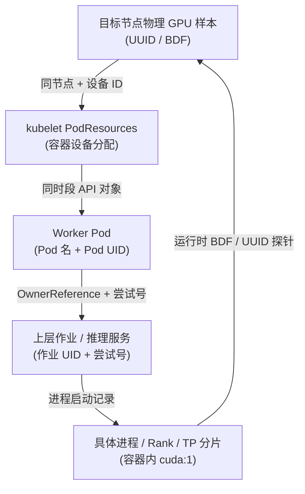
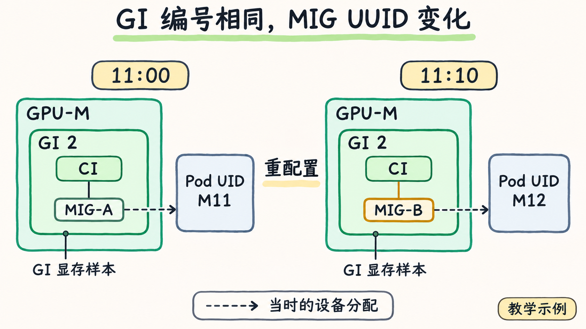

# 设备、实例与作业的身份关联

告警群里刚刚弹出一条消息：“训练作业 Rank 5 通信超时”；同一时间，监控看板上某台节点的 GPU 温度曲线明显抬升。可点开指标一看，底层遥测只带着物理 UUID，训练日志里写的却是 Rank，而在线推理网关记录的又是服务副本 Pod 名。

如果不能把“物理 GPU / MIG 实例 → 宿主机容器分配 → Kubernetes 对象 → 进程或 Rank”串成一条严丝合缝的证据链，再精准的硬件指标也找不到归属。

本篇先交待全章贯穿的训推集群场景，再演示如何闭合跨层身份链、编写 PromQL 工作负载关联查询，并厘清 MIG 重配置与 Time-Slicing 共享下的归因边界。

## 本章贯穿的训推共存集群

本章沿用 [第 16 章](../16_Volcano的作业调度与队列管理/00_内容大纲.md) 的多节点集群，在同一套硬件底座上同时呈现**分布式训练**与**在线推理**两类核心负载：

- **节点与网络底座**：三台 8 卡 H100 80 GB（SXM + NVSwitch）节点，分别命名为 `node-1`、`node-2`、`node-3`。每台节点向集群提供 8 张整卡、32 CPU、192 GiB 主机内存和 2 个支持 RDMA 的 SR-IOV VF；节点间通过独立 `200 Gb/s` RoCEv2 物理口互联，存储走另一张独立网络。
- **训练主线（`ai-demo/train-12`）**：一套 3 节点 12 卡同步训练的 Volcano 作业。每台节点运行 1 个 worker Pod，申请 4 张 H100 整卡、16 CPU、96 GiB 内存与 1 个 VF。首轮尝试按启动器分工：`node-1` 承载 Rank 0–3，`node-2` 承载 Rank 4–7，`node-3` 承载 Rank 8–11。
- **推理主线（`ai-demo/infer-svc-1`）**：部署在同集群推理资源池中的大模型在线服务，每副本按需占用多卡张量并行（如 4 卡 TP）或单卡/MIG 切分实例，独立承接外部用户请求。

需要注意的是，**Rank 仅在单次通信组尝试内有效**。哪怕作业重启后依然是“3 个 Pod、每 Pod 4 个进程”，各节点分到的 Rank 编号也可能重新洗牌，因此必须把“尝试号”纳入历史归档。

## 从物理 UUID 闭合到具体进程或 Rank

把一张物理 GPU 的监控样本归属到上层进程，本质上要同时回答四个问题：**节点上谁拿到了这张卡？这个容器属于哪个 Pod 与作业？多卡容器里哪个进程选中了它？以及这几条记录在什么时间同时成立？**

沿这四个问题逐层取证，就构成了完整的四跳关联表。下面以 `10:12` 时段 `node-2` 上的目标训练卡为例，展示各观测层的具体字段对照：

| 观测层次 | 关键取证记录（`10:12` 窗口） | 承上启下的关联键 |
| --- | --- | --- |
| **主机硬件与遥测** | `node-2` 上物理卡 `GPU-a1b2c3d4-...`（BDF `0000:65:00.0`，宿主机索引 `2`），温度约 `67 °C` | 节点名、物理 UUID、BDF、采样时间 |
| **kubelet PodResources** | `ai-demo/train-12-worker-1` 的 `trainer` 容器获配 4 个 `nvidia.com/gpu` ID，包含上述 UUID | 节点名、命名空间、Pod 名、容器名、设备 ID |
| **Kubernetes API 对象** | `train-12-worker-1`（Pod UID `p21-8f3c...`）绑定于 `node-2`，属主为 VolcanoJob（UID `j17-4a9b...`） | Pod UID、属主作业 UID、节点名、有效时段 |
| **容器内应用启动日志** | 第 1 次尝试中，Rank 5 选用容器内 `cuda:1`，进程探针打印该设备 BDF 为 `0000:65:00.0` | 尝试号、Pod UID、进程/Rank、设备 BDF/UUID |

为何不能省掉中间步骤？因为 Kubernetes 节点 `Allocatable` 只记了“4 张卡”这个整数。要查到容器实际拿到的设备 ID，必须调用宿主机 kubelet 的 **PodResources `List` 接口**（NVIDIA Device Plugin `v0.20.1` 默认上报物理 UUID）。

其次，容器内外拥有各自独立的 CUDA 设备枚举空间（详见 [第 10 章](../10_GPU如何进入容器/00_内容大纲.md)）。宿主机上的 2 号卡进了 4 卡容器后可能变成 `cuda:1`，所以必须靠应用启动时的设备探针把逻辑设备号对回真实 BDF 或 UUID：

```json
// 1. 节点侧 kubelet PodResources List 响应精简片段（说明容器拿到了哪 4 张物理卡）
{
  "pod_name": "train-12-worker-1",
  "namespace": "ai-demo",
  "containers": [
    {
      "name": "trainer",
      "devices": [
        {
          "resource_name": "nvidia.com/gpu",
          "device_ids": [
            "GPU-99887766-...",
            "GPU-a1b2c3d4-...",
            "GPU-55443322-...",
            "GPU-1100ffee-..."
          ]
        }
      ]
    }
  ]
}
```

```text
# 2. 训练进程启动探针日志（将逻辑 Rank 与容器内设备编号闭合回物理 BDF / UUID）
[2026-11-20 10:01:25] attempt=1 pod_uid=p21-8f3c rank=5 local_rank=1 device=cuda:1 pci_bus_id=0000:65:00.0 uuid=GPU-a1b2c3d4-...

# 3. 同理，在线推理副本启动日志（将推理副本实例、TP 分片编号绑定到物理 UUID）
[2026-11-20 10:05:12] pod=infer-svc-1-7c9d pod_uid=inf-31a0 tp_rank=1 device=cuda:1 uuid=GPU-77665544-...
```

把这四层证据连成闭环，就是一条双向可验的身份链路：



*图 17-02-01：跨层身份关联闭环。最后一条探针边回到物理设备，用于在一容器多卡（如 4 卡训练 Pod 或 4 卡 TP 推理副本）中锁定具体进程使用的单张卡；环上每一跳都必须落在重合的时间段内。*

## 用 PromQL 关联工作负载并防住重名坑

在实际监控栈里，DCGM Exporter 已经内置了本地对接 kubelet PodResources 的能力，会自动给指标附加上 `namespace`、`pod` 和 `container` 标签。

这样我们在 Prometheus 里既能直接按 Pod 筛选 GPU 曲线，也可以借助 `kube-state-metrics` 暴露的元信息指标，通过 PromQL `group_left` 一次性关联出上层作业名与 Pod UID：

```promql
# 将 GPU 活动率按 (namespace, pod) 左连接 kube_pod_info 与 kube_pod_owner，补全 Pod UID 与属主作业
DCGM_FI_DEV_GPU_UTIL{namespace="ai-demo"}
  * on (namespace, pod) group_left (uid, created_by_name, created_by_kind)
    kube_pod_info{namespace="ai-demo"}
```

不过，靠 Exporter 自动打标签有两个必须留神的工程细节：

- **默认关闭高基数标签**：按 GPU Operator `v26.7.2` 默认配置，`enablePodUID` 与 `enablePodLabels` 均处于关闭状态。盲目开启会给 kube-apiserver 增加压力，也会让时序库的时间序列数成倍膨胀，因此集群通常选择在查询侧关联 `kube_pod_info`。
- **警惕 Pod 重名合并**：分布式作业重试时，控制器常会复用完全相同的 Pod 名（例如新旧两轮都叫 `train-12-worker-1`）。若看板只按 `pod="train-12-worker-1"` 拉取一小时曲线，两次不同运行的样本就会无缝拼成一条线，误导趋势判断。

> [!warning] 常见误区：容器重启沿用 Pod UID，缺失映射绝不能向前回填
> 就算补上了 Pod UID，同一只 Pod 内的容器发生崩溃重启时，Pod UID 依然不变；要精确切分到某次运行，必须同时结合容器实例 ID 或应用尝试号。此外，当节点重启或 API 快照缺失、拿不到同时段的分配映射时，应明确把该窗口标记为“归属未知”，**绝不能用最近一次分配记录向前回填**。

## MIG 重配置如何改写实例身份

当集群为在线推理或开发池开启 MIG 硬件切分（机制见 [第 14 章](../14_GPU共享、切分与隔离/00_内容大纲.md)）时，一张物理卡会被切成多个 GPU 实例（GI），每个 GI 内再建计算实例（CI）交付给容器。

此时观测对象变成了“父物理卡 → GI → CI”三层嵌套结构。DCGM Exporter 会通过 `GPU_I_ID`（GI 编号）和 `GPU_I_PROFILE`（切分规格）等标签区分实例级指标：

```prometheus
# MIG 实例级显存指标示例：注意 UUID 为父卡标识，GPU_I_ID 与 GPU_I_PROFILE 标明所属 GI
DCGM_FI_DEV_FB_USED{gpu="0",UUID="GPU-m1234567-...",GPU_I_ID="2",GPU_I_PROFILE="1g.10gb",Hostname="node-3",pod="infer-mig-a"} 4096
```

这里暗藏一个高频踩坑点：**MIG UUID 才绑定单个实例的生命周期，而 GI 的数字编号在重配置后会被重复回收利用**。

看下面这个典型场景。同一张父卡（图中标为 `GPU-M`）上的 `GI 2` 在 `11:00` 对应实例 `MIG-A`，分配给旧 Pod（`M11`），读得 GI 显存 `4,096 MiB`。

到了 `11:10`，管理员销毁并重建切分。相同的编号 `GI 2` 已指向全新实例 `MIG-B`，分配给新 Pod（`M12`），读得显存 `5,120 MiB`。



*图 17-02-02：MIG 重配置前后的实例生命周期对照（对应图中父卡 `GPU-M` 与 `GI 2`）。虚线表示当时生效的设备分配，实线标出两次显存样本均落在 GI 边界；`4,096 MiB` 与 `5,120 MiB` 分别属于 `MIG-A` 与 `MIG-B` 两个独立生命周期。*

沿图对照可以得出三条硬约束：

1. **不可仅凭父卡 UUID + GI 编号跨时间查归属**：必须结合采样时刻反查当时的 MIG 实例 UUID 清单，才能区分 `MIG-A` 与 `MIG-B`。
2. **切换缝隙保留未知态**：如果 `11:05` 正处于重配置切换期且缺少快照，就无法仅凭 `GI 2` 确定样本归属谁。
3. **GI 显存不能硬拆给多个 CI**：若同一个 GI 内划分了多个 CI 并分给不同容器，落在 GI 层的显存读数只能按整个 GI 解释，无法直接按比例分摊到单个 CI。

## 共享策略限定了归因的最小粒度

在在线推理低峰共享或开发测试池里，集群常会启用 **Time-Slicing（时分共享）** 让多个 Pod 复用同一张物理 GPU。

GPU Operator `v26.7.2` 文档对 NVIDIA Device Plugin 的 Time-Slicing 路径给出了明确限制：**DCGM Exporter 采集的是整张卡的硬件指标，无法按容器记账**。

哪怕分配记录清楚地写着两个推理 Pod 共享了同一张卡，而该卡当前的活动率读数是 `80%`，我们也绝不能简单把它平分成“各占 `40%`”。真正的情况很可能是其中一个副本突发长提示词占去了 `75%`，把另一个副本的尾延迟彻底拖垮。

> [!tip] 工程直觉：分清“访问权”与“归因粒度”
> 记住一条黄金法则：**分配记录回答“谁有资格使用这张卡”，而遥测实体决定了“指标最细能归因到哪一层”**。在 Time-Slicing 共享池排查邻居干扰时，应把整卡硬件指标与各个推理 Pod 自身的业务指标（请求率、排队数、TTFT 分布）并排对比；需要精确核定单副本资源画像时，则改用独占卡或硬件隔离的 MIG 实例分别测量。

> [!summary] 核心结论
> 物理 UUID 锁定硬件，PodResources 锁定容器分配，Pod UID 与尝试号切分生命周期，进程探针收口一容器多卡的最后一步；遇到 MIG 重配置看实例 UUID，遇到 Time-Slicing 共享则尊重整卡归因边界。

身份归属一旦立稳，我们就能放心深入每项指标的内部含义。下一篇，我们拆解 GPU 活动率、SM/Tensor Core、HBM 带宽、显存与健康计数，并正式打通**在线推理业务指标与底层 GPU 硬件指标的因果映射**。

> [!info]- 参考资料
> - **分布式启动与设备枚举**：[PyTorch 2.9 · torchrun 与 Rank 稳定性](https://docs.pytorch.org/docs/2.9/elastic/run.html)、[CUDA 13.2.1 Runtime · 设备管理](https://docs.nvidia.com/cuda/archive/13.2.1/cuda-runtime-api/group__CUDART__DEVICE.html)
> - **Kubernetes PodResources 与设备插件**：[Kubernetes v1.36 · PodResources List 接口](https://v1-36.docs.kubernetes.io/docs/concepts/extend-kubernetes/compute-storage-net/device-plugins/#monitoring-device-plugin-resources)、[NVIDIA Device Plugin v0.20.1 · 设备 ID 策略](https://raw.githubusercontent.com/NVIDIA/k8s-device-plugin/v0.20.1/README.md)
> - **DCGM Exporter 标签映射与共享限制**：[DCGM Exporter 4.8.4 · Kubernetes 映射源码](https://raw.githubusercontent.com/NVIDIA/dcgm-exporter/4.8.4/internal/pkg/transformation/kubernetes.go)、[GPU Operator v26.7.2 · 标签开关配置](https://raw.githubusercontent.com/NVIDIA/gpu-operator/v26.7.2/deployments/gpu-operator/values.yaml)、[GPU Operator v26.7.2 · Time-Slicing 监控限制](https://docs.nvidia.com/datacenter/cloud-native/gpu-operator/26.7/gpu-sharing.html#limitations)
> - **MIG 实例模型与 UUID 语义**：[NVIDIA MIG · 实例与设备概念](https://docs.nvidia.com/datacenter/tesla/mig-user-guide/620/concepts.html)、[NVML API · 设备与 MIG UUID 查询](https://docs.nvidia.com/deploy/nvml-api/620/api/group__nvmlDeviceQueries.html)
