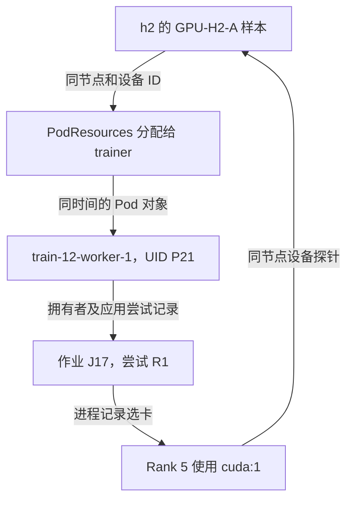

第 01 篇的温度样本只带着物理 UUID，而分布式训练日志写的是 Rank。Rank 是进程在本次通信组内的编号，只在一次运行的通信组内有效。把两者连起来，需要回答四个问题：哪只 Pod 在哪个节点运行、容器分到了哪些设备、进程最终选中了其中哪张卡、这几条记录在什么时间同时成立。本篇沿一条完整的证据链还原归属，再用 MIG 重配置和共享策略检验这条链的有效期与粒度边界。

## 贯穿全章的教学场景

本章沿用第 16 章的 Volcano 作业 `ai-demo/train-12`。三台节点 `h1/h2/h3` 各运行一只 worker Pod，每只请求 4 张 H100 80 GB 整卡、16 CPU、96 GiB 主机内存和 1 个支持远程直接内存访问的虚拟网卡。每台节点可供 Pod 请求 8 GPU、32 CPU、192 GiB 内存和 2 个虚拟网卡。补充两个拓扑条件：单机采用 H100 SXM 与 NVSwitch，每台有一条 200 Gb/s 物理端口承载作业的 RoCEv2 流量，存储流量走另一个网络。RoCEv2 在可路由的以太网/IP 网络上承载 RDMA（Remote Direct Memory Access，远程直接内存访问）。

给作业 UID 记短写 `J17`，给本次训练进程组用应用记录的尝试号 `R1`。主例按启动记录确认 `h1/h2/h3` 对应 Rank 0–3、4–7、8–11。计算分工来源于启动器和进程日志；即使每次都是一 Pod 四进程，重启也可能重新分配 Rank。以下节选 `h2` 在 10:12 的关联材料，标识和数值均为教学构造。 [PyTorch 2.9 · torchrun 与 Rank 稳定性](https://docs.pytorch.org/docs/2.9/elastic/run.html)

## 从物理 UUID 到当时的 Rank

| 观测位置 | 教学节录 | 关联用的字段 |
| --- | --- | --- |
| 主机设备清单及 GPU 样本 | `h2` 上 `GPU-H2-A`，BDF `0000:65:00.0`，宿主机索引 2，10:12 约 67 °C。 | 节点、物理 UUID、BDF、观测时间 |
| kubelet PodResources `List` | `ai-demo/train-12-worker-1` 的 `trainer` 容器获配四个 `nvidia.com/gpu` ID，其中一个为 `GPU-H2-A`。 | 节点、命名空间、Pod 名、容器名、资源名、设备 ID、采样时间 |
| 同时段 Kubernetes 对象记录 | Pod 名为 `train-12-worker-1`，UID `P21`，绑定 `h2`，归属 UID 为 `J17` 的 VolcanoJob。 | Pod 与拥有者 UID、节点、对象有效时间 |
| 应用启动记录 | `J17/R1` 中，`P21/trainer` 的 Rank 5 使用 `cuda:1`，运行时探针记录该设备 BDF 与 `GPU-H2-A` 相符。 | 尝试号、Pod UID、容器或进程标识、Rank、设备身份 |

查询本节点的 kubelet PodResources 是为了得到**具体分配**，而不只是资源数量。Kubernetes v1.36 的 `List` 返回 Pod 名、命名空间及各容器的分配信息，设备 ID 的格式由设备插件决定。留存历史时，要在同一节点按同时段的 Kubernetes 对象补上 UID，并记录快照有效期。本例插件以 UUID 上报；若得到的是索引或其他 ID，需要该插件当时的映射表。最后一步用应用枚举把容器内的 `cuda:1` 对到物理设备——容器内外各有独立的枚举空间，序号相同不代表同一张卡。 [Kubernetes v1.36 · PodResources List 格式](https://v1-36.docs.kubernetes.io/docs/concepts/extend-kubernetes/compute-storage-net/device-plugins/#monitoring-device-plugin-resources) · [NVIDIA Device Plugin v0.20.1 · 设备 ID 策略](https://raw.githubusercontent.com/NVIDIA/k8s-device-plugin/v0.20.1/README.md) · [CUDA Runtime · 设备管理](https://docs.nvidia.com/cuda/archive/13.2.1/cuda-runtime-api/group__CUDART__DEVICE.html)

图 17-02-01　箭头表示观测记录的匹配方向，最后一条边回到物理卡，核对进程实际选中的设备，说明已分配给容器的四张卡中哪张对应 Rank 5。环上的每一跳都依赖“同时段”这一条件。

**替代文本**　用节点和 GPU ID 查容器分配，补上 Pod UID 与拥有者作业，再按进程实际选卡把 Rank 5 对回同一张物理 GPU。

Exporter 可以利用 PodResources 给指标补充 `namespace`、`pod`、`container` 等标签。但 GPU Operator v26.7.2 的 Helm 值中 `enablePodUID` 与 `enablePodLabels` 默认都关闭，启用会带来额外的 API 访问和时间序列维度。只凭 Pod 名筛选历史有一个具体风险：Pod 名被复用时，两次运行的样本会被同一条查询合并。容器重启也可能沿用 Pod UID，因此要拆到一次进程运行时，需再加入容器实例或应用尝试、进程标识和时间。当 API 对象与节点快照拿不到同一时段的映射时，应把该样本标记为归属未知，而不是用最近一次分配向前回填。 [Exporter 4.8.4 · Kubernetes 映射源码](https://raw.githubusercontent.com/NVIDIA/dcgm-exporter/4.8.4/internal/pkg/transformation/kubernetes.go) · [GPU Operator v26.7.2 标签开关](https://raw.githubusercontent.com/NVIDIA/gpu-operator/v26.7.2/deployments/gpu-operator/values.yaml)

## MIG 重配置改变实例身份

第 14 章介绍的 MIG（Multi-Instance GPU，多实例 GPU）把一张物理卡划成 GPU Instance（GI，GPU 实例），在 GI 内创建 Compute Instance（CI，计算实例）后应用才能使用对应 MIG 设备。父卡 UUID、GI 编号和 CI 编号指向不同层次，样本必须先确定来自物理卡还是某个 GI，再查当时的实例清单。Exporter 可能为实例样本提供 `GPU_I_ID`、`GPU_I_PROFILE` 等标签，实际字段和标签以该版本、实体选择与设备能力为准。关键约束是：MIG UUID 对应一个实例的生命周期，而 GI 的数字编号可以在重配置后再次出现，编号本身不具备跨时间的唯一性。 [NVIDIA MIG R620 · 实例与设备](https://docs.nvidia.com/datacenter/tesla/mig-user-guide/620/concepts.html) · [NVML R620 · UUID 语义](https://docs.nvidia.com/deploy/nvml-api/620/api/group__nvmlDeviceQueries.html) · [Exporter 4.8.4 · 标签源码](https://raw.githubusercontent.com/NVIDIA/dcgm-exporter/4.8.4/internal/pkg/transformation/kubernetes.go)

在一个与整卡训练独立的教学变体中，父卡 `GPU-M` 的 GI 2 在 11:00 映射到实例 `MIG-A`，分给 UID 为 `M11` 的 Pod；11:10 重配置后，GI 2 映射到另一个实例 `MIG-B`，分给 `M12`。两次 GI 显存分别读到 4,096 和 5,120 MiB。按父卡、编号和采样时间查当时的实例 UUID，会得到两个独立归属；若 11:05 恰在映射切换期间且缺少快照，该时刻无法仅凭编号确定归属。若多个 CI 同处一个 GI，GI 级显存观测只能按整个 GI 解释，不能拆到单个 CI。

图 17-02-02　每栏只画本次观测涉及的 GI 和 CI。虚线连接当时的 MIG 设备与获配 Pod。4,096 MiB 和 5,120 MiB 的读数分别来自两次实例生命周期，实线标出两次采样都覆盖的 GI 层。

## 共享策略限定可归因的粒度

Time-Slicing（时分共享）让多个工作负载分享一张卡的执行时间。GPU Operator v26.7 对 NVIDIA Device Plugin 的 Time-Slicing 路径明确记录了 DCGM Exporter 的容器关联限制：即使分配记录能确认两只 Pod 都可访问同一张卡，整卡 80% 的活动率也无法按分配份额拆成各 40%，因为设备侧采样不按容器记账。需要进程粒度的结论时，要么使用当前平台支持的进程级观测，要么用独占对照分别量出各自行为。这里要把两件事分开：分配记录回答“谁可以访问这张卡”，样本实体决定“这条指标能归因到哪一层”。 [GPU Operator v26.7 · Time-Slicing 限制](https://docs.nvidia.com/datacenter/cloud-native/gpu-operator/26.7/gpu-sharing.html#limitations)

身份链建立之后，下一篇转向字段本身：同样是 `GPU-H2-A` 的一条活动率，它的分母是什么、能证明工作量还是只能证明忙闲，取决于指标的定义。
