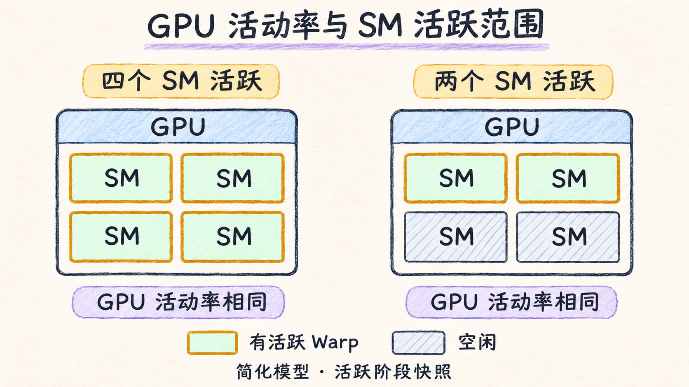

# GPU 活动、显存、互联与健康指标

深夜里在线推理告警响起，值班同学点开监控面板心里一紧：GPU 显存占了整整 `90%`，GPU 利用率也飙到 `96%`。直觉第一反应往往是“算力吃满、显存快爆了，赶紧扩容”。

可一旦拉出底层硬件剖析指标，真相往往令人意外：Tensor Core 活跃度其实不到 `18%`，而推理引擎内部的 KV Cache 池才用了刚过一半。最常盯的两个大数字，为什么会如此“骗人”？

根源在于每个硬件指标的**分母与统计边界**完全不同。本篇按前文建立的 Gauge / Counter 分类，拆解 GPU 活动率、算力与显存带宽的真实口径，系统打通**在线推理业务指标与底层硬件的因果映射**，再用功耗降频与错误计数补齐硬件健康拼图。

## 活动率、算力与显存占用的五个分母

在 [第 02 章](../02_GPU如何计算与显存/00_内容大纲.md) 我们已经熟悉了 SM、Warp、Tensor Core 与 HBM 的分工。落到 DCGM `4.6.1` 与 DCGM Exporter `4.8.4` 的监控字段上，必须把最容易混淆的五个 Gauge 指标按分母彻底拆开：

| 指标名称（Exporter 4.8.4） | 单位 | 统计分母与回答的问题 | 工程判读要点 |
| --- | --- | --- | --- |
| `DCGM_FI_DEV_GPU_UTIL` | `%` | 采样区间内，至少有 1 个 Kernel 在执行的时长占比 | **只回答“忙不忙”**。大矩阵计算、小批量访存、甚至通信 Kernel 持续轮询，都能把它顶到 `90%+`。 |
| `DCGM_FI_PROF_SM_ACTIVE` | `0–1` | 平均到全卡所有 SM，至少有 1 个活跃 Warp 的周期比例 | 区分“全卡并行吃满”还是“只点亮了少数 SM”。要算真实吞吐，仍需结合完成的计算量与耗时。 |
| `DCGM_FI_PROF_PIPE_TENSOR_ACTIVE` | `0–1` | Tensor Core 矩阵乘加流水线处于工作状态的周期比例 | **深度学习核心算力晴雨表**。衡量矩阵乘（如训练前反向、推理 Prefill）是否真正吃满张量核心。 |
| `DCGM_FI_PROF_DRAM_ACTIVE` | `0–1` | 显存控制器（HBM 接口）正在收发数据的周期比例 | **访存受限指纹**。持续高位且 Tensor Core 偏低，说明负载卡在显存带宽墙（如推理 Decode）。 |
| `DCGM_FI_DEV_FB_USED` | `MiB` | 当前实体已被占用的 Framebuffer 显存容量 | 反映分配态而非实时计算态；模型权重、框架缓存池和预分配的 KV Cache 在空载等待时也会常驻。 |

用一张简化模型就能一眼看透前两项的差别：假设一张 GPU 只有 4 个 SM，两次任务都有 Kernel 持续覆盖 `90%` 的采样时段，因此两轮的 `DCGM_FI_DEV_GPU_UTIL` 均为 `90%`。

但第一轮 4 个 SM 全部有活跃 Warp，第二轮只有半数 SM 在干活、另半数完全空闲。按全卡 SM 平均，两者的 `DCGM_FI_PROF_SM_ACTIVE` 立刻拉开一倍差距：

$$
\text{SM Active}_{\text{左}} = \frac{4}{4} \times 0.90 = 0.90, \qquad \text{SM Active}_{\text{右}} = \frac{2}{4} \times 0.90 = 0.45
$$



*图 17-03-01：两轮负载的设备活动率（`GPU_UTIL`）均为 90%，但左侧全卡 SM 活跃，右侧仅半数 SM 活跃，导致平均 SM 活跃度相差一倍。*

需要特别留意的是，在 DCGM Exporter `4.8.4` 上游默认配置中，`DCGM_FI_PROF_*` 系列的硬件剖析字段默认处于注释关闭状态。上线深度监控前，需要通过 ConfigMap 取消对应行的注释并重启采集：

```csv
# /etc/dcgm-exporter/default-counters.csv 关键剖析字段示例（取消行首 # 启用）
# 格式：DCGM 字段名, Prometheus 类型, 说明
DCGM_FI_DEV_GPU_UTIL, gauge, GPU utilization (in %).
DCGM_FI_DEV_FB_USED, gauge, Framebuffer memory used (in MiB).
DCGM_FI_PROF_SM_ACTIVE, gauge, The ratio of cycles an SM has at least 1 warp assigned.
DCGM_FI_PROF_PIPE_TENSOR_ACTIVE, gauge, Ratio of cycles the tensor (HMMA) pipe is active.
DCGM_FI_PROF_DRAM_ACTIVE, gauge, Ratio of cycles the device memory interface is active.
```

> [!note] 版本与硬件采集约束
> - **硬件计数器限制**：启用 `DCGM_FI_PROF_*` 剖析字段受芯片代际、容器权限与硬件计数器复用约束，同时开启过多剖析项可能触发采样降频。
> - **跨版本单位变化**：DCGM Exporter `4.9.0` 起将 `GPU_UTIL` 改为 `GPU_UTIL_RATIO`（`0–1`），`FB_USED` 改为 `FB_USED_BYTES`（字节），时钟改为 Hz。升级看板前须同步核对单位。

## 在线推理可观测性：业务指标与底层 GPU 的因果映射

在同步训练里，工程师习惯盯紧 `SM_ACTIVE` 与 `PIPE_TENSOR_ACTIVE` 是否长期跑满。但切到**在线大模型推理**（`infer-svc-1`）后，业务视角立刻转向一套全新的 SLO 指标。

最核心的六个业务信号包括：首字延迟（TTFT）、单 token 生成延迟（TPOT / ITL）、输出吞吐（tokens/s）、排队深度、KV Cache 利用率与请求抢占率。

脱离引擎业务指标孤立看 GPU 硬件，或者脱离硬件指标孤立看业务延迟，都只能看到半张拼图。下面这张因果映射表，把推理引擎（以 vLLM 暴露的标准 Prometheus 指标为例）与底层 DCGM 指标直接打通：

| 业务核心指标 | 典型引擎指标名与类型 | 联动观测的底层 GPU 指标 | 异常升高或下滑时的主导因果 |
| --- | --- | --- | --- |
| **首字延迟（TTFT）** | `vllm:time_to_first_token_seconds`（Histogram） | `PIPE_TENSOR_ACTIVE`、`SM_ACTIVE` | 请求在队列积压过久，或长提示词 Prefill 阶段打满 Tensor Core 算力。 |
| **单 token 延迟（TPOT / ITL）** | `vllm:inter_token_latency_seconds`（Histogram） | `DRAM_ACTIVE`、`NVLINK` 吞吐 | Decode 阶段 HBM 带宽饱和（`DRAM_ACTIVE` 冲高），或卡间 TP 通信变慢。 |
| **输出吞吐（tokens/s）** | `vllm:generation_tokens_total`（Counter） | `DRAM_ACTIVE` 与 `PIPE_TENSOR_ACTIVE` | 并发 Batch 过小导致算力闲置；或发生 KV Cache 抢占重算，白白消耗算力。 |
| **请求排队时长 / 深度** | `vllm:num_requests_waiting`（Gauge） | `GPU_UTIL`、`FB_USED` | 副本算力饱和或 KV Cache 块池耗尽，引擎拒绝接纳新请求入批。 |
| **KV Cache 利用率** | `vllm:kv_cache_usage_perc`（Gauge，`0–1`） | `DCGM_FI_DEV_FB_USED`（恒定平台） | 长上下文与高并发吃光引擎内部块池；逼近 `0.95–1.0` 即触发抢占雪崩。 |
| **请求抢占 / 换出率** | `vllm:num_preemptions_total`（Counter） | `PIPE_TENSOR_ACTIVE` 虚高而有效吞吐跌落 | KV Cache 耗尽迫使引擎踢出在途请求，释放块后再重算 Prefill，形成恶性循环。 |

掌握了这张映射表，就能一眼识破在线推理运维中最经典的**三个监控假象**：

1. **假象一：“显存常年占满 `90%`，是不是显存泄漏快 OOM 了？”**
   - **真相**：主流推理引擎（如 vLLM 默认 `gpu-memory-utilization=0.90`）加载权重后，会一次性向驱动申请完剩余 `90%` 显存，切分成定长块池供 PagedAttention 调度。
   - 因此哪怕线上 `0` 流量，`DCGM_FI_DEV_FB_USED` 也会稳停在约 `72 GiB / 80 GiB`；**真正显存水位要看 `vllm:kv_cache_usage_perc`，而非 `FB_USED`**。
2. **假象二：“`GPU_UTIL` 飙到 `96%`，显卡已经算力跑满了吗？”**
   - **真相**：Decode 每生成一个 token 都需把全量模型权重从 HBM 搬进片上计算，算术强度极低；连续发射小批量 Decode Kernel 会将 `GPU_UTIL` 顶到 `95%+`，但实际 `PIPE_TENSOR_ACTIVE` 仅约 `0.15`，`DRAM_ACTIVE` 高达 `0.85`。
   - 这正是 **Decode 访存受限的典型指纹**——只有加大有效批大小（Continuous Batching）或采用量化，才能把真实算力压榨出来。
3. **假象三：“`Tensor Active` 很高、GPU 忙得滚烫，为什么业务吞吐反而腰斩？”**
   - **真相**：一旦 `vllm:kv_cache_usage_perc` 顶死 `1.0`，引擎会频繁抢占踢出生成到一半的请求，稍后重新做一遍 Prefill 计算。结果底层 GPU 看起来满载干活，实际上大量算力全浪费在重复计算上，用户侧的 P99 TTFT 却直线飙升。

> [!tip] 工程直觉：用四象限指纹一眼定性推理负载态
> - **Prefill 算力吃满**：`GPU_UTIL` 高 + `PIPE_TENSOR_ACTIVE` 高（`>0.6`）+ 排队上升 → 扩容或做 PD 分离卸载 Prefill。
> - **典型 Decode 访存受限**：`GPU_UTIL` 高 + `PIPE_TENSOR_ACTIVE` 低（`<0.25`）+ `DRAM_ACTIVE` 高（`>0.75`）+ `kv_cache_usage_perc` 健康 → 显存带宽主导，调大 Batch 提升吞吐，留意 TPOT 红线。
> - **KV Cache 抢占雪崩**：`FB_USED` 恒定 `90%` + `kv_cache_usage_perc ≈ 1.0` + `num_preemptions_total` 陡增 + 有效 `tokens/s` 暴跌 → 立刻限流、扩容或启用 KV 卸载/量化。
> - **通信或外部阻塞**：`GPU_UTIL` 低 + `DRAM_ACTIVE` 低 + 请求延迟高 → 排查卡间 TP 通信、PD 分离 KV 迁移网络或上游网关阻塞。

在 Prometheus 里把推理业务指标与同 Pod 底层 GPU 剖析指标配进同一张联动看板，只需要几条精简的 PromQL：

```promql
# 1. 在线推理核心 SLO：过去 5 分钟 P99 首字延迟（TTFT）与 P99 词间延迟（ITL）
histogram_quantile(0.99, sum by (le, pod) (rate(vllm:time_to_first_token_seconds_bucket{pod=~"infer-svc-1.*"}[5m])))
histogram_quantile(0.99, sum by (le, pod) (rate(vllm:inter_token_latency_seconds_bucket{pod=~"infer-svc-1.*"}[5m])))

# 2. 真实显存压力与雪崩信号：KV Cache 池利用率与每秒抢占速率
vllm:kv_cache_usage_perc{pod=~"infer-svc-1.*"}
rate(vllm:num_preemptions_total{pod=~"infer-svc-1.*"}[5m])

# 3. 同一批推理副本的底层算力 vs 访存带宽指纹（一眼识别 Decode 带宽受限）
avg by (pod) (DCGM_FI_PROF_PIPE_TENSOR_ACTIVE{pod=~"infer-svc-1.*"})
avg by (pod) (DCGM_FI_PROF_DRAM_ACTIVE{pod=~"infer-svc-1.*"})
```

## 用温度、功耗与频率联动锁定硬件降频

不管是训练步变慢，还是推理 TPOT 抬升，硬件降频都是最先要排除的嫌疑对象。

温度（`DCGM_FI_DEV_GPU_TEMP`）、功耗（`DCGM_FI_DEV_POWER_USAGE`）和 SM 时钟（`DCGM_FI_DEV_SM_CLOCK`）均属 Gauge 指标。它们必须与同窗的**时钟事件原因**（`DCGM_FI_DEV_CLOCKS_EVENT_REASONS`）配对判读，否则很难分清“空闲节能”与“被动限速”。

下面是一张 GPU 重复执行完全相同固定输入计算时的两个对照窗口（设定生效功耗上限为 `450 W`），设备完成时间取自应用侧 GPU 事件计时：

| 观测窗口 | GPU 温度 | 实时功耗 | SM 时钟 | 设备计算耗时 | 同窗时钟事件原因 |
| --- | ---: | ---: | ---: | ---: | --- |
| 正常窗口 A | `68 °C` | `400 W` | `1,590 MHz` | `4.0 ms` | 无主动限速事件 |
| 降速窗口 B | `69 °C` | `449 W` | `1,320 MHz` | `4.7 ms` | 触发 `SW Power Cap` |

窗口 B 的功耗贴死 `450 W` 上限，频率骤降近 `17%`。同时，驱动明确上报了软件功耗封顶（`SW Power Cap`）。三条证据咬合，直接坐实功率约束拉长了计算耗时。

反过来，如果窗口 B 测到的功耗只有 `230 W`、频率同样很低，但事件原因显示 `GPU Idle`，那就说明卡根本没收到活干——排查方向必须立刻调头，去查上游数据加载、推理排队或通信阻塞。宿主机上可以直接用一条命令同时拉出这组对齐证据：

```bash
# 同行查询功耗、温度、当前 SM 频率以及最常见的三类降频/空闲原因
nvidia-smi --query-gpu=index,temperature.gpu,power.draw,power.limit,clocks.sm,clocks_event_reasons.sw_power_cap,clocks_event_reasons.hw_thermal_slowdown,clocks_event_reasons.gpu_idle --format=csv
```

## 互联流量、错误增量与 Xid 的正确读法

最后一组 GPU 侧指标涵盖 PCIe、NVLink 吞吐以及硬件错误记录。读这一组字段时，最容易栽跟头的地方是**把速率型 Gauge、累计型 Counter 和状态编号型 Gauge 混用同一种函数**。

| 指标组（Exporter 4.8.4） | 类型与单位 | 统计范围与正确用法 |
| --- | --- | --- |
| `DCGM_FI_PROF_PCIE_TX_BYTES` / `...RX_BYTES` | Gauge（`B/s`） | 已是区间**速率**，含协议头与载荷。方向以 **GPU 自身视角**为准（TX 是从卡发出，RX 是写入卡内），切勿再套 `rate()`。 |
| `DCGM_FI_DEV_NVLINK_BANDWIDTH_TOTAL` 与 `DCGM_FI_PROF_NVLINK_TX/RX_BYTES` | Gauge（前者 `MB/s`，后者 `B/s`） | 前者是跨所有 NVLink 链路的聚合吞吐；需要区分收发方向时使用后者（不含协议头），定位单条坏链则取逐链统计。 |
| `DCGM_FI_DEV_PCIE_REPLAY_COUNTER` 与 NVLink 错误字段 | Counter（次） | 单调递增的链路重传或 CRC/恢复累计值。必须在同一计数生命周期内求增量或使用 `rate()`，并结合同窗流量与应用受影响程度判断。 |
| ECC 错误计数（`volatile` / `aggregate`） | Counter（次） | `volatile` 统计本次驱动加载以来，`aggregate` 统计显卡终身持久累计；再细分已纠正（corrected）与不可纠正（uncorrected）。部分字段须在 CSV 中显式开启。 |
| `DCGM_FI_DEV_XID_ERRORS` | Gauge（事件编号） | 记录驱动报告的**最近一次 Xid 错误码**（详见 [第 18 章](../18_从故障现象追到具体层次/00_内容大纲.md)）。它是一个状态快照而非累加器，绝不能对其求速率。 |

以 PCIe 重传计数为例，看看跨驱动重载的陷阱。假设某张卡的 `DCGM_FI_DEV_PCIE_REPLAY_COUNTER` 在 60 秒内从 `40` 涨到 `46`，期间无重载也无回绕。此时平均重传速率非常明确：

$$
r_{\text{replay}} = \frac{46 - 40}{60\text{ s}} = 0.1\text{ 次/s}
$$

如果下一分钟的读数突然变成 `2`，并且中间发生过一次驱动重载，那么 `46` 与 `2` 已经分属两个独立的计数生命周期。直接拿 `2 - 46` 会算出荒谬的负数，而丢失的失采缝隙也无法靠两端数字凭空还原。

```promql
# 正确 1：对 Counter 使用 rate()，Prometheus 自动识别观测到的计数复位并估算平均速率
rate(DCGM_FI_DEV_PCIE_REPLAY_COUNTER{Hostname="node-2"}[5m])

# 正确 2：对速率型 Gauge 直接做单位换算（B/s -> GB/s），严禁套用 rate()
DCGM_FI_PROF_PCIE_TX_BYTES{Hostname="node-2"} / 1e9

# 正确 3：检测 Xid 状态码是否出现非零值（真实发生次数与精确时刻仍须回查宿主机内核日志）
DCGM_FI_DEV_XID_ERRORS{Hostname="node-2"} != 0
```

> [!warning] 常见误区：连续读到同一个 Xid 编号 ≠ 持续新增报错
> `DCGM_FI_DEV_XID_ERRORS` 只保留“最后一次观察到的错误码”。哪怕只发生过 1 次 Xid 79，后续抓取仍会持续上报 `79`。发现非零值时，务必回查宿主机 `dmesg` 确认真实次数与时间戳。同时，`rate()` 虽能处理观测到的 Counter 复位，却补不回失采空白期漏掉的事件。

> [!summary] 核心结论
> - **看清分母**：`GPU_UTIL` 只看忙闲，`PIPE_TENSOR_ACTIVE` 看算力，`DRAM_ACTIVE` 看 HBM 访存。
> - **戳破推理假象**：别把 `90%` 静态预分配显存当泄漏，必须用 `kv_cache_usage_perc` 和 `num_preemptions_total` 联动剖析指纹定性瓶颈。
> - **守住健康口径**：查降频看时钟事件原因，查链路错误严防跨重载直减，查 Xid 回到内核日志核实条数。

卡内的算力、显存与健康指标已经透明。但只要任务跨出单机——无论是多机训练的 AllReduce，还是 PD 分离推理的跨节点 KV Cache 迁移——关键证据还会同时落在网卡、交换机和存储链路上。下一篇，我们把同一套身份与时间窗方法推进到网络与存储侧。

> [!info]- 参考资料
> - **DCGM 剖析指标、拓扑与 Exporter 清单**：[DCGM · Profiling 指标口径与兼容性](https://docs.nvidia.com/datacenter/dcgm/latest/learn/modules/profiling.html)、[DCGM · 拓扑与 NVLink 统计](https://docs.nvidia.com/datacenter/dcgm/latest/learn/core-services/topology-and-links.html)、[DCGM Exporter 4.8.4 默认字段清单](https://raw.githubusercontent.com/NVIDIA/dcgm-exporter/4.8.4/etc/default-counters.csv)、[DCGM Exporter 4.9.0 字段变更清单](https://raw.githubusercontent.com/NVIDIA/dcgm-exporter/4.9.0/etc/default-counters.csv)
> - **`nvidia-smi` 利用率、降频原因、ECC 与 Xid**：[NVIDIA SMI · Utilization 口径](https://docs.nvidia.com/deploy/nvidia-smi/index.html#utilization)、[NVIDIA SMI · Clock Event Reasons 与功耗](https://docs.nvidia.com/deploy/nvidia-smi/index.html)、[NVIDIA SMI · ECC 统计](https://docs.nvidia.com/deploy/nvidia-smi/index.html#ecc-errors)、[NVIDIA Xid 错误指南](https://docs.nvidia.com/deploy/xid-errors/latest/index.html)
> - **在线推理引擎指标与 Prometheus 函数**：[vLLM · Production Metrics（TTFT / ITL / KV Cache / Preemptions）](https://docs.vllm.ai/en/latest/serving/metrics.html)、[Prometheus · `rate()` 与 Counter 复位处理](https://prometheus.io/docs/prometheus/latest/querying/functions/#rate)
