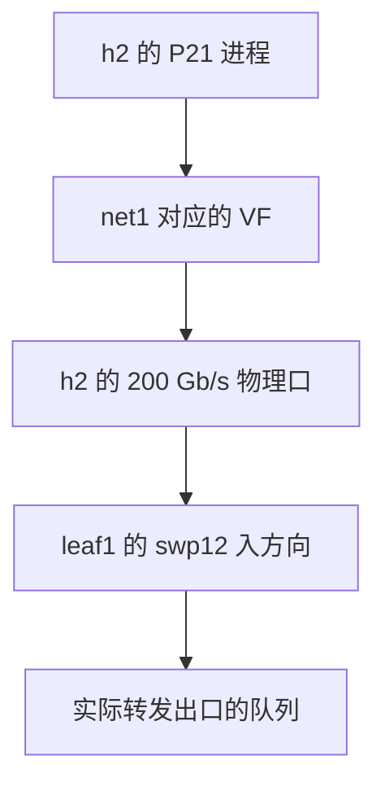

`train-12` 的 Rank 5 上报了该步的集合完成时间。第 02 篇已经把 Rank 5 对到 `h2/P21/GPU-H2-A`，要了解它跨节点的通信经过哪些端口，还得继续沿网络分配向下追；要解释它为什么很晚才抵达集合，则需同时了解读取和预处理。这两条路径的计数都必须对应到本次训练实际访问的对象和时段，否则高吞吐或长队列都可能是别人的流量。

## 从 Pod 附加网卡追到交换机端口

第 13 章用 SR-IOV（Single Root I/O Virtualization，单根 I/O 虚拟化）解释一块网卡怎样向 Pod 提供 VF（Virtual Function，虚拟功能）。PF（Physical Function，物理功能）管理该物理设备上的 VF。本章假设 `h2` 的 worker 在默认网络上完成作业协调，另有 `net1` 承载 RoCEv2 数据。应用实际使用哪个 RDMA 设备，要从通信日志、进程看到的设备和配置中确认。按下面的教学快照可以一路追到网线和对端端口。 [NVIDIA Network Operator v26.7.1 · SR-IOV RDMA](https://docs.nvidia.com/networking/display/kubernetes2671/quick-start/sriov-network-rdma.html) · [NCCL 2.27.3 · 网卡选择与日志变量](https://docs.nvidia.com/deeplearning/nccl/archives/nccl_2273/user-guide/docs/env.html)

| 位置 | 在 `h2/P21` 的教学记录 | 如何核对 |
| --- | --- | --- |
| Pod 与进程 | `net1`，日志选中容器内的 `mlx5_2/1`。 | 对照附加网络状态、进程的 RDMA 设备和端口。名字只在该视图中有效。 |
| 节点内 | VF BDF `0000:81:00.2`，父 PF BDF `0000:81:00.0`，接至 `ens6f0` 所对应的物理口。 | 对照设备插件 ID、RDMA 设备与 PCI 关系，再用 VF 的 `physfn` 关系及主机清单映射到端口。 |
| 交换网络 | 该物理口接 `leaf1/swp12`，`h1` 接 `leaf1/swp11`，`h3` 接 `leaf2/swp13`。 | 查布线与链路邻居。若要分析通过哪个上联，另核对本轮流的路由和路径。 |

图 17-04-01　箭头追踪 `h2` 发出的一路数据。VF 与物理口之间省略网卡内部转发。若看对端向 `h2` 发送，则 `swp12` 对交换机是出口、物理口对主机是接收，方向随观察点反转。

**替代文本**　进程发出的数据经 Pod 的 VF 和节点物理口进入 leaf1 的 swp12，再进入实际出口队列。

一个 VF 的计数范围通常小于物理口：物理口可能汇集多个 VF 及主机自身流量。Linux 提供标准接口统计、驱动定义的 `ethtool -S` 字段以及 RDMA 设备统计等多个观测层，先要确认驱动与接口层级、单位和重置范围，再用端口清单确定谁和谁可比。物理口总量需要配合 VF 计数或连接记录，才能进一步归属到具体作业——这与第 02 篇“分配记录不等于归因粒度”是同一条边界。 [Linux 6.18 · 网络接口统计](https://docs.kernel.org/6.18/networking/statistics.html) · [Linux 6.18 · PCI sysfs 中的 VF 与 PF 关系](https://www.kernel.org/doc/html/v6.18/admin-guide/abi-testing.html)

图 17-04-02　加入背景流量的教学变体。主机物理口的发送计数覆盖经过它的两路流量，交换机的相邻端口从接收方向观测这两路流量；两端字节统计仍须按各自字段定义比较，不能默认相等。

## 按方向复算流量，按队列解释拥塞

下面是独立的十秒**教学对照**。假定 `h2` 物理口 TX 累计值以字节为单位，连续两个时点由 `105 × 10⁹ B` 变到 `285 × 10⁹ B`，期间该 counter 没有复位或回绕。平均发送速率为 `(285 − 105) × 10⁹ B × 8 ÷ 10 s = 144 Gb/s`。线路名义单向速率 200 Gb/s 相当于 25 GB/s。两者比较时要注明端口字段是否计入帧头、物理层开销和其他流量；交换机上的相邻入方向与主机 TX 对应，但统计对象及协议层级可能不同。在原生 InfiniBand 环境使用 Linux ABI 的 `port_xmit_data` 时，该 counter 的定义是“数据字节数除以 4”，应先乘 4 再做同样换算——这个换算依赖字段定义，不能套用到以太网端口。 [Linux 6.18 · RDMA sysfs ABI](https://www.kernel.org/doc/html/v6.18/admin-guide/abi-stable.html) · [Linux 6.18 · 网络计数的边界](https://docs.kernel.org/6.18/networking/statistics.html)

观察交换机时，把端口或队列深度、标记、暂停和物理错误对齐到同一时窗。同一时窗里出队列堆积并出现 ECN（Explicit Congestion Notification，显式拥塞通知）标记增量，支持“这个队列遇到拥塞”的判断。PFC（Priority Flow Control，基于优先级的流量控制）是邻接链路上的逐优先级暂停机制：主机侧收到暂停帧，意味着链路邻居要求该方向的发送端放慢相应优先级，具体压力点还要沿拓扑继续核对。CRC（循环冗余校验）错误和链路重训或掉线属于另一类物理证据，宜结合相邻端口的方向与时间看，读数前先查设备手册确认单位是帧数、持续时间还是其他口径。 [NVIDIA Cumulus Linux 5.15 · RoCE 队列与计数](https://docs.nvidia.com/networking-ethernet-software/cumulus-linux-515/Layer-1-and-Switch-Ports/Quality-of-Service/RDMA-over-Converged-Ethernet-RoCE/)

例如十秒平均 144 Gb/s 可以来自近似平稳的单流，也可以来自多个发送方在短时集中到同一个出口。后者即使平均速率远低于线路上限，仍可能出现短时排队。检查队列峰值或更细粒度的分布，并用端口级、优先级级和进程级证据逐层约束；若只有未分优先级的 PFC 总量，也要先确认相关业务是否走该优先级。

## 把存储端吞吐放回输入路径

第 09 章建立了从存储读入、CPU 解码与预处理、主机缓冲到 GPU 的完整路径。此处同时看客户端、服务端和应用三层：相同的 GPU 空档可能由存储请求慢、CPU 没及时解码，或某步输入格式变化引起，而平均吞吐还会受缓存命中和请求大小影响。

| 观察位置 | 同窗取什么 | 怎样跟下一段互证 |
| --- | --- | --- |
| 本地块设备或存储客户端 | 本地看读写字节、完成请求、队列和请求耗时。共享文件挂载看按挂载点与操作类型的请求速率、延迟、重传。 | 确认文件路径实际走该设备或挂载，区分读数据、元数据和检查点写入。 |
| 存储服务端 | 对应客户端或卷的吞吐、请求延迟、队列、介质或元数据服务负载。 | 客户端变慢且服务端对应队列增长，支持继续检查这条服务路径；两侧统计对象需匹配。 |
| 应用与 CPU | 读取和解码时长、预取队列、GPU 拷贝输入就绪、步完成、检查点开始与完成。 | 文件已读而预取仍空时，查解码或主机线程。读取与等待同窗上升时，记录采样与时钟精度，再设计对照。 |

本地 Linux 块设备的累计读耗时可能跨多个同时执行的请求累加，不能当作墙钟区间长度。共享文件系统以 NFS（Network File System，网络文件系统）为例，客户端的请求往返时间和完整执行时间含义有别，要进一步区分服务器压力与客户端排队，还需要额外证据。 [Linux 6.18 · 块设备 I/O 统计](https://www.kernel.org/doc/html/v6.18/admin-guide/iostats.html) · [nfs-utils · nfsiostat 字段](https://man7.org/linux/man-pages/man8/nfsiostat.8.html)

跨节点比较事件要先统一时区并估计时钟误差，同节点的分段耗时则使用单调时钟；应用记录应带尝试号、全局步和集合序号。若两个事件的时间差小于跨机误差上界，时间戳不足以确认先后。把秒级窗口的队列变化与毫秒级训练步骤关联时，需要短周期观测或事件记录复核，并保留覆盖率和采样分辨率说明。带着这些身份、方向和时间范围的约束，下一篇就可以用受控测试给出各层的正常范围。
