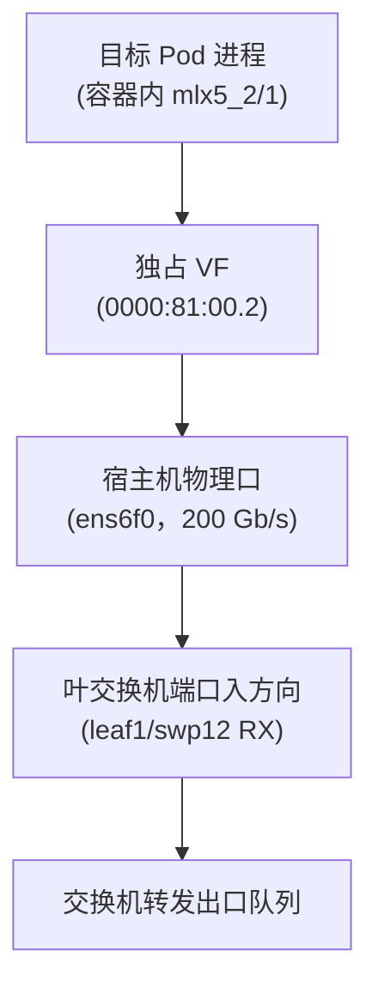
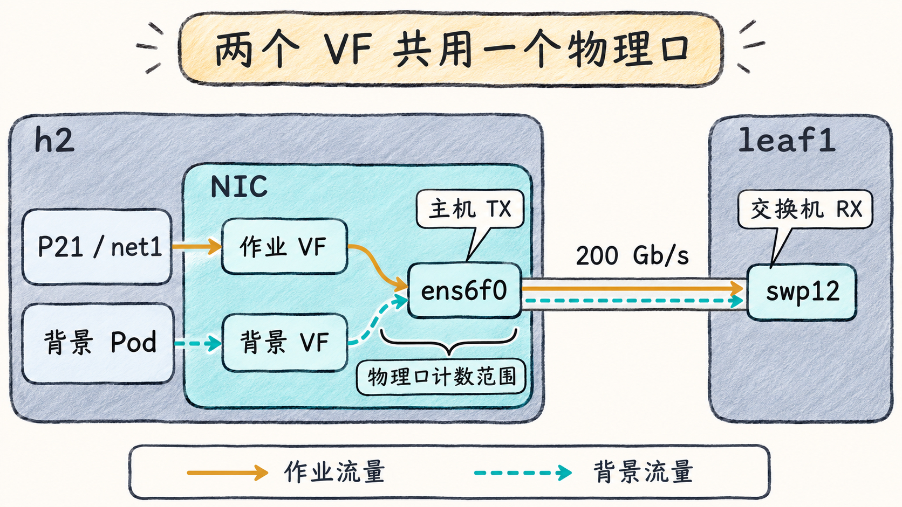

# 网卡、交换机与存储的时间窗证据

训练步时拉长了一半，或者 PD 分离推理的跨机 KV 迁移偶发超时，可切回上一篇的 GPU 面板一看：卡内既没触发功耗降频，也没有 Xid 与 ECC 异常。

当硬件本身“清白”时，真相多半藏在机箱之外的通道上——要么是跨节点通信在网卡或交换机队列里撞了车，要么是训练输入与推理权重在存储读取链路上断了粮。

本篇把前文“先锁身份、再看口径、最后对齐时间窗”的方法延伸到网卡、交换机与存储三层，结合真实计数片段演示如何复算吞吐、识别拥塞，并避开跨机时钟与统计范围陷阱。

## 从 Pod 附加网卡追到交换机端口

在 [第 13 章](../13_Multus与RDMA_把高速网络交给Pod/00_内容大纲.md) 我们已经把 Multus 附加网与 SR-IOV VF 交给了容器。以 `node-2` 上的训练 Pod `train-12-worker-1` 为例，默认网卡只负责控制协调，RoCEv2 通信则走附加网口 `net1`。

要确认某个进程发出的流量究竟走了哪根光纤、进了哪台交换机的哪个端口，不能靠猜，必须逐跳核对映射表：

| 观测层次 | `node-2` 上的路径映射记录 | 现场核对方式 |
| --- | --- | --- |
| **Pod 与进程内** | 附加网卡 `net1`，NCCL 日志选中容器内 `mlx5_2/1` | 核对 Pod 附加网络状态与通信库日志；设备名仅在容器视图内有效。 |
| **宿主机 PCIe 与网口** | VF BDF `0000:81:00.2` → 父 PF `0000:81:00.0` → 物理口 `ens6f0` | 由 Device Plugin ID 查 VF，沿 sysfs `physfn` 找到父 PF 及对应物理网口。 |
| **交换机链路拓扑** | `node-2` 接 `leaf1/swp12`（`node-1` 接 `leaf1/swp11`，`node-3` 接 `leaf2/swp13`） | 核对机房布线表或交换机 LLDP 邻居表；跨叶转发还需进一步查路由路径。 |

在宿主机和容器日志里，这三跳对应几条极短的取证命令与输出：

```bash
# 1. 容器内 NCCL 初始化日志：确认通信进程实际选中的 RDMA 设备与端口
# [node-2] NCCL INFO NET/IB : Using [0]mlx5_2:1/RoCE ...

# 2. 宿主机查 VF 归属的父 PF（确认该 VF 落在哪张物理网卡）
readlink -f /sys/bus/pci/devices/0000:81:00.2/physfn
# 输出：/sys/devices/pci0000:80/.../0000:81:00.0

# 3. 宿主机查看父 PF 对应的物理网口名与 RDMA 设备映射
rdma link show | grep ens6f0
# 输出：link mlx5_0/1 state ACTIVE physical_state LINK_UP netdev ens6f0
```

串起上述映射，一条从应用进程直达交换机转发队列的数据路径就完整浮现出来：



*图 17-04-01：节点发送方向的数据路径追踪（省略网卡内部 VF 到物理口交换细节）。若观察对端发回的流量，则交换机端口变为出方向（TX）、宿主机物理口变为接收方向（RX），方向随观察点反转。*

这条路径上有一个和第 02 篇完全同构的归因边界：**单个 VF 的统计范围小于物理网口**。当一台宿主机上同时跑着训练 Pod 和其他背景流量 Pod 时，两路流量会从不同 VF 汇入同一个物理网口 `ens6f0` 并共用同一根网线。



*图 17-04-02：双 VF 共用物理口的统计边界（图中 `h2` 对应本例 `node-2`，`P21` 对应 `train-12-worker-1`）。主机物理口 TX 与交换机相邻端口 RX 同时覆盖作业与背景两路流量；且两端统计的协议帧头层级可能不同，切忌默认字节数严格相等。*

因此，物理网口跑满只能证明链路很忙，要断定是不是目标作业打满的，必须补看各 VF 独立计数、RDMA 设备统计或连接级记录。

## 按方向复算流量，用 ECN/PFC/CRC 拆解拥塞

拿到物理口字节 Counter 后，第一步是按同一计数生命周期复算平均速率。假设 `node-2` 的 `ens6f0` 发送（TX）累计字节在 10 秒窗口内从 $105 \times 10^{9}\text{ B}$ 增至 $285 \times 10^{9}\text{ B}$（无复位或回绕），平均发送速率为：

$$
B_{\text{TX}} = \frac{(285 - 105) \times 10^{9}\text{ B} \times 8\text{ bit/B}}{10\text{ s}} = 144\text{ Gb/s}
$$

参照单向名义线速 $200\text{ Gb/s} \div 8 = 25\text{ GB/s}$，这一窗口的端口发送均值为线速的 `72%`。

> [!note] 协议口径差异：以太网字节计数 vs InfiniBand 4 字节计数
> 在原生 InfiniBand 环境下，Linux RDMA sysfs 稳定 ABI 提供的 `port_xmit_data` 定义为“**数据字节数除以 4**”。换算速率前必须先乘以 `4` 再乘 `8` 变比特；而标准以太网/RoCE 接口的 `tx_bytes` 直接以字节为单位，切不可把两套换算公式混用。

光看吞吐还看不出有没有撞车。排查拥塞时，必须把同时间窗的**队列深度、ECN 标记、PFC 暂停帧和 CRC 错误**放到一起对照（机制见 [第 07 章](../07_InfiniBand、RoCE与集群网络拓扑/00_内容大纲.md)）。

下面分别给出宿主机网卡、Cumulus Linux `5.11` 交换机与 Prometheus 的常用取证命令：

```bash
# 1. 宿主机网卡侧：检查 RoCE 优先级（例为 prio3）的暂停帧、物理 CRC 及 ECN/CNP 拥塞计数
ethtool -S ens6f0 | grep -E "tx_bytes_phy|rx_prio3_pause|tx_prio3_pause|rx_crc_errors_phy"
#     tx_bytes_phy: 285000000000
#     rx_prio3_pause: 1420         # 收到交换机发来的暂停帧：本端发送方向正在承受上游背压
#     tx_prio3_pause: 0
#     rx_crc_errors_phy: 0         # 物理层校验无错误

rdma statistic show link mlx5_0/1
# link mlx5_0/1 ... np_ecn_marked_roce_packets 8920 rp_cnp_handled 8895 ...
```

```bash
# 2. 交换机侧（Cumulus Linux 5.11 NVUE）：核查出口 swp13 的 RoCE 拥塞与 ECN/PFC 计数
nv show interface swp13 qos roce counters
# ECN Marked Packets : 12450       # 出口队列越过阈值，正在主动打 ECN 标记促发降速
# PFC RX Pause Frames: 0
# PFC TX Pause Frames: 680         # 向上游相邻端口发送暂停帧缓解缓存压力
# FCS / CRC Errors   : 0           # 物理链路完好，排除光模块/光纤误码
```

```promql
# 3. Prometheus 看板：将物理口字节 Counter 换算为 Gb/s，并监控 5 分钟内新增 ECN/PFC 增量
rate(node_network_transmit_bytes_total{instance="node-2",device="ens6f0"}[1m]) * 8 / 1e9
increase(node_network_receive_errs_total{instance="node-2",device="ens6f0"}[5m])
```

把三类核心网络计数放在一起，能立刻划出清晰的排查边界：

- **出口队列积压 + ECN 标记增长**：确认该转发出口正在经历网络拥塞，交换机已触发端到端降速通知。
- **PFC 暂停帧增长**：邻接链路已触发逐跳流控。主机侧收到暂停帧代表对端要求本端暂停发送对应优先级，须沿数据流向下游逐跳追查真正的堵点。
- **CRC 错误或链路重训增长**：直接指向光模块、光纤脏污或物理端口硬件故障，应结合相邻端口收发方向对照定位。

> [!warning] 常见误区：10 秒均值离满速还远 ≠ 没有发生拥塞
> 刚才算出的 `144 Gb/s` 看似还留有 `56 Gb/s` 余量，但 10 秒均值会抹平微秒级的 **Incast 微突发**——多台发送节点若在几毫秒内同时把梯度或 KV Cache 砸向同一出口，队列瞬间就能打穿 ECN 甚至 PFC 阈值。定位瞬时拥塞时，必须配合交换机队列峰值、微突发直方图与按优先级的细粒度计数。

## 把存储读写放回输入供给链

当网络链路干净无拥塞，但训练卡大量空转（或推理新副本冷启动慢半拍）时，证据就要沿 [第 09 章](../09_GPU的数据从哪里来_存储与IO/00_内容大纲.md) 建立的 I/O 链路去查。无论是训练样本读取与 Checkpoint 落盘，还是在线推理拉取百 GB 权重与卸载冷 KV，都必须同时采集三层同窗证据：

| 观测位置 | 同窗核心采集项 | 如何与上下游互证 |
| --- | --- | --- |
| **本地块设备 / 存储客户端** | 读写字节、IOPS、队列深度、请求耗时；共享挂载按操作类型（READ / WRITE / GETATTR）拆分的往返与执行延迟 | 确认目标文件路径确实落在该挂载点或本地盘，区分样本读、元数据查询与 Checkpoint 突发写。 |
| **存储服务端** | 对应卷或客户端的吞吐、队列深度、后端盘延迟与元数据服务负载 | 客户端延迟飙升且服务端同卷队列同步暴涨，即可把焦点收束到共享存储或存储网络。 |
| **应用进程与宿主机 CPU** | 文件读取耗时、CPU 解码/预处理耗时、预取队列水位、H2D 输入就绪时点 | 文件读得很快但预取队列仍空，瓶颈在 CPU 解码线程；读取耗时与等待同步拉长，则继续追查客户端与服务端。 |

在共享存储（如 NFS）与本地 NVMe 上读延迟指标时，有两个非常具体的字段陷阱：

```bash
# 1. 共享存储客户端：使用 nfsiostat 区分网络往返/服务端耗时（RTT）与完整执行耗时（exe）
nfsiostat 5 /mnt/train-data
# read:   ops/s    kB/s    avg RTT (ms)    avg exe (ms)
#        1420.0   90880.0         82.4            90.2
# 解读：RTT 占了绝大部分，说明耗时主要花在存储网络或服务端处理，而非本机内核排队

# 2. 本地 NVMe 块设备：iostat 观察并发队列（aqu-sz）与平均等待（r_await）
iostat -xz 5 /dev/nvme0n1
```

需要注意：Linux 内核块设备统计（`/proc/diskstats`）中的累计读耗时，会把同一时刻并发在途的多个 I/O 请求耗时叠加记账，因此它的总和完全可能超过实际经过的墙钟秒数，不可直接当作“磁盘阻塞了多少秒的墙钟时间”。

## 跨节点对齐时间窗的三道标尺

把 GPU、网卡、交换机和存储四张表拼到同一条时间线上之前，还有最后一道决定结论能否成立的硬门槛——**时钟口径与分辨率**。

1. **跨机事件受限于时钟误差上界**：跨节点对比时间戳前必须统一时区并核查 NTP/PTP 同步精度。如果两台节点的时钟偏差上界是 `2 ms`，那么相差不到 `2 ms` 的两条跨机日志就无法用来裁定绝对先后。
2. **同机分段耗时使用单调时钟**：记录同一节点内“读盘完成 → 解码结束 → 提交 GPU”的耗时，务必采用不受校时跳变影响的**单调时钟（Monotonic Clock）**，避免 NTP 校时回拨算出负数。
3. **秒级监控不能替代毫秒级事件**：Prometheus 15 秒抓取的端口速率与毫秒级训练步、推理首字延迟不在同一时间尺度上。怀疑微突发拥塞或短时抖动时，必须用带尝试号、全局步与集合序号的应用事件日志，或交换机高频遥测交叉复核。

> [!summary] 核心结论
> 网络与存储取证遵循四步闭环：**路径映射 → 计数范围 → 方向单位 → 时钟对齐**。先沿 VF/PF 追到物理口与交换机端口，警惕多 VF 共享物理口的统计边界。随后用 ECN/PFC/CRC 拆开拥塞与物理误码，并用客户端、服务端与应用三方互证锁定 I/O 堵点。

现在我们已经能看清设备、网络与存储的实时证据，但还缺最后一把尺子：“当前算出来的 `144 Gb/s` 或 `90 ms` 到底算健康还是异常？”下一篇，我们就逐层建立从物理链路、RDMA、集合通信到在线推理与 KV 迁移的**分层性能基线**。

> [!info]- 参考资料
> - **SR-IOV RDMA 网络与 NCCL 选卡日志**：[NVIDIA Network Operator v26.7.1 · SR-IOV RDMA 快速开始](https://docs.nvidia.com/networking/display/kubernetes2671/quick-start/sriov-network-rdma.html)、[NCCL 2.27.3 · 网卡选择与日志环境变量](https://docs.nvidia.com/deeplearning/nccl/archives/nccl_2273/user-guide/docs/env.html)
> - **Linux 内核网络、PCI sysfs、RDMA ABI 与块存储统计**：[Linux 6.18 · 网络接口统计口径](https://docs.kernel.org/6.18/networking/statistics.html)、[Linux 6.18 · PCI sysfs VF/PF 关系](https://www.kernel.org/doc/html/v6.18/admin-guide/abi-testing.html)、[Linux 6.18 · RDMA sysfs 稳定 ABI（`port_xmit_data` 单位定义）](https://www.kernel.org/doc/html/v6.18/admin-guide/abi-stable.html)、[Linux 6.18 · 块设备 I/O 统计](https://www.kernel.org/doc/html/v6.18/admin-guide/iostats.html)、[nfs-utils · `nfsiostat` 字段说明](https://man7.org/linux/man-pages/man8/nfsiostat.8.html)
> - **交换机 RoCE 队列与拥塞计数**：[NVIDIA Cumulus Linux 5.11 文档中心（RoCE / NVUE 遥测）](https://docs.nvidia.com/networking-ethernet-software/cumulus-linux/511/)
