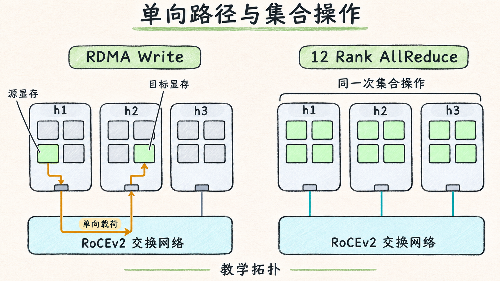

# 链路、RDMA 与集合通信的性能基线

监控面板上跳出两个数字：跨机 RDMA 吞吐 `165 Gb/s`，12 卡集合通信带宽 `20.5 GB/s`。它们到底算满血健康，还是已经悄悄退化了一半？

脱离参照物孤立看数字，永远得不出答案。`200 Gb/s` 只是物理层名义上限。两点间用 RDMA 搬运显存有自己的有效载荷边界，12 卡协同归约有算法折算系数。切到在线推理后，标尺还要进一步转向微秒级小消息延迟与并发拐点曲线。

一次健康运行留下的**基线（Baseline）**，本质上是一组**固定前提、可重复验证**的受控观测。本篇沿“物理链路 → 单机卡间 → 跨机 RDMA → 集合通信”逐层建立训练基线，并同步补齐**在线推理 SLO 曲线与 PD 分离 KV 迁移基线**。

## 先锁定测试条件，再谈基线对比

为 `node-1`、`node-2`、`node-3` 建立集群基线时，所有基准测试都必须在空载预约窗口内错峰执行，避免彼此抢带宽。更重要的是，必须把以下四类条件和原始输出一起存档，否则日后复测时根本分不清变化来自硬件还是参数漂移：

| 基线必须冻结的条件 | 若漏记会混入的隐性误差 |
| --- | --- |
| **拓扑与物理位置**：节点名、GPU UUID/BDF、GPU 与 NIC 的 NUMA 亲和、网口、VF、路由与链路速率 | 跨 NUMA 绕行、跨叶交换跳数增加或物理链路降速。 |
| **软件栈与参数**：内核、驱动、CUDA、网卡固件、NCCL、测试工具版本、容器镜像及环境变量 | 传输后端切换（如 GDR 回退主机内存）、集合算法变化或计数口径变更。 |
| **负载与计时口径**：操作类型、消息大小、方向、缓冲区模式、并发数、预热轮次、聚合方式与校验 | 启动固定开销、双向并发竞争或未校验的脏结果混入成绩。 |
| **运行环境状态**：同机其他作业、交换机背景流量、功耗上限、SM 时钟及错误计数起止值 | 邻居干扰、硬件触发降频或隐性链路错包拉低成绩。 |

建立正常范围时，每组参数需在预热后多次重复采样，同时记录**代表值与波动区间**。并且务必把**小消息**与**大消息**拆开留档：前者暴露软件启动与同步延迟，后者暴露链路有效带宽与共享瓶颈。

## 从协商链路到单机卡间与跨机 RDMA

### 第一层：协商链路状态

开工前先核对物理层上界：确认 PCIe 实际协商代际与宽度达标、单机 NVSwitch 域就绪、RoCEv2 物理口协商为 `200 Gb/s`，且测试窗内无新增 CRC 或链路重训错误。

将端口线速换算成单向理论字节上限为 $200\text{ Gb/s} \div 8 = 25\text{ GB/s}$。这个值尚未扣除帧头与协议开销，只作为后续各层不可逾越的物理天花板。

### 第二层：单机卡间点对点（`nvbandwidth`）

接下来在 `node-2` 上用 `nvbandwidth v0.11.0` 测量两张目标 H100 经 NVSwitch 的单机拷贝引擎（CE）写入带宽，固定缓冲区为 `256 MiB`：

```bash
# 单机点对点写带宽测试（行表示目标 GPU，列表示源 GPU；须同步留存设备索引与 UUID 映射表）
nvbandwidth -t device_to_device_memcpy_write_ce -b 256
# 节录目标卡对所在矩阵格：240.0 GB/s
```

需要注意，`nvbandwidth` 的单卡对成绩只代表当前这两个端点使用拷贝引擎的表现；如果要验证 8 卡全并发压满 NVSwitch 或 SM 拷贝，必须使用对应多流测试用例并单独留存基线。

### 第三层：跨节点双端点 RDMA（`ib_write_bw`）

跨出单机后，使用 `perftest 26.07.8` 的 `ib_write_bw` 测量 `node-1 → node-2` 的 RoCEv2 单向写入带宽。

两轮对比严格固定同一 RDMA 设备、端口、GID、MTU 与可靠连接（RC）。每轮使用单 QP、发送深度 `128`、单请求 `64 KiB`、共 `8,192` 次迭代，单向总应用载荷为 $512\text{ MiB}$：

```bash
# 轮次 1：两端主机内存 -> 主机内存（接收端 node-2 先启服务端，发送端 node-1 发起单向写）
ib_write_bw -d mlx5_2 -i 1 -x 3 -s 65536 -n 8192 --tx-depth=128 --report_gbits <node-2-ip>

# 轮次 2：两端 GPU 显存 -> GPU 显存（开启 GPUDirect RDMA 与 DMA-BUF 显存注册）
ib_write_bw -d mlx5_2 -i 1 -x 3 -s 65536 -n 8192 --tx-depth=128 --use_cuda=1 --use_cuda_dmabuf --report_gbits <node-2-ip>
```

两轮实测的代表耗时与有效载荷速率对照如下：

| 缓冲区类型 | 单向总应用载荷 | 代表完成耗时 | 单向有效载荷速率 |
| --- | ---: | ---: | ---: |
| 主机内存 → 主机内存 | `64 KiB × 8,192 = 512 MiB` | `24.0 ms` | `178.96 Gb/s` |
| GPU 显存 → GPU 显存（GDR） | `64 KiB × 8,192 = 512 MiB` | `26.0 ms` | `165.19 Gb/s` |

按二进制字节换算十进制比特速率，两轮结果的复算过程一目了然：

$$
B_{\text{host}} = \frac{512 \times 2^{20}\text{ B} \times 8}{0.024\text{ s} \times 10^{9}} \approx 178.96\text{ Gb/s}, \qquad
B_{\text{GDR}} = \frac{512 \times 2^{20}\text{ B} \times 8}{0.026\text{ s} \times 10^{9}} \approx 165.19\text{ Gb/s}
$$

两轮的微小差异反映了源端读显存与目的端写显存在 PCIe 路径上的真实代价。如果要验证反方向（`node-2 → node-1`）或三节点全链路健康，必须交换发起端并补测涉及 `node-3` 的端点与多流并发。

## 从单机集合扩大到十二卡集合

双端点通畅之后，再向上叠加软件通信库，用 `NCCL 2.27.3` 与 `nccl-tests v2.17.9` 的 `all_reduce_perf` 测量多卡协同性能。

两轮测试均固定每卡 1 进程、FP32 求和、每 Rank `64 MiB`、独立收发缓冲（out-of-place）与结果校验（`#wrong=0`），先测 `node-2` 单机 4 卡，再扩到三节点 12 卡：

```bash
# 三节点 12 卡 AllReduce 基准（每节点 4 进程，启用结果校验 -c 1，测试 64 MiB 固定载荷）
mpirun -np 12 -N 4 --host node-1,node-2,node-3 \
  all_reduce_perf -b 64M -e 64M -f 2 -g 1 -o sum -d float -c 1
```

| 参与范围 | Rank 数 $n$ | 每 Rank 大小 $S$ | 单次代表耗时 $t$ | `algbw`（GB/s） | `busbw`（GB/s） |
| --- | ---: | ---: | ---: | ---: | ---: |
| `node-2` 单机 4 卡 | `4` | `64 MiB` | `1.00 ms` | `67.11` | `100.66` |
| `node-1/2/3` 跨机 12 卡 | `12` | `64 MiB` | `6.00 ms` | `11.18` | `20.51` |

沿用 [第 08 章](../08_NCCL如何组织GPU间的通信/00_内容大纲.md) 的 `nccl-tests` 性能公式，以 12 卡跨节点轮次为例复算两个核心指标：

$$
\text{algbw} = \frac{S}{t} = \frac{64 \times 2^{20}\text{ B}}{0.006\text{ s} \times 10^{9}} \approx 11.18\text{ GB/s}
$$

$$
\text{busbw} = \text{algbw} \times \frac{2(n - 1)}{n} \approx 11.1848 \times \frac{22}{12} \approx 20.51\text{ GB/s}
$$

这里必须把“双端点 RDMA”和“多卡集合通信”的覆盖范围彻底看清：前者只测了两个显存端点间的单向搬运，后者则同时检验了 12 张卡的机内 NVSwitch、三台网卡的并发收发、交换机转发和同步步调。



*图 17-05-01：跨节点单向 RDMA Write 与 12 卡 AllReduce 的观测范围对照（图中 `h1/h2/h3` 对应 `node-1/node-2/node-3`）。每节点仅画出分配给训练的 4 张卡，省略机内互联与具体通道拓扑。*

> [!warning] 常见误区：别拿 `busbw ÷ 25 GB/s` 当物理口利用率
> 看到 12 卡 `busbw = 20.51 GB/s`，切忌顺手除以 `25 GB/s` 线速得出“网口跑了 82%”。`busbw` 是按等分 Ring 模型折算的**单卡等效总线带宽**，覆盖了机内 NVSwitch 与跨机网络的多段路径。真实物理口利用率必须直接查第 04 篇的网口计数。

## 在线推理性能基线与 PD 分离 KV 迁移基线

如果是为在线推理服务 `infer-svc-1` 建立验收与排障基线，直接套用上面那套 `64 MiB` 大流训练基准会严重失焦。推理基线必须额外抓住三个独特维度：

### 1. 小消息微秒级 TP 集合延迟基线

大模型张量并行（如单机 4 卡 TP）在每一层 Decode 都要做一次 AllReduce，同步的往往只是几十 KiB 到几 MiB 的隐藏状态张量。对它而言，大包带宽高低反在其次，**`64 KiB–4 MiB` 区间的微秒级完成延迟**才是守住 TPOT 的命脉，必须在空载窗口按小消息档位单独建基线。

### 2. 并发–延迟–吞吐帕累托基线

在线推理不存在“唯一吞吐值”，而是随并发度变化的权衡曲线。建基线时必须冻结**模型版本、量化精度、输入/输出长度分布（如 `ISL=2048 / OSL=512`）、Prefix Cache 命中率与并发等级**，测出从“最低延迟地板”到“SLO 甜点区”再到“过载拐点”的完整画像：

```bash
# 在线推理压测基线采集示例（严格固定输入/输出长度分布与并发阶梯，记录 TTFT/ITL 分位数）
vllm bench serve \
  --model /models/llama-70b-bf16 \
  --dataset-name random --random-input-len 2048 --random-output-len 512 \
  --max-concurrency 32 --num-prompts 320
```

下面是一组单副本 4 卡 H100（TP=4、BF16、`ISL=2048 / OSL=512`、无前缀复用）在不同并发阶梯下的健康基线表：

| 并发等级 | P99 TTFT | P99 TPOT（ITL） | 有效输出吞吐 | `KV Cache` 水位 | 底层 `Tensor / DRAM Active` | 运行区间定性 |
| --- | ---: | ---: | ---: | ---: | --- | --- |
| 并发 `1` | `180 ms` | `14 ms` | `72 tokens/s` | `4%` | `0.08 / 0.42` | **延迟地板**：算力与带宽远未饱和 |
| 并发 `32` | `380 ms` | `28 ms` | `1,850 tokens/s` | `62%` | `0.26 / 0.78` | **SLO 甜点区**：HBM 带宽充分吃满、无抢占 |
| 并发 `64` | `2,450 ms` | `58 ms` | `1,520 tokens/s` | `97%` | `0.41 / 0.88` | **拐点过载区**：排队暴涨且触发 KV 抢占，吞吐反降 |

### 3. PD 分离下的跨节点 KV Cache 迁移基线

在 [第 05 章](../05_为什么一个作业需要多张GPU/00_内容大纲.md) 与 [第 06 章](../06_从普通网络通信走向RDMA/00_内容大纲.md) 的 **PD 分离**架构下，Prefill 节点算完提示词后，须通过 GPUDirect RDMA 把 KV Cache 实时推向 Decode 节点显存。这段传输耗时直接叠加在用户感知的 TTFT 中。

前文测出的单流 GDR 基线（$165.19\text{ Gb/s} \approx 20.65\text{ GB/s}$）正是现成的标尺。假设某条长上下文请求产生 $256\text{ MiB}$ KV Cache，安静网络下的纯传输耗时下界为：

$$
t_{\text{KV-xfer}} = \frac{256 \times 2^{20}\text{ B}}{20.65 \times 10^{9}\text{ B/s}} \approx 13.0\text{ ms}
$$

如果生产中同等体积的 KV 迁移耗时飙破 `120 ms`，对照 `13.0 ms` 底线即可锁定三类排查方向：

- GDR 是否意外回退成了主机内存中转；
- 多台 Prefill 并发推向同一 Decode 网卡，是否引发了 Incast 队列拥塞；
- 参与传输的 GPU 与网卡是否跨了 NUMA 节点。

## 条件变了，基线就必须重新配对

拿现网数据对照历史基线时，最忌讳“跨条件硬比”。假设 12 卡 AllReduce 复测时间从 `6.00 ms` 降到了 `4.00 ms`，表面看快了三分之一。但如果消息大小同时从 `64 MiB` 缩成了 `32 MiB`，复算算法带宽其实是：

$$
\text{algbw}_{32\text{MiB}} = \frac{32 \times 2^{20}\text{ B}}{0.004\text{ s} \times 10^{9}} \approx 8.39\text{ GB/s}
$$

工作量减半后带宽反而更低，根本不能拿来和 `64 MiB` 基线直接画等号。

反过来，如果 `64 MiB` 同条件基线的三轮实测波动区间是 `5.90 ms`、`6.00 ms`、`6.20 ms`，那么某次复测拿到 `6.15 ms` 恰好落在正常波动带内，无需草木皆兵。

> [!tip] 工程直觉：空载复测回答“路修得好不好”，生产排查还要看“车怎么开”
> 空载窗口的 `all_reduce_perf` 或 `ib_write_bw` 正常，证明的是所测端点与物理网络在安静状态下完好；但线上真实业务还叠加了计算与通信重叠、磁盘读入、其他作业共享链路以及动态请求长度分布。把基线与真实业务窗口拼在一起看，正是下一篇的核心任务。

> [!summary] 核心结论
> 分层基线把“系统快不快”拆成可逐层排除的阶梯：协商线速定天花板，`nvbandwidth` 验单机互联，`ib_write_bw` 验跨机 GDR（同时给出 PD 分离 KV 迁移底线），`nccl-tests` 验多卡集合。在线推理还须补齐并发压测曲线，所有对比都必须严格核对测试条件。

有了硬件指标、身份映射、网络存储证据和分层基线四把利器，下一篇我们就回到用户最关心的终极视角：排队有多久、算力真正在产出有效进度吗、以及训练慢窗与推理延迟雪崩究竟该怎么定案？

> [!info]- 参考资料
> - **链路状态与单机互联测试**：[NVIDIA SMI · PCIe 与 NVLink 查询](https://docs.nvidia.com/deploy/nvidia-smi/index.html)、[DCGM · 拓扑与 NVLink](https://docs.nvidia.com/datacenter/dcgm/latest/learn/core-services/topology-and-links.html)、[nvbandwidth v0.11.0 · 用法与矩阵方向](https://raw.githubusercontent.com/NVIDIA/nvbandwidth/v0.11.0/README.md)
> - **跨机 RDMA 与 GPUDirect RDMA 基准**：[perftest 26.07.8 · 参数、CUDA 与 DMA-BUF](https://github.com/linux-rdma/perftest/blob/a31f9ea9df720ee68f941e55f75fec31349fcd35/README)、[perftest 26.07.8 · 带宽计算实现](https://github.com/linux-rdma/perftest/blob/a31f9ea9df720ee68f941e55f75fec31349fcd35/src/perftest_parameters.c)、[CUDA 13.2.1 · GPUDirect RDMA 平台约束](https://docs.nvidia.com/cuda/archive/13.2.1/gpudirect-rdma/index.html)
> - **集合通信性能公式与推理指标**：[NCCL 2.27.3 · 集合操作语义](https://docs.nvidia.com/deeplearning/nccl/archives/nccl_2273/user-guide/docs/usage/collectives.html)、[nccl-tests v2.17.9 · AllReduce 测试实现](https://raw.githubusercontent.com/NVIDIA/nccl-tests/v2.17.9/src/all_reduce.cu)、[nccl-tests v2.17.9 · `algbw` 与 `busbw` 公式说明](https://github.com/NVIDIA/nccl-tests/blob/v2.17.9/doc/PERFORMANCE.md#allreduce)、[vLLM · Production Metrics](https://docs.vllm.ai/en/latest/serving/metrics.html)
