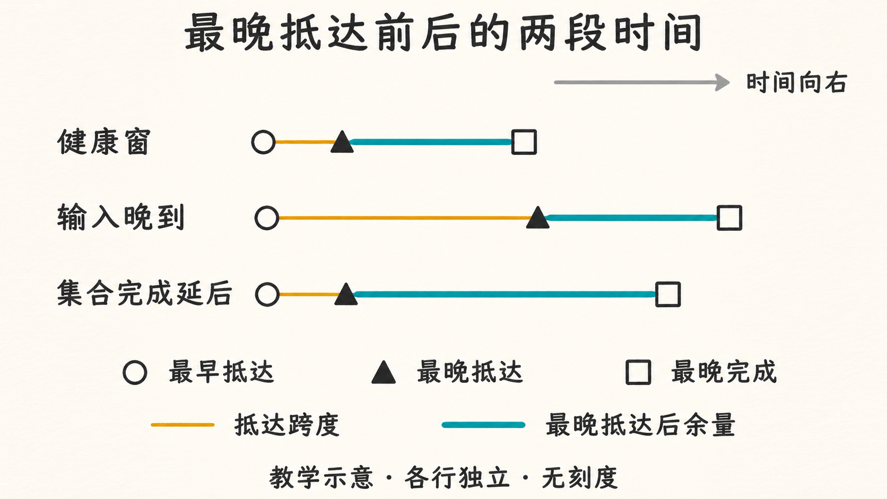

# 集群观测与性能基线的综合检验

下面四组实战检验题覆盖全章核心能力，只需纸笔和计算器即可独立完成。所有题干沿用本章三节点 24 卡训推共存集群，先确认通用设备映射表，再依次推演并核对文末的分步参考推理：

| 实体角色 | 节点与硬件映射 | 负载说明 |
| --- | --- | --- |
| **三节点训练集群** | `node-1`、`node-2`、`node-3`（每台 8 卡 H100，共 24 卡可分配） | `train-12` 占 3 个 worker Pod、共 12 张整卡 |
| **目标观察卡** | `node-2` 上的物理卡 `GPU-a1b2c3d4-...`（简称目标卡） | 重试前后被复用名 Pod 持续分配 |
| **RoCEv2 高速网口** | `node-2` 的 `ens6f0` → `leaf1/swp12`；`node-3` 物理口 → `leaf2/swp13` | 单向名义线速均为 `200 Gb/s` |
| **在线推理副本** | `infer-svc-1`（单副本 4 卡 H100 TP=4，预分配 `90%` 显存池） | 暴露标准 vLLM Prometheus 指标 |

---

## 材料一：重试前后的身份重建与驱动重载 Counter 处理

训练作业 `train-12` 因异常触发重试，新旧两次尝试归属同一 VolcanoJob，但 `node-2` 上重建的 Pod 复用了相同名称 `train-12-worker-1`，且训练成员重新编号。`11:03` 前后 `node-2` 执行过一次驱动重载，期间存在采样空白：

| 时刻 | `node-2` Prometheus 采集情况 | 同时段的容器分配与应用启动记录 |
| --- | --- | --- |
| `11:00` | `up=1`，目标卡 `GPU_UTIL = 68%`，`PCIE_REPLAY_COUNTER = 46` | 旧 Pod `train-12-worker-1`（UID `p21`），`trainer` 获配含目标卡；第 1 次尝试 Rank 5 选中该卡 |
| `11:02` | `up=1`，未收到目标卡的 `GPU_UTIL` 样本 | 旧 Pod 已终止，尚无新容器分配记录 |
| `11:03` | `up=0` | 无可供关联的采样数据 |
| `11:05` | `up=1`，同一物理 UUID `GPU_UTIL = 52%`，`PCIE_REPLAY_COUNTER = 2` | 新 Pod `train-12-worker-1`（UID `p22`），`trainer` 获配仍含目标卡；第 2 次尝试 Rank 9 选中该卡 |

1. 简述硬件字段到达 Prometheus 时间序列的采集路径，并指出 `nvidia-smi` 所处支路；为 `11:00` 与 `11:05` 两笔活动率补齐完整归属（作业尝试、Pod UID、容器与 Rank）；分别说明 `11:02` 与 `11:03` 缺失了哪一层证据及排查起点。
2. 若监控面板直接拿 `2 - 46` 计算 PCIe 重传增量，该结果能否成立？为什么？若另一片 MIG 推理池在两次采集间重配置了实例，父卡 UUID 与 GI 编号均保持不变，应补查什么映射才能避免串账？若同一 GI 内划出两个 CI 分给不同 Pod，GI 级显存样本最细能归因到哪一层？

---

## 材料二：运行路径与空载基线对照

`11:06–11:07`（60 秒窗口），第 2 次尝试的跨机通信经 `node-2` 的 `200 Gb/s` RoCE 物理口 `ens6f0` 发出，并包含发往 `node-3` 的流量。

该窗内 `ens6f0` 的 TX 字节 Counter 从 $760 \times 10^{9}\text{ B}$ 增至 $2,050 \times 10^{9}\text{ B}$（无复位或回绕，含该物理口其他背景流量）。

同期交换机观测显示：连接 `node-3` 的 `leaf2/swp13` 在 RoCE 优先级上出口队列明显增长、ECN 标记持续增加、CRC 错误计数无新增；同时 `node-2` 的 NFS 读取延迟与健康窗持平。下表列出同序号集合操作的代表步计时（跨机时钟误差不超过 `2 ms`）：

| 同序号集合计时（相对步起点） | 健康窗代表步 | 第 2 次尝试慢窗代表步 |
| --- | ---: | ---: |
| 最早抵达时刻 | `780 ms` | `780 ms` |
| 最晚抵达时刻 | `800 ms` | `805 ms` |
| 最晚完成时刻 | `940 ms` | `1,160 ms` |

随后在独立预约的空载窗口测得如下 12 卡 AllReduce 记录（全部 `#wrong=0`，除表列字段外其余软硬件、端点与预热条件完全一致）：

| 测试组 | Rank 数 $n$ | 每 Rank 大小 $S$ | 缓冲区模式 | 单次代表耗时 $t$ |
| --- | ---: | ---: | --- | ---: |
| 健康基线 | `12` | `64 MiB` | `out-of-place` | `6.00 ms` |
| 对照 A | `12` | `32 MiB` | `out-of-place` | `4.00 ms` |
| 对照 B | `12` | `64 MiB` | `out-of-place` | `8.00 ms` |
| 对照 C | `12` | `64 MiB` | `in-place` | `7.50 ms` |

3. 复算 `11:06–11:07` 期间 `node-2` 物理口的平均发送速率，并指出它与相邻端口 `leaf1/swp12` 的哪个方向对应；解释 `leaf2/swp13` 出口队列增长、ECN 增量与 CRC 零增量分别指向什么，还需补齐哪类证据才能坐实它与本次慢步的因果关系？
4. 计算两窗的抵达跨度与最晚抵达后余量，说明本次慢步与第 06 篇训练慢窗的本质区别；从 A、B、C 中选出唯一能与健康基线同条件直接比较的记录，复算它的 `algbw`、`busbw` 及 `algbw` 降幅，并说明空载复测覆盖了哪些条件、尚未覆盖哪些现场变量。

---

## 材料三：队列账本、失败率与有效进展核算

- 同资源池另一多卡作业在 `11:00:00` 提交，`11:02:00` 进入 `Inqueue`，`11:05:00` 完成全部 Pod 成组绑定，`11:06:30` 上报首个全局完成步。
- 当日该池终结的作业中：`21` 个成功、`3` 个最终失败、`6` 个被用户取消，另有 `3` 个仍在运行。报表约定取消与未终结作业单列汇报。
- `11:06–11:07`（60 秒）内三节点 `24` 张卡全部可分配。`train-12` 的 `12` 张卡全窗已分配，另一作业占用了其余 `6` 张卡共 `30 s`。进度方面：第 1 次尝试最晚跑到第 `1,030` 步，最后可恢复检查点落盘在第 `1,000` 步；第 2 次尝试在该 60 秒窗内从第 `1,000` 步恢复，最终推进到第 `1,045` 步。

5. 按“提交至成组绑定”口径计算该作业的排队耗时（保留入队前后两段）与端到端首步延迟；计算当日作业失败率与 `11:06–11:07` 期间的资源池 GPU 分配占比。
6. 计算第 2 次尝试的重做步数、该窗步处理速率，以及首次超越第 1 次尝试旧进度的净新增步速率；并指出还需哪项应用证据才能确认这些净新增步具备可恢复性。

---

## 材料四：在线推理监控假象与 PD 分离 KV 迁移诊断

在线推理服务 `infer-svc-1`（单副本 4 卡 H100 TP=4，启动时按默认参数预分配 `90%` 显存池即 `72 GiB/卡`）在三个不同 5 分钟窗口内录得如下观测数据：

| 跨层指标（单副本） | 健康基线窗 | 观察窗甲 | 观察窗乙 |
| --- | ---: | ---: | ---: |
| `DCGM_FI_DEV_FB_USED`（单卡） | `72 GiB (90%)` | `72 GiB (90%)` | `72 GiB (90%)` |
| `DCGM_FI_DEV_GPU_UTIL` | `91%` | `95%` | `96%` |
| `DCGM_FI_PROF_PIPE_TENSOR_ACTIVE` | `0.25` | `0.14` | `0.46` |
| `DCGM_FI_PROF_DRAM_ACTIVE` | `0.78` | `0.86` | `0.84` |
| `vllm:kv_cache_usage_perc` | `60%` | `42%` | `99%` |
| `vllm:num_requests_waiting` | `1` | `0` | `24` |
| 抢占速率（`num_preemptions_total`） | `0 次/min` | `0 次/min` | `35 次/min` |
| P99 TTFT / P99 ITL（TPOT） | `380 ms / 28 ms` | `240 ms / 22 ms` | `3,800 ms / 72 ms` |
| 有效输出吞吐（tokens/s） | `1,850` | `680` | `910` |

此外，在同集群的 PD 分离部署模式下，某条超长上下文请求在 Prefill 节点生成了 `512 MiB` 的 KV Cache。

该 KV 块需沿第 05 篇建立的单流 `200 Gb/s` RoCEv2 GPUDirect RDMA 健康基线（`165.19 Gb/s`）迁往 Decode 节点。线上监控录得本次实际迁移耗时高达 `180 ms`。

7. 值班同学看到观察窗甲与观察窗乙的显存均占满 `90%`、且 `GPU_UTIL ≥ 95%`，断言“两个窗口都已算力吃满且即将显存泄漏 OOM”。请逐一反驳这一误判，并结合表格数据准确定性观察窗甲与观察窗乙的真实状态。
8. 复算在单流健康 GDR 基线下，传输 `512 MiB` KV Cache 的纯网络传输耗时下界；对照实测的 `180 ms`，指出至少两个最可能拖慢迁移的根因及下一步取证方向。

---

## 分步参考推理

### 题 1：采集链路、重试归属与缺测判读

- **采集链路**：`nvidia-smi` 走的是 NVML 管理支路，提供实时单次快照；持续时序链路为“GPU 与驱动 → DCGM host engine（监视并缓存字段）→ DCGM Exporter（暴露 `/metrics`）→ Prometheus（定期抓取并写入时序库）”。
- **两笔活动率归属**：同一物理卡的 `11:00` 样本属于**第 1 次尝试、Pod `train-12-worker-1`（UID `p21`）、`trainer` 容器、Rank 5**；`11:05` 样本虽 Pod 同名且物理卡相同，但结合新 UID 与进程日志应归属为**第 2 次尝试、Pod `train-12-worker-1`（UID `p22`）、`trainer` 容器、Rank 9**。
- **两处缺测差异**：`11:02` 时 `up=1`，说明 Prometheus 抓取到了 HTTP 响应，但缺失该卡活动率字段——应先查本次响应的设备与标签变化，再查 DCGM 与驱动状态；`11:03` 时 `up=0`，说明本次抓取直接失败——先查网络可达性与 Exporter Pod 状态。两处空白都**必须保留缺测，严禁填零**。

### 题 2：驱动重载 Counter 复位与 MIG 归因边界

- **Counter 跨重载不可直减**：`11:03` 发生过驱动重载，`46` 与 `2` 分属两个独立的计数生命周期，直接算 `2 - 46 = -44` 毫无意义；要恢复完整重传次数，必须在重载前后的各自生命周期内补齐采样，丢失的空白期无法凭两端反推。
- **MIG 重配置与多 CI 归因**：GI 数字编号会在重配置后复用，不能仅凭父卡 UUID + GI 编号串联历史，必须按**采样时段反查当时的 MIG 实例 UUID 与容器分配清单**。当同一 GI 内存在两个 CI 时，落在 GI 层的已用显存只能归因到**整个 GI**，无法按 Pod 分配直接拆给单个 CI。

### 题 3：端口速率复算与交换机拥塞判读

- **端口平均发送速率**：`60 s` 内字节增量为 $(2,050 - 760) \times 10^{9} = 1,290 \times 10^{9}\text{ B}$，平均发送速率为：

$$
B_{\text{TX}} = \frac{1,290 \times 10^{9}\text{ B} \times 8\text{ bit/B}}{60\text{ s} \times 10^{9}} = 172\text{ Gb/s}
$$

- **方向对应与计数范围**：`node-2` 主机侧的 `ens6f0` 发送（TX）方向，对应相邻交换机 `leaf1/swp12` 的**接收（RX / 入方向）**；该物理口统计同时覆盖该口上的背景流量，不能直接全部划给训练作业。
- **交换机三项信号含义**：`leaf2/swp13` 出口队列增长叠加 ECN 标记增多，证明该 RoCE 优先级的转发出口正在经历拥塞；CRC 零增量说明已监测到的物理链路暂未出现误码。要坐实它与本次慢步的因果关系，还需补齐**本轮集合流量的真实转发路径**与**更细时间粒度的队列/流记录**，核对该出口排队峰值是否精准重合集合的发送与等待时段。

### 题 4：慢步方向判定与同条件基线复算

- **慢步区间拆解**：对比健康窗与慢窗，两段耗时变化如下：

$$
\text{抵达跨度}：\; 800 - 780 = 20\text{ ms} \longrightarrow 805 - 780 = 25\text{ ms} \quad (\text{基本不变})
$$

$$
\text{最晚抵达后余量}：\; 940 - 800 = 140\text{ ms} \longrightarrow 1,160 - 805 = 355\text{ ms} \quad (\text{增加 } 215\text{ ms})
$$

  这与第 06 篇恰好相反：第 06 篇的增量落在**抵达跨度**（输入晚到 `500 ms`，余量仍是 `140 ms`）；本题增量集中在**最晚抵达后的集合执行期**，因此排查方向应直接指向跨机通信路径、交换机拥塞与集合执行态。

*图 17-99-01：两种典型慢步的耗时增量分布对照。第 06 篇“输入晚到”拉长最晚抵达前的抵达跨度（`520 ms`）；本题“集合完成延后”拉长最晚抵达后的完成余量（`355 ms`）。三组最晚完成时点依次为 `940`、`1,160`、`1,440 ms`。*

- **同条件基线选择与复算**：只有**对照 B**（`12 Rank`、`64 MiB`、`out-of-place`）与健康基线条件完全一致；对照 A 改小了消息尺寸，对照 C 改成了 `in-place` 缓冲，均不可直接硬比。复算对照 B：

$$
\text{algbw}_{B} = \frac{64 \times 2^{20}\text{ B}}{0.008\text{ s} \times 10^{9}} \approx 8.39\text{ GB/s}, \qquad
\text{busbw}_{B} = 8.3886 \times \frac{22}{12} \approx 15.38\text{ GB/s}
$$

  消息量相同，速率之比即耗时反比 $\frac{6.00}{8.00} = 0.75$，因此 `algbw` **下降了 `25%`**。
- **空载复测边界**：对照 B 证明 12 卡在空载条件下集合通信本身也已退化，覆盖了参与通信的硬件与软件路径；但它不包含生产现场的磁盘读入、计算通信重叠及其他作业并跑竞争，后者需结合生产时间窗证据另查。

### 题 5：排队账本、失败率与资源池分配占比

- **排队与首步延迟**：入队前等待 `120 s`（`11:00→11:02`），入队至成组绑定 `180 s`（`11:02→11:05`），按“提交至成组绑定”口径**排队合计 `300 s`**；绑定齐全至首步完成 `90 s`（`11:05→11:06:30`），**端到端提交至首步合计 `390 s`**。
- **作业失败率**（取消与运行中单列，分母取已决终态）：

$$
\text{作业失败率} = \frac{3}{21 + 3} = \frac{3}{24} = 12.5\%
$$

- **GPU 分配占比**（`11:06–11:07` 共 `60 s`）：

$$
\text{GPU 分配占比} = \frac{12 \times 60 + 6 \times 30}{24 \times 60} = \frac{900\text{ GPU}\cdot\text{s}}{1,440\text{ GPU}\cdot\text{s}} = 62.5\%
$$

### 题 6：重试重做步数与净新增进度

- **重做步数**：从第 `1,000` 步检查点恢复到上次最远的第 `1,030` 步，第 `1,001–1,030` 步共**重做 `30` 步**。
- **步处理速率 vs 净新增步速率**：60 秒内第 2 次尝试共处理 `45` 步（`1,001–1,045`），但只有最后 `15` 步（`1,031–1,045`）真正推进了旧进度：

$$
v_{\text{处理}} = \frac{45\text{ 步}}{60\text{ s}} = 0.75\text{ 步/s}, \qquad
v_{\text{净新增}} = \frac{15\text{ 步}}{60\text{ s}} = 0.25\text{ 步/s}
$$

- **可恢复性证据**：这 `15` 个净新增步在持久落盘前仍可能因下次崩溃丢失，必须等待应用明确记录**新的持久检查点已提交完毕且校验可读**，才能记为可恢复进展。

### 题 7：拆穿在线推理监控假象并定性双窗

- **驳斥“显存 90% = 泄漏/OOM”**：`infer-svc-1` 在启动时按配置预先把 `90%` 显存（`72 GiB/卡`）划作了静态 KV Cache 池，因此健康基线窗同样是 `90%`，这绝不是内存泄漏；判断真实显存压力必须看业务层的 `vllm:kv_cache_usage_perc`。
- **定性观察窗甲（健康的低并发 Decode 访存受限态）**：虽然 `GPU_UTIL = 95%`，但 `PIPE_TENSOR_ACTIVE` 仅 `0.14`、`DRAM_ACTIVE` 高达 `0.86`，且排队为 `0`、KV 水位 `42%`、TTFT（`240 ms`）与 ITL（`22 ms`）均优于基线。
  - 这是典型的**小批量 Decode 访存受限指纹**，服务完全健康，只是并发偏低导致总吞吐（`680 tokens/s`）未跑满。
- **定性观察窗乙（KV Cache 耗尽触发的抢占雪崩）**：`kv_cache_usage_perc` 已顶死 `99%`，排队堆积到 `24`，每分钟发生 `35` 次抢占换出，被踢出的请求反复重做 Prefill。
  - 无效重算把 `PIPE_TENSOR_ACTIVE` 虚高顶到 `0.46`，有效输出却腰斩至 `910 tokens/s`、P99 TTFT 暴涨 10 倍至 `3,800 ms`，亟需限流、扩容或缩短长上下文积压。

### 题 8：PD 分离 KV 迁移耗时底线与根因排查

- **纯传输耗时下界复算**：健康单流 GDR 基线速率为 $165.19\text{ Gb/s} \div 8 \approx 20.65\text{ GB/s}$，搬运 $512\text{ MiB}$ KV Cache 的理论最快时间下界为：

$$
t_{\text{KV-floor}} = \frac{512 \times 2^{20}\text{ B}}{20.64875 \times 10^{9}\text{ B/s}} \approx 0.0260\text{ s} = 26.0\text{ ms}
$$

- **根因定位与取证方向**：线上实测 `180 ms` 是健康底线（`26.0 ms`）的近 **7 倍**，已直接侵蚀 TTFT 预算。优先沿两条线索排查：
  1. **GDR 意外退化或跨 NUMA 绕行**：核查传输库运行日志与宿主机 PCIe/DMA-BUF 状态，确认是否回退到了主机内存中转或跨 Socket 拷贝；
  2. **Decode 入口拥塞或共享物理口干扰**：对齐同窗交换机针对 Decode 节点出口的 ECN/PFC 计数与队列深度，以及物理网口与 VF 独立计数，确认是否有多台 Prefill 同时打向同一台 Decode 触发了 Incast 排队，或有同机背景流量抢占了该物理口带宽。

---

## 全章知识串联：带着完整证据进入故障排查

> [!summary] 全章证据交接清单
> 1. **遥测采集（01）**：分清 Gauge 与 Counter，保留缺测严禁填零。
> 2. **身份闭环（02）**：用物理 UUID、PodResources、Pod UID、尝试号与进程探针钉死归属。
> 3. **跨层取证（03–04）**：辨清 GPU 分母与推理假象，将 VF、物理口、交换机 ECN/PFC 与存储对齐到同一时间窗。
> 4. **基线与账本（05–06）**：用分层基准与训推双窗口锁定主导瓶颈，以有效进展（Goodput）与 SLO 达标率结账。

这套带着**时间戳、实体身份、统一分母和可比基线**的交接材料，正是 [第 18 章](../18_从故障现象追到具体层次/00_内容大纲.md) 开展跨层硬故障与慢节点排障的起点。

> [!info]- 参考资料
> - **遥测、Counter 复位与集合基线公式**：[DCGM Exporter 4.8.4 默认字段清单](https://raw.githubusercontent.com/NVIDIA/dcgm-exporter/4.8.4/etc/default-counters.csv)、[Prometheus · `rate()` 与 Counter 复位](https://prometheus.io/docs/prometheus/latest/querying/functions/#rate)、[nccl-tests v2.17.9 · `algbw` 与 `busbw` 公式](https://github.com/NVIDIA/nccl-tests/blob/v2.17.9/doc/PERFORMANCE.md#allreduce)
> - **在线推理指标口径**：[vLLM · Production Metrics（KV Cache、排队、抢占与延迟分位）](https://docs.vllm.ai/en/latest/serving/metrics.html)
