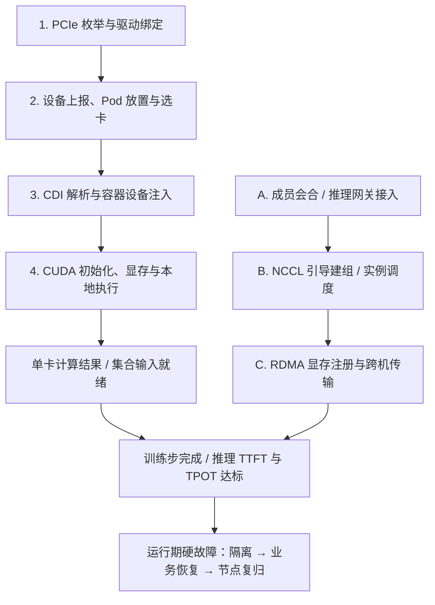
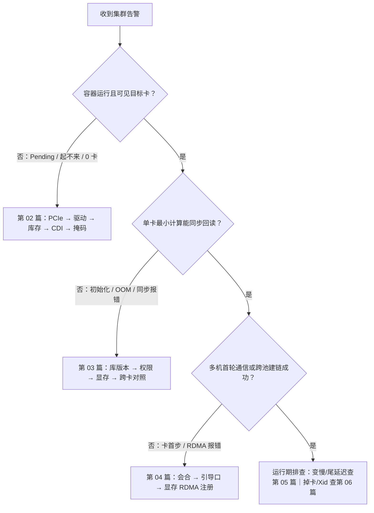

# 故障定位的证据规则与排查顺序

凌晨两点，值班群里同时弹出三条告警：一条说新提交的训练 Pod 报“找不到 GPU”，一条说运行中的 12 卡训练突然报 **30 秒 NCCL 超时**，还有一条说在线推理服务的 **P99 延迟飙升了三倍**。

面对这种局面，新手最容易犯的错是“看见报错就顺手猜根因”——看到 NCCL 超时就去折腾交换机，看到推理变慢就急着扩容副本，甚至不等保留日志就先重启节点“碰运气”。

一线资深 SRE 的排障逻辑恰好相反：**绝不跳层盲猜，而是把故障现象放回系统正常的依赖链里，顺藤摸瓜找到第一个断掉的交接点**。本篇先把这套跨层排障的“总地图”和几条硬核口诀立起来。

## 先建一张分层排障总地图

无论是分布式训练还是在线推理，同一句“任务跑不起来”或“性能崩了”，背后都可能对应完全不同的层次。设备从硬件插槽走到业务出结果，必须依次跨过硬件、驱动、容器交付、计算执行、多机通信或服务调度这一整串交接。

我们可以把整套系统的依赖拆成两条交汇的主线：**单卡交付与计算线**决定单个进程能不能把活干完，**多机协调与服务线**决定跨节点通信或请求流转能不能跑顺。

*图 18-01-01：GPU 集群排障的依赖总地图。左侧决定单卡是否可用可算（第 02–03 篇），右侧决定多机协调、高速通信与推理流转（第 04–05 篇），硬件链路突断与恢复闭环落到第 06–07 篇。*

有了这张依赖图，值班现场拿到任何告警，都可以直接按下面的**四步分流决策树**决定先查哪一层：

*图 18-01-02：从故障现象到具体排查层次的一线分流决策树。自左向右每一关只要未通过，就不必浪费时间往后追。*

> [!tip] 工程直觉：向上找最后一个绿灯，向下找第一个红灯
> 下游成功可以反推本次走过的上游交接没问题——例如某进程刚在这张卡上跑完前向并读回正确结果，就不必怀疑它的驱动没绑上；反过来，下游失败绝不代表根因就在报错点——其他节点刷屏“集合超时”，多半只是在干等某个早已悄然退出的故障节点。

## 排障三条硬核口诀

工具命令会随版本迭代，但下面三条排障纪律在任何 GPU 集群里都不过时。把它们刻进肌肉记忆，能帮你在高压值班时少走八成弯路。

### 口诀一：日志干净不等于健康，严格区分三种状态

每检查一个节点或组件，现场材料只能给出三种结论之一：**已通过、已失败、尚未观测**。

运维中最致命的幻觉，是把“日志里没看到报错”当成“这一层已经验证正常”。很多时候没报错只是因为流程根本没走到那一步、采集器掉线了，或者日志已经被轮转覆盖。就像第 17 章强调的“缺测不能填成 0”，排障时也绝不能拿空白记录给某一层发通行证。

| 检查状态 | 现场必须落实的事实 | 下一步动作 |
| --- | --- | --- |
| **已通过** | 谁在本次尝试中完成了具体动作，且结果被下游消费或校验 | 记为最近可靠起点，继续往下一交接推进 |
| **已失败** | 哪一次调用返回明确错误、被拒绝或输出不符预期 | 锁定为首个失败候选，立即核查它的直接输入与同窗上游事件 |
| **尚未观测** | 动作未执行、指标未采集，或时间窗口未覆盖 | 补采针对性证据，绝不用“无报错”推导“正常” |

### 口诀二：最先刷屏的多半是受害者，分清三个“最早”

设想一次典型的多机训练事故：故障节点上某条 PCIe 根端口先发生链路致命错误，几毫秒后对应 GPU 报掉线，本地训练进程随即异常退出，30 秒后所有健康节点的监控同时刷屏“集合通信超时”。

把这四个事件摆在一起，必须分清三件事：
1. **时间戳最早的记录**：内核里的 PCIe 链路错误日志；
2. **首个有证据的失败交接**：驱动访问目标 GPU 的路径中断；
3. **下游连坐症状**：其他健康节点苦等缺席成员触发的通信超时。

> [!warning] 常见误区：找到首个失败交接 ≠ 已经锁死硬件责任部件
> 看到驱动访问 GPU 失败，足以让你把排查重心从“全网交换机”收窄到“故障节点的这条 GPU 链路”。但真正坏的究竟是 GPU 芯片、HGX 底板、PCIe 交换芯片还是供电模块，仍需要结合带外 BMC 电源/散热记录和机房检修才能定责。

### 口诀三：上游绿灯只管当前段，别拿它担保下游

很多排障僵局，源于把一个局部成功的检查过度外推成了全局健康。下表列出了 GPU 集群里最容易让人掉坑的六张“局部通行证”：

| 你看到的绿灯 | 它真正能保证的 | 它**绝不**保证的 |
| --- | --- | --- |
| 宿主机 `nvidia-smi` 列出所有卡 | PCIe 枚举与驱动管理通路正常 | Pod 拿到了卡，或容器内能做 CUDA 计算 |
| 容器内 `cudaGetLastError` 返回成功 | 主机侧参数与 Kernel 提交检查通过 | GPU 真的执行完了该 Kernel（同步时仍可能报错） |
| 单机 4 卡 AllReduce 跑通 | 本机卡间互联（NVLink/PCIe）可用 | 跨节点会合、RoCE 路径与全组通信约定正常 |
| NCCL 打印 `Init COMPLETE` | 已执行的建组步骤顺利完成 | 首轮数据通信一定成功（动态建连可能延后到首次调用） |
| 两点间 `perftest` 测速达标 | 这对端点、单方向、当前缓冲类型的通路 | 生产多节点并发、显存注册或反向链路无拥塞 |
| 诊断全绿、Pod 重新 `Running` | 静态体检通过、容器进程已拉起 | 原触发故障的条件已消除，或训练/推理已恢复有效产出 |

## 先对齐“谁在什么时候”，再谈因果

把不同节点、不同重试轮次、甚至不同重启周期的日志拼成一条故事线，是跨机排障最隐蔽的翻车点。动笔写时间线前，先核对两把尺子：

- **身份尺（绑定到具体一次运行）**：至少对齐作业尝试号、Pod UID、容器实例、Rank（或推理副本名）、物理 GPU UUID、当次启动的 BDF 与节点启动周期。作业重试后 Rank 往往重新洗牌，维修换卡后 UUID 和 BDF 也会变化，切忌只凭“都是 `worker-1` 的 1 号卡”把前后两次事故混为一谈。
- **时间尺（分清同机顺序与跨机误差）**：同一台机器内，内核日志的单调时钟最可靠，不受 NTP 校时回拨影响；跨节点对比时间戳时，必须留出时钟同步残差。例如本章集群的跨机时钟成对最大偏差为 `2 ms`，如果两个跨节点事件只相差 `1 ms`，光靠时间戳绝对排不出先后。
- **计数生命周期**：PCIe Replay、ECC 错误、网卡 CRC 等累计 Counter 在驱动重载或节点重启后会清零，跨生命周期相减毫无意义。

## 用受控对照代替拍脑袋猜想

当现场证据同时符合两三个嫌疑原因时，不要再盲目收集更多同质日志，而是设计一次**一锤定音的受控对照**。好的排障对照只需在动手前写清三件事：**固定哪些条件、只改哪一个变量、拿什么当通过标准**。

例如，Pod 始终卡在容器创建阶段，运行时报找不到 CDI 设备项。我们保持镜像、节点和已分配的 GPU UUID 完全不变，**只把缺失的规格文件放到运行时实际扫描的目录**。如果新容器立即解析成功并跑通计算，就把嫌疑稳稳锁死在“规格目录错位”。

在工程实战中，还要分清两种性质不同的验证动作：

- **严格单变量对照**：只改一个开关或配置（如上述修复目录、单独降下竞争背景流），结果可以直接锁定因果；
- **路径分解对照**：当测试不得不同时改变多个底层机制时（例如把 `perftest` 从主机内存换成 GPU 显存，缓冲区位置与 DMA-BUF 注册机制会一起变化），它的价值在于**快速把故障圈定在某一段新引入的路径里**，再进到那一段里做单变量深挖。

> [!summary] 止血绕行 ≠ 修好原路
> 排查多机通信时，把 NCCL 临时切到 TCP Socket 绕开 RDMA 后任务跑通了，这叫**有效止血**，只能说明问题确实出在 RDMA 路径上，绝不代表 RoCE 网卡已经修好。如果生产 SLA 要求走高速网，修复后必须回到原 RDMA 路径、原端点与真实并发条件下复测通过。

## 本章贯穿实战场景与角色映射

为了让整章案例前后连贯、方便与已有硬件和时序插画逐项对照，本章承接第 17 章的训推共存 H100 集群：

- **训练主线**：三台 8 卡 HGX H100 节点运行 12 卡同步训练作业 `train-12`（每只 worker Pod 申请 4 张整卡、16 CPU、96 GiB 主机内存与 1 个 `200 Gb/s` RoCEv2 SR-IOV VF，存储走独立网络）；第 07 篇恢复阶段引入一台同规格备用节点。
- **推理主线**：集群推理资源池运行大模型在线服务 `infer-svc-1`（覆盖独占、同卡共享与 PD 分离部署），用于串联显存 OOM、TTFT/TPOT 尾延迟飙升、KV Cache 抢占雪崩与跨池 KV 迁移故障。

下文讲普遍原理时一律使用语义角色，具体节点与设备编号集中收束在这张映射表中，需要对照日志或手绘插画时随时查阅即可：

| 语义角色 | 案例与插画对应标识 | 关键硬件与拓扑属性 |
| --- | --- | --- |
| **正常训练节点 / 对端节点** | `h1`、`h3` | 8 卡 H100 SXM（NVSwitch 互联），各承载 4 个 Rank |
| **重点追踪故障节点** | `h2`（事故启动周期 `boot-B`） | 承载 worker Pod `P21`（Rank 4–7），其中重点追踪 Rank 5 |
| **目标异常 GPU** | `GPU-H2-A`（`0000:65:00.0`） | 位于根端口 `0000:40:01.0` 下游，在容器内映射为 `cuda:1` |
| **故障节点高速网卡路径** | VF `0000:81:00.2` / PF `0000:81:00.0`（`ens6f0`） | 位于独立 PCIe 分支，对应 `mlx5_2/1`，连向交换机 `leaf1/swp12` |
| **备用恢复节点** | `h4`（第 07 篇引入） | 同规格 H100 节点，用于接替 `h2` 完成作业恢复 |
| **在线推理服务实例** | `infer-svc-1` / `infer-svc-2` / PD 池 | 分别用于 KV Cache 抢占、同卡共享干扰与 PD 跨池迁移排查 |

排障总地图和三条口诀已经立住。接下来从最常见、也最容易一头雾水的一类工单入手：当业务方喊出“**GPU 不可见**”时，如何沿着五道交付关卡在几分钟内指认出到底卡在哪一层。

> [!info]- 参考资料
> - **Kubernetes 故障排查与节点状态**：[Kubernetes v1.36 · Debug Running Pods](https://v1-36.docs.kubernetes.io/docs/tasks/debug/debug-application/debug-running-pods/)、[Device Plugins 机制](https://v1-36.docs.kubernetes.io/docs/concepts/extend-kubernetes/compute-storage-net/device-plugins/)
> - **NVIDIA GPU 诊断与通信排查**：[NVIDIA SMI 文档](https://docs.nvidia.com/deploy/nvidia-smi/index.html)、[NCCL 2.27.3 Troubleshooting Guide](https://docs.nvidia.com/deeplearning/nccl/archives/nccl_2273/user-guide/docs/troubleshooting.html)、[NVIDIA Xid Errors 指南](https://docs.nvidia.com/deploy/xid-errors/latest/working-with-xid-errors.html)
> - **PyTorch 分布式弹性启动**：[PyTorch 2.9 · torchrun Elastic Launch](https://docs.pytorch.org/docs/2.9/elastic/run.html)
