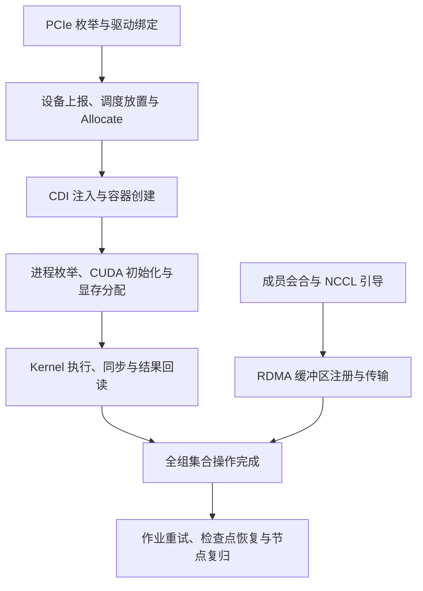

第 17 章把分散的设备、网络和作业样本组织成带时间、带身份、带条件的观测体系，并留下了分层基线。本章接手下一步：当一次训练偏离基线，报告「GPU 不可见」「多机挂住」或「训练变慢」时，怎样从这些现象追到具体是哪一层、哪个交接点出了问题。本章不准备给一份命令清单，而是练习一套可复用的推理过程——先恢复现场，再沿依赖找最早有证据的异常，用对照缩小范围，最后把判断变成可验收的处置。

## 现象是症状，层次才是定位目标

同一句「训练起不来」可能来自完全不同的层：节点没枚举到卡、调度器放不进 Pod、运行时注入失败、CUDA 初始化报错，或者跨节点会合缺员。现象只说明用户观察到的结果，不说明责任部件。GPU 集群的工作路径本身有严格的前后依赖，下游能力建立在上游交接成功之上。

图 18-01-01　单节点交付链自上而下交接，跨节点路径在会合之后并入集合完成，处置阶段再决定重试与复归。第 02—03 篇覆盖左链，第 04 篇处理运行中的设备异常，第 05 篇覆盖会合与传输，第 06 篇解释集合为什么变慢或挂起，第 07 篇覆盖最下方的恢复环节。

**替代文本**　一张 GPU 从 PCIe 枚举开始，经设备上报、调度放置、CDI 注入、CUDA 初始化到计算回读；多机路径从会合、引导经 RDMA 传输汇入全组集合完成，之后进入作业重试与节点复归。

这条依赖关系给出两条基本推理方向。下游成功意味着它实际走过的上游交接都成功过，例如进程能在某张卡上完成一次计算，说明枚举、注入和该卡的基本执行能力已有证据；反过来，下游失败并不自动说明根因在下游，集合超时可能只是最早暴露症状的位置，真正的异常在另一台节点的设备层。所以定位不是从报错位置就地猜原因，而是沿依赖向上找**最早有证据的失败点**。

## 每个检查点只有三种证据状态

对任意一个检查点，记录只可能支持三种结论：已知成功、已知失败、证据缺失。「日志里没有错误」属于第三种，它不等于成功——也许该动作根本没有执行，也许观测没有覆盖那个窗口。第 17 章讨论缺测时强调不能把空白填成零，故障定位中同样不能把「没采到」写成「正常」。

还要区分三个容易混淆的「最早」。以第 04 篇的教学事故为例：内核在 0 ms 报告 PCIe 分支 fatal AER，+6 ms 驱动报 Xid 79，+17 ms Rank 5 同步失败退出，+30,017 ms 其他节点的集合等待超时。时间戳最早的是 AER，最早有证据的**失败交接**是 GPU 的 PCIe 可达性，而超时只是最晚出现的下游症状；至于责任部件是 GPU、连接器还是上游组件，现有证据仍不足以确定。根因是需要额外证据才能回答的问题，不能用时间顺序直接代替。

每类成功证据都有自己的覆盖范围，超出范围的结论必须另外取证：

| 已取得的成功证据 | 它证明的能力 | 它不能证明的事情 |
| --- | --- | --- |
| 宿主机 NVML 查询列出 GPU | 设备可枚举、驱动管理通路可用 | 容器能拿到卡，或应用能完成计算 |
| 容器内枚举到设备、启动检查通过 | 注入成功、主机侧提交成功 | 本次设备工作已经完成（同步可能报错） |
| 单机 AllReduce 通过 | 本地执行与卡间互联可用 | 跨节点会合、RDMA 路径与全组约定可用 |
| 通信组初始化完成 | 已实际执行的初始化步骤通过 | 首轮集合成功，连接可能在首次调用时才建立 |
| 两点间 RDMA 微基准成功 | 该对端点、该方向、该缓冲区类型的路径 | 十二个成员的调用约定、全部路径与并发 |
| 一次诊断绿色、作业重新 Running | 诊断覆盖项通过、生命周期进入新阶段 | 原故障条件已消除，或训练已有有效进展 |

## 把每条记录对齐到同一次运行

故障材料最常见的错误，是把不同时间、不同实例的记录拼成一条因果链。对齐需要两组键。身份键包括作业 UID 与尝试号（`J17/R1`）、Pod UID 与容器实例、Rank、GPU 的 UUID 与 BDF、节点启动周期，以及集合通信的组 ID 与调用序号。Rank 在重试后可能重新分配，BDF 在维修或重新枚举后可能变化，只有 UUID 稳定标识物理卡；因此每一条设备证据都要先对回当时的映射，而不是沿用旧编号。

时间键分两种用法。同一台机器内的事件顺序优先用本次启动以来的单调时钟判断，不受校时调整影响；跨节点比较绝对先后时，先确认各机时钟已同步，并记住剩余误差。本章教学材料给出的跨机时钟成对最大偏差为 2 ms，时差小于这个量级的两个跨机事件不能判定先后。累计计数（例如 PCIe replay、CRC）还要先确认计数生命周期：复位或驱动重载后计数清零，跨生命周期取差没有意义。

正文中每个故障变体都会明确标注为独立的教学快照。同一变体只使用同一次尝试、同一容器和同一启动周期内的记录；把 A 变体的失败和 B 变体的成功拼成「修复有效」，是对照实验中最典型的伪证据。

## 好的对照只改变一个变量

当两个候选解释都能匹配现象时，定位依靠对照而不是更多猜测。一个合格的对照要写清四件事：固定了哪些条件、只改变哪一个变量、通过标准是什么、结论能外推到多大范围。例如同一 Pod、同一镜像和同一批设备，只把 CDI 规格发布到运行时实际扫描的目录，名称解析成功就把故障收窄到规格可见性；先测主机内存缓冲区、再只把缓冲区换成显存，其余端点和参数不动，失败位置的变化才说明问题出在显存注册交接。

对照的结论必须带着覆盖范围阅读。用 Socket 载荷绕开 RDMA 后通信恢复，只能说明故障随路径变化，不能当作 RoCE 已经修复；空载基准复测正常，也不能直接外推到带背景流量的生产窗口。改变了多个条件才成功的「对照」，无法指出究竟哪一项起作用，只能算一次有效处置，不算一次定位证据。

## 贯穿全章的场景与排查地图

本章沿用第 17 章的三节点训练作业 `ai-demo/train-12`，健康作业的 UID 短写为 `J17`，故障这次尝试简称 `R1`。节点 `h1/h2/h3` 各运行一个 worker Pod，分别承载 Rank 0–3、4–7、8–11；Rank 是进程在通信组内的编号。每个 Pod 请求 4 张 H100 SXM 80 GB 整卡、16 CPU、96 GiB 主机内存和 1 个支持 RDMA（远程直接内存访问）的网卡虚拟功能（VF，由 SR-IOV 提供）；每节点有 8 张可请求整卡、32 CPU、192 GiB 内存和 2 个 VF。节点内 GPU 由 NVSwitch 互联，每节点一条 200 Gb/s RoCEv2 物理口承载训练 RDMA 流量，存储走独立网络。重点跟踪 `h2` 上 Pod UID 为 `P21` 的 Rank 5 及其使用的 `GPU-H2-A`，替代节点 `h4` 到第 07 篇才引入。所有故障记录、耗时和计数均为教学构造。

后续各篇按「先单节点、再多机，先失败定位、再恢复验收」的顺序展开。第 02 篇从一张卡如何交给训练容器讲起，第 03 篇跟踪容器内一次计算的完整过程；第 04 篇看设备在运行中出错时证据怎样向全组传播；第 05 篇解决单机正常、多机停滞；第 06 篇把慢步切成可复算的时间段；第 07 篇把判断转换为隔离、恢复和复归的验收证据；第 99 篇用独立材料一次性检验全部环节。

下一篇先处理最常被报告的一类问题：「GPU 不可见」。它可能发生在交付链的好几个位置，沿检查点逐段取证才能分辨。
