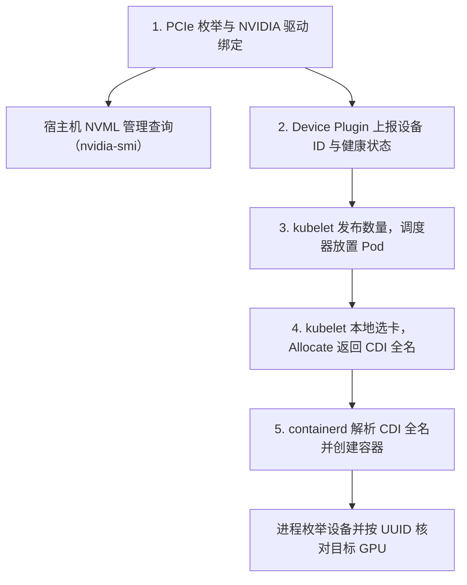

# GPU 枚举、资源分配与容器可见性

业务方提了一张高优工单，描述只有短短五个字：“**GPU 不可见**”。

但在 Kubernetes GPU 集群里，这五个字背后可能藏着五种八竿子打不着的现场：物理卡压根没被主板识别、宿主机驱动没装上、Pod 还在 Pending 根本没建容器、containerd 解析设备描述报错，或者容器里 `nvidia-smi` 正常，训练进程却被一个空环境变量蒙住了眼睛。

如果一上来就盲目重启 Device Plugin 或重装驱动，往往越修越乱。想在三分钟内准确定位，先沿着一张 GPU 走进训练进程的**五道正常交付关卡**走一遍。

## 一张 GPU 走进容器的五道正常关卡

从裸机硬件到应用代码里的 `cuda:1`，目标 GPU 必须顺次完成五次交接。只要记住这条流水线，排障时就能像查电路断点一样，用二分法迅速锁定哪一关没交接出去。



*图 18-02-01：GPU 从宿主机交付到容器进程的五道检查点。宿主机管理查询只走左侧短路径，容器内可见则必须完整走完右侧五关。*

这条流水线上有三个极易踩坑的机制边界，排查前先记牢：

### 1. BDF、UUID 与容器内序号各管一摊

宿主机开机枚举 PCIe 总线时，会给每张卡分配本次启动周期的拓扑地址（BDF）；NVIDIA 驱动成功绑定后，宿主机管理接口就能查出这张卡出厂固化的物理 UUID。

进入容器后，进程看到的 `cuda:0`、`cuda:1` 只是**该进程可见列表里的局部编号**，既不等于宿主机 `nvidia-smi` 的序号，也不对应物理槽位。换卡或维修重启后，BDF 和 UUID 都可能变动，跨工具追账必须以**当前启动周期的物理 UUID**为准。

### 2. “节点数量账本”和“具体选哪张卡”是两本账

Device Plugin 在节点侧把设备 ID 清单和健康状态报给 kubelet，kubelet 汇总出一个整数写进 Node 的 `Allocatable`。**调度器只看这个整数和调度约束，压根不知道具体哪张 UUID 给了哪个 Pod**。

假设一台 8 卡节点当前 `Allocatable = 8`，已有运行中的 Pod 合计请求了 6 张卡，此时新提交一只 4 卡训练 Pod，账面余量为：

$$8 - 6 = 2 < 4$$

就算已有 Pod 里的 4 张卡此刻 GPU 利用率都是 `0%`，只要它们还挂在 Pod 请求账本上，调度器就不会再分给新 Pod。只有 Pod 绑定到节点之后，kubelet 才会本地选定具体 UUID，并调用插件的 `Allocate` 接口拿取注入指令。

### 3. 逐字核对 CDI 全名，别用 K8s 资源键瞎猜

按本集群基准栈，节点采用 NVIDIA Device Plugin `v0.20.1` 的 `cdi-cri` 策略，配合 containerd `v2.3.0` 原生 CDI 支持（默认扫描 `/etc/cdi` 与 `/var/run/cdi`）。`Allocate` 返回的不是环境变量，而是一个 `vendor/class=name` 格式的 CDI 设备全名。

这里有一个高频暗坑：**不要把 Kubernetes 扩展资源键 `nvidia.com/gpu` 当成 Device Plugin 生成的 CDI kind**。核对 `v0.20.1` 源码可知，插件指定的 vendor 是 `k8s.device-plugin.nvidia.com`、class 是 `gpu`，因此交给 containerd 的实际 CDI 全名形如：

```text
k8s.device-plugin.nvidia.com/gpu=GPU-H2-A
```

`nvidia.com/gpu` 既用作 Kubernetes 资源名，也常出现在独立 NVIDIA Container Toolkit 生成的规格里，但在这条 Device Plugin 交付链上，containerd 必须按上面的完整名称精准匹配，错一个字符就会拒绝建容器。

## 五类“GPU 不可见”的现场诊断与日志对照

下面五类现场是生产值班里最常撞见的“GPU 不可见”变体。按表先锁定首个断掉的交接点，再结合对应命令日志动手验证：

| 业务工单现象 | 现场最核心证据 | 首个失败关卡 | 立即执行的下一步验证 |
| --- | --- | --- | --- |
| **1. 节点少了一张卡** | 同启动周期 PCIe 树少了一台物理 GPU，其余卡正常 | 第 1 关（PCIe 枚举） | 核对完整 `lspci` 清单与资产表区分“重编号”还是“真丢卡”；确认丢失后查 BMC 硬件日志与供电链路 |
| **2. 主机查不到 GPU** | `lspci` 有设备但未绑定 `nvidia`，内核报模块加载失败 | 第 1 关（驱动绑定） | 对比当前运行内核版本与驱动模块构建/Secure Boot 签名状态，修好加载后再验 `nvidia-smi` |
| **3. Pod 一直 Pending** | `spec.nodeName` 为空，事件报节点余量不足（`2 < 4`） | 第 3 关（调度放置） | 核对各节点健康库存、已有请求与成组约束；若健康数少于物理卡，反查 Device Plugin 注册与健康上报 |
| **4. 主机有卡，容器起不来** | Pod 已绑定且 `Allocate` 成功，containerd 报 CDI 无法解析 | 第 5 关（CDI 解析） | 核对 CDI 规格实际落地目录与 containerd 扫描目录，补齐同名规格后重测建容器与枚举 |
| **5. 容器 Running，应用报 0 卡** | 同容器内 `nvidia-smi` 正常，但应用进程读到 0 张 CUDA 卡 | 进程级可见性筛选 | 打印目标进程真实环境变量，排查启动脚本是否覆盖了 `CUDA_VISIBLE_DEVICES` |

光看表格还不够直觉，下面把现场最关键的三段真实感命令输出摆出来，帮你建立一眼识破故障层的手感。

### 现场片段 A：设备在 PCIe 树上，却没绑上驱动（第 1 关断裂）

在故障节点执行 `lspci -nnk` 检查目标槽位与内核日志：

```bash
# 查看目标 GPU 的 PCIe 枚举与驱动绑定情况
$ lspci -nnk -s 0000:65:00.0
65:00.0 3D controller [0302]: NVIDIA Corporation GH100 [H100 SXM5 80GB] [10de:2330] (rev a1)
        Subsystem: NVIDIA Corporation Device [10de:16c1]
        Kernel modules: nvidiafb, nouveau, nvidia_drm, nvidia
        # 注意：此处缺少 "Kernel driver in use: nvidia"！

# 紧接着查当前启动周期的内核模块加载报错
$ dmesg -T | grep -iE "nvidia|module"
[Tue Nov 18 02:11:04 2026] nvidia: loading out-of-tree module taints kernel.
[Tue Nov 18 02:11:04 2026] LockDown: modprobe: unsigned module loading is restricted; see man kernel_lockdown.7
```

一眼就能看穿：硬件枚举完全正常，断在内核开启安全启动后拒绝加载未签名驱动模块。此时去查 Device Plugin 或容器运行时纯属白费功夫。

### 现场片段 B：调度和选卡全过，containerd 卡在 CDI 解析（第 5 关断裂）

宿主机 `nvidia-smi` 全绿，Pod 已经绑定到目标节点，但迟迟卡在 `CreateContainerError`。拉取 `kubectl describe pod` 事件与 containerd 日志：

```text
# kubectl describe pod <worker-pod> 关键事件
Events:
  Type     Reason     Age   From               Message
  ----     ------     ----  ----               -------
  Normal   Scheduled  42s   volcano            Successfully assigned ai-demo/train-worker-1 to h2
  Warning  Failed     18s   kubelet            Error: failed to create containerd container:
           failed to inject CDI devices: unresolvable CDI devices k8s.device-plugin.nvidia.com/gpu=GPU-H2-A

# 宿主机核对运行时扫描目录 vs 实际规格目录
$ ls /etc/cdi /var/run/cdi          # 空目录，未包含目标规格
$ ls /opt/site/cdi/                 # 规格文件错放到了未配置的自定义目录
nvidia-device-plugin.yaml
```

> [!warning] 别把“创建等待”事件直接怪给运行时
> 如果 `kubectl describe` 只看到一条笼统的 `ContainerCreating` 卡住，此时 `Allocate` 和 CDI 解析两层都还处于“尚未观测”状态。必须同时翻 kubelet 日志确认是否已把 CDI 全名交给 CRI，再用节点的 `PodResources List` 接口核对当下到底分配了哪几张 UUID（追溯历史容器时要同时核对 Pod UID 与容器实例）。

把完整规格放到 containerd 实际扫描的目录后，做一次干净的单变量验证：固定原镜像、节点与设备分配不变，观察新容器是否能顺利解析同名设备、进入 `Running` 并枚举出目标 UUID，最后再用第 03 篇的计算探针确认能算。

### 现场片段 C：容器里 `nvidia-smi` 有卡，应用偏说没卡（进程掩码）

Pod 已经 `Running`，运维用 `kubectl exec` 进容器敲 `nvidia-smi` 看到 4 张 H100 稳稳在线，但训练或推理日志偏偏报 `RuntimeError: No CUDA GPUs are available`。

这时立刻检查目标业务进程**实际的运行环境**，而不是只看 `exec` 进来的交互式 Shell：

```bash
# 直接读取目标业务进程（而非当前 shell）的真实环境变量
$ tr '\0' '\n' < /proc/$(pgrep -f train.py | head -n 1)/environ | grep -E "CUDA|NVIDIA"
NVIDIA_VISIBLE_DEVICES=GPU-H2-A,...
CUDA_VISIBLE_DEVICES=          # <-- 启动包装脚本误把该变量导出成了空串！
```

`CUDA_VISIBLE_DEVICES` 设为显式空字符串时，CUDA Runtime 会把当前进程的可见设备数清零，而走 NVML 的 `nvidia-smi` 并不受它影响。去掉这行错误导出，用相同容器用户重跑进程，枚举立刻恢复。

## DRA、GPU Operator 与在线推理的排查入口

上面五道关卡的逻辑并不绑死在传统 Device Plugin 上。遇到现代组件或在线推理场景时，只是“去哪翻账本”变了，分层思路完全不变：

- **使用 DRA 分配设备时**：同样沿“是否已放置 → 设备是否已交付 → 运行时是否已注入”排查，只是查询对象换成 `ResourceClaim` 的分配状态、节点侧 DRA 驱动的准备日志，以及最终下发给 containerd 的 CDI 设备名。
- **由 GPU Operator 托管节点栈时**：Operator 的 `ClusterPolicy` 汇总状态和 Validator Pod 日志是极好的**全局雷达**，能帮你一眼扫出哪台节点的驱动、Toolkit 或插件异常；但具体到某只业务容器起不来，仍必须回到该容器的分配记录与运行时报错。
- **在线推理服务遇到“不可见”时**：除了上述五关，若资源池启用了 MIG 切分或 HAMi 共享，还要额外核对节点标签上的 MIG Profile 是否与 Pod 请求匹配，以及容器是否因节点刚做完 MIG 重配置而持有了失效的旧实例 ID。

> [!summary] 核心结论
> 排查“GPU 不可见”绝不要凭感觉重启组件。按 **PCIe 枚举 → 驱动绑定 → 调度账本 → CDI 解析 → 进程掩码** 五步逐关验绿灯，每一步都能用一条命令给出非黑即白的答案；且每次局部修复后，必须一路验到容器内按 UUID 枚举成功，再进入计算验证。

当业务进程在容器里准确枚举到了目标 GPU 的物理 UUID，交付链的使命就结束了。但现实中还有更折磨人的工单：“`nvidia-smi` 能看到卡，代码也枚举到了，可一算就报错！”下一篇我们用一只极简的单卡计算探针，把“能看见”推进到“能算对”。

> [!info]- 参考资料
> - **NVIDIA 管理与环境变量**：[NVIDIA SMI 文档](https://docs.nvidia.com/deploy/nvidia-smi/index.html)、[CUDA 13.2.1 · CUDA_VISIBLE_DEVICES 环境变量](https://docs.nvidia.com/cuda/archive/13.2.1/cuda-programming-guide/05-appendices/environment-variables.html)
> - **Kubernetes 设备交付与库存**：[Kubernetes v1.36 · Device Plugins](https://v1-36.docs.kubernetes.io/docs/concepts/extend-kubernetes/compute-storage-net/device-plugins/)、[扩展资源的使用](https://v1-36.docs.kubernetes.io/docs/concepts/configuration/manage-resources-containers/#consuming-extended-resources)、[PodResources 监控接口](https://v1-36.docs.kubernetes.io/docs/concepts/extend-kubernetes/compute-storage-net/device-plugins/#monitoring-device-plugin-resources)、[Dynamic Resource Allocation (DRA)](https://v1-36.docs.kubernetes.io/docs/concepts/scheduling-eviction/dynamic-resource-allocation/)
> - **CDI 与容器运行时源码口径**：[NVIDIA Device Plugin v0.20.1 · Configuration Option Details](https://raw.githubusercontent.com/NVIDIA/k8s-device-plugin/v0.20.1/README.md#configuration-option-details)、[NVIDIA Device Plugin v0.20.1 · plugin-manager.go](https://github.com/NVIDIA/k8s-device-plugin/blob/v0.20.1/cmd/nvidia-device-plugin/plugin-manager.go)、[NVIDIA Device Plugin v0.20.1 · server.go](https://github.com/NVIDIA/k8s-device-plugin/blob/v0.20.1/internal/plugin/server.go)、[containerd v2.3.0 · CRI CDI 配置](https://github.com/containerd/containerd/blob/v2.3.0/docs/cri/config.md)、[CDI 规格 v1.1.0](https://github.com/cncf-tags/container-device-interface/blob/v1.1.0/SPEC.md)
> - **GPU Operator 组件清单**：[GPU Operator v26.7.2 · values.yaml](https://raw.githubusercontent.com/NVIDIA/gpu-operator/v26.7.2/deployments/gpu-operator/values.yaml)
