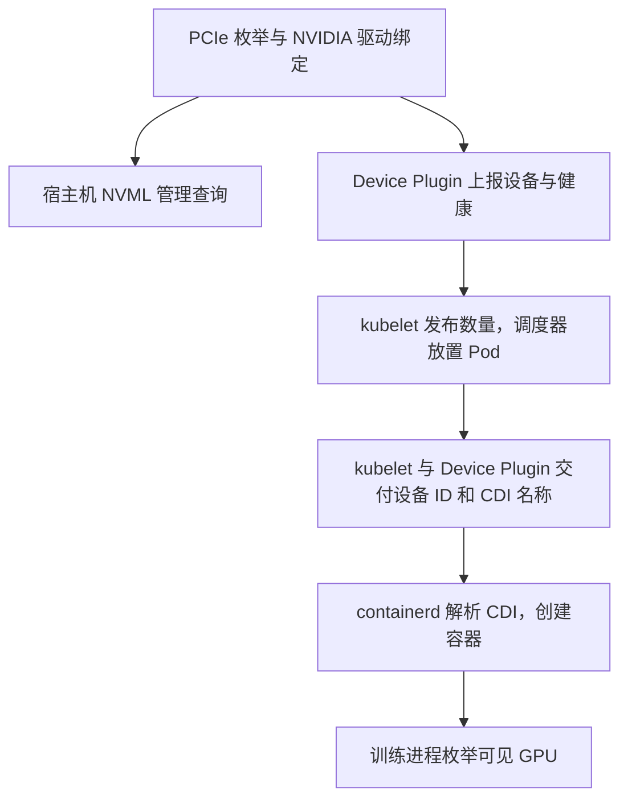

第 01 篇把故障定位拆成沿依赖链找最早失败点的过程。本篇从交付链的起点开始：收到「GPU 不可见」时，先记下谁看不到什么。一名用户可能在已运行的容器中看到 CUDA 设备数为零，另一名用户的 Pod 可能还在等待放置。前者已有一次进程内枚举，后者尚未创建容器——按第 01 篇的三种证据状态，这是两个不同位置的证据缺失。要让两种描述都能用于定位，先看一张 GPU 如何交到正常进程手里。

## 同一张卡怎样交给训练容器

场景沿用第 01 篇的 `ai-demo/train-12`：作业 `J17` 的本次尝试为 `R1`，`h1/h2/h3` 各运行一个 worker Pod，分别承载 Rank 0–3、4–7、8–11，Rank 是进程在通信组内的编号。每个 Pod 请求 4 张 H100 SXM 80 GB 整卡、16 CPU、96 GiB 主机内存和 1 个支持 RDMA（远程直接内存访问）的网卡 VF；每节点有 8 张可供请求的整卡、32 CPU、192 GiB 内存和 2 个 VF，节点内由 NVSwitch 连接 GPU，训练 RDMA 走一条 200 Gb/s RoCEv2 物理口，存储使用分开的网络。设备、UID、时间和结果均为教学记录。

从 `h2` 上的一张卡出发。启动后，Linux 在 PCIe 树中枚举到 `0000:65:00.0`。BDF（Bus、Device、Function，通常带域号）表示设备在本次节点拓扑中的地址。NVIDIA 驱动绑定设备后，宿主机可通过 `nvidia-smi` 使用 NVML（NVIDIA Management Library）做管理查询，取得物理 UUID，教学中简写为 `GPU-H2-A`。在同一次启动中，BDF 把 PCI 事件和这张卡连起来。跨启动或维修后应重新记录 BDF 和 UUID 的对应。 [NVIDIA SMI · 设备标识和管理接口](https://docs.nvidia.com/deploy/nvidia-smi/index.html)

接下来有一次数量交接和一次具体设备交接。Device Plugin 在节点上把设备 ID 与健康状态报告给 kubelet。kubelet 把可调度的数量写入 Node 状态，调度器据此以及已有请求、作业约束等放置 Pod。`Allocatable` 是可供调度计算的总量，已有 Pod 的请求仍需从这一账本扣除。假设 `h2` 可分配 8 张且已计入 6 张请求，新的 4 卡 Pod 在该节点只有 2 张的账面余量。现场看到 4 张设备低活动也不会增加余量。Pod 绑定后，kubelet 在本节点为目标容器取得具体设备，并调用插件的 `Allocate` 取得交付信息。以上以 Kubernetes v1.36 的 Device Plugin 路径为例。 [Kubernetes v1.36 · Device Plugins](https://v1-36.docs.kubernetes.io/docs/concepts/extend-kubernetes/compute-storage-net/device-plugins/) · [Kubernetes v1.36 · 扩展资源的使用](https://v1-36.docs.kubernetes.io/docs/concepts/configuration/manage-resources-containers/#consuming-extended-resources)

本例明确启用 NVIDIA Device Plugin v0.20.1 的 `cdi-cri` 策略。实际生效的 containerd v2.1.5 开启原生 CDI，扫描 `/etc/cdi` 和 `/var/run/cdi`。CDI（Container Device Interface，容器设备接口）用有完整名称的规格项描述要加入容器的设备节点、挂载等修改。`Allocate` 返回的 CDI 全名由 kubelet 通过 CRI（Container Runtime Interface，容器运行时接口）转交。containerd 必须在有效规格中找到同名项，才能应用对应修改并创建目标容器。教学记录中，`h2` 的 worker Pod UID 为 `P21`。目标训练容器获得包含 `GPU-H2-A` 在内的四张卡，原运行中的 Rank 5 报告进程侧 `cuda:1` 对应这张卡。容器序号来自进程的可见设备列表，宿主机索引 2 属于另一层枚举。 [NVIDIA Device Plugin v0.20.1 · 策略](https://raw.githubusercontent.com/NVIDIA/k8s-device-plugin/v0.20.1/README.md#configuration-option-details) · [containerd v2.1.5 · enable_cdi 与 cdi_spec_dirs](https://raw.githubusercontent.com/containerd/containerd/v2.1.5/docs/cri/config.md#cri-plugin-config-guide) · [CDI 规格 v1.1.0](https://github.com/cncf-tags/container-device-interface/blob/v1.1.0/SPEC.md)

图 18-02-01　本例的 GPU 交付检查点。箭头表示成功依赖与交接顺序。驱动绑定后，一支可做宿主机管理查询，另一支沿节点上报、Pod 放置、设备分配和注入走到训练进程。图中管理查询是取证分支。

**替代文本**　驱动绑定后分出两支：一支供宿主机 NVML 管理查询，另一支经 Device Plugin 上报、调度放置、设备分配与 CDI 注入，直到训练进程枚举到可见 GPU。

## 用失败记录定位交接点

下表各行是相对于健康场景独立变化的**教学快照**。同一行只使用同一次 Pod 创建尝试、同一容器及对应节点启动周期的记录。实际查询时，用 Kubernetes 事件和 `spec.nodeName` 看放置阶段，用设备插件和 kubelet 记录看分配。容器创建后再观察目标进程的库和设备视图。

| 用户描述 | 已取得的记录 | 下一项能区分解释的观测 |
| --- | --- | --- |
| 「节点少了一张卡」 | 同一启动周期的 PCI 树少了资产记录中的 GPU。沿上游查该分支，其余分支中的 GPU 还能枚举。 | 先对照完整 PCI 树、平台事件和当次 BDF 清单，分辨重编号与实际枚举缺失。确认缺失后查上游链路、供电及平台状态，驱动加载记录需要在可枚举设备的前提下解释。 |
| 「主机查不到 GPU」 | PCI 树有目标 GPU，`lspci -nnk` 中该设备未绑定 `nvidia`，本次启动日志记录模块加载失败。 | 对照正在运行的内核、磁盘模块及失败原因，例如无该内核构建的模块或签名校验失败。绑定成功后再查同一 UUID 的 NVML 响应。 |
| 「Pod 一直拿不到 GPU」 | 调度事件明确请求 4 张，而候选节点 GPU 余量为 2，且 `spec.nodeName` 为空。 | 对候选节点逐一核对请求、健康库存及时点。若健康设备少报，查插件注册和健康上报。若 8 张都已入账而 6 张被占，继续查可用放置与等待。 |
| 「主机能看到，训练容器起不来」 | `P21` 已绑定 `h2`，本次 `Allocate` 成功且创建请求有全名 `nvidia.com/gpu=GPU-H2-A`（UUID 短写）。运行时报告该项无法解析。规格文件实际只有 `/opt/site/cdi/` 内有该项。 | 以完整名称核对生产端的规格和运行时的有效目录。该路径差异解释了为什么插件已交付 ID 而运行时仍无法注入。 |
| 「容器运行中，训练进程报告零设备」 | 同容器、同用户身份的管理查询列出分配的卡。应用入口脚本显式导出空的 `CUDA_VISIBLE_DEVICES`。 | 记录目标进程的实际环境。固定容器、用户、库与目标 UUID，在新进程中只去掉该掩码并重新枚举。核对枚举结果对应的 UUID，再做计算探针。 |

在 CDI 案例中，可用同一 Pod 的新建容器尝试做对照，将完整规格发布到实际扫描的目录，保留镜像、分配设备和其他配置，并在新记录中追到名称解析、容器创建、进程枚举和计算完成。如果只有一条「创建等待」的 Kubernetes 事件，`Allocate` 和 CDI 两层均待取证。节点 `PodResources List` 能说明查询时已暴露的具体分配。历史记录要按节点、命名空间、Pod 名、容器及快照时间补齐 Pod UID。容器多次重建还需核对容器实例。 [Kubernetes v1.36 · PodResources](https://v1-36.docs.kubernetes.io/docs/concepts/extend-kubernetes/compute-storage-net/device-plugins/#monitoring-device-plugin-resources) · [CUDA 13.2.1 · CUDA_VISIBLE_DEVICES](https://docs.nvidia.com/cuda/archive/13.2.1/cuda-programming-guide/05-appendices/environment-variables.html)

若实际使用 DRA（Dynamic Resource Allocation，动态资源分配），同样从「已放置、设备可交付、已注入」三个状态取证。分配和准备的记录改查 ResourceClaim 的分配结果及驱动的节点准备，核对其是否交出运行时消费的 CDI 名称。若节点栈由 GPU Operator 管理，汇总状态可用来定位要查哪台节点及哪一组件。判断本次训练容器到达的阶段，仍需使用本次分配、创建或应用记录。 [Kubernetes v1.36 · DRA](https://v1-36.docs.kubernetes.io/docs/concepts/scheduling-eviction/dynamic-resource-allocation/) · [GPU Operator v26.7.2 · 组件配置](https://raw.githubusercontent.com/NVIDIA/gpu-operator/v26.7.2/deployments/gpu-operator/values.yaml)

获得进程内的设备 UUID 后，问题就从「这张卡是否交到了进程」推进到「这次计算停在哪个动作」。第 03 篇用一个有预期输出的探针把这两种状态接起来。
