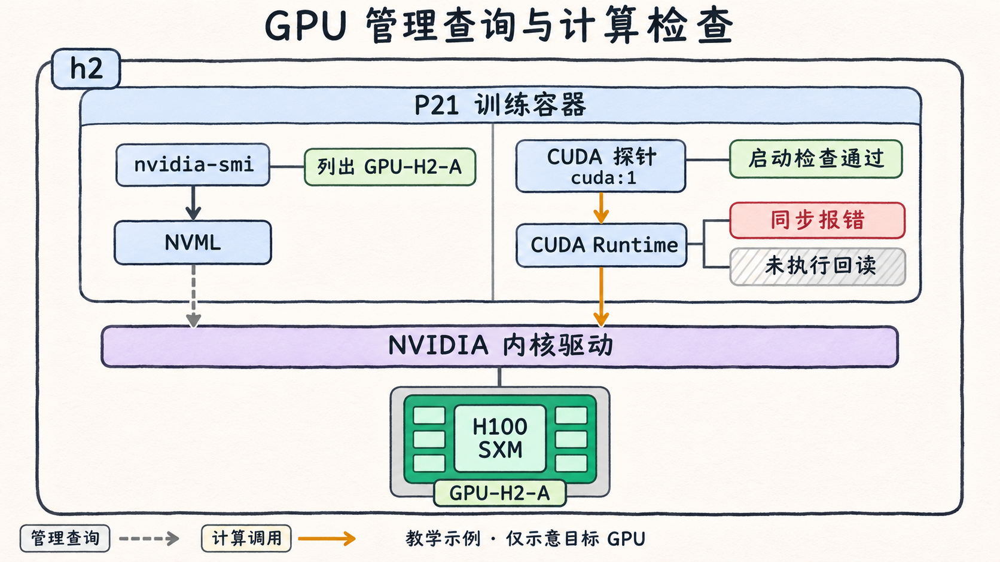

# CUDA 初始化、显存分配与计算失败

按照第 02 篇走完交付链，容器顺利进入 `Running`，`nvidia-smi` 也把目标 GPU 的型号和 UUID 列得清清楚楚。但业务代码刚一启动，屏幕就甩出一行刺眼的 `CUDA error`，进程直接退出。

为什么“明明能看到卡，却一算就挂”？因为 `nvidia-smi` 走的是 **NVML 管理旁路**，只验证驱动能读到设备状态；而真正做训练或推理，必须打通 **CUDA Runtime → 用户态驱动库 `libcuda.so.1` → 设备权限与上下文初始化 → 显存分配 → 异步 Kernel 执行与结果回读** 这一整条计算主干。

本篇用一只极简的单卡计算探针，把“设备可见”一步步推进到“结果正确回读”，彻底拆解四类最常见的计算层故障。

## 用一只最小单卡探针划清“算完了”的边界

排查计算故障时，切忌直接在庞大的训练脚本或推理框架里大海捞针——框架往往在 `import` 或首次算子调用时混杂了大量隐式动作，掩盖真正的第一现场。

一线排障最趁手的工具，是在**同一容器、同一系统用户、同一环境变量与目标 GPU**下跑一只最小探针：申请 `4 B` 显存、跑一个写入整数 `7` 的极简 Kernel、显式同步、再拷回主机校验 `output == 7`。关键观察点如下（`check` 表示检查并打印返回码）：

```cpp
check(cudaSetDevice(1));                                       // 1. 选中目标卡并触发 Runtime 初始化
int *device_output = nullptr;
check(cudaMalloc((void **)&device_output, 4));                 // 2. 申请最小 4 B 显存
write_seven<<<1, 1>>>(device_output);                          // 3. 异步提交极简 Kernel
check(cudaGetLastError());                                     // 4. 主机侧启动参数与提交检查
check(cudaDeviceSynchronize());                                // 5. 等待 GPU 真正跑完并捕获执行错误
int output = 0;
check(cudaMemcpy(&output, device_output, 4, cudaMemcpyDeviceToHost)); // 6. 将结果拷回主机内存
assert(output == 7);                                           // 7. 数值校验：证明闭环真正完成
```

按每一步卡住的位置对照下表，几秒钟就能把故障切进对应子层：

| 探针卡住的阶段 | 已跨过的上游能力 | 现场必留证据与第一排查方向 |
| --- | --- | --- |
| **入口库装载失败** | 容器进程已启动 | 动态链接器报错、`ldd` 实际库路径、缺失符号；查镜像与 `LD_LIBRARY_PATH` |
| **`cudaSetDevice` 失败** | 基础动态库加载完成（CUDA 12.0 起此调用即初始化所选设备 Runtime 状态） | 设备数、实选 UUID、错误码；核对 `libcuda.so.1` 来源、设备权限与宿主机驱动状态 |
| **`cudaMalloc` 失败** | 设备初始化成功 | 申请字节数、`cudaMemGetInfo` 余量、同卡进程占用与框架分配器缓存状态 |
| **Kernel 启动检查失败** | 显存分配成功 | Kernel 名称、Grid/Block 启动参数、架构编译目标（`sm_xx` / PTX）与返回码 |
| **`cudaDeviceSynchronize` 失败** | Kernel 已被主机接受并入队 | 同步返回码、此前入队的 Stream/Kernel 记录，以及同时间窗宿主机内核/Xid 日志 |
| **回读值不等于 `7`** | 设备执行未报错 | 拷贝返回码、实际读回值；核对输入数据依赖、并发写入或内存越界 |

最小探针读回 `7`，说明单卡计算闭环没有硬伤，可以把排查重心移出“驱动坏了或卡坏了”。但它只是单卡及格线，真实的显存规模、卡间互联与多机通信仍需按原业务工作量逐层复核。

## 为什么“启动检查通过”却在同步时报错？

这是 CUDA 排障里最容易让新手看错行号的坑。CUDA Stream 是异步指令队列：主机提交 Kernel 就像把快递单递进柜台，`cudaGetLastError()` 只检查单据格式、架构代码与启动参数合不合法，验完就立刻返回成功。

至于 GPU 真正把 Kernel 跑起来之后会不会非法访存或触发硬件异常，主机要等到 `cudaDeviceSynchronize()` 或后续某一次 `cudaMemcpy` 等待结果时才会收到报错。换句话说，**程序抛异常的那一行代码，经常只是“发现问题的位置”，而不是“闯祸的那个 Kernel”**。

> [!tip] 定位异步报错的实用开关：`CUDA_LAUNCH_BLOCKING=1`
> 如果业务代码在某次拷贝或后置算子处抛出 `an illegal memory access was encountered` 或 `unspecified launch failure`，可以在单卡复现环境临时加上 `CUDA_LAUNCH_BLOCKING=1`。它会强制每次 Kernel 启动后同步等待，让报错堆栈直接钉在肇事算子上（切勿带到生产环境，否则会抹平异步流水线、拖垮性能）。

## 四类“可见却不可算”的现场排查实战

下面四类故障均发生在容器已正常看到 GPU 之后，按最常见的出现频率逐一拆解。

### 1. 管理查询正常，初始化报 `cudaErrorInsufficientDriver`

容器镜像升级后，`nvidia-smi` 依然满屏正常，但业务进程在 `cudaSetDevice` 阶段直接报错：

```text
RuntimeError: The NVIDIA driver on your system is too old (found version 12040).
# 或原生 CUDA 返回：cudaErrorInsufficientDriver (35)
```

此时不要只盯着 `nvidia-smi` 右上角的 `CUDA UMD Version`（旧版写作 `CUDA Version`）做大小比较——那个字段反映的是宿主机驱动侧支持信息，不等于业务容器实际加载的 CUDA Runtime 版本，更不能代替驱动分支兼容性核对。排查动作分三步：

```bash
# 1. 查看宿主机运行中的真实驱动版本与进程实际链接的 libcuda 路径
$ nvidia-smi --query-gpu=driver_version --format=csv,noheader
$ ldd $(which python) | grep -i cuda
$ LD_DEBUG=libs python -c "import torch; torch.cuda.init()" 2>&1 | grep -i "libcuda.so.1"
```

如果旧镜像在同节点、同用户、同卡能跑通，优先核对新镜像是否夹带了过旧或伪造的 `libcuda.so.1`（常见于误把 `stubs` 目录写进 `LD_LIBRARY_PATH`），或检查容器内 CUDA Runtime 是否超出了宿主机驱动的次版本兼容边界；对于携带 PTX 中间码等待驱动 JIT 编译的程序，尤其要确认目标驱动版本支持对应的 PTX 指令集。

### 2. 设备文件都在，打开却返回 `EACCES`

容器里 `ls -l /dev/nvidia*` 看得见所有设备节点，但探针一到设备初始化就失败。挂上 `strace` 跟踪系统调用，真相立刻露面：

```bash
$ strace -f -e trace=openat ./cuda_probe 2>&1 | grep nvidia
openat(AT_FDCWD, "/dev/nvidiactl", O_RDWR) = 3
openat(AT_FDCWD, "/dev/nvidia1", O_RDWR)    = -1 EACCES (Permission denied)
```

设备文件存在，只说明路径挂载进了容器，并不意味着当前容器 UID/GID、cgroup v2 设备访问控制规则或安全上下文（SELinux/AppArmor）允许读写。

> [!warning] 常见误区：别用 `--privileged` 验证权限问题
> 随手拉一个特权容器看到探针跑通，并不能说明到底缺了哪一条权限——特权模式一次性放开了全部 cgroup 设备规则和 Linux Capabilities，属于“临时绕行”。规范做法是保持镜像、用户和目标 GPU 不变，逐条核对 cgroup v2 设备策略与安全审计日志，只补齐缺失的放行规则，再用原用户跑通计算回读。

### 3. 4 B 探针全绿，业务一跑就报 `cudaErrorMemoryAllocation`

最小探针稳稳通过，业务进程却在选卡后申请 `6 GiB` 显存时抛出 OOM（`cudaErrorMemoryAllocation`）。此时在同一张目标卡上查询 `cudaMemGetInfo`，发现当前可用显存仅剩 `4 GiB`：

$$4\text{ B} \le 4\text{ GiB（当前可用显存）} \implies \text{最小探针通过}$$

$$6\text{ GiB} > 4\text{ GiB（当前可用显存）} \implies \text{新分配请求被拒}$$

这组对照直接说明 GPU 计算硬件本身没坏，瓶颈在于**可用显存余量不足**。接下来立刻做三层细分：
1. **查“谁占了卡”**：用 `nvidia-smi --query-compute-apps=pid,process_name,used_memory --format=csv` 核对是否有僵尸进程或其他共享容器提前吃掉了显存；
2. **查“框架预留还是碎片”**：如果宿主机显存看起来只占了一半、PyTorch 却报 OOM，调出 `torch.cuda.memory_summary()` 区分“存活张量”与“缓存分配器预留但难以复用的碎片”；
3. **查“是不是主机内存 OOM”**：若进程直接收到 `SIGKILL (Exit Code 137)` 而非 CUDA 异常，改查容器 cgroup 内存上限与节点 `dmesg` 的 OOM Killer 记录。

> [!tip] 在线推理常见坑：KV Cache 启动预分配 OOM
> 主流大模型推理引擎（如 vLLM、SGLang）在加载完权重后，会按 `gpu_memory_utilization`（常见默认 `0.90`）一次性预留整块显存作为 Paged KV Cache 池。在同卡共享或混部节点上，哪怕一个不起眼的残留进程多占了 `10%–15%` 显存，推理引擎也会在启动压测显存余量时直接 OOM 崩溃，哪怕权重本身明明装得下。

### 4. 启动检查通过，首次同步报错：用跨卡对照分清“硬件”与“代码”

回到最棘手的场景：容器内管理查询正常，探针的 `cudaGetLastError()` 也绿了，但代码一走到 `cudaDeviceSynchronize()` 就报错退出，根本没机会执行回读。

下图对照了故障节点容器内“管理旁路”与“计算主干”的汇合边界（图中 `h2` 为故障节点，`P21` 为目标训练容器，`GPU-H2-A` 为映射到容器内 `cuda:1` 的目标 H100 卡）：



*图 18-03-01：同一容器内的管理查询与计算探针边界。左侧 NVML 旁路列出目标卡仅确认管理通路可用；右侧计算主干在同步阶段报错后，未执行结果回读，需结合前序提交工作与同窗驱动日志进一步分流。*

同步报错后，现场最怕陷入“算法怀疑卡坏了、运维怀疑代码越界”的扯皮。用一次干净的**同输入跨卡对照**就能迅速拍板：

- **换卡即通 + 原卡有异常**：用完全相同的镜像、输入数据和随机种子，换到同型号健康卡上同步成功并读回预期值，同时故障卡在相同时间窗内留有内核 Xid 或 PCIe 错误日志 → **优先锁定原卡或所在硬件路径**；
- **多卡同错 + 内核干净**：同一输入在多张已验证健康的同型卡上都复现了相同的非法访存或地址错误，且驱动日志干干净净 → **优先排查应用算子越界、张量步长错误或异步流释放过早**。

> [!summary] 核心结论
> “看到 GPU”只算交付及格，“算完并读回正确结果”才是单卡可用的终点。遇到可见但报错，按 **动态库与驱动兼容 → 设备访问权限 → 显存余量与碎片 → 同输入跨卡同步对照** 四步排查，每次验证都必须走到同步无错并回读预期值。

至此，单张 GPU 的交付与计算闭环已经彻底打通。但到了分布式生产环境，工程师最常遇到的是下一堵高墙：**单卡、单机全通，一拉成多机任务就死活等不到第一轮结果**。下一篇我们切入多机会合、NCCL 引导与 RDMA 显存注册的排查战场。

> [!info]- 参考资料
> - **CUDA Runtime 与异步错误处理**：[CUDA 13.2.1 Runtime API · Driver vs Runtime API](https://docs.nvidia.com/cuda/archive/13.2.1/cuda-runtime-api/driver-vs-runtime-api.html)、[CUDA 13.2.1 · Runtime 初始化](https://docs.nvidia.com/cuda/archive/13.2.1/cuda-programming-guide/02-basics/intro-to-cuda-cpp.html#runtime-initialization)、[设备管理 API](https://docs.nvidia.com/cuda/archive/13.2.1/cuda-runtime-api/group__CUDART__DEVICE.html)、[错误处理 API](https://docs.nvidia.com/cuda/archive/13.2.1/cuda-runtime-api/group__CUDART__ERROR.html)、[异步执行模型](https://docs.nvidia.com/cuda/archive/13.2.1/cuda-programming-guide/02-basics/asynchronous-execution.html)
> - **驱动兼容与管理接口**：[NVIDIA SMI · CUDA UMD Version](https://docs.nvidia.com/deploy/nvidia-smi/index.html)、[NVIDIA CUDA Minor Version Compatibility](https://docs.nvidia.com/deploy/cuda-compatibility/minor-version-compatibility.html)
> - **显存管理与设备访问控制**：[CUDA 13.2.1 · 显存管理 API](https://docs.nvidia.com/cuda/archive/13.2.1/cuda-runtime-api/group__CUDART__MEMORY.html)、[PyTorch 2.9 · CUDA 显存管理](https://docs.pytorch.org/docs/2.9/notes/cuda.html#memory-management)、[Linux Kernel · cgroup v2 设备控制器](https://docs.kernel.org/6.18/admin-guide/cgroup-v2.html#device-controller)
