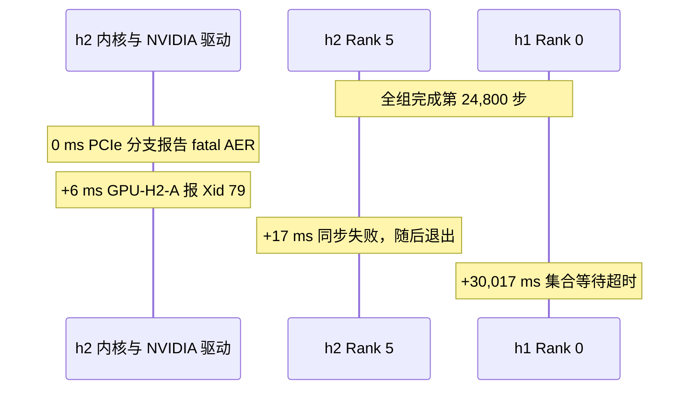
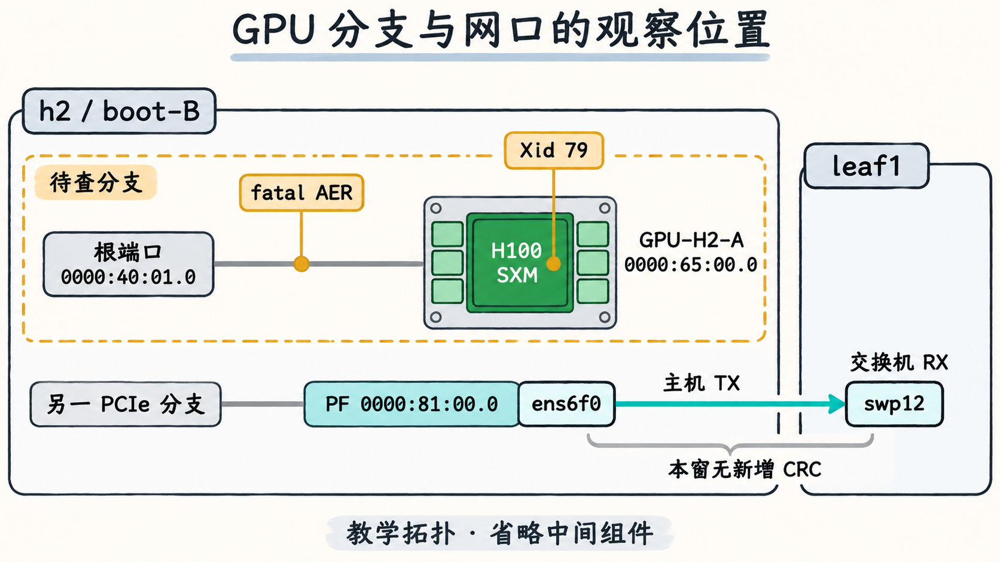

前三篇走完了一台节点把卡交给进程并完成一次计算的正常路径，本篇开始处理运行中的设备异常。`ai-demo/train-12` 已完成 24,800 个全局优化步。第 24,801 步中，`h1` 的多个 Rank 等不到集合结果，`h2` 的 Rank 5 已退出。集合通信要求组内的进程共同参与，一台节点的 GPU 失去执行能力，另外两台仍可能只看到自己的通信超时。按第 01 篇的方法，判断从哪一段开始，需要把最先异常的设备和实际退出的进程放在同一条时间线上，并区分最早事件、最早失败交接与下游症状。下面采用同一三节点作业的**教学故障记录**，第 07 篇接续这次事故。

## 用节点、启动周期与 PCI 拓扑对齐记录

Xid 是 NVIDIA 驱动报告 GPU 异常的事件编号。Linux 上通常可从内核日志取得带 GPU 地址的 Xid 消息。PCIe AER（Advanced Error Reporting，高级错误报告）由 PCIe 层报告链路或事务相关错误，Linux 可由根端口服务收集并发起恢复。两者观察位置不同。AER 中的报告者标识指向发出错误报告的设备，结合错误状态、严重性和当时的 PCI 树才能划定调查分支。可纠正的错误可由协议恢复，严重的不可纠正错误可能使事务或链路不可靠。Linux 6.18 文档还指出，是否由操作系统记录与处理 AER 受内核支持和固件通过 ACPI `_OSC` 交出的控制权影响，部分错误输出会限频。 [NVIDIA · Linux 上的 Xid 日志](https://docs.nvidia.com/deploy/xid-errors/latest/working-with-xid-errors.html) · [Linux 6.18 · PCIe AER](https://docs.kernel.org/6.18/PCI/pcieaer-howto.html)

本次 `h2` 启动周期记为 `boot-B`。先用事故前的清单还原实际路径。`GPU-H2-A` 的 BDF 为 `0000:65:00.0`，位于根端口 `0000:40:01.0` 的下游分支，供 `J17/R1/P21` 的 Rank 5 使用。`P21` 的 RoCE VF 为 `0000:81:00.2`，其父设备 `0000:81:00.0` 位于另一 PCIe 分支，接到 `ens6f0` 对应物理口，链路对端为 `leaf1/swp12`。GPU 与网卡都在 `h2`，这份拓扑将它们的直接 PCIe 路径分开。

下表是按关键字段转写的教学节录。时间相对于 10:42:00（UTC+8）。同一台机器的两个内核事件使用本次启动中单调时钟的顺序。表中的跨节点应用时点已校时，成对最大偏差为 2 ms。

| 相对时间 | 观察位置 | 教学记录 |
| --- | --- | --- |
| −80 ms | 全组应用 | 第 24,800 步已完成并提交优化器更新。 |
| 0 ms | `h2/boot-B` 内核 | GPU 所在根端口 `0000:40:01.0` 对应分支报告 fatal AER。 |
| +6 ms | `h2/boot-B` NVIDIA 驱动 | `0000:65:00.0` 报告 Xid 79，驱动访问设备失败。 |
| +17 ms | `h2/P21` Rank 5 | 第 24,801 步内 GPU 同步失败，进程随后退出。本次集合缺少该成员的完成记录。 |
| +30,017 ms | `h1` Rank 0 | 同一尝试中第 24,801 步的集合等待达到本例设置的超时时间，报告超时。 |

图 18-04-01　按时间顺序读取三个观察点。两个内核事件属于 h2 的同一次启动，Rank 5 与 Rank 0 的记录属于同一次运行、同一个故障步。纵向间距为示意，精确时差以表中数值为准。

**替代文本**　全组完成第 24,800 步后，h2 内核先报告 PCIe 分支 fatal AER，6 ms 后 GPU-H2-A 报 Xid 79，Rank 5 在 17 ms 同步失败退出，h1 的 Rank 0 在 30,017 ms 报告集合等待超时。

H100 的 Xid 79 表示驱动经 PCIe 访问 GPU 时发现设备已不可访问。PCIe 链路问题是目录列出的常见解释。它与同分支 fatal AER 及设备同步失败互相印证，所以首先调查 `h2` 的 GPU PCIe 路径和平台状态。现有记录无法在 GPU、本地连接、上游组件或供电之间确定责任部件。Rank 0 超时说明整组受到影响，发生在先前设备异常之后。若另有日志表明 Rank 0 在这之前就调用了不同顺序的集合，还需调查是否有独立故障。 [NVIDIA · H100 Xid 目录](https://docs.nvidia.com/deploy/xid-errors/latest/analyzing-xid-catalog.html)

作为对照，`ens6f0` 和 `leaf1/swp12` 在覆盖故障的短窗内，CRC 接收错误无新增，且端口没有记录掉线。这是对网卡物理链路假设的有限证据。CRC（循环冗余校验）接收错误表明接收端读到校验失败的帧。若另一次事故中 `leaf1/swp12` 的 RX CRC 增加，先看从 `h2` 发往交换机的物理方向，并核对两端的链路事件、同方向 RDMA 进度及端口计数定义。邻机端口的错误增量或较宽时间窗的计数，不能归到这次 GPU 事件。物理口无 CRC 增量这一项也无法排除拥塞、传输重试或未覆盖的交换路径。 [Linux 6.18 · 接口统计字段及驱动计数](https://docs.kernel.org/6.18/networking/statistics.html)

图 18-04-02　boot-B 的拓扑把 fatal AER 与 Xid 79 对到 GPU-H2-A 所在分支。相邻网口提供另一观察点，h2 的 TX 指向 leaf1/swp12 的 RX。短窗内无新增 CRC 只覆盖这两个网口的相关计数。要判断当时的传输表现，还需核对实际进度与排队。

**替代文本**　h2 的上方分支由根端口 0000:40:01.0 通往 GPU-H2-A，fatal AER 指向分支，Xid 79 指向 GPU；下方网卡位于另一分支，ens6f0 发向交换机 leaf1 的 swp12。

## ECC 和 NVLink 异常为什么会扩大或缩小故障范围

下面的两种变体各自替换上例中的设备事件。查证顺序仍从对象、时间和当前影响开始。

- **显存 ECC。** ECC（Error-Correcting Code，纠错码）让硬件检测存储数据的错误并纠正其中一部分。读到累计可纠正错误较高时，先确认计数口径、生命周期及故障窗是否有新增，再查该卡当时的执行与健康状态。若同窗出现不可纠正错误，核对 H100 目录中 Xid 48 及随后的处理事件。支持错误遏制的设备上，Xid 94 和 95 分别代表遏制与未遏制的情形，受影响应用范围不同。即使只终止访问错误显存的进程，这个进程属于非弹性的同步组，其余成员仍会失去它。是否需要重启应用、排空后复位或进一步检修，应结合伴随事件、恢复动作字段、行重映射状态以及厂商对当前平台的指导。 [NVIDIA · GPU 显存错误遏制](https://docs.nvidia.com/deploy/a100-gpu-mem-error-mgmt/latest/error-containment.html) · [NVIDIA · H100 Xid 目录](https://docs.nvidia.com/deploy/xid-errors/latest/analyzing-xid-catalog.html)
- **NVLink。** 在本例的 H100/NVSwitch 节点，若另一次故障只有某张 GPU 报 Xid 74，先查它所报告的链路及对端。故障可能出在该连接，也可能由对端 GPU 或 NVSwitch 的异常传来。若对端先报设备不可达，随后本端出现 NVLink 错误，本端报错可由对端退出解释。若无更早事件，查两端的链路状态、交换芯片事件和受影响的 GPU 对，再用相同的路径测卡间结果和吞吐。PCI 枚举及单卡回读通过只覆盖到单卡访问与计算。 [NVIDIA · Xid 74](https://docs.nvidia.com/deploy/xid-errors/latest/analyzing-xid-catalog.html) · [NVIDIA SMI · NVLink 查询](https://docs.nvidia.com/deploy/nvidia-smi/index.html)

## 在计数复位前保全证据

保留内核原始事件、启动 ID、PCI 树、驱动与固件信息、设备与作业映射，以及同窗内的网卡和互联记录。日志、累计计数及最近事件编号的时间意义不同。以 DCGM Exporter 4.8.4 上游字段为例，`DCGM_FI_DEV_XID_ERRORS` 是最后一次 Xid 编号，连续采到 79 只说明该值仍被报告。PCIe replay 则是累计计数，要在同一设备、同一计数生命周期内取差。重启过后即使看板恢复正常，也需要用故障前记录确定影响范围。现有证据足以把 `h2` 的 GPU 路径纳入隔离和维修，进一步确认故障部件要靠平台证据或受控检修。 [DCGM Exporter 4.8.4 · 字段定义](https://raw.githubusercontent.com/NVIDIA/dcgm-exporter/4.8.4/etc/default-counters.csv)

本篇的事故发生在作业已经跑起来之后，证据沿设备层向整组传播。下一篇把时间倒回作业启动阶段：当单机测试正常、跨节点却等不到第一个结果时，会合、引导和 RDMA 传输各自需要什么证据。
