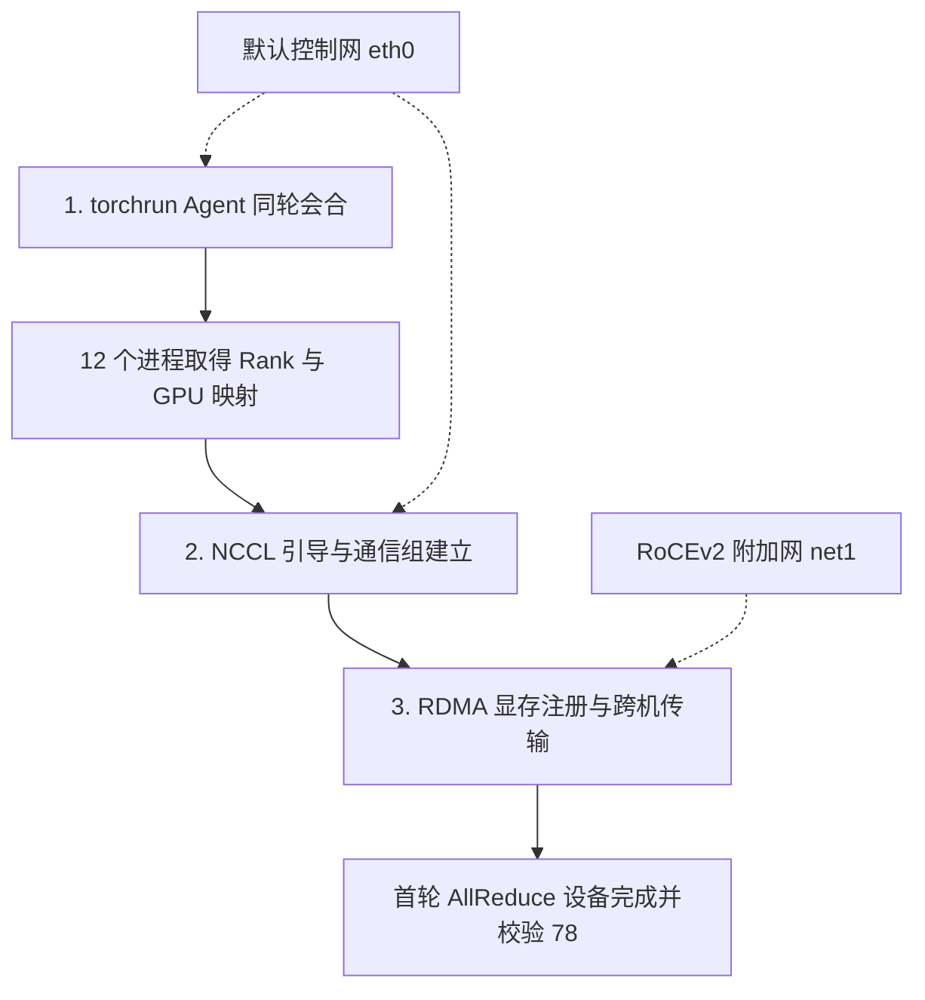
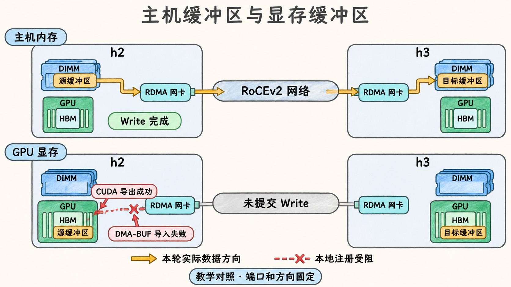

# 多机会合、RDMA 与 NCCL 初始化

单卡探针读回了 `7`，单机 4 卡 AllReduce 也跑得顺滑如丝。可一旦把 12 卡同步训练铺到三台节点上，或者在 PD 分离推理集群里启动 Prefill 与 Decode 跨池建链，日志停在初始化阶段一动不动，怎么都等不到第一轮结果。

面对“单机正常、多机卡死”，很多人本能地去重跑单机基准，或者一上来就怀疑交换机丢包。其实多机启动和单机最大的区别在于：**NCCL 只负责编排 GPU 集合通信，它不会替启动器拉齐成员，也不会替操作系统和网卡打通 RDMA 显存注册**。

本篇先拆清多机首轮通信依赖的三条独立路径，再逐一攻破四类最典型的跨节点启动障碍（含在线推理 PD 分离架构的 RDMA 注册异常）。

## 首轮通信必须打通的三条独立路径

为验证 12 卡跨机通信真正闭环，我们可以跑一只极简功能探针：让每个 Rank 提交一个 FP32 标量，Rank $r$ 填入 $r + 1$（从 1 到 12），全组执行一次求和 AllReduce。所有 Rank 设备完成并回读校验时，每张卡拿到的结果必须精确等于：

$$1 + 2 + \dots + 12 = 78$$

别看算式简单，要让这 12 个数字跨三台节点汇成 `78`，必须依次跑通三条职责完全隔离的路径：

| 路径与参与者 | 承载网络（本集群映射） | 核心职责 | 通过的硬证据 |
| --- | --- | --- | --- |
| **1. 启动器会合（`torchrun`）** | 默认网络 `eth0` | 让各节点 Agent 发现彼此、对齐轮次 | 全部节点进入同一轮，`WORLD_SIZE=12`，12 个进程拿到互不重复的 Rank |
| **2. NCCL 引导与建组** | 默认网络 `eth0` | 进程间建立控制 TCP 连接、交换组元数据 | 全组日志打印 `Init COMPLETE`，各 Rank 与物理 GPU UUID 一一对应 |
| **3. RDMA 载荷路径** | 附加网络 `net1`（RoCEv2 VF） | 选中 HCA/端口/GID、注册显存并完成硬件传输 | 首轮 AllReduce 设备工作结束，12 份回读结果全部等于 `78` |

下面这张依赖图直观标出了控制面（`eth0`）与高速数据面（`net1`）的分工：



*图 18-04-01：多机首轮集合通信的三段检查点与双网分工。实线代表先后交接，虚线标出控制面与数据面各自依赖的网络平面。*

排查时记住一个铁律：**默认网通了只覆盖第 1、2 段，绝不担保高速附加网的第 3 段能通**；哪怕第 1、2 段同走 `eth0`，会合端点通了也不保证所有 Rank 互相公告的 NCCL 监听端口彼此可达。下面来看三类最常见的训练启动故障。

## 故障一：会合 ID 不一致——Pod 全 Running，实为两组孤岛

现象最迷惑人：三只 worker Pod 全部是健康的 `Running`，但前两台节点的 `torchrun` Agent 死等第三个伙伴，一直卡在会合超时。

核查各 Pod 实际启动命令与会合后端日志，往往会立刻抓到参数错位：第三台节点把 `--rdzv_id` 写成了另一个值（或连向了不同的会合端点）。三个 Pod 虽然同时活着，却被拆进了两个互不相识的“聊天室”。

此时根本还没进入 NCCL 或 RDMA 阶段。排查只需核对三只 Pod 的实际启动参数与会合后端成员表，**只把错误节点的会合 ID 修正为统一值**，保持其余条件不变，确认三个 Agent 进入同一轮、全部 12 个进程拿到正确 `WORLD_SIZE` 与不重复的 Rank，再往下看建组。

## 故障二：NCCL 引导接口选错——会合过了，建组连不上

这一回，12 个进程全都拿到了 Rank 并打印出各自的 GPU UUID，说明第 1 段会合已经顺利过关。但开启 `NCCL_DEBUG=INFO` 后，日志直接暴露了第 2 段引导建链的异常：

```text
# 健康节点日志：正确选中业务默认网 eth0
[node-1/Rank 0] NCCL INFO Bootstrap : Using eth0:10.244.1.15<0>
# 故障节点日志：误选了只能通运维孤岛的接口 bond0，导致对端连不通
[node-3/Rank 8] NCCL INFO Bootstrap : Using bond0:192.168.99.23<0>
[node-3/Rank 8] NCCL WARN Connect to 10.244.1.15<41283> failed : Connection timed out
```

故障节点选错控制网卡后，自己探测本地地址能通，但把它通告给其他节点时，对端根本路由不到这个隔离网段。

修法很干净：核对 `NCCL_SOCKET_IFNAME` 配置，仅将故障节点的引导接口修正回 `eth0` 后重试。**注意同时确认 `NCCL_IB_HCA`（如 `mlx5_2:1`）是否按预期选对了 RoCE 网卡**——如果有人为了“先跑通”把 `NCCL_IB_DISABLE=1` 强切到了 Socket 路径，那只是业务临时止血，绝不等于修好了 RoCEv2 载荷网。

## 故障三：主机 RDMA 通了，显存 DMA-BUF 注册拦在门口

最深的一类启动卡死长这样：12 个进程全打印了 `Init COMPLETE`，可一跑首轮 AllReduce，某台节点的训练进程就在网络准备阶段报本地显存注册失败，其余节点全部陷入死等。

要迅速判断是“整个 RDMA 网络坏了”，还是“只在 GPU 显存直通（GDR）这一步卡壳”，可以在隔离窗口用 `perftest`（`ib_write_bw`）做一组极其高效的**两轮路径分解对照**（保持源/目标节点、网卡端口 `mlx5_2/1`、GID、单向 `Write` 方向、队列深度与消息大小完全一致）：

```bash
# 第一轮：纯主机内存缓冲区（验证网卡、GID、路由、QP 建连与基础 RDMA 传输）
$ ib_write_bw -d mlx5_2 -i 1 -x 3 -F --report_gbits <peer_net1_ip>
# 结果：两台节点控制连接、MR 注册与 Write 均成功完成！

# 第二轮：两端改用 GPU 显存 + DMA-BUF 注册（保持端口、GID 与方向完全不变）
$ ib_write_bw -d mlx5_2 -i 1 -x 3 --use_cuda=1 --use_cuda_dmabuf -F --report_gbits <peer_net1_ip>
# 结果：发送端在提交 Write 之前即报错退出：
# Couldn't register MR via dmabuf (ibv_reg_dmabuf_mr): Operation not supported / Cannot allocate memory
```

两轮对照的结果与物理位置如下表与插画所示（图中 `h2` 为发起端故障节点、`h3` 为接收端对端节点）：

| 对照轮次 | 观察到的结果 | 能直接拍板的结论 |
| --- | --- | --- |
| **轮次 1：主机内存 → 主机内存** | 建连、注册、RDMA Write 全部完成 | 选定端点、方向、GID 与交换网络的基础 RDMA 通路完好 |
| **轮次 2：GPU 显存 + DMA-BUF** | CUDA 显存导出成功，但发起端 RDMA 栈导入失败，**尚未提交 Write** | 故障锁死在发起端**本地显存注册交接**，与网络交换机无关 |



*图 18-04-02：基于 perftest 26.07.8 的主机内存与 GPU 显存 RDMA 路径分解对照（端点、端口与方向固定）。上排证明基础 RoCE 通路正常；下排在发起端本地 DMA-BUF 导入处即阻断，载荷尚未上链。*

> [!warning] 路径分解对照 ≠ 严格单变量实验
> 从主机内存切换到 GPU 显存时，**缓冲区位置**与**注册机制**（CUDA 导出 + DMA-BUF 导入）同时发生了变化。因此这组对照的作用是快速排除网络，把排查收窄到本地显存注册段。
>
> 接下来需在该段内逐项单变量核查：GPU 与网卡的 PCIe 拓扑与 ACS/IOMMU 设置、内核及网卡驱动的 DMA-BUF 导入支持、容器锁页内存权限（`RLIMIT_MEMLOCK`）；归因 NCCL 失败前还须确认选中了同一 GPU、网卡与注册方式。

## 警惕 `Init COMPLETE` 幻觉：动态建连陷阱

排查多机建组时，有一条版本细节常让人误判：**在 NCCL `2.27.3` 中，`NCCL_RUNTIME_CONNECT` 默认值为 `1`**。这意味着 NCCL 允许把部分数据通道的连接动作推迟到**第一次真正调用集合通信时**才动态建立。

因此，全组日志清一色打印出 `Init COMPLETE`，只说明引导与通信组初始化通过了，绝不保证所有跨机 RDMA 连接已经建好，更不代表数据已经算对。多机启动验收的唯一终点，必须是**核对实际走的是 RoCE 而非 Socket、全组设备完成无异步报错，且探针精确回读出预期校验值**。

## 在线推理延伸：PD 分离架构下的 KV Cache RDMA 注册失败

上述显存 RDMA 排查套路，不仅适用于多机训练，更是排查 **PD 分离（Prefill / Decode Disaggregation）在线推理集群**的利器。

在 PD 分离架构里，Prefill 池与 Decode 池各自独立弹性扩缩容，它们通常不组成静态的 NCCL 通信组，而是通过专用点对点 RDMA 传输引擎（如 NIXL 等）在 Prefill 算完提示词后，把 PagedAttention 的 KV Cache 显存块直接跨机写入 Decode 节点的显存池。

由于两池动态扩缩且显存池体量庞大，生产现场最常撞上两类初始化/建链报错：

```text
# 现场报错 A：推理引擎启动注册 48 GiB Paged KV 显存池时直接失败
[kv-transfer-engine] ERROR: ibv_reg_dmabuf_mr(size=51539607552) failed: Cannot allocate memory (ENOMEM)
# 原因：容器默认 ulimit -l（RLIMIT_MEMLOCK）仅几十 MiB 或未加 IPC_LOCK，无法锁定数十 GiB KV 池

# 现场报错 B：Prefill 池向新扩容的 Decode 副本发起跨池 KV 握手超时
[prefill-03] WARN: RDMA handshake to decode-07 (gid_idx=1, 10.128.4.21) timed out after 5000ms
# 原因：新扩容节点缺少 RoCEv2 IPv4 GID 映射，或两池被调度到了未打通路由的隔离网络域
```

面对这类 PD 分离建链故障，直接复用本篇的两步套路：
1. **先查本地注册**：在报错容器内检查 `ulimit -l`、容器 `IPC_LOCK` 能力以及 `ib_write_bw --use_cuda_dmabuf`，排除锁页额度或 DMA-BUF 能力缺失；
2. **再查跨池寻址与连通**：核对 Prefill 与 Decode 两端网卡的 `show_gids` 输出、生效的 RoCEv2 GID 索引和 MTU，用跨池两点 `perftest` 验证单向写通，再回归业务请求检查。

> [!summary] 核心结论
> 多机启动卡顿绝非一团浆糊：先看**会合是否凑齐同组**，再看**引导是否选对控制口**，最后用**主机内存 vs 显存 DMA-BUF 两轮 `perftest`** 切开网络问题与本地显存注册问题——同一套方法同时覆盖同步训练建组与 PD 分离推理的跨池 KV 建链。

一旦首轮通信顺利跑通，系统就进入了稳态运行期。接下来最折磨运维的不再是“起不来”，而是“**跑是跑起来了，可训练步越走越慢，在线推理尾延迟也莫名飙升**”。下一篇我们进入性能退化的精细切分。

> [!info]- 参考资料
> - **NCCL 通信、排障与动态建连**：[NCCL 2.27.3 · Collectives](https://docs.nvidia.com/deeplearning/nccl/archives/nccl_2273/user-guide/docs/usage/collectives.html)、[NCCL Troubleshooting](https://docs.nvidia.com/deeplearning/nccl/archives/nccl_2273/user-guide/docs/troubleshooting.html)、[环境变量与 NCCL_RUNTIME_CONNECT](https://docs.nvidia.com/deeplearning/nccl/archives/nccl_2273/user-guide/docs/env.html#nccl-runtime-connect)、[NCCL v2.27.3-1 · init.cc 参数源码](https://github.com/NVIDIA/nccl/blob/v2.27.3-1/src/init.cc#L1148)
> - **PyTorch 弹性会合**：[PyTorch 2.9 · torchrun Elastic Launch](https://docs.pytorch.org/docs/2.9/elastic/run.html)
> - **GPUDirect RDMA 与 DMA-BUF 测试**：[NVIDIA · GPUDirect RDMA 文档](https://docs.nvidia.com/cuda/gpudirect-rdma/)、[perftest 26.07.8 · CUDA 与 DMA-BUF 用法](https://raw.githubusercontent.com/linux-rdma/perftest/26.07.8/README)
