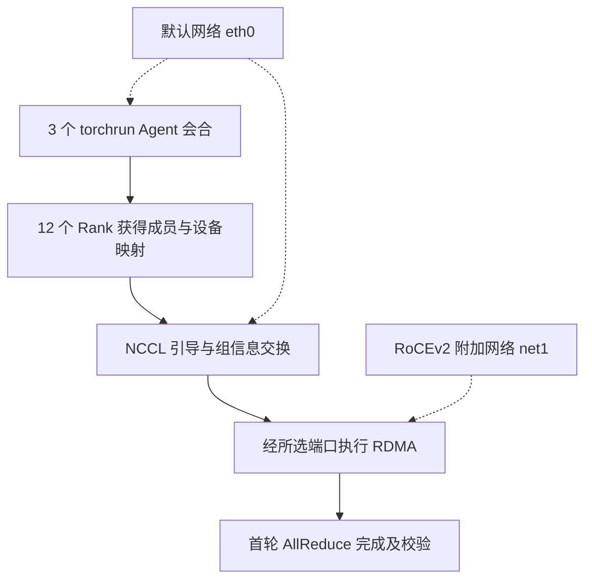
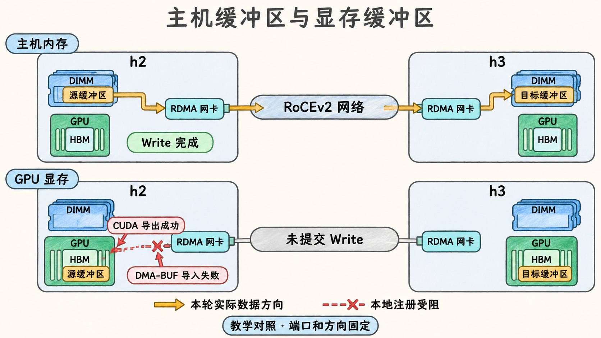

第 04 篇的设备异常发生在作业运行中，本篇把时钟拨回启动阶段，处理另一类典型故障。AllReduce 需要所有成员贡献输入，并把归约结果交给每个成员。NCCL（NVIDIA Collective Communications Library，NVIDIA 集合通信库）负责建立通信组并安排跨 GPU 的数据传输，跨节点时还依赖作业启动器交付成员信息、网络提供控制和载荷路径。`train-12` 在 `h2` 的四张 GPU 上能通过单机 AllReduce，扩展到 `h1/h2/h3` 各四卡后却等不到第一次结果。按第 01 篇的覆盖范围原则，单机测试已经证明本地执行与卡间能力，跨节点新增的交接需要各自证实。 [NCCL 2.27.3 · 集合操作](https://docs.nvidia.com/deeplearning/nccl/archives/nccl_2273/user-guide/docs/usage/collectives.html)

## 会合、引导与实际传输使用什么连接

健康的教学运行中，每只 worker Pod 有一个 `torchrun` Agent 和四个训练进程。固定规模为三个 Agent、十二个训练进程。**会合（rendezvous）**让 Agent 通过指定后端对本轮成员和运行标识达成一致，随后训练进程取得自己的 Rank 和组规模。本例会合端点通过 Pod 默认网络 `eth0` 可达。NCCL 的**引导（bootstrap）**随后在本例使用同一默认网络建立进程间的控制连接、交换建立通信组所需的信息。会合服务和 NCCL 对等连接需要分别核对源接口、目标地址和端口。一个监听端口可达，覆盖的是那项具体连接。 [PyTorch 2.9 · torchrun 会合与成员](https://docs.pytorch.org/docs/2.9/elastic/run.html) · [NCCL 2.27.3 · IP 接口与连接排查](https://docs.nvidia.com/deeplearning/nccl/archives/nccl_2273/user-guide/docs/troubleshooting.html)

跨节点载荷在本例通过附加网络 `net1` 上的 RoCEv2 发送。RoCEv2 在可路由的以太网/IP 网络上承载 RDMA（Remote Direct Memory Access，远程直接内存访问），网卡可以在已注册的缓冲区之间传输数据。缓冲区若位于 GPU 显存，GPUDirect RDMA 使网卡在条件满足时直接访问它，省去由主机内存中转这段载荷的需要。`h2/P21` 进程看到 `mlx5_2/1`，它对应 `net1` 的 VF `0000:81:00.2`，通过父设备的物理口连接 `leaf1/swp12`。`eth0` 和 `net1` 的用法来自本例的部署与实选路径。NCCL 的 Socket 接口选择和 RDMA 设备选择分别生效。 [NVIDIA · GPUDirect RDMA](https://docs.nvidia.com/cuda/gpudirect-rdma/) · [NCCL 2.27.3 · NCCL_SOCKET_IFNAME 与 NCCL_IB_HCA](https://docs.nvidia.com/deeplearning/nccl/archives/nccl_2273/user-guide/docs/env.html)

图 18-05-01　本例的跨节点检查点与网络分工。实线串起会合、进程入组、引导、载荷传输和结果完成，虚线指出该动作依赖的网络。通信连接可能在初始化阶段或首次操作中建立。

**替代文本**　三个 torchrun Agent 先在默认网络 eth0 上会合，十二个 Rank 取得成员与设备映射，NCCL 再经 eth0 完成引导，载荷经附加网络 net1 上的 RoCEv2 执行 RDMA，最后校验首轮 AllReduce。

## 三份启动停滞记录指向不同阶段

下面是三份独立的**教学变体**。故障表述都是「单机通过，多机等不到首步」。每份记录先核对同一次尝试的 Agent、Rank、通信组与实际设备，再找最早有明确错误或尚缺成功证据的位置。

### 只有两个 Agent 进入会合

`h1/h2` 的 Agent 一直等待第三个成员。`h3` 的容器也在运行，其启动命令却将会合 ID 写成另一个值，且它的日志记录了该值。三个 Pod 都可能处于 Running，Agent 此时仍在两个不同的会合组中。核对三份实际启动参数、会合后端的成员记录及 `h3` 到指定端点的访问。以相同端点和一致的会合 ID 重试，复核三个 Agent 进入同一轮、十二个训练进程取得正确的组规模和不重复的 Rank，随后再看通信组。

### 会合成功后，NCCL 引导选错接口

十二个进程都记录了 Rank 与 GPU UUID。排障收集的 `NCCL_DEBUG=INFO` 日志把最早的连接异常定位到引导。健康节点使用 `eth0`，`h3` 选了只能访问隔离网段的运维接口。该接口能访问本机探测地址，由此无法推到其他 Rank 对它公告的地址可达。核对进程日志里的实际源接口、对端通告地址和监听端口，再用同 Pod 网络视图验证连通性。仅修正 `h3` 的引导接口选择，以同一放置重做初始化和首轮操作。修正前后的日志要同时保留实际的 RDMA 设备选择，避免把走 Socket 载荷的成功当成了 RoCE 恢复。 [NCCL 2.27.3 · 调试日志、接口与 IB 开关](https://docs.nvidia.com/deeplearning/nccl/archives/nccl_2273/user-guide/docs/env.html)

### 主机缓冲区可传输，显存缓冲区注册失败

十二个进程在本轮均有通信组初始化完成的记录。之后，Rank 5 在首轮集合的网络准备阶段报告本地显存注册失败，其他 Rank 等不到设备完成。同时间段在隔离的测试窗口用 `perftest` 对照，先测 `h2 → h3` 的单向 RDMA Write，缓冲区都位于主机内存，再把两端改成显存。保持同一对 Pod 网络视图、RDMA 设备和端口、GID、方向、队列深度、并发和消息规格，记录两端的职责。`h2` 发起 Write，`h3` 提供目标缓冲区，本次只测这一个载荷方向。GID（Global Identifier，全局标识符）是 RDMA 端口用于寻址的标识，RoCE 环境还要核对该项关联的接口与类型。控制连接的成功需与 RDMA 请求完成分别记录。

| 教学对照 | 固定条件下的结果 | 如何缩小范围 |
| --- | --- | --- |
| 主机内存到主机内存的 RDMA Write | 两端控制连接和注册通过，`h2` 观察到请求成功完成。 | 指定端口、方向和负载条件下基本 RDMA 路径可用。 |
| 两端换成指定 GPU 上的显存，采用 DMA-BUF 注册 | CUDA 分配和导出成功，`h2` 的 RDMA 用户态栈导入本地缓冲区时失败，未提交 Write。 | 失败收窄到 `h2` 的显存注册交接。优先查 GPU–NIC 的 PCIe 路径、GPU/NIC 驱动能力、内核与注册权限。 |

图 18-05-02　教学对照采用 perftest 26.07.8。两轮覆盖同一对端点和同一方向。主机内存轮完成传输，显存轮在 h2 本地导入处停止，未提交 RDMA Write。进一步解释 NCCL 首轮失败，需要核实应用实际选择的 GPU、网卡和注册机制。

**替代文本**　两排都把 h2 放在左侧、h3 放在右侧；上排数据由 h2 主机缓冲区经两端网卡送至 h3 主机缓冲区，下排缓冲区进入 GPU 显存，失败标记在 h2 内部的 DMA-BUF 导入处，网络上没有本轮载荷。

DMA-BUF 是 Linux 通过文件描述符在设备驱动间共享缓冲区的一种机制。上例按 perftest 26.07.8 支持 CUDA 与 DMA-BUF 的构建设定，需要两端实际具备导出和导入能力。测试与生产若使用不同注册机制，微基准只能验证自己走过的路径。只有另外核实 NCCL 记录的同一端点、同一 GPU 和同一注册机制，二者的失败才互相加强。若第一轮主机缓冲区也失败，则先按实际发生的控制连接、GID 或路由、队列对建立、传输完成等环节继续缩小范围。 [perftest 26.07.8 · GPU Direct 与 DMA-BUF 用法](https://raw.githubusercontent.com/linux-rdma/perftest/26.07.8/README) · [NVIDIA · GPUDirect RDMA](https://docs.nvidia.com/cuda/gpudirect-rdma/)

## 初始化通过后仍要验证首轮设备完成

NCCL 2.27.3 的 `NCCL_RUNTIME_CONNECT` 默认值为 `1`，允许在调用集合等操作时动态建连。全组初始化完成只确认已走过相应的初始化路径。继续查实际使用的后端、每端选中的 NIC、首轮的调用顺序和参数，以及所有 Rank 的设备完成与结果校验。双端点测试成功覆盖的是这一对端点的指定操作，无法覆盖十二个成员的调用约定、所有路径与并发。若临时用 Socket 载荷绕开 RDMA 作对照，先确认后端确实切换，再用结果判断故障是否随该路径变化。需要原 RoCE 交付时，恢复后回到同一 RDMA 端点和消息条件重测。 [NCCL 2.27.3 · 动态建连及网络配置](https://docs.nvidia.com/deeplearning/nccl/archives/nccl_2273/user-guide/docs/env.html#nccl-runtime-connect)

首轮已完成后，调查的对象从「能否组队和传输」变成「哪一段拉长了后续训练步」。最早开始等的进程和最晚让整组继续的进程可能在不同节点，第 06 篇就把一个训练步切成可复算的时间段。
