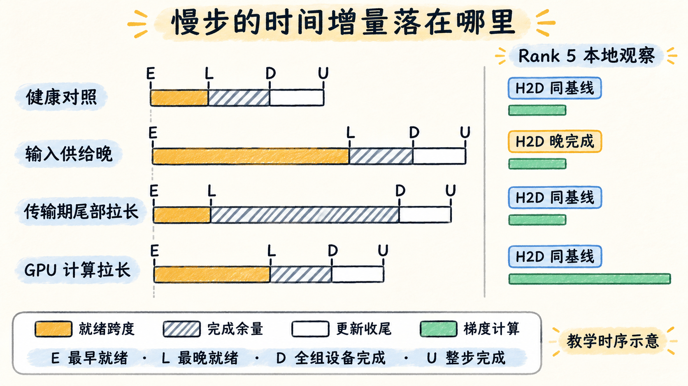
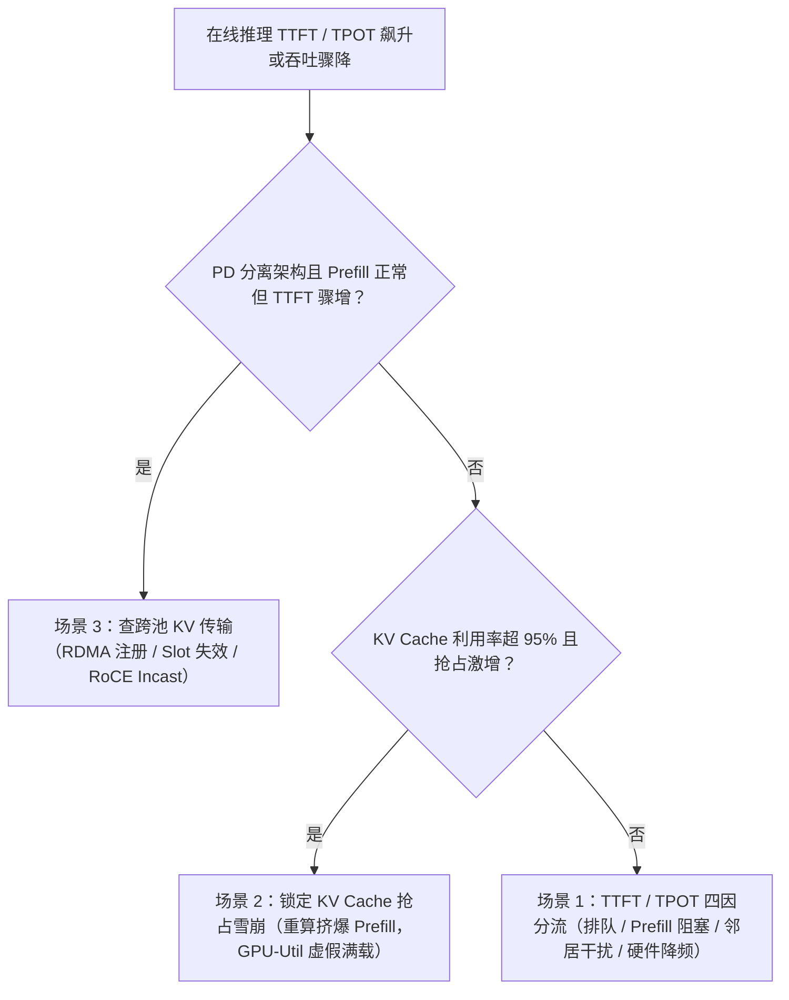

# 慢 Rank、集合等待与训练步退化

最让人头疼的告警往往不是“作业报错退出”，而是“任务还在跑，但效率腰斩”。

在训练侧，一个原本 `180 ms` 一步的 12 卡作业突然拖到了 `570 ms`，绝大多数卡的监控看起来都“在等通信”；在推理侧，业务面板上 `GPU-Util` 稳稳贴在 `98%`，用户体感却卡成幻灯片——TTFT 和 TPOT 尾延迟双双突破红线，有效吞吐断崖式下跌。

如果只凭直觉喊“网络慢了”或“加卡扩容”，十有八九会南辕北辙。本篇前半部分用设备侧时间切分彻底拆解**分布式训练的慢步与集合挂起**，后半部分系统梳理**在线推理三大典型生产故障**（尾延迟飙升、KV Cache 抢占雪崩与 PD 分离传输超时）。

---

## 一、分布式训练：用设备侧时间轴锁定慢因

第 17 章已经能靠窗口指标抓出“哪五分钟变慢了”，本篇把镜头推进到**单个故障步的 GPU 设备侧**，回答一个核心问题：多出来的几百毫秒，到底落在了“等人到齐”，还是落在了“到齐之后传得太慢”？

### 1. 用 E、L、D、U 切开一个训练步

考虑同步训练的一步：每张卡完成输入 H2D 拷贝与本地梯度计算后，参与同一轮 AllReduce，最后执行优化器更新（为看清主干，这里暂不计梯度分桶与跨步流水重叠）。

对每个 Rank $i$，我们在 **GPU 设备侧**记下三个关键时点：输入与前置依赖就绪、可以开工集合的时点 $R_i$；本轮集合设备工作完成的时点 $C_i$；优化器更新结束的时点 $U_i$。汇总全组得到四个全局锚点：

$$E = \min_i(R_i),\quad L = \max_i(R_i),\quad D = \max_i(C_i),\quad U = \max_i(U_i)$$

从最早成员就绪到全组集合完成，总耗时可以严格拆成相邻两段：

$$D - E = (L - E) + (D - L)$$


*图 18-05-01：同步集合通信的四个设备侧观测点。`L − E` 反映成员齐步的离散度，`D − L` 反映最晚成员就绪后还需多久收尾（部分先到成员可能已在 L 之前提前启动了部分传输）。*

> [!note] 两个不能混用的时间口径
> 1. **设备就绪 $R_i$ ≠ 应用调用 $A_i$**：第 17 章记录的“应用抵达”属于主机侧调用入队，而这里的 $R_i$ 是 GPU 设备前置依赖真正满足的时刻；在异步执行下二者可能相差甚远，切忌把两种口径直接相减。
> 2. **跨机对齐须带误差意识**：GPU 内部时钟需要通过追踪工具的 host/device 校准映射到主机单调时钟，再叠加跨机校时同步（本集群成对最大误差约 `2 ms`）；若缺乏统一校准，仅做同机区间对比。

### 2. 三种经典慢步的数值对照

下表对比了同一 12 卡作业在相同模型与批量下的四种工况（单位 `ms`，以共同步起点为 `0`；最早就绪 `E` 来自 Rank 0，最晚就绪 `L` 均落在目标节点上的 Rank 5）：

| 工况 | Rank 5 H2D 完成 | Rank 5 梯度计算 | E | L | D | U | 就绪跨度 `L − E` | 完成余量 `D − L` |
| --- | ---: | ---: | ---: | ---: | ---: | ---: | ---: | ---: |
| **健康对照** | 35 | 55 | 70 | 90 | 150 | 180 | 20 | 60 |
| **输入供给晚** | 425 | 55 | 70 | 480 | 540 | 570 | 410 | 60 |
| **传输期尾部拉长** | 35 | 55 | 70 | 90 | 420 | 450 | 20 | 330 |
| **GPU 计算拉长** | 35 | 175 | 70 | 210 | 270 | 300 | 140 | 60 |

拿三种慢步减去健康对照，增量立刻把真凶分成了截然不同的两拨：

| 慢步工况 | $\Delta(L - E)$ | $\Delta(D - L)$ | $\Delta(U - D)$ | 整步增量 $\Delta U$ | 首要排查方向 |
| --- | ---: | ---: | ---: | ---: | --- |
| **输入供给晚** | `+390 ms` | `0 ms` | `0 ms` | `+390 ms` | 增量全在就绪跨度，且 H2D 晚了 `390 ms` → 查数据读取与供给链 |
| **传输期尾部拉长** | `0 ms` | `+270 ms` | `0 ms` | `+270 ms` | 全员准时到齐，增量全在完成余量 → 查 RoCE 拥塞与网络队列 |
| **GPU 计算拉长** | `+120 ms` | `0 ms` | `0 ms` | `+120 ms` | H2D 准时，梯度计算多花 `120 ms` → 查该卡降频、散热与功耗 |



*图 18-05-02：三种慢步的时间增量分布对照（精确毫秒值见上表）。先把新增耗时钉在 `L − E` 还是 `D − L`，再结合右侧最晚成员的 H2D 与计算时长做二次分流。*

### 3. 三条分支的现场取证与验证

- **分支 A：输入供给晚（存储/预取拖垮全组）**
  本例中，健康节点 Rank 0 从就绪到全组完成要苦等 $540 - 70 = 470\text{ ms}$（基线仅 `80 ms`），监控上看起来满屏都是“集合等待”。但顺着最晚成员追查发现，梯度计算仍是稳稳的 `55 ms`，只是 H2D 推迟到了 `425 ms`，同批次 NFS 读取 p95 时延激增。
  **验证动作**：保持样本、批量、预处理与通信配置不变，将同批原始数据预热到目标节点本地盘重跑。如果 `L − E` 与 `U` 同步恢复基线，就能坐实问题出在远端数据供给，再进一步对齐客户端、存储网与服务端排队；此时 GPU 低利用率纯粹是“饿肚子”的结果。

- **分支 B：传输期尾部拉长（RoCE 出口拥塞）**
  全员准时就绪（`L − E = 20 ms`），但完成余量从 `60 ms` 暴涨到 `330 ms`。核查实际收发路径发现，交换机发往目标节点的出口队列深度与 ECN 标记增量同步攀升，两端无新增 CRC 错包。
  **验证动作**：固定通信拓扑与负载，在受控窗口仅压低竞争同一交换机出口队列的背景流量。若队列积压、ECN 增量与 `D − L` 同时回落，即锁定为队列竞争。注意 PFC 暂停会沿上游逐跳扩散，切忌只凭某一跳的 PFC 计数就直接定罪拥塞源头。

- **分支 C：GPU 硬件降频（数据到了，算得太慢）**
  H2D 准时在 `35 ms` 完成，但梯度计算从 `55 ms` 暴涨至 `175 ms`（多出的 `120 ms` 恰好等于 $\Delta U$）。立即在计算期间抓该卡的频率、温度与时钟事件原因：

```bash
$ nvidia-smi -i 1 -q -d CLOCK,TEMPERATURE,PERFORMANCE
    Temperature
        GPU Current Temp                  : 87 C       # 逼近热节流阈值
    Clocks
        SM                                : 700 MHz    # 较基线 1,550 MHz 腰斩！
    Clocks Event Reasons
        Idle                              : Not Active
        SW Power Cap                      : Not Active
        HW Thermal Slowdown               : Active     # <-- 实锤：硬件过热触发降频
```

> [!warning] 别把“空闲低频”误判为“算力降频”
> GPU 在等数据或等通信空闲时，SM 时钟也会自动降到几百 MHz 省电。只有当负载处于满载计算窗、`Idle` 为 `Not Active` 且 `HW Thermal Slowdown` 或 `SW Power Cap` 处于 `Active` 时，低频率才是计算变慢的真凶。

### 4. 集合彻底挂起（没有 `D`）：先查调用分歧

如果某一轮彻底卡死、永远等不到 `D`，切忌把缺失时点填成 0，也别盲目怪网络。第一时间把 12 个 Rank 的**通信组 ID、调用序号、原语类型、张量字节数与数据类型**拉齐对照：

- 若 11 个成员都提交了第 38 次 `AllReduce`，剩下 1 个成员停在前一轮、已异常退出，或因代码分支改调了 `Broadcast`，这就形成了**调用顺序/类型分歧**——先查应用逻辑分支或上一轮未处理的异常；
- 若全员提交了完全匹配的调用，再逐卡检查前置 CUDA Stream Event 是否悬而未决、通信 Kernel 是否已启动，以及网卡发送计数是否彻底停滞。

---

## 二、在线推理典型故障排查：尾延迟飙升、KV 雪崩与 PD 超时

训练最怕“一步拖慢全组”，而在线大模型推理最怕两件事：**用户等太久（TTFT/TPOT 尾延迟飙升）** 和**吞吐莫名雪崩**。很多时候，推理集群的 GPU 指标看起来“忙得热火朝天”，服务却已经濒临不可用。

拿到推理延迟告警后，直接按下面这棵**四向分流决策树**，把业务指标和底层 GPU 遥测交叉对照，五分钟内就能锁死故障层：



*图 18-05-03：在线 LLM 推理性能退化的快速分流决策树。先把 PD 跨池传输和 KV 抢占雪崩两类高频大雷筛出来，再精细区分四类尾延迟诱因。*

### 场景 1：TTFT / TPOT 尾延迟飙升——四因对照分流

把推理引擎吐出的业务指标（排队时长、Prefill/Decode 阶段耗时、TTFT、TPOT）和 DCGM 底层指标（`SM_ACTIVE`、`DRAM_ACTIVE`、`SM_CLOCK`、`Clock Event Reasons`）摆到同一张表上，四类真凶一眼就能分开：

| 故障根因 | TTFT 表现 | TPOT（ITL）表现 | 关键交叉证据（业务 + 硬件） | 首选验证与处置 |
| --- | --- | --- | --- | --- |
| **1. 请求突增排队** | 陡升 | 基本平稳 | 引擎等待队列长度与排队时长暴涨，但单个请求进入执行后的 Prefill/Decode 耗时不变 | 属容量/入口问题而非 GPU 故障；检查限流、负载均衡策略与弹性扩容 |
| **2. Prefill 抢占 Decode** | 偏高 | 出现**周期性尖刺** | 每当超长 Prompt 进入，`SM_ACTIVE` 瞬间拉满，正在吐字的 Decode 批次被插队停顿数十至数百毫秒 | 开启或调优 Chunked Prefill，合理收紧 `max_num_batched_tokens` 切分大块计算 |
| **3. 同卡共享邻居干扰** | 略升或抖动 | **整体抬升且 P99 剧烈抖动** | 本服务并发与上下文长度稳定，但同卡 `DRAM_ACTIVE` / `GPU-Util` 被其他容器拉满（Time-Slicing/MPS 争抢 HBM 带宽） | 用 `nvidia-smi pmon` 与容器级 DCGM 抓出吵闹邻居；高 SLO 推理迁往 MIG 硬隔离或独占池 |
| **4. 硬件降频** | 同步拉长 | 同步拉长 | 业务并发、输入长度与邻居均无变化，但单步计算耗时按固定比例膨胀，`SM_CLOCK` 跌落且热/功耗限速激活 | 核查机房散热与功耗上限，摘流该副本并隔离排查硬件 |

### 场景 2：KV Cache 耗尽触发大规模抢占/重算（吞吐雪崩）

这是在线推理生产环境里**最具欺骗性**的故障：告警响起时，你在监控上看到 `GPU-Util = 98%`、显存占用 `99%`，很容易误以为“集群太火爆、算力全满”。但拉出推理引擎的业务指标和日志，真相触目惊心：

```text
# 推理引擎 Prometheus 指标快照（5 分钟故障窗口）
vllm:kv_cache_usage_perc{pod="infer-svc-1-7b8d"}    0.994   # KV 显存池几乎吃干！
vllm:num_requests_running{pod="infer-svc-1-7b8d"}    68
vllm:num_requests_waiting{pod="infer-svc-1-7b8d"}    142
vllm:num_preemptions_total{pod="infer-svc-1-7b8d"}   +420    # 5 分钟内发生 420 次请求抢占！

# 推理引擎告警日志摘录
WARNING 11-20 14:22:08 scheduler.py: Sequence group req-91842 is preempted by
  Recomputation mode because there is not enough KV cache space.
  This can affect the end-to-end performance. Increase gpu_memory_utilization or reduce max_num_seqs.
```

为什么 KV Cache 满载会直接引发**吞吐雪崩**？我们可以从显存容量与吞吐的正反馈环看清本质。设单副本分配给 KV Cache 的显存池容量为 $M_{\text{KV}}$，每 token 占用的 KV 字节数为 $b_{\text{tok}}$，当前并发活跃请求数为 $N$、平均上下文长度为 $\bar{L}$：

$$N \cdot \bar{L} \cdot b_{\text{tok}} \ge M_{\text{KV}} \implies \text{无可用 KV Block，触发抢占（Preemption）}$$

一旦越过这条红线，系统立刻陷入死亡螺旋：
1. **被踢出与重算**：调度器被迫中止部分正在 Decode 的请求，清空其 KV Block（Recompute 模式）或通过 PCIe 换出到主机内存（Swap 模式）；
2. **算力空转挤兑**：被抢占的请求重新排进队列，再次消耗大量 SM 算力重复做 Prefill，或者打满 PCIe 带宽反复换入换出；
3. **驻留越拖越长**：在途请求被反复插队，完成时间成倍拉长，反而更久地占住宝贵的 KV 显存——最终 `GPU-Util` 飙到 `98%`，做的却全是**无用重算**，真正交付给用户的有效生成速率（Goodput）断崖式下跌。

> [!tip] 排查与止血抓手
> 看到 `kv_cache_usage_perc > 95%` 叠加 `num_preemptions_total` 抬头，立刻按三步处置：
> - 核查是否混入了异常超长输出或长上下文突发请求；
> - 调低 `max_num_seqs` 控制并发上限，让在途请求尽快吐完释放 KV Block；
> - 检查 Prefix Caching 命中率与 KV Offloading 链路是否饱和，必要时拆出独立长文本池。

### 场景 3：PD 分离架构下的 KV Cache 传输超时

在 PD 分离推理架构里，客户端感知的首字延迟被拆成了四段接力：

$$\text{TTFT}_{\text{PD}} = T_{\text{P队列}} + T_{\text{Prefill计算}} + T_{\text{KV传输与握手}} + T_{\text{D首步调度}}$$

当线上报警 **TTFT 从 `150 ms` 骤增到数秒甚至直接超时**，而 Prefill 实例的算力计算耗时正常（如 `110 ms`）、Decode 实例的显存余量也充足时，新增延迟几乎必然卡在中间的 **$T_{\text{KV传输与握手}}$**。

现场日志往往能直接把传输超时细分成三种完全不同的病因：

```text
# 病因 A：新扩容或配置漂移导致显存 RDMA 注册失败，退化或超时（衔接第 04 篇）
[prefill-02] ERROR kv_transfer: ibv_reg_dmabuf_mr failed (ENOMEM), falling back / aborting req-4410

# 病因 B：多台 Prefill 并发向同一热点 Decode 实例扇入写 KV，引发 RoCE Incast 拥塞超时
[prefill-02] WARN  kv_transfer: RDMA write to decode-04 timed out (>2000ms), retry=2
# 同窗对照交换机发往 decode-04 的出口端口：ECN 标记与队列深度激增，无新增 CRC

# 病因 C：控制面握手过慢，Decode 侧预留的 KV Slot 已被超时驱逐回收
[decode-04]  ERROR kv_receiver: remote write rejected, target KV block slot already freed (req-4410)
```

对应的排查顺序极简清晰：
1. **先排注册硬错**：按第 04 篇方法检查报错节点的锁页额度、DMA-BUF 导入与跨池 GID 连通性，排除“根本没发出去”；
2. **再查网络扇入拥塞**：对照目标 Decode 节点对应交换机出口的 ECN/PFC 计数增量，检查请求路由器是否把大量长 Prompt 的 KV 迁移集中打到了同一台热点 Decode 节点，造成 RoCE Incast 排队；
3. **最后核对生命周期超时阈值**：对齐 Prefill 发送完成时间与 Decode 侧 KV Slot 预留超时配置，防止高并发微突发时 Decode 提前回收显存块导致重试风暴。

> [!summary] 核心结论
> 无论是训练慢步还是推理尾延迟飙升，破局的关键永远是**切段时间 + 交叉印证**：训练用 `E/L/D/U` 把“输入晚、网络堵、卡降频”三者一刀切开；推理则把业务侧的排队、抢占、KV 占比与底层 `SM_ACTIVE`、`DRAM_ACTIVE`、`SM_CLOCK` 和 RoCE 队列拼到同一时间窗，绝不被虚假的“98% 利用率”骗过去。

不过，上面分析的都是硬件还健在、只是性能退化或软件卡顿的情形。如果运行到一半，某张 GPU 突然从 PCIe 总线人间蒸发，或者显存爆出不可纠正硬错，整个集群瞬间告警刷屏，又该如何从满屏混乱中还原第一现场？下一篇我们进入硬件与底层链路的硬故障时间线。

> [!info]- 参考资料
> - **CUDA 异步执行与 Profiler 校准**：[CUDA 13.2.1 · 异步执行](https://docs.nvidia.com/cuda/archive/13.2.1/cuda-programming-guide/02-basics/asynchronous-execution.html)、[PyTorch 2.9 · Profiler](https://docs.pytorch.org/docs/2.9/profiler.html)
> - **NCCL 调用约定与 RoCE 拥塞统计**：[NCCL 2.27.3 · Collectives 调用要求](https://docs.nvidia.com/deeplearning/nccl/archives/nccl_2273/user-guide/docs/usage/collectives.html)、[Cumulus Linux 5.11 · RoCE ECN 与 PFC](https://docs.nvidia.com/networking-ethernet-software/cumulus-linux-511/Layer-1-and-Switch-Ports/Quality-of-Service/RDMA-over-Converged-Ethernet-RoCE/)
> - **GPU 时钟事件与在线推理监控口径**：[NVIDIA SMI · 温度与 Clock Event Reasons](https://docs.nvidia.com/deploy/nvidia-smi/index.html)、[vLLM 官方生产指标说明](https://docs.vllm.ai/en/latest/serving/metrics.html)
