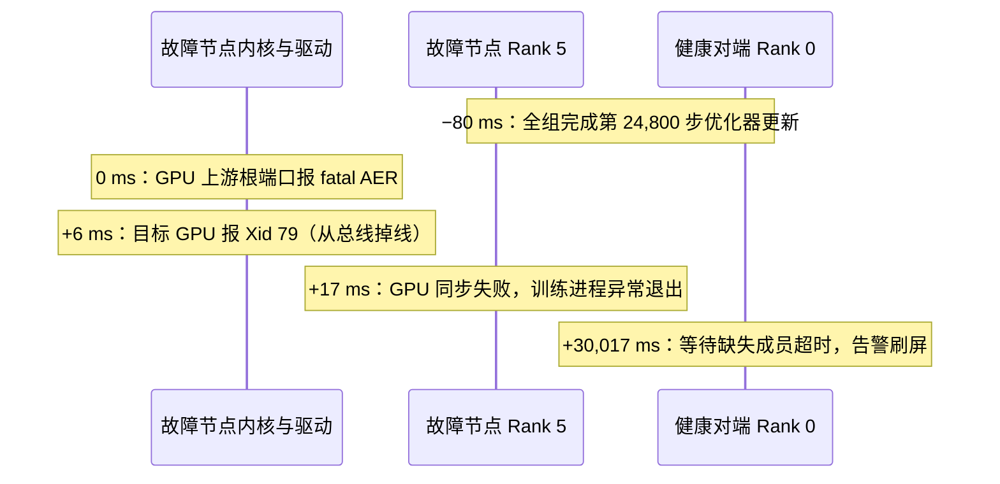
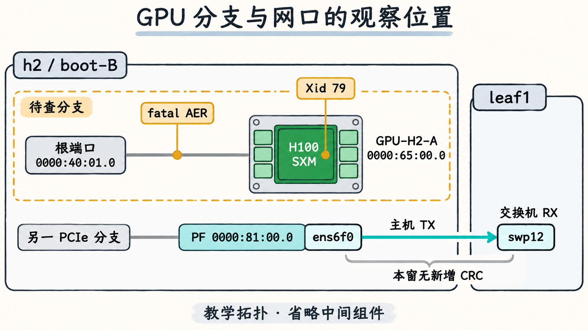

# Xid、ECC 与设备链路的故障证据

集群告警突然刷屏：一个稳跑至第 `24,800` 步的三节点同步训练作业瞬间停滞，两台健康节点上的训练进程在 30 秒后齐刷刷报出 **NCCL 集合通信超时**。

看到“通信超时”，很多工程师第一反应是扑向交换机查丢包或 RoCE 拥塞。但在多机 GPU 集群里，**最先刷屏的告警往往只是下游受害者的连坐症状**——哪怕只有一台节点上的一张 GPU 在运行中途突发 PCIe 硬错掉线，其余所有健康节点都会在几十秒后统一表现为“死等集合通信超时”。

前几篇已经覆盖了“起不来”和“跑得慢”，本篇专门攻克**运行中途爆发的硬件与底层链路硬故障**：先系统立住 **Xid、PCIe AER、ECC 错误遏制**三类底层信号的机制定义，再把内核日志、NVLink 与网卡统计钉回同一条时间线。

## 一、主定义：认清三类底层硬件错误信号

Linux GPU 节点的硬件异常分散在 PCIe 协议层、NVIDIA 驱动层和显存控制器三个位置。排查前，必须先摸清这三类核心信号各自代表什么：

- **Xid（NVIDIA GPU 异常事件码）**：由 NVIDIA 内核驱动向系统内核日志（`dmesg`）输出的 GPU 故障事件编号，每条日志都会附带涉事 GPU 的 PCI 地址。Xid 覆盖从硬件链路中断、显存双比特坏页到软件非法指令的多种异常，是最重要的 GPU 现场报警哨。
- **PCIe AER（Advanced Error Reporting，高级错误报告）**：PCIe 硬件协议内置的错误上报机制，由 Linux 根端口（Root Port）驱动收集并写入内核日志。它分为两级：可由硬件链路层自动重传恢复的**可纠正错误（Correctable）**，以及可能破坏事务或导致设备失联的**不可纠正/致命错误（Uncorrectable / Fatal）**。
- **ECC（Error-Correcting Code，显存纠错码）与错误遏制（Error Containment）**：数据中心 GPU 为 HBM 与片上 SRAM 配备的检错纠错机制。**SBE（单比特错误）**由硬件静默修复，**DBE（双比特不可纠正错误）**则可能污染数据。
  - 在 A100/H100 等现代架构上，硬件引入了**错误遏制**机制——尽量将坏页破坏锁在触碰它的进程内，并结合**行重映射（Row Remapping）**永久隔离损坏的物理显存行。

下表汇总了一线值班最常撞见的六类关键 Xid 编号与第一排查直觉：

| Xid 编号 | 官方核心含义 | 常见诱因与第一排查抓手 |
| --- | --- | --- |
| **Xid 79** | GPU has fallen off the bus（GPU 从总线掉线） | 驱动彻底失去对卡的访问；优先查同分支 PCIe AER、底板连接、供电瞬跌与散热保护 |
| **Xid 48** | Double Bit ECC Error（双比特不可纠正显存错误） | 显存硬件坏页；立刻查 `nvidia-smi -q -d ECC,ROW_REMAPPER` 判断是否触发遏制与行重映射 |
| **Xid 94** | Contained ECC Error（已遏制的 ECC 错误） | 硬件成功将坏页影响锁在触碰进程内，同卡其他独立进程（或 MIG 实例）不受波及 |
| **Xid 95** | Uncontained ECC Error（未遏制的 ECC 错误） | 错误突破隔离边界，波及整卡上下文；需要立即隔离排空并复位或下线检修 |
| **Xid 74** | NVLink Error（NVLink 高速互联异常） | 核对卡间链路状态与时间顺序，先排除“对端先掉卡连累本端报 74” |
| **Xid 63 / 64** | Row Remapping / Page Retirement 事件 | 显存硬件标记坏行并排队或完成重映射；若出现重映射失败或待生效项，需按规程复位或换卡 |

> [!note] 看不到 AER 不等于 PCIe 没出事
> Linux 内核能否记录 PCIe AER，取决于内核编译配置以及主板固件是否通过 ACPI `_OSC` 将错误控制权移交给操作系统；同时高频重复报错可能被内核限频折叠。若高度怀疑链路掉卡却在 `dmesg` 看不到 AER，务必同步拉取带外 **BMC / IPMI 系统事件日志（SEL）** 交叉核对。

## 二、把掉卡、进程退出与跨节点超时拉回同一时间轴

回到开头第 `24,800` 步后的全组停滞事故。拉取故障节点当前启动周期的硬件映射表，我们先抓住一个决定性的拓扑事实：**异常 GPU 与节点高速网卡挂在两条完全独立的 PCIe 分支上**。这意味着两者物理链路互不串联，完全可以分开举证。

| 语义角色 | 设备与拓扑标识（对照图 18-06-02） | 归属说明 |
| --- | --- | --- |
| **故障节点与启动周期** | `h2` / `boot-B` | 本次事故中异常进程所在节点 |
| **待查 GPU 分支** | 根端口 `0000:40:01.0` → GPU `0000:65:00.0`（`GPU-H2-A`） | 承载本轮训练的 Rank 5 |
| **独立高速网卡分支** | 另一 PCIe 分支 → PF `0000:81:00.0`（`ens6f0`）→ `leaf1/swp12` | 承载该节点跨机 RoCE 流量 |

接下来调取故障节点内核日志（同启动周期单调时钟）并对齐跨节点应用日志（跨机时钟误差 `≤ 2 ms`）：

```text
# 故障节点内核日志与跨节点应用事件对齐（以 10:42:00.000 为 0 ms 基准）
[-0.080s] [cluster/all]  Step 24800 optimizer update completed
[+0.000s] pcieport 0000:40:01.0: AER: Uncorrected (Fatal) error received: 0000:40:01.0
[+0.006s] NVRM: Xid (PCI:0000:65:00): 79, pid='<unknown>', GPU has fallen off the bus.
[+0.017s] [worker/Rank 5] RuntimeError: CUDA error: unspecified launch failure -> process exit
[+30.017s] [peer/Rank 0]  Watchdog caught collective operation timeout (30000 ms)
```

把这串日志投到时序图上，谁是真凶、谁是受害者一目了然：



*图 18-06-01：将故障节点内核记录与跨节点应用日志对齐到同一时间轴。纵向间距仅示意先后顺序，精确时差见上方日志戳。*

顺着这条时间线做两步交叉印证，故障边界立刻彻底清晰：
1. **钉死首个失败交接**：`0 ms` 根端口爆出致命 AER，`+6 ms` 同分支下游 GPU 报 **Xid 79**，直接坐实故障节点上该 GPU 的 PCIe 可达路径在运行中断开；`+17 ms` 本地进程退出、`+30,017 ms` 健康对端超时，全都是顺理成章的下游连坐。
2. **核验网卡分支清白**：同时拉取故障短窗内主机网卡发送（TX）与交换机对端端口接收（RX）的硬件计数：

```bash
# 核对故障窗口前后网卡与交换机对端端口的物理帧错误与闪断计数
$ ethtool -S ens6f0 | grep -iE "crc|err|drop|link"
     rx_crc_errors_phy: 0
     tx_errors_phy: 0
# 对端交换机 leaf1/swp12 RX 方向同窗口复核：无新增 RX CRC，无链路翻动（Link Flap）
```



*图 18-06-02：故障节点 GPU 分支与高速网卡分支的物理观察对照。fatal AER 与 Xid 79 命中上方待查分支；下方网卡分支在同时间窗无新增 CRC，可排除该方向物理帧损坏。*

> [!warning] 常见误区：看到 Xid 79 ≠ 直接定罪“换 GPU 模组”
> Xid 79 证明的是“驱动经由 PCIe 总线再也连不上这张卡”。主板 PCIe 根端口/交换芯片、HGX 底板连接器接触不良、电源模块瞬时掉压或过热强制保护，都会触发完全一样的 Xid 79。最终定责到具体可更换硬件，必须结合 BMC 电源/温度记录与机房下线检修。

如果另一场事故中交换机端口 `RX CRC` 确实在故障窗飙升，排查方向应严格沿着 **“主机 TX → 光模块/线缆 → 交换机 RX”** 推进，重点查发送端光模块光衰、脏污或线缆损伤；反过来，端口“无新增 CRC”只能排除线缆物理坏帧，排查性能退化时仍需另查队列拥塞与 ECN/PFC。

## 三、ECC 与 NVLink 异常：精准评估爆炸半径

并非所有硬故障都会把整台服务器拉下水。遇到显存 ECC 或 NVLink 报错时，核心动作是**看清计数周期、时间先后和业务隔离边界**。

### 1. 显存 ECC 与行重映射：看懂 `nvidia-smi -q` 输出

值班查显存健康时，直接执行 `nvidia-smi -i <idx> -q -d ECC,ROW_REMAPPER`，重点盯住四个字段：

```bash
$ nvidia-smi -i 1 -q -d ECC,ROW_REMAPPER
    ECC Errors
        Volatile                               # 本次驱动加载/启动周期内的增量
            SRAM Correctable              : 0
            SRAM Uncorrectable            : 0
            DRAM Correctable              : 14 # 硬件已自动修复，关注是否持续陡增
            DRAM Uncorrectable            : 1  # <-- 本周期新发不可纠正错误（对应 Xid 48/94/95）
        Aggregate                              # 设备出厂以来的历史持久累计
            DRAM Correctable              : 1842
            DRAM Uncorrectable            : 1
    Remapped Rows
        Correctable Error                 : 0
        Uncorrectable Error               : 1
        Pending                           : Yes # <-- 已有坏行待下次 GPU 复位生效隔离
        Remapping Failure Occurred        : No  # 若变为 Yes，说明备用行耗尽，需报修换卡
```

判读两条铁律：
- **先分 Volatile（本周期）与 Aggregate（历史总计）**：看到 `Aggregate Correctable` 有一两千别急着下线，那可能是半年攒下来的；重点看 `Volatile` 在故障窗口内有没有陡增，以及 `DRAM/SRAM Uncorrectable` 是否大于 0。
- **再看遏制结果与重映射状态**：出现不可纠正错误时，结合内核日志里的 **Xid 94（遏制成功）** 与 **Xid 95（未遏制）** 判断波及面；若 `Pending : Yes`，需尽快安排窗口复位 GPU 让行重映射生效；一旦 `Remapping Failure Occurred : Yes`，直接提单换硬件。

> [!tip] 同一个坏页，对训练和在线推理的爆炸半径截然不同
> - **同步分布式训练**：即便硬件完美遏制了错误（Xid 94），只杀掉触碰坏页的那 1 个训练进程，非弹性的同步通信组仍会因缺员而全组停摆。
> - **在线推理服务**：若部署了多副本负载均衡或 MIG 硬件切分，Xid 94 错误遏制可以把故障锁死在单个副本/实例内——网关摘流重试在途请求，同卡其他 MIG 实例或集群其余副本照常提供低延迟服务。

### 2. NVLink 异常（Xid 74）：先查“谁先倒下”

在 8 卡 HGX H100 的 NVSwitch 平台上，如果某张卡报出 **Xid 74（NVLink 错误）**，切忌孤立地只查报错卡：

```bash
# 查看各条 NVLink 通道的速率状态与误码累计
$ nvidia-smi nvlink -s -i 1
$ nvidia-smi nvlink -e -i 1
```

- **先对齐时间线**：很多时候是同域另一张 GPU 先发生掉卡（Xid 79）或复位，才导致与之相连的正常 GPU 顺带报出 Xid 74——此时后报错的卡只是被动受害者；
- **再查双端链路**：如果没有更早的对端故障，再核对受损 NVLink 通道、NVSwitch 芯片健康事件，并执行卡间点对点带宽与数值校验——单卡能跑矩阵乘，不代表它的 NVLink 互联仍然健康。

## 四、重启机器之前，先锁住这五份现场证据

GPU 运维最痛心的失误，就是出了硬错后二话不说先 `reboot`“抢恢复”。机器一重启，**内存里的 `dmesg` 清空、Volatile 计数归零、监控看板瞬间全绿**，真正埋雷的坏卡或松动线缆混回生产池，下周再炸一次千卡作业。

重启前务必记住监控指标的生命周期差异：
- **最后事件快照（Gauge）**：如 `DCGM_FI_DEV_XID_ERRORS` 只保留**最近一次** Xid 编号；重启前它一直挂着 `79`，只说明上次故障尚未清零，并非每分钟都在新掉一次卡。
- **累计计数（Counter）**：如 PCIe Replay、ECC、网卡 CRC，必须只在**同一次启动周期内做时间差**，驱动重载或整机重启就会归零。

> [!summary] 重启或下线故障节点前必留的五份现场证据
> 1. **内核与带外硬件日志**：当前启动周期的完整 `dmesg`（含 AER、Xid）及 BMC 系统事件日志（SEL 电源/温度记录）。
> 2. **拓扑与身份映射**：`lspci -tv`、当前 GPU UUID/BDF 清单，以及卡到 Pod、Rank 或推理副本的归属快照。
> 3. **显存与卡间互联状态**：`nvidia-smi -q -d ECC,ROW_REMAPPER` 与 `nvidia-smi nvlink -s/-e` 输出。
> 4. **网络短窗硬件计数**：故障窗口前后两端网卡与交换机端口的 CRC、链路翻动及 ECN/PFC 增量。
> 5. **软件与固件基线**：内核版本、NVIDIA 驱动版本及 GPU/网卡固件版本。

至此，时间线已经把这起事故干脆利落地钉死在故障节点的 GPU PCIe 分支上，高速网卡也拿到了清白证明。现场证据留存完毕，接下来立刻进入双线作战：一条线让受损业务以最快速度安全恢复，另一条线把故障节点彻底隔离、检修并逐层验收能否归队。下一篇我们走完最后这一环。

> [!info]- 参考资料
> - **NVIDIA Xid 与显存错误遏制**：[Working with Xid Errors](https://docs.nvidia.com/deploy/xid-errors/latest/working-with-xid-errors.html)、[NVIDIA H100 Xid Catalog](https://docs.nvidia.com/deploy/xid-errors/latest/analyzing-xid-catalog.html)、[GPU Memory Error Containment & Row Remapping](https://docs.nvidia.com/deploy/a100-gpu-mem-error-mgmt/latest/error-containment.html)
> - **Linux PCIe AER 与网卡统计**：[Linux Kernel · PCIe AER HOWTO](https://docs.kernel.org/6.18/PCI/pcieaer-howto.html)、[Linux Network Interface Statistics](https://docs.kernel.org/6.18/networking/statistics.html)
> - **观测命令与 DCGM 字段口径**：[NVIDIA SMI 文档](https://docs.nvidia.com/deploy/nvidia-smi/index.html)、[DCGM Exporter 4.8.4 默认字段清单](https://raw.githubusercontent.com/NVIDIA/dcgm-exporter/4.8.4/etc/default-counters.csv)
