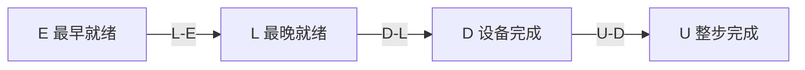
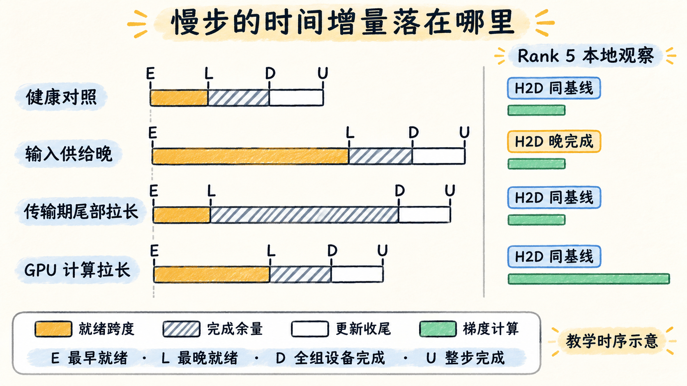

第 05 篇解决了「能不能组队和传输」，本篇处理作业仍在推进、但一个训练步变慢或停住的情况。同步训练的一个 Rank 看起来在通信中等了很久，可能是另一个 Rank 迟迟没有备好输入，也可能是集合运行期本身变慢；还可能出现所有进程都存活、某一轮却一直没有设备完成。第 17 章已经用 GPU 活动率、端口与存储观测找到了慢窗，本篇按第 01 篇的方法把一个慢步切成可复算的时间段，再用单变量对照定位延迟增加的位置。

## 从输入就绪到整组完成

仍用 `train-12` 的十二个 Rank，每个进程占一张整卡。以下均为独立的**教学时序**。每个工况的模型、全局样本数、每 Rank 批量、集合载荷及数据类型相同。为便于推导，假定本步各 Rank 从共同观测起点计时，先让输入经 H2D（主机到设备拷贝）到达 GPU，执行梯度计算，再参加同一轮 AllReduce，其后完成优化器更新。本例省略梯度分桶、跨步流水重叠和其他集合。各工况最终完成点由全组最晚完成决定。

取同一尝试、通信组和调用序号的时间点。`E` 是最早有输入张量满足集合前置依赖的时点，`L` 是最晚满足前置依赖的时点，`D` 是所有 Rank 的对应设备工作都完成的时点，`U` 是全组完成优化器更新的时点。应用用计算与通信 Stream 的事件和对齐后的 GPU 活动追踪这些时点，CPU 调用或入队时间另记。以下跨节点时点已映射到同一时间基准，成对最大偏差为 2 ms。同一台机器的局部耗时优先用单调时钟。 [CUDA 13.2.1 · Stream 与 Event](https://docs.nvidia.com/cuda/archive/13.2.1/cuda-programming-guide/02-basics/asynchronous-execution.html) · [PyTorch 2.9 · Profiler](https://docs.pytorch.org/docs/2.9/profiler.html)

图 18-06-01　同一轮集合的四个观测点。从步起点计时，图中从左到右标出 E、L、D、U。箭头分别表示就绪跨度、完成余量和更新收尾。队列或传输可能在 L 之前已有活动，这里用 D−L 度量最晚就绪后的剩余时间。

**替代文本**　一条从左到右的时间线，依次经过最早就绪 E、最晚就绪 L、全组设备完成 D 和整步完成 U，相邻两点之间分别标为就绪跨度、完成余量和更新收尾。

从最早就绪到全组设备完成的区间为 `D − E = (L − E) + (D − L)`。`L − E` 度量成员就绪的跨度，早到的成员可能在这期间等待别的成员。`D − L` 是最晚就绪后的完成余量，可能包含通信、设备队列和尾部调度延迟。集合的一部分工作可以在最晚就绪前已经推进，因此这两项不能直接读成「纯等待」和「纯网络」。本例的步时还包含最早成员准备的时间和全组设备完成后的收尾。如果有计算与通信重叠时，需沿实际依赖找出决定 `U` 的关键路径。处于关键路径上的延迟才会推迟整步完成。

## 三种慢步的证据和对照

以下是从各工况中摘取的一步，表中所有时点和耗时单位均为 ms。记录确认 `E` 均来自 Rank 0，`L` 均来自 `h2/P21/GPU-H2-A` 上的 Rank 5。Rank 5 的 H2D 完成后就启动一段梯度计算，该计算在表中 `L` 完成。数字用于演示时间分解。

| 工况 | Rank 5 H2D 完成 | Rank 5 梯度计算耗时 | E | L | D | U | L − E | D − L |
| --- | ---: | ---: | ---: | ---: | ---: | ---: | ---: | ---: |
| 健康对照 | 35 | 55 | 70 | 90 | 150 | 180 | 20 | 60 |
| 输入供给晚 | 425 | 55 | 70 | 480 | 540 | 570 | 410 | 60 |
| 传输期尾部拉长 | 35 | 55 | 70 | 90 | 420 | 450 | 20 | 330 |
| GPU 计算拉长 | 35 | 175 | 70 | 210 | 270 | 300 | 140 | 60 |

图 18-06-02　区段宽度用于定性比较，精确时点见上表。输入供给晚将就绪跨度从 20 ms 拉到 410 ms，完成余量仍为 60 ms。传输期变体保持 20 ms 的就绪跨度，完成余量增至 330 ms。GPU 计算变体中 Rank 5 仍在 35 ms 完成 H2D，随后计算从 55 ms 增到 175 ms，就绪跨度增至 140 ms。

**替代文本**　四行从对齐的 E 起点读到 L、D、U；输入供给晚一行的琥珀色就绪跨度最长，传输期变体的灰色完成余量最长；右侧 Rank 5 观察中，只有输入供给晚一行标注 H2D 晚完成，只有 GPU 计算变体的绿色梯度计算细条变长。

### 输入未交付，其他 Rank 先进入等待

输入慢这一行，Rank 0 从就绪到全组设备完成要等 `540 − 70 = 470 ms`，正常时为 80 ms。新增的 390 ms 都落在就绪跨度。Rank 5 的梯度计算仍用 55 ms，H2D 完成却晚了 390 ms。再往上游拆开本批次的文件读取、解码、预取队列交付和 H2D。假设跟踪发现 NFS 读取等待随同一批次变长，批次交付后的 H2D 耗时稳定，输入供给路径便成为当前最有证据的调查方向。GPU 低活动可能是输入延迟传播下来的结果。

保持样本内容、批量、预处理、CPU 配额、GPU 放置及通信后端，受控重跑时只提前准备本批需要的原始数据，记录批次就绪、`L − E` 与步时。若三者一起恢复，说明绕开的输入供给片段对慢步有贡献。这个对照还不足以在存储服务端、读网络和客户端间分责。要继续定位，按同一读请求关联客户端完成时间、网络与服务端排队。若批次已交付而 H2D 晚，验证拷贝 Stream 的依赖和本地数据搬运才更直接。

### 成员准时就绪，RoCE 出口排队延长传输尾部

传输期变体中 `L − E` 仍是 20 ms，`D − L` 从 60 ms 升到 330 ms。先核实同组调用参数和 GPU 前置工作，再沿当时的发送和接收路径取证。教学快照表明 `leaf1/swp12` **发往 h2** 的出口上，承载 RoCE 的队列深度和 ECN 标记增量上升，同窗使用这一队列的训练接收进度变慢，两端没有记录到新增 CRC。ECN（Explicit Congestion Notification，显式拥塞通知）在支持并配置的路径上提供拥塞反馈。若读取 PFC（Priority-based Flow Control，按优先级暂停）计数，还需查端口的发送或接收方向、对应优先级及生效配置。暂停是链路局部反馈，可传播到上游，凭某个端口的暂停次数难以指认拥塞起点。 [NVIDIA Cumulus Linux 5.11 · RoCE 的 ECN 与 PFC](https://docs.nvidia.com/networking-ethernet-software/cumulus-linux-511/Layer-1-and-Switch-Ports/Quality-of-Service/RDMA-over-Converged-Ethernet-RoCE/)

固定拓扑、实际 RDMA 后端、消息与并发，在受控窗口减少已确认竞争同一出口队列的背景流量。若队列积压、ECN 增量与 `D − L` 同时回落，支持该队列竞争影响了完成尾部。若空载基准复测正常而生产慢窗未覆盖，结论只能外推到该空载测试条件。反之，若实际方向观察到新 CRC 或掉线，先查物理链路，再与传输重试及时间窗交叉核对。

### 数据已在设备上，计算阶段发生降频

计算慢这一行与输入慢一样扩大了就绪跨度，差别在 Rank 5 的 H2D 仍在 35 ms 完成，梯度计算由 55 ms 增至 175 ms。此时查同一张卡、同一工作形状的 Kernel 设备时间、SM 时钟、功耗、温度和时钟事件原因。教学对照中慢计算期间保持负载，SM 时钟从约 1,550 MHz 降到约 700 MHz，同窗报告硬件热降速。核对平台散热记录后，在受控环境以同工作量和有效功率配置重跑。若温度、热降速状态、实际设备时钟和 Kernel 时长随散热条件一同恢复，归因有了可验证的链条。低时钟如果只出现在长时间等待批次的空闲阶段，就应优先解释那段等待。一次采样或温度数值本身不足以区分这两种情况。 [NVIDIA SMI · 温度与 Clock Event Reasons](https://docs.nvidia.com/deploy/nvidia-smi/index.html)

## 集合挂起时沿同一调用序号找缺失的进度

全组仍有完成步时，可以复算各区间。某轮挂起时，可能连 `L` 或 `D` 都没有，先查调用证据而非给缺失时间填零。将各 Rank 的组 ID、调用序号、操作类型、元素个数、数据类型、归约算子，以及适用的根 Rank 对齐。调用的参数与顺序取决于该组的集合约定。 [NCCL 2.27.3 · 集合操作的调用要求](https://docs.nvidia.com/deeplearning/nccl/archives/nccl_2273/user-guide/docs/usage/collectives.html)

假设其余十一名成员都提交了第 38 次 AllReduce，而 Rank 5 最后一次记录停在上一轮完成。先查该进程是否退出、是否卡在数据或计算、是否走到了跳过集合的应用分支。若 Rank 5 在同一序号改调 Broadcast，就已有调用顺序分歧，联系应用分支及错误传播来解释等待。若所有成员都提交了相容调用，检查 GPU 上是否满足 Stream 的前置事件，随后确认通信 Kernel、异步错误与实际网卡进度。没有设备完成时，主机日志中的调用返回只确认主机侧动作。带着最早缺失的证据、对应的 Rank 和所在路径，再决定应恢复哪一层——第 07 篇就把这些判断转换为故障隔离、作业恢复和节点复归的具体处置与验收。
