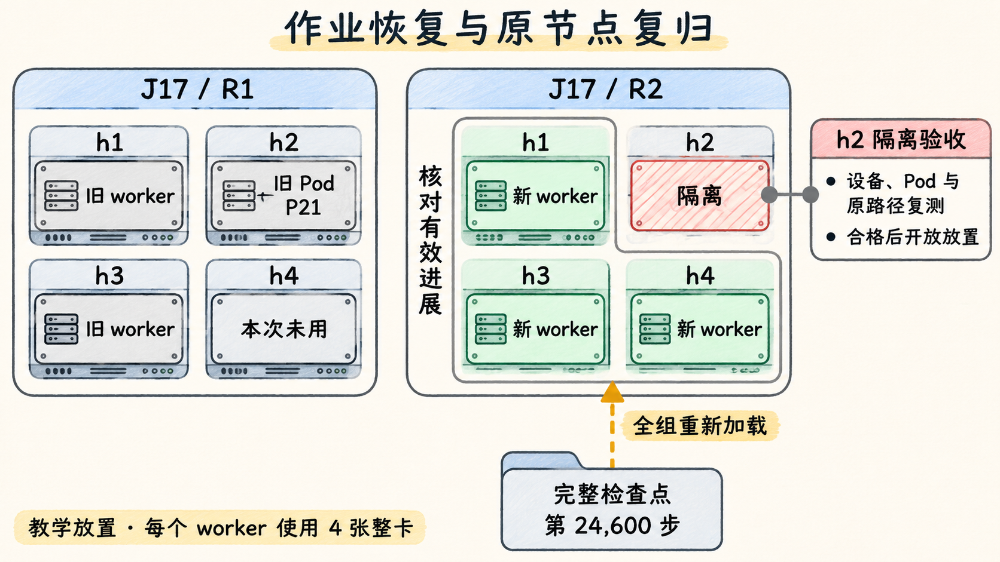

第 04 篇的事故已经定位到 `h2` 的 GPU PCIe 路径：`J17/R1` 完成第 24,800 步后，`GPU-H2-A` 所在分支发生 fatal AER，驱动报告 Xid 79，Rank 5 退出，其他成员的集合等待超时。本篇进入处置阶段。已有证据足以暂停该节点的新训练放置，并将设备路径交给平台运维；但作业恢复和节点复归是两条需要分别验收的路径——作业可在别处恢复，`h2` 则要单独证明可安全承接原类负载。以下为接续该事故的**教学处置记录**。

## 界定故障域并阻断新的分配

**故障域**是一次异常或处置可能共同影响的范围。单卡计算出错时，验证范围至少包含这张卡和使用它的应用。此处同时有 GPU 上游 PCIe 分支错误，且尚不知道维修与复位会影响多大的范围，因此先按节点隔离。将 `h2` 的设备、Pod UID、容器进程、训练尝试和队列占用存档，保留内核、平台与互联日志，并把故障起点和当时的实际拓扑随处置记录交接。若检测到平台需要立即保护设备，先阻止影响扩大，再采集仍能保存的证据。

在 Kubernetes v1.36 中，`cordon` 将节点设为不可调度，阻止通常经调度器的新放置，已有 Pod 仍可存在。核对现场是否有直绑 `nodeName`、相关容忍或 DaemonSet 等例外。若设备插件报告该卡 Unhealthy，kubelet 会减少该资源的 `Allocatable`，既有 Pod 的分配仍指向原设备。若平台支持可信的单卡撤回、同分支其他设备未受影响，且恢复动作也在单卡范围内，可以按更小范围处置。本例采用节点级隔离。进行 `drain` 前，查看同节点的其他作业、PodDisruptionBudget（PDB，限制自愿中断的预算）、临时本地数据和控制器行为。正常逐出流程受 PDB 约束，DaemonSet Pod 需要另外核对。维护前用实际 Pod、进程及 GPU 使用记录确认依赖已经退出。 [Kubernetes v1.36 · 安全排空节点](https://v1-36.docs.kubernetes.io/docs/tasks/administer-cluster/safely-drain-node/) · [Kubernetes v1.36 · 不健康设备的处理](https://v1-36.docs.kubernetes.io/docs/concepts/extend-kubernetes/compute-storage-net/device-plugins/#device-plugin-and-unhealthy-devices)

避免把启动器重试误认成已经换节点。`torchrun` 可以重启 Worker Group。若 Agent 与原 Pod 仍在 `h2`，重启进程可能仍使用原设备。容器重启也可能保留 Pod UID 与 GPU 分配。本例假定 Agent 重试预算耗尽，Pod 随后进入 Failed，且 Job 尚有整组重试预算。Volcano v1.16.0 的 Job 策略将 `PodFailed` 映射为 `RestartJob`。控制器重建整组后才能形成新的放置。本例先确保 `h2` 已隔离。现场查看实际的 Pod 终止原因、控制器接收的事件及是否触发对应策略。 [PyTorch 2.9 · torchrun 故障和重启行为](https://docs.pytorch.org/docs/2.9/elastic/run.html) · [Volcano v1.16.0 · Pod 事件](https://raw.githubusercontent.com/volcano-sh/volcano/v1.16.0/pkg/controllers/job/job_controller_handler.go) · [Volcano v1.16.0 · RestartJob 状态转换](https://raw.githubusercontent.com/volcano-sh/volcano/v1.16.0/pkg/controllers/job/state/running.go) · [Volcano v1.16.0 · 重试预算](https://raw.githubusercontent.com/volcano-sh/volcano/v1.16.0/pkg/controllers/job/state/restarting.go)

## 让训练从完整检查点重新推进

训练放置由原来的 `h1/h2/h3` 改成 `h1/h3/h4`。备用节点 `h4` 与原池有同样的 GPU 类型和节点内互联，具备本次所需的 4 张整卡、16 CPU、96 GiB 主机内存和 1 个 VF。放置前还要查队列额度、成组条件及网络域。它也提供 200 Gb/s RoCEv2 物理口，但跨节点交换路径已经变化。三只新 worker 创建后，记录新尝试 `R2`、新 Pod UID、各 Rank 到实际 GPU/VF 的映射。Rank 在重试中可能重新分配，旧的 Rank 5 到 `GPU-H2-A` 映射只适用于 `R1`。核对旧成员的请求已归账与设备已释放，同时看新成员的实际占用。 [PyTorch 2.9 · Rank 与 Worker Group](https://docs.pytorch.org/docs/2.9/elastic/run.html)

Checkpoint（检查点）是应用写到存储上的一份可恢复训练状态。它需要能找到同一版本的模型、优化器和训练进度等必需数据。要按原数据进度继续，本例还保存采样位置与所需的随机状态。三只 worker 重新会合后，从相同提交版本加载，并报告同一已完成优化步编号。事故后的教学记录如下。

| 版本或进度 | 证据 | 恢复含义 |
| --- | --- | --- |
| 第 24,800 步 | `R1` 最后一个已完成的全局优化步。 | 用它界定事故前已完成工作。 |
| 第 24,750 步的检查点 | 有部分分片，缺本存储实现要求的完成记录和一个必需分片。 | 恢复端缺少完整版本。 |
| 第 24,600 步的检查点 | 存储有完整提交记录，读取方成功装载所有必需状态。 | `R2` 恢复于第 24,600 步之后。 |

`24,800 − 24,600 = 200` 个此前完成的步需要重做。`R2` 首次完成的是 24,601，完成 24,801 时才超过旧尝试已达到的进度。恢复耗时还包含等待放置、容器与设备交付、会合、检查点读取和重做。用同批量、消息和放置条件下的有效进展监控 `R2`，并查看下一份检查点是否完整提交。本例以连续完成步、超过旧进度并生成新的完整检查点作为恢复证据。训练重新 Running 能帮助定位生命周期阶段，仍需看这些应用结果。 [PyTorch 2.9 · Distributed Checkpoint](https://docs.pytorch.org/docs/2.9/distributed.checkpoint.html)

## 在隔离窗口重测原节点

平台侧按照对应 H100 系统的维护流程检查故障 PCIe 分支，重新装接相关部件并重新启动。该教学记录只给出这组联合变更，结果可以验证设备路径恢复，无法拆分各项动作的贡献。硬件复位作用域、共享互联及受影响进程应按平台和驱动确认。按 DCGM（Data Center GPU Manager）支持的设备、版本、权限和运行等级选择健康或压力诊断，在维护窗口保留实际执行项、跳过项、错误详情与覆盖卡。仅凭一次诊断绿色无法覆盖 Pod 交付和集群路径。

| 本例复归需取得的证据 | 是否已覆盖原故障条件 |
| --- | --- |
| 新启动周期的资产、BDF、驱动、PCIe 协商和 NVLink 状态对得上。相关设备通过支持的诊断，记录 ECC、AER、Xid 与链路基线。 | 在静态与规定负载下重建硬件视图。计数从新生命周期起观察，保留旧周期日志。 |
| 用仅供验收的放置路径，让测试 Pod 获取真实资源和实际 UUID，验证容器创建、单卡计算回读、同机多卡与 VF 附加网络。 | 观察实际 GPU 和 NIC 交付。继续覆盖受维修分支牵连的设备与同机路径。 |
| 测指定对端的主机内存及显存 RDMA，再按原 `h1/h2/h3` 放置做 12 Rank、每 Rank 64 MiB、FP32 求和、独立收发缓冲区的 AllReduce，使用支持多进程启动的 MPI 构建，核对后端及结果。 | 保持第 17 章的空载测试、计时与预热条件。教学复测三轮代表值为 5.98、6.04、6.13 ms，校验均通过，与原 5.90、6.00、6.20 ms 的观察范围相符。 |
| 在覆盖原 I/O 与计算强度的代表窗口监控进展、时延和新错误，并按队列账本核实放回的容量。 | 本例给定的隔离负载窗中无新增 fatal AER 或 Xid 79，作业连续推进，再开放通常放置并继续观察。 |

图 18-07-01　R2 在 h1/h3/h4 重建三个 worker，从第 24,600 步的完整检查点恢复。旧尝试完成到第 24,800 步，因此有 200 步需重做，完成第 24,801 步才超过旧进度。h2 在隔离窗口单独验收，需覆盖设备、容器、互联、原跨节点路径和代表性负载。

**替代文本**　两栏用相同位置显示 h1、h2、h3、h4；R1 由 h1、h2、h3 的三只旧 worker 组成，R2 由 h1、h3、h4 的三只新 worker 组成并从完整检查点恢复，右栏 h2 标为隔离，旁边是独立的复测条件。

这里的三轮基准和负载窗是教学验收材料。原基线的三个值提供可比较的参照区间，生产复归阈值还需按历史波动、负载覆盖和故障复现条件约定。测试中若再出现相同的 fatal AER、设备不可访问或实测路径退化，保持或恢复隔离，保留新增记录。如果仅在 `h4` 上看到训练推进，完成的是业务恢复这条路径，`h2` 的验收证据仍需收集。 [NVIDIA · DCGM Diagnostics](https://docs.nvidia.com/datacenter/dcgm/latest/user-guide/dcgm-diagnostics.html) · [nccl-tests v2.17.9 · 测试参数](https://raw.githubusercontent.com/NVIDIA/nccl-tests/v2.17.9/README.md)

至此，从现象到最早失败点、从对照定位到隔离与复归的完整闭环已经走完。第 99 篇用一份独立材料检验能否独立完成这条推理链；第 19 章再把这里的复归证据扩展到节点交付、版本升级和回滚评审。
