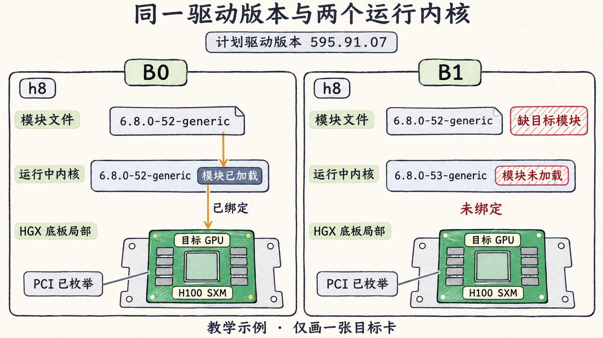

# 节点交付的生命周期与配置基线

第 18 章分别回答了“作业是否恢复”和“故障节点是否可以回来”。持续运行还要把这个判断提前到故障之前：新节点凭什么加入生产，升级时可以拿走几台，原配置或原节点丢失后怎样重建？本章把管理对象从一次故障扩展为节点的整个交付生命周期。

## 节点生命周期与生产准入

**节点交付**是把已安装、接线并启动的服务器变成能够承接指定负载的能力。**资源池**是一组按机型、网络域、软件与使用规则组织的节点；**生产准入**则决定其中哪些节点、设备和使用方式当前可以交给生产作业。节点注册成功只是控制面认识了它，入池还需要验证设备、计算、通信、容量和使用权限。

先看一次最小正常过程。平台准备新节点 `h8`，给它保留验收隔离；节点侧驱动和容器组件启动后，设备插件发布四张健康 GPU；获准的测试 Pod 通过普通调度取得设备，完成计算，再与两个已验收对端完成集合通信。平台对照事先写下的门槛，确认租户权限、性能和恢复资料齐备，才开放这类生产放置。之后同一节点若升级或维修，需要先撤回相应能力，再经过复测返回。

| 生命周期状态 | 平台要维持的事实 | 转入下一状态的依据 |
| --- | --- | --- |
| 待交付 | 有目标配置、制品来源与负责人，尚不承接生产 | 能按目标启动，进入受控验收区 |
| 验收中 | 测试可到达，普通生产不能进入 | 使用范围内的功能、路径、性能与隔离证据齐备 |
| 生产可用 | 允许指定负载放置，持续记录健康与进度 | 计划维护或故障触发撤回，并核算影响 |
| 撤回与处置 | 阻止新放置，分别处理旧作业、设备使用和维修 | 变更/修复完成，旧使用者和本地状态得到处置 |
| 复归验收 | 设备可能已健康，但仍保留生产隔离 | 对照原服务目标复测，更新身份和容量后再开放 |

这些是运维状态，不是一组 Kubernetes 内置枚举。平台要用节点调度限制、准入策略、控制器和验收记录共同实现它们。例如“设备库存恢复到四卡”和“允许生产进入”分别由健康上报与平台放行控制，不能让前者自动代替后者。

## 双机架案例的作业与设备边界

本章保留第 17—18 章三节点十二卡的**作业规格**，另设一套双机架平台：A 放置 `h1–h4`，B 已运行 `h5–h7`，拟交付 `h8`。每节点改用四卡 HGX H100 的 GPU 间直连 NVLink，不沿用前两章八卡节点的 NVSwitch 拓扑。每台有一个 200 Gb/s RoCEv2 物理口，以及独立存储网。RoCEv2 将 RDMA（Remote Direct Memory Access，远程直接内存访问）承载在可路由的以太网络上；SR-IOV（Single Root I/O Virtualization，单根 I/O 虚拟化）让网卡提供可独立分配的 VF（Virtual Function，虚拟功能）。[NVIDIA · HGX H100 四卡与八卡拓扑](https://developer.nvidia.com/blog/?p=46100)

固定训练含三个 worker Pod，每个运行四个 Rank，Rank 是通信组内的成员编号。每个 Pod 请求 4 张整卡、16 CPU、96 GiB 主机内存和一个支持 RDMA 的 VF；每节点至多放一个 worker，三个节点必须位于同一网络域。本例网络域恰好与机架一致。各篇的升级、故障和恢复是独立教学窗口，会重新给出起始状态。全部标识、预算、性能和事件均为教学构造，未在 GPU 集群实测。

## 配置基线、运行实态与性能基线

**配置基线**是经平台评审后固定的一组交付输入，包括硬件布局、软件制品、配置及管理归属；**运行实态**是某次启动实际加载和使用的内容。第 17 章的**性能基线**则是健康系统在固定测试条件下留下的观测。三者要相互对应：由配置基线重建节点，以实态证明输入已经生效，再把同条件性能与健康参照比较。

例如镜像标签仍叫 `node-B0`，仓库中标签指向的内容却变了，仅靠名称无法重建原状态；因此保存镜像摘要以标识具体内容。又如磁盘上已有新驱动，内核里仍加载旧模块，包版本也不能代替实态。对基线的检查应同时回答：取哪份输入、由谁修改、如何观察生效、什么能力算合格。

以 `h8` 的入池单为例。基线编号 `B0` 表示本例批准的交付目标。实际设备身份与启动记录随验收采集。同型号替换卡时，下表的资产映射随之更新，读者仍可用同一基线判断能力是否满足。

| 基线项目             | `B0` 约定的输入与管理方                                                                                                                                                                                | `h8` 的有效状态证据                                                          |
| ---------------- | --------------------------------------------------------------------------------------------------------------------------------------------------------------------------------------------- | --------------------------------------------------------------------- |
| 硬件、布线、固件         | 资产方留存机型、主板与 GPU/NIC 清单，BIOS、BMC（基板管理控制器）、NIC 固件批准版本及升级包。机架方维护 A/B 供电和交换机端口图。                                                                                                                  | 序列号、GPU UUID、PCI 地址、GPU/NIC 拓扑、实际固件与 NVLink 状态，RoCE 口连到机架 B 的接入交换机。   |
| 操作系统、内核和驱动       | 镜像 `node-B0` 按摘要发布，教学设定 Ubuntu 24.04 LTS、x86_64、`6.8.0-52-generic`，预装经批准的 NVIDIA 开源内核模块版本 `595.91.07`、配套用户态库与 NIC/RDMA 驱动。按该启动内核准备确切模块及所需签名。                                                  | 实际启动内核与启动 ID，内核中已加载的 GPU/NIC 模块和设备绑定，用户态库版本以及任何签名拒绝记录。                |
| Kubernetes 与节点组件 | Kubernetes v1.36，containerd 2.3，GPU Operator v26.7.2。平台方管理 chart、CRD（自定义资源定义）与 ClusterPolicy（Operator 的集群配置对象）。主例用预装驱动，Toolkit 与 Device Plugin 由 Operator 管理，启用 CDI（容器设备接口），关闭 NRI（节点资源接口）插件。 | 目标节点上的组件与实际镜像摘要，CRI（容器运行时接口）配置及 CDI 规格，设备插件登记的健康卡数与普通 Pod 的实际 GPU 分配。 |
| CUDA 与作业镜像       | 应用方保存镜像摘要、设备代码目标和关键库。验收探针以 CUDA 13.2 GA 构建，含 H100 的 `sm_90` 设备代码。集合测试与生产样本各自固定镜像和启动参数。                                                                                                        | 同一 Pod 的实际镜像和库解析路径、选中设备、完成同步和结果回读，外加测试适用的拓扑及负载。                       |
| 附加网络和存储          | 网络方留存 PF（物理功能）、VF 资源键、Multus、NAD（NetworkAttachmentDefinition，附加网络定义）、地址分配、MTU（最大传输单元）、路由与交换侧 QoS（按流量分类提供的服务策略）。存储方留存挂载、身份、地址与并发窗口要求。                                                          | Pod 的 VF、接口、实际对端、物理端口与流量等级，默认网和附加网的策略试验，以及从目标存储读取和提交检查点的记录。           |

GPU Operator 的 v26.7 平台文档列有 Ubuntu 24.04 LTS、Kubernetes v1.36 和 containerd 2.3，v26.7.2 组件矩阵包含 `595.91.07`。可用这些条目筛选候选。主机预装制品、具体机型的互联、NIC 固件和显存直达能力各有支持条件。此处的精确内核构建和软硬件组合属于教学设定，正式基线需要附节点厂商、操作系统和网络供应方的依据，以及对应制品和有效状态。 [NVIDIA · v26.7 平台与组件矩阵](https://docs.nvidia.com/datacenter/cloud-native/gpu-operator/26.7/platform-support.html)

### 同一组件需要一个明确的配置归属

`B0` 的 Helm 值选 `driver.enabled=false`，让节点镜像负责驱动。Toolkit 配置运行时使用 CDI（Container Device Interface，容器设备接口），由运行时按设备描述为容器加入访问所需的资源。Operator 仍会协调其负责的组件。检查一份变更差异时，应同时看 Helm 值、现有 ClusterPolicy 与生成的 DaemonSet。仅改节点上的文件，后续组件重建时可能按 Operator 的配置覆盖它。固件、交换机端口和应用镜像分别有自己的权威来源和变更记录。 [NVIDIA · 预装驱动与 GPU Operator](https://docs.nvidia.com/datacenter/cloud-native/gpu-operator/26.7/getting-started.html#pre-installed-nvidia-gpu-drivers) · [NVIDIA · CDI 与 NRI](https://docs.nvidia.com/datacenter/cloud-native/gpu-operator/26.7/cdi.html) · [v26.7.2 chart 的配置结构](https://raw.githubusercontent.com/NVIDIA/gpu-operator/v26.7.2/deployments/gpu-operator/values.yaml)

运行实态偏离预期配置的现象称为**配置漂移**。假设运维为排障临时改了 containerd 配置，普通 GPU Pod 恢复可用，但组件重建又将文件写回旧值。问题在于修复没有进入负责生成该文件的配置来源。正确的闭环是记录临时差异，判断应由节点镜像还是 Operator 接纳，修改该来源，然后重新生成并核对实际配置。一个文件可以被多个过程读取，其修改责任仍应清楚，否则下次重启无法预测结果。

## 兼容性是相邻接口的约束

版本矩阵可以筛掉已知不支持的候选，却不能替代一条实际运行路径。对本例，至少要核对四条关系：

| 关系 | 要成立的条件 | 能观察的结果 |
| --- | --- | --- |
| 启动内核与 GPU/NIC 模块 | 模块为该内核准备，签名满足主机策略 | 本次启动成功加载、绑定目标设备 |
| GPU 用户态库与内核驱动 | 配套关系和应用所需接口受支持 | 进程实际装载正确库并建立上下文 |
| 应用代码与 GPU 架构 | 镜像包含适用设备代码或可用的编译路径 | 目标设备上执行、同步和回读正确 |
| GPU 显存与 RDMA 网卡 | 内存注册方式、驱动、固件和物理路径受支持 | 目标端点的显存注册及数据传输完成 |

因此一次内核变化会要求重新检查多条边，即使 GPU 驱动的版本字符串没有变化。下面只改变内核，观察依赖如何依次暴露。

## 一次内核升级牵动哪些接口

候选基线 `B1` 将镜像切到 `node-B1`，计划启动 `6.8.0-53-generic`，GPU 驱动完整版本和用户态库保持相同。以下推演使用独立的假设证据：

1. 新镜像启动后，`uname -r` 确认新内核，PCI 枚举仍列出 4 张卡。NVIDIA 模块未绑定任何一张卡，查询新内核的模块目录发现只有旧内核产物。由此可把首个失败定位到模块准备。若产物存在，再看模块与该内核是否匹配、签名是否被信任、本次启动为何拒绝加载。 [Ubuntu Server · NVIDIA 驱动与内核模块](https://ubuntu.com/server/docs/how-to/graphics/install-nvidia-drivers/#installing-the-kernel-modules) · [Linux · 模块签名](https://docs.kernel.org/admin-guide/module-signing.html)
2. 为新内核补齐匹配模块后，先查运行中的版本与实际 NVLink 状态，NIC 侧也查驱动、固件和 RDMA 设备。再进入实际容器查 Runtime、`libcuda.so.1` 与所选设备。CUDA 13.2 GA 发布说明的“Toolkit 对应驱动”表列出 Linux x86_64 为 `>=595.45.04`；同页的“次版本兼容”表给 CUDA 13.x 的下限为 R580。这两张表回答的问题不同，不能把前者当成所有 CUDA 13.2 程序的绝对运行下限。次版本兼容仍受新特性和 PTX（供驱动即时编译的中间代码）限制。本例采用 `595.91.07` 和适合 H100 的 `sm_90` 设备代码，再以同步与回读核实探针。 [CUDA 13.2 GA · 两类驱动版本表](https://docs.nvidia.com/cuda/archive/13.2.0/cuda-toolkit-release-notes/index.html#cuda-driver) · [NVIDIA · CUDA 次版本兼容的应用限制](https://docs.nvidia.com/deploy/cuda-compatibility/latest/minor-version-compatibility.html#application-considerations-for-minor-version-compatibility) · [NVIDIA · Hopper 应用兼容](https://docs.nvidia.com/cuda/archive/12.6.0/hopper-compatibility-guide/index.html)
3. 补齐模块只解决了一个依赖。新内核和驱动栈还必须在目标 VF、IOMMU（设备地址转换和隔离单元）配置与 GPU 到 NIC 的 PCIe 路径上验证显存注册及传输。若以 DMA-BUF 方式共享 GPU 内存，须核对开源 GPU 内核模块、内核、RDMA 软件栈、测试工具构建和平台支持。 [NVIDIA · GPU Operator 的 GPUDirect RDMA 选型](https://docs.nvidia.com/datacenter/cloud-native/gpu-operator/26.7/gpu-operator-rdma.html)

图 19-01-01｜计划使用的 NVIDIA 驱动版本同为 595.91.07。右栏是 B1 补齐模块之前的快照。PCI 枚举仍能识别目标卡。当前内核缺少匹配模块，NVIDIA 驱动尚未绑定。图中每栏仅示意同一张目标 GPU。

图中失败发生在模块进入当前内核之前。改变条件：若模块已经加载并绑定，但容器进程装载了错误的 `libcuda.so.1`，则应转查用户态库的来源与注入，不能继续用“缺模块”解释失败。这正是第 18 章“首个有证据的失败交接”在交付中的应用。

交付单现在已有目标、管理归属、运行证据和兼容性关系。还有一项必须先确定：哪些身份可以修改这些目标，哪些 Pod 可以取得设备与附加网络。只有把使用边界也写进交付要求，后续验收才知道要证明哪些访问成功、哪些访问应被拒绝。
