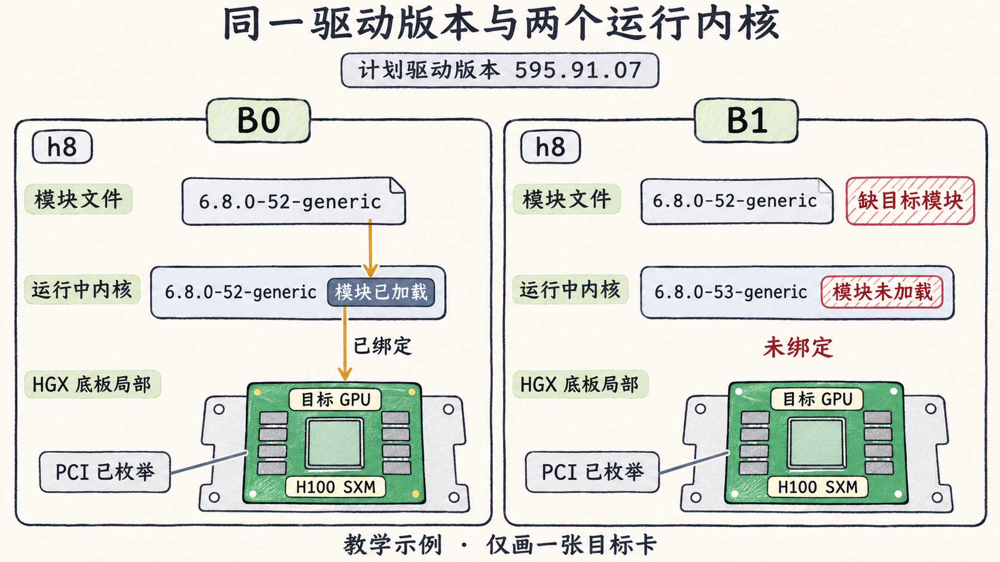

# 节点基线、兼容性与配置归属

在第 18 章的故障处置中，替代节点能接住训练，原节点则要单独通过复测。本章沿用三节点十二卡的作业规格，在双机架内评审新增节点和计划变更。A 放置 `h1–h4`，B 已运行 `h5–h7`，拟交付 `h8`。本例将同机互联设为四卡 HGX H100 的 GPU 间直连 NVLink。每台有一个承载作业流量的 200 Gb/s RoCEv2 物理口，以及独立存储网。RoCEv2 将 RDMA（远程直接内存访问）流量承载在可路由的以太网络上。网卡通过 SR-IOV（单根 I/O 虚拟化）划出可单独分配的 VF（Virtual Function，虚拟功能），一个 VF 作为独立设备交给训练 Pod。所有节点标识与结果均为教学构造。 [NVIDIA · HGX H100 四卡与八卡拓扑](https://developer.nvidia.com/blog/?p=46100)

## 基线把交付要求连到运行证据

**节点交付**将装好、接线并启动的服务器变成能够安全承接某类作业的容量。设备清单回答「装了什么」，**基线**还要定义被批准的组合及该组合应具备的能力。部署前根据基线准备制品与配置，启动后采集有效状态对照。一份基线至少能回答三个问题：重建时取哪一份输入，运行中从哪里看它已经生效，出问题时由谁修改。

以 `h8` 的入池单为例。基线编号 `B0` 表示本例批准的交付目标。实际设备身份与启动记录随验收采集。同型号替换卡时，下表的资产映射随之更新，读者仍可用同一基线判断能力是否满足。

| 基线项目 | `B0` 约定的输入与管理方 | `h8` 的有效状态证据 |
| --- | --- | --- |
| 硬件、布线、固件 | 资产方留存机型、主板与 GPU/NIC 清单，BIOS、BMC（基板管理控制器）、NIC 固件批准版本及升级包。机架方维护 A/B 供电和交换机端口图。 | 序列号、GPU UUID、PCI 地址、GPU/NIC 拓扑、实际固件与 NVLink 状态，RoCE 口连到机架 B 的接入交换机。 |
| 操作系统、内核和驱动 | 镜像 `node-B0` 按摘要发布，教学设定 Ubuntu 24.04 LTS、x86_64、`6.8.0-52-generic`，预装经批准的 NVIDIA 开源内核模块版本 `595.91.07`、配套用户态库与 NIC/RDMA 驱动。按该启动内核准备确切模块及所需签名。 | 实际启动内核与启动 ID，内核中已加载的 GPU/NIC 模块和设备绑定，用户态库版本以及任何签名拒绝记录。 |
| Kubernetes 与节点组件 | Kubernetes v1.36，containerd 2.3，GPU Operator v26.7.2。平台方管理 chart、CRD（自定义资源定义）与 ClusterPolicy（Operator 的集群配置对象）。主例用预装驱动，Toolkit 与 Device Plugin 由 Operator 管理，启用 CDI（容器设备接口），关闭 NRI（节点资源接口）插件。 | 目标节点上的组件与实际镜像摘要，CRI（容器运行时接口）配置及 CDI 规格，设备插件登记的健康卡数与普通 Pod 的实际 GPU 分配。 |
| CUDA 与作业镜像 | 应用方保存镜像摘要、设备代码目标和关键库。验收探针以 CUDA 13.2 GA 构建，含 H100 的 `sm_90` 设备代码。集合测试与生产样本各自固定镜像和启动参数。 | 同一 Pod 的实际镜像和库解析路径、选中设备、完成同步和结果回读，外加测试适用的拓扑及负载。 |
| 附加网络和存储 | 网络方留存 PF（物理功能）、VF 资源键、Multus、NAD（NetworkAttachmentDefinition，附加网络定义）、地址分配、MTU（最大传输单元）、路由与交换侧 QoS（按流量分类提供的服务策略）。存储方留存挂载、身份、地址与并发窗口要求。 | Pod 的 VF、接口、实际对端、物理端口与流量等级，默认网和附加网的策略试验，以及从目标存储读取和提交检查点的记录。 |

GPU Operator 的 v26.7 平台文档列有 Ubuntu 24.04 LTS、Kubernetes v1.36 和 containerd 2.3，v26.7.2 组件矩阵包含 `595.91.07`。可用这些条目筛选候选。主机预装制品、具体机型的互联、NIC 固件和显存直达能力各有支持条件。此处的精确内核构建和软硬件组合属于教学设定，正式基线需要附节点厂商、操作系统和网络供应方的依据，以及对应制品和有效状态。 [NVIDIA · v26.7 平台与组件矩阵](https://docs.nvidia.com/datacenter/cloud-native/gpu-operator/26.7/platform-support.html)

### 同一组件需要一个明确的配置归属

`B0` 的 Helm 值选 `driver.enabled=false`，让节点镜像负责驱动。Toolkit 配置运行时使用 CDI（Container Device Interface，容器设备接口），由运行时按设备描述为容器加入访问所需的资源。Operator 仍会协调其负责的组件。检查一份变更差异时，应同时看 Helm 值、现有 ClusterPolicy 与生成的 DaemonSet。仅改节点上的文件，后续组件重建时可能按 Operator 的配置覆盖它。固件、交换机端口和应用镜像分别有自己的权威来源和变更记录。 [NVIDIA · 预装驱动与 GPU Operator](https://docs.nvidia.com/datacenter/cloud-native/gpu-operator/26.7/getting-started.html#pre-installed-nvidia-gpu-drivers) · [NVIDIA · CDI 与 NRI](https://docs.nvidia.com/datacenter/cloud-native/gpu-operator/26.7/cdi.html) · [v26.7.2 chart 的配置结构](https://raw.githubusercontent.com/NVIDIA/gpu-operator/v26.7.2/deployments/gpu-operator/values.yaml)

## 一次内核升级牵动哪些接口

候选基线 `B1` 将镜像切到 `node-B1`，计划启动 `6.8.0-53-generic`，GPU 驱动完整版本和用户态库保持相同。以下推演使用独立的假设证据：

1. 新镜像启动后，`uname -r` 确认新内核，PCI 枚举仍列出 4 张卡。NVIDIA 模块未绑定任何一张卡，查询新内核的模块目录发现只有旧内核产物。由此可把首个失败定位到模块准备。若产物存在，再看模块与该内核是否匹配、签名是否被信任、本次启动为何拒绝加载。 [Ubuntu Server · NVIDIA 驱动与内核模块](https://ubuntu.com/server/docs/how-to/graphics/install-nvidia-drivers/#installing-the-kernel-modules) · [Linux · 模块签名](https://docs.kernel.org/admin-guide/module-signing.html)
2. 为新内核补齐匹配模块后，先查运行中的版本与实际 NVLink 状态，NIC 侧也查正在运行的驱动、固件及 RDMA 设备。然后进入实际容器查 Runtime、`libcuda.so.1` 与所选设备。CUDA 13.2 GA 发布说明列出的 Linux x86_64 对应驱动下限是 `595.45.04`，CUDA 13.x 次版本兼容还有 PTX（可供驱动即时编译的中间代码）和新特性限制。本例用适合 H100 的设备代码与指定驱动建立探针的预期，最终看同步及回读。 [CUDA 13.2 GA · 对应驱动](https://docs.nvidia.com/cuda/archive/13.2.0/cuda-toolkit-release-notes/index.html#cuda-driver) · [NVIDIA · CUDA 次版本兼容的应用限制](https://docs.nvidia.com/deploy/cuda-compatibility/latest/minor-version-compatibility.html#application-considerations-for-minor-version-compatibility) · [NVIDIA · Hopper 应用兼容](https://docs.nvidia.com/cuda/archive/12.6.0/hopper-compatibility-guide/index.html)
3. 补齐模块只解决了一个依赖。新内核和驱动栈还必须在目标 VF、IOMMU（设备地址转换和隔离单元）配置与 GPU 到 NIC 的 PCIe 路径上验证显存注册及传输。若以 DMA-BUF 方式共享 GPU 内存，须核对开源 GPU 内核模块、内核、RDMA 软件栈、测试工具构建和平台支持。 [NVIDIA · GPU Operator 的 GPUDirect RDMA 选型](https://docs.nvidia.com/datacenter/cloud-native/gpu-operator/26.7/gpu-operator-rdma.html)

*图 19-01-01｜计划使用的 NVIDIA 驱动版本同为 595.91.07。右栏是 B1 补齐模块之前的快照。PCI 枚举仍能识别目标卡。当前内核缺少匹配模块，NVIDIA 驱动尚未绑定。图中每栏仅示意同一张目标 GPU。*

兼容性检查的产物是一份可验证的变更单。它列出准备变更的输入、相邻接口的版本约束、运行中应出现的证据和原制品位置。接下来可以按这份变更单验收 `h8` 的 `B0`，为判断 `B1` 是否改变了实际能力留下对照。
