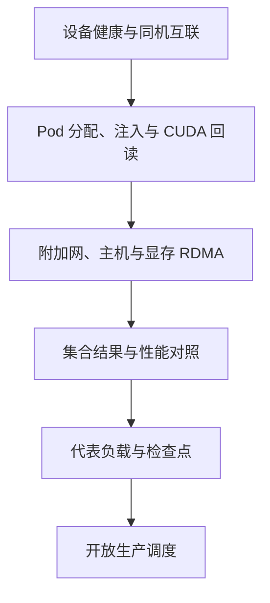

# GPU 节点的分层验收与入池

机架 B 的 `h8` 已启动批准的 `B0` 镜像。**入池**指允许某类生产作业使用节点。验收阶段先用专用 `NoSchedule` 污点挡住通常的生产放置，管理组件和获准的验收 Pod 有对应容忍，并用节点选择器把验收 Pod 限定在目标节点。验收 Pod 仍经过调度。容忍只是解除匹配污点的阻碍，还需满足其他过滤和资源要求。本例假定管理组件的有效模板与租户准入已经分别覆盖这两类条件。 [Kubernetes v1.36 · 污点和容忍](https://v1-36.docs.kubernetes.io/docs/concepts/scheduling-eviction/taint-and-toleration/)

## 从设备健康到一次正确的 Pod 内计算

每项记录带 `h8` 的节点身份、启动 ID 和观察时段。先逐层验证，出现中断时保留上一项成功证据及下一项失败细节。同一验收步骤里要把所有目标设备和端口纳入覆盖范围。

| 验收层次 | `h8` 的教学证据 | 证据如何用于入池判断 |
| --- | --- | --- |
| 宿主设备与健康 | PCI 枚举、驱动绑定及 GPU UUID 对齐，4 卡和预定的 RoCE 物理口都在预期拓扑位置。采集空闲和负载诊断的执行项、跳过项、ECC、Xid、PCIe AER 错误及链路速率。 | 诊断记录覆盖指定卡和明确的测试等级。跳过的诊断与只在系统空闲时采集的指标需要按目标负载补证。 |
| 节点内互联 | 按四卡直连 NVLink 拓扑逐对检查实际链路，验证同机四卡的集合计算与基线。 | 查询拓扑和 NVLink 状态，观察 GPU 对之间的实际路径、数据结果、耗时及负载期间的链路错误增量。 |
| 调度、分配与计算 | Node 上 `nvidia.com/gpu` 的 Capacity / Allocatable 均为 4。验收 Pod 请求 1 卡，绑到 `h8`，用 kubelet 的 PodResources 接口核对分配到的 UUID。核对有效 CDI、容器可见设备和探针结果，探针完成显存分配、Kernel、同步与结果回读。 | 数量上报、具体卡分配、运行时注入到计算完成各有证据。若逐卡探针覆盖是验收条件，要按实际 UUID 统计，避免重复测试同一张卡。 |

以标准 Device Plugin（设备插件）路径为例，插件把设备标识和健康状态交给 kubelet。调度器根据节点发布的数量和已计入的请求做放置，随后 kubelet 才选择具体 GPU。一个探针占 1 卡且其他请求为空时，该节点的 GPU 请求余量为 `4 − 1 = 3`，健康设备数仍为 4。测试结束后核查 Pod 释放和账本归还。单卡探针报告预期结果支持该实例的计算链路，多卡负载需要同机及跨机证据。 [Kubernetes v1.36 · Device Plugin 与 PodResources](https://v1-36.docs.kubernetes.io/docs/concepts/extend-kubernetes/compute-storage-net/device-plugins/) · [NVIDIA · DCGM（Data Center GPU Manager）诊断](https://docs.nvidia.com/datacenter/dcgm/latest/user-guide/dcgm-diagnostics.html) · [NVIDIA SMI · 拓扑与 NVLink 查询](https://docs.nvidia.com/deploy/nvidia-smi/index.html)

换成八卡 HGX H100 的 NVSwitch 机型，验收单还要核对平台要求的 Fabric Manager 与驱动配套、服务状态和每张 GPU 的 Fabric 注册。注册通过后仍需要验证实际同机数据路径。[NVIDIA · HGX H100 机内互联](https://developer.nvidia.com/blog/?p=46100) · [NVIDIA · NVSwitch Fabric 初始化](https://docs.nvidia.com/datacenter/tesla/fabric-manager-user-guide/index.html)

## 分开验证 Pod 网络、RDMA 缓冲区与集合完成

多节点测试 Pod 在默认网络做会合，在附加网使用 VF 承载 RoCEv2。以 `h5`、`h6` 为 B 域对端，核对实际 VF 的 PCI 地址、物理上联和对端关系。在 `h8` 与两个对端分别测试相同 RDMA 端口的主机内存和 GPU 显存，记录方向、报文与消息条件、后端、路径和数据校验。RDMA（Remote Direct Memory Access，远程直接内存访问）主机缓冲区通过后，更换成显存缓冲区会引入 GPU 内存注册与 GPU–NIC 可达性。要证明 GPUDirect RDMA 路径，还须记录工具选中的显存模式、成功注册与数据传输条件。默认网的 Pod 启动或附加 IP 可达只能作为前置证据。 [NVIDIA · GPUDirect RDMA 的平台与注册方式](https://docs.nvidia.com/datacenter/cloud-native/gpu-operator/26.7/gpu-operator-rdma.html) · [linux-rdma · perftest 26.07.8](https://raw.githubusercontent.com/linux-rdma/perftest/26.07.8/README)

例如 `h8 → h5` 的教学记录中，固定发送和接收两端的 VF，主机内存 Write 已完成，再在两端用显存缓冲区，记录所选 GPU 的 UUID、DMA-BUF 注册成功及本次传输完成。内容验证采用测试工具支持的模式并记录覆盖量。perftest 26.07.8 的 `--data_validation` 需要满足可用构建与运行条件。以 GPU 写带宽试验为例，需要 RC（可靠连接）及 CUDA 验证插件。验证可能改变带宽，性能对照要固定校验模式。若主机轮完成而显存轮在注册处失败，应回到目标驱动与 GPU–NIC 路径查原因。 [perftest 26.07.8 · 数据校验及构建条件](https://raw.githubusercontent.com/linux-rdma/perftest/26.07.8/README)

随后做一次整组 AllReduce。每张 GPU 对应一个通信成员，组内编号称为 Rank。12 个 Rank 各交入一块数据，每个 Rank 都获得各位置求和后的结果。通信库 NCCL（NVIDIA Collective Communications Library）执行集合操作。启用 MPI（Message Passing Interface，消息传递接口）构建的 nccl-tests v2.17.9 用 12 个进程，每进程一设备，四个 Rank 放一节点。固定 NCCL 2.27.3、CUDA 测试镜像、每 Rank 64 MiB、FP32 求和、独立收发缓冲区、CPU/GPU/VF 绑定、后端、预热和迭代规则。每轮取该条目的平均每次操作时间，三轮取中位数，校验各轮结果。记录 GPU 到 NIC 的传输选择及端口活动，端口计数用于佐证实际链路，集合时长衡量整组。 [NCCL 2.27.3 · 集合操作](https://docs.nvidia.com/deeplearning/nccl/archives/nccl_2273/user-guide/docs/usage/collectives.html) · [nccl-tests v2.17.9 · MPI 与计时参数](https://raw.githubusercontent.com/NVIDIA/nccl-tests/v2.17.9/README.md)

| 组合 | 同域空载集合测试的三轮用时 | 中位数与判定 |
| --- | --- | --- |
| `h5/h6/h7`，合格同型旧节点，B 域参考 | 5.90、6.00、6.20 ms | 6.00 ms，作为本次入池参照。 |
| `h5/h6/h8`，`B0` 候选 | 5.96、6.05、6.14 ms | 6.05 ms，约增加 `0.05 ÷ 6.00 = 0.83%`。 |

表中是教学记录。本例提前约定门槛为中位时长至多增加 10%，即参考组的 `6.00 × 1.10 = 6.60 ms`。此外要求全组结果正确、GPU 缓冲区路径与预期一致、规定的代表性训练窗口内持续推进并成功提交检查点。两组同 leaf、同接入容量、同测试条件，替换节点仍改变了端口和硬件实例，所以这是等效条件下的验收对照。正式升级优先在同一组物理节点做变更前后对照。一次轻载集合测试不足以表征多作业拥塞或存储峰值，这两个条件会在容量账本中单独约束。

*图 19-02-01｜正常验收路径。节点保留验收污点，依次核实宿主设备及同机互联、Pod 分配与计算、附加网与两种 RDMA 缓冲区、集合正确性和性能、代表负载与检查点，满足约定条件后开放生产调度。*

最后在 `h5/h6/h8` 做 20 min 的代表训练试跑。教学验收单要求按相同数据、批量与并发条件完成至少 570 个全局步，并提交一份 96 GiB 的完整检查点。记录显示完成 598 步，读取方能核对已提交状态，窗口内无新增致命设备或链路错误。此前设备、计算和路径证据也满足约定，于是平台移除专用验收污点，核对域标签、生产队列及已归还的请求。若其中一次集合校验失败，或 6.05 ms 实际通过别的通信后端取得，就保持验收隔离，按实际路径补证。此时的可交付能力决定 `h8` 能否计入机架 B 的作业容量。
