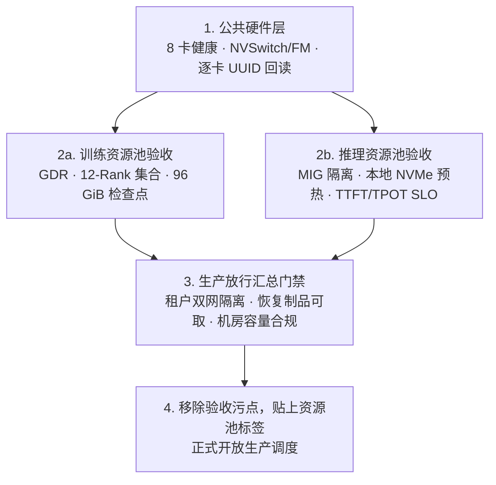

# GPU 节点的分层验收与生产准入

一台全新的 8 卡 HGX H100 服务器已经按基线 v1 完成启动，`nvidia-smi` 能整齐列出 8 张卡，单卡矩阵乘探针也能顺利跑出结果——此时可以直接开放给线上业务吗？

工程经验给出的答案是**绝不行**。单卡健康挡不住 NVSwitch 链路降级，默认网络互通不等于 GPUDirect RDMA 可用，而能够跑满训练集合通信的节点，也未必扛得住在线大模型推理的冷启动耗时与尾延迟 SLO。

本篇以待交付节点 `node-8` 为例，在受控验收隔离区里逐层推进验证，并明确拉开**训练资源池**与**推理资源池**的差异化准入门槛，最终用完整证据决定何时放行生产调度。

## 一、验收隔离：让探针走通调度，把生产挡在门外

新节点验收天然存在一对矛盾：如果彻底禁止调度（如直接 `cordon`），验收探针只能靠直绑绕过调度器，无法验证真实的 kube-scheduler → Device Plugin → CDI 交付链；如果直接放开调度，未经核验的硬件又会把生产作业拉下水。

标准的解法是**专用验收污点 + 受控容忍**：在节点注册时打上 `NoSchedule` 验收污点，仅向系统管理 DaemonSet 与平台验收账号的测试 Pod 授予对应容忍，同时配合 `nodeSelector` 将探针精准钉在待验收节点上。

```bash
# 1. 为待交付节点打上验收隔离污点（挡住所有未携带该容忍的生产负载）
$ kubectl taint nodes node-8 node-role.infra/acceptance=true:NoSchedule
node/node-8 tainted
```

```yaml
# 2. 平台受控验收 Pod 片段：走标准调度器，而非绕过调度的 nodeName 直绑
spec:
  nodeSelector:
    kubernetes.io/hostname: node-8
  tolerations:
    - key: "node-role.infra/acceptance"
      operator: "Equal"
      value: "true"
      effect: "NoSchedule"
  containers:
    - name: cuda-probe
      image: registry.example.com/infra/cuda-probe:13.2.1@sha256:3c91...a02f
      resources:
        limits:
          nvidia.com/gpu: "1"
```

配套的准入策略必须禁止普通租户擅自添加该容忍、篡改节点标签或使用 `nodeName` 绕过调度。此外，跨机测试需要预约同域已验收对端（如 `node-5` 与 `node-6`），预约占用的资源必须如实计入集群容量账本，不能一边测验收、一边把同一批卡承诺给生产作业。

## 二、公共基础层：全机 8 卡健康、NVSwitch 互联与逐卡覆盖

无论节点最终划入训练池还是推理池，都必须先通过覆盖全部 8 张卡的基础交付检查。每条验收记录都须绑定节点名、本次启动 ID（`boot_id`）和采样时间窗，避免把重启前已被清零的旧计数误当成长期健康证明。

| 验收层次 | 8 卡 HGX H100 节点的核心核验项 | 判定合格的硬性依据 |
| --- | --- | --- |
| **硬件健康与互联** | 8 张卡 PCIe 枚举与速率、BIOS/BMC/NIC 固件、`nvidia-fabricmanager` 活跃态、全机 NVSwitch/NVLink 状态、DCGM 3 级压测诊断 | 8 张卡全部绑定且拓扑无降级，Fabric 注册就绪；诊断无跳过核心项，负载窗口内 ECC、Xid、PCIe AER 零致命新增 |
| **机内多卡带宽** | 核对 `nvidia-smi topo -m` 全互联矩阵，运行 `nvbandwidth` 与 8 卡单机集合基准 | 全机 NVLink P2P 与集合带宽落入同机型健康区间，无单卡带宽塌陷或 NVLink CRC 激增 |
| **调度、分配与回读** | Node `Capacity` 与 `Allocatable` 均为 `8`；验收 Pod 经普通调度拿到 GPU，关联 kubelet PodResources 与容器内 UUID；执行显存分配、Kernel、同步与结果回读 | **8 张卡按唯一 UUID 100% 覆盖**，CDI 注入路径与库解析正确，所有卡均完成计算回读校验 |

下面的验收脚本串联了单机基础层的核心核查命令：

```bash
# 1. 核对 8 卡 NVSwitch Fabric Manager 与 NVLink 状态
$ systemctl is-active nvidia-fabricmanager
active

$ nvidia-smi nvlink -s | grep -c "GB/s"
144                                   # 8 卡 × 每卡 18 条 H100 NVLink 全部处于激活速率

# 2. 执行 DCGM Level 3 负载级硬件诊断（覆盖显存、算力与 PCIe/NVLink 压力）
$ dcgmi diag -r 3 -j | jq '.["DCGM GPU Diagnostic"].test_categories[].tests[] | {name, status}'
# 预期：全部关键测试项为 Pass，且 dmesg 无新增 PCIe AER / Xid 报错

# 3. 核对 K8s 上报的 8 卡库存与逐卡 UUID 覆盖
$ kubectl get node node-8 -o jsonpath='{.status.capacity.nvidia\.com/gpu}/{.status.allocatable.nvidia\.com/gpu}{"\n"}'
8/8

# 4. 一次性申请 8 卡探针（或并行 8 个单卡 Pod）确认 8 个唯一 UUID 均完成计算回读
$ kubectl exec -n infra-acceptance probe-8gpu-node8 -- python3 /opt/probe/verify_all_gpus.py
# 预期输出 8 行不同 GPU UUID，各自显存分配、GEMM 同步与结果校验全部 PASS
```

> [!warning] 常见误区：跑 8 次单卡测试 ≠ 覆盖了全部 8 张卡
> 依次串行提交 8 次 1 卡验收 Pod，kubelet 的默认选卡策略极有可能把 8 次测试全分到同一张空闲卡上。
>
> **正确做法**：必须按实际分配到的 **GPU UUID** 去重统计覆盖率——要么一次性占用全部 8 张卡并行校验，要么通过受控设备映射确保 8 个唯一 UUID 逐一跑通计算与回读。

> [!note] 异构机型扩展：4 卡直连 NVLink 节点的单机验收差异
> 若待验收节点为 **4 卡 HGX H100（直连 NVLink、无 NVSwitch）**，基础层无需校验 Fabric Manager 服务与 Fabric 注册，但必须通过 `nvidia-smi topo -m` 逐对检查全部 6 对卡间的直连 NVLink 链路状态，并以该机型的 4 卡单机集合基线作为参照。

## 三、训练资源池专项验收：跨机 GDR、集合基线与并行存储

分布式训练对基础设施的核心诉求是**极高的跨机有效带宽、全组零慢卡，以及周期性百 GB 检查点的稳定落盘**。节点进入训练资源池前，必须依次过完以下三关。

### 1. 主机内存与显存双轮 RDMA 验证

固定同域对端（`node-5`、`node-6`）的同一组 VF、物理上联与流量方向，先跑主机内存 RDMA Write，再切到 GPU 显存缓冲区（通过 DMA-BUF 注册执行 GPUDirect RDMA），最后交换发起端覆盖反方向路径：

```bash
# 第一轮：主机内存 RDMA 基准（验证 VF、物理链路与 RoCE 队列基础通路）
$ ib_write_bw -d mlx5_0 -x 3 -s 65536 -q 1 --report_gbits 10.210.0.15

# 第二轮：同一对端切换 GPU 显存 + DMA-BUF（专项验证 GPUDirect RDMA 路径）
$ ib_write_bw -d mlx5_0 -x 3 -s 65536 -q 1 --use_cuda=0 --use_cuda_dmabuf --report_gbits 10.210.0.15
# 注：启用 --data_validation 校验载荷内容时，需确认构建含 CUDA 插件，且性能对比须固定同一校验开关
```

如果主机内存轮顺利打满链路，而显存轮在内存注册阶段报错，根因就立刻收敛到开源内核模块、DMA-BUF 路径或 PCIe/IOMMU 配置，而不必再去折腾交换机路由。

### 2. 同域 12-Rank 集合通信对照

沿用集群主力训练作业 `train-12` 的规格（同域 3 节点 × 每节点 4 张卡 = 12 Ranks），在统一条件下运行 `nccl-tests v2.17.9`（NCCL `2.27.3`、每 Rank `64 MiB`、FP32 求和、out-of-place、开启结果校验 `#wrong=0`）：

```bash
# 在 node-5 / node-6 / node-8 同域三节点运行 12-Rank AllReduce 验收
$ mpirun -np 12 -N 4 -H node-5:4,node-6:4,node-8:4 \
  -x NCCL_DEBUG=INFO -x NCCL_IB_HCA=mlx5_0 \
  /opt/nccl-tests/build/all_reduce_perf -b 64M -e 64M -f 2 -g 1 -c 1 -w 10 -n 50
# 核验要点：日志确认选中 NET/IB (GDRDMA) 路径、#wrong=0、三轮取平均耗时中位数
```

提前约定的入池门槛为**中位耗时相对同域健康参照增幅不超过 $10\%$**。空载预约窗口实测结果如下：

| 参与节点组合 | 同条件三轮平均操作耗时 | 中位数与准入判定 |
| --- | --- | --- |
| `node-5 / node-6 / node-7`（域 B 在役参考组） | `5.90`、`6.00`、`6.20 ms` | 中位数 `6.00 ms`，作为入池参照 |
| `node-5 / node-6 / node-8`（待交付基线 v1） | `5.96`、`6.05`、`6.14 ms` | 中位数 `6.05 ms`，校验 `#wrong=0`，**达标** |

按预定门槛核算相对偏差：

$$T_{\text{门槛}} = 6.00 \times (1 + 10\%) = 6.60\text{ ms}, \qquad \Delta = \frac{6.05 - 6.00}{6.00} \approx +0.83\% \le 10\%$$

### 3. 代表训练试跑与并行存储检查点提交

集合微基准达标后，在 `node-5 / node-6 / node-8` 上执行 20 分钟代表训练试跑：门槛要求完成至少 `570` 个全局步，并向并行存储提交一份 `96 GiB` 的完整检查点且由读取端验证可读。实测 20 分钟推进 `598` 步，检查点完整性核验通过，窗口内无新增致命硬件或链路错误。

如果此时仅推进了 `530` 步（未达 `570` 步门槛），即便前面所有网络和计算基准全绿，也必须拦住放行，沿第 17–18 章的数据加载、通信和设备基线查清慢步根因。

## 四、推理资源池专项验收：MIG 隔离、权重预热与延迟 SLO

在线大模型推理的性能瓶颈与训练截然不同：它不依赖大消息跨机 AllReduce，而是高度敏感于**硬件切分隔离度、百 GB 模型权重冷启动加载速度，以及高并发下的 TTFT / TPOT 尾延迟**。

待交付节点若要进入（或兼任）在线推理资源池，必须在公共基础层之上补齐三项推理专属验收：

1. **MIG 硬件切分与邻居干扰验收**：针对需要多实例共享的推理卡，启用 MIG 模式并创建目标 Profile（如 `3g.40gb` 或 `2g.20gb`），核对 Device Plugin 正确上报对应扩展资源（如 `nvidia.com/mig-3g.40gb`）；随后在一块切片上施加满载压测，确认同卡相邻切片上的参考推理实例 TPOT P99 波动不超标。
2. **本地 NVMe 模型权重预热与冷启动验收**：在线推理弹性扩容的头号杀手是百 GB 权重拉取阻塞。验收须实测从对象/共享存储同步权重到本地 NVMe、再由本地 NVMe 装载至 HBM 的端到端耗时，确认单实例冷启动满足自动扩缩容时间窗口。
3. **单实例与并发 TTFT / TPOT SLO 基线**：固定模型（如 70B FP8、TP=2 部署 `infer-svc-1`）、典型输入/输出长度分布（如 `1024` 输入 / `256` 输出 tokens）及目标并发压力，核验 TTFT P99、TPOT P99、总输出吞吐与 KV Cache 峰值水位，确认无请求抢占雪崩与 5xx 报错。

```bash
# 1. 推理池 MIG 硬件切分与 K8s 资源上报验收（示意对指定推理卡切分 3g.40gb）
$ nvidia-smi mig -lgi -i 4,5
# 确认 GPU 4/5 均已生成目标 GI/CI 实例，且 Node Allocatable 出现 nvidia.com/mig-3g.40gb

# 2. 本地 NVMe 权重预热盘吞吐与模型冷启动加载验收
$ fio --name=nvme-weight-read --filename=/mnt/nvme-cache/bench.bin --rw=read \
  --bs=1M --iodepth=32 --direct=1 --runtime=30 --group_reporting
# 预期：本地 NVMe 顺序读速率稳定在 6+ GB/s；70B FP8 (~70 GiB) 权重热盘加载 HBM 耗时 ≤ 20 s

# 3. 推理服务并发 SLO 基准验收（固定 1024 in / 256 out，并发 64 请求）
$ python3 /opt/bench/infer_slo_probe.py --endpoint http://infer-canary-node8:8000/v1 \
  --concurrency 64 --input-len 1024 --output-len 256 --requests 500
# 示例合格输出摘要：
# TTFT_P99=340ms (<=500ms) | TPOT_P99=32ms (<=45ms) | KV_Cache_Peak=78% | Preemptions=0 | Errors=0
```

下表集中对比了**训练资源池**与**推理资源池**的差异化交付准入门槛，便于平台在节点贴标签分池时一键对齐：

| 验收维度 | 训练资源池准入门槛 | 在线推理资源池准入门槛 |
| --- | --- | --- |
| **硬件与共享形态** | 全 8 卡整卡独占，NVSwitch + Fabric Manager 全互联零降级 | 整卡（TP=2/4）或 **MIG 硬件切分**（如 `3g.40gb`）正常上报，相邻切片压测零显著尾延迟干扰 |
| **高速通信重点** | 跨机 DMA-BUF GDR + 12/24-Rank 大消息 AllReduce 中位耗时增幅 $\le 10\%$ | 机内 TP 低延迟 AllReduce 微基准；若用 PD 分离，额外验跨机 KV Cache P2P 迁移延迟 |
| **存储与缓存路径** | 并行存储持续读 + `96 GiB` 完整检查点在期限内成功提交并可读 | **本地 NVMe 模型权重预热**与顺序读达标，百 GB 权重冷启动加载耗时落入扩容预算 |
| **代表业务指标** | 20 分钟试跑推进步数达标（$\ge 570$ 步），窗口内硬件与链路零致命错误 | 固定并发下 **TTFT P99、TPOT P99** 达标，KV Cache 无抢占雪崩，错误率为 `0` |

## 五、汇合全部证据并移除生产阻断

硬件与业务压测全部绿灯后，还不能马上撤掉验收污点。如图 19-03-01 所示，只有把**基础健康、训推专项基准、租户权限隔离、恢复资料可用性以及机房容量预算**五条线全部汇合齐备，才能正式签发生产准入：



*图 19-03-01：GPU 节点分层验收与训推双池生产准入路径。基础与专项验收仅证明节点自身能力，最终开放生产还须同步闭合租户隔离、恢复资料与容量余量三项平台条件。*

回看上一篇留下的硬约束：即使待交付节点的计算、集合与推理 SLO 全部达标，只要多租户场景下的**跨租户 RoCE 拒绝对照**仍未补齐，该节点依然只能先放行给单租户池，绝不能提前开放给多租户共享池。

> [!tip] 生产放行终检清单（移除污点前逐项打勾）
> - **基础清零**：8 张卡唯一 UUID 全覆盖计算回读通过，测试 Pod 已销毁，GPU 与 VF 账本完全归还。
> - **双池达标**：按目标池归属留存完整测试条件、原始读数与判定结论（非单纯一个“Pass”布尔值）。
> - **边界齐备**：跨租户双网允许/拒绝证据齐备，基线制品摘要可独立拉取，域标签（如 `topology.infra/domain=rack-b`）与资源池标签已准确贴附。
> - **容量不越界**：确认新节点接入后机架供电、散热与共享存储仍在预算内——移除 `node-role.infra/acceptance:NoSchedule` 污点，开放调度。

一台合格节点如何进入资源池已经有了完整闭环。接下来进入集群视角：双机架一共装了 8 台 8 卡服务器（64 张 H100），扣除供电、散热、网络割面、存储并发以及维护余量之后，平台究竟敢向业务承诺多少组训练与多少路在线推理？下一篇我们就把这笔硬账彻底算清。

> [!info]- 参考资料
> - **Kubernetes 调度隔离与设备分配**：[Kubernetes v1.36 · 污点和容忍](https://v1-36.docs.kubernetes.io/docs/concepts/scheduling-eviction/taint-and-toleration/)、[Kubernetes v1.36 · Device Plugin 与 PodResources 接口](https://v1-36.docs.kubernetes.io/docs/concepts/extend-kubernetes/compute-storage-net/device-plugins/)
> - **硬件诊断、拓扑与 NVSwitch 初始化**：[NVIDIA · DCGM 诊断级别与用法](https://docs.nvidia.com/datacenter/dcgm/latest/user-guide/dcgm-diagnostics.html)、[NVIDIA SMI · 拓扑、MIG 与 NVLink 查询](https://docs.nvidia.com/deploy/nvidia-smi/index.html)、[NVIDIA · HGX H100 机内互联架构](https://developer.nvidia.com/blog/?p=46100)、[NVIDIA · NVSwitch Fabric Manager 用户指南](https://docs.nvidia.com/datacenter/tesla/fabric-manager-user-guide/index.html)
> - **RDMA、GDR 与集合通信基准**：[NVIDIA · GPUDirect RDMA 平台与注册选型](https://docs.nvidia.com/datacenter/cloud-native/gpu-operator/26.7/gpu-operator-rdma.html)、[perftest 26.07.8 · 参数、DMA-BUF 与数据校验](https://raw.githubusercontent.com/linux-rdma/perftest/26.07.8/README)、[NCCL 2.27.3 · 集合通信原语](https://docs.nvidia.com/deeplearning/nccl/archives/nccl_2273/user-guide/docs/usage/collectives.html)、[nccl-tests v2.17.9 · MPI 与计时口径](https://raw.githubusercontent.com/NVIDIA/nccl-tests/v2.17.9/README.md)
