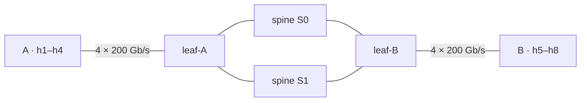
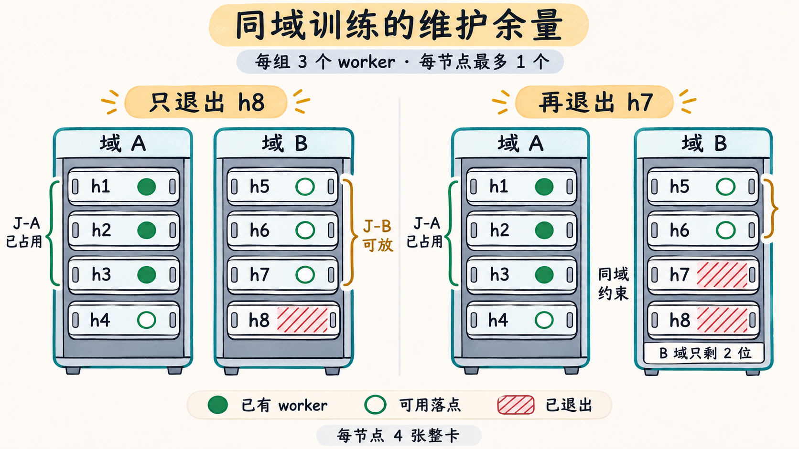

# 机架供电、网络与作业容量

`h8` 入池后，机架 A 和 B 各有四台同型节点，每台提供 4 张整卡。**容量设计**要回答在指定工况下可以持续交付多少能力。先确定生产和故障工况，再找每类资源的共同约束。以下预算、拓扑和测量值只用于本章推演。

## 单路供电和持续散热限定装机数

每台按整机交流输入 4 kW 预留，机架内其余设备合计预留 1 kW。假定电源和接线支持失一路后由另一路承担此负载，A/B 每路线在连续运行与冗余预留后各可供 18 kW。正常均分，失一路时剩余一路承接全部预留。机架可持续排热预算为 19 kW，本模型近似将机架交流输入按同值换算成待排热量。实际交付还要核对机型的失电行为、供电分相、断路器与上游、瞬态和持续散热条件。液冷机型需核对供液温度、流量和仍由空气带走的热量。第 01 章已经说明整机规格与机架配电是两个约束。 [NVIDIA DGX H100/H200 · 电源冗余和系统规格示例](https://docs.nvidia.com/dgx/dgxh100-user-guide/introduction-to-dgxh100.html#support-for-psu-redundancy-and-continuous-operation)

| 每机架节点数 | 总功率预留 | 正常每路 | 失一路后剩余一路 | 持续散热 |
| ---: | ---: | ---: | ---: | ---: |
| 4 | `4 × 4 + 1 = 17 kW` | 8.5 kW | 17 kW，余 1 kW | 17 kW，余 2 kW |
| 5 | `5 × 4 + 1 = 21 kW` | 10.5 kW | 21 kW，差 3 kW | 21 kW，差 2 kW |

单路供电上限对应 `⌊(18 − 1) ÷ 4⌋ = 4` 台，散热上限为 `⌊(19 − 1) ÷ 4⌋ = 4` 台。即使 B 还有机位和接入口，也无法按本工况接入第五台 `h9`。若要改用系统限功率，需按真实失电时的整机输入复算，并验证该工况下仍能持续推进且达到服务目标。

## 网络域和单向割面限定跨机架服务

每个机架的四个计算端口各以 200 Gb/s 全双工接入本机架 leaf。每台 leaf 各以一条 200 Gb/s 全双工上联接 `S0`、一条接 `S1`。A、B 两个网络域分别由 `leaf-A`、`leaf-B` 下的节点组成。固定同域的集合流量留在该 leaf，跨域测试或服务走 spine。存储网另有自己的路径与瓶颈。此处近似交换机转发充足，路由收敛并可使用可用链路，背景流量与协议开销暂略。 [NVIDIA HGX AI Factory · Spine-Leaf 的连接方式](https://docs.nvidia.com/enterprise-reference-architectures/hgx-ai-factory-h100-h200-b200/latest/network-logical-architecture.html)

*图 19-03-01｜仅画 RoCEv2 计算网。每端机架内的带标签连线汇总四条独立下联，各 leaf 分别直连 S0、S1，四条未标注的上联各为 200 Gb/s 全双工。按 A→B 方向比较 leaf-A 的出口和 leaf-B 的入口，可得该方向的上界。*

割面是把路径分成两侧后，所有跨分界的链路。在 A→B 方向，源 leaf 上联和目的 leaf 上联各构成一个割面，两端接入链路也各有容量上界。正常时单向上界为 `min(800, 400, 400, 800) = 400 Gb/s`，每 leaf 的下联与上联容量比为 `800:400 = 2:1`。任一条计算网上联失效，收敛后只剩一条完整的跨域路径，A→B 上界为 200 Gb/s。单方向计算只取每条链路的该方向容量。此处两个域各只有一台 leaf，整台 leaf 失效时，其接入节点会一起失去本例的 RoCE 路径。

教学计划另有一项跨机架服务，两个独立端点对同时各需 120 Gb/s 的有效单向负载。合计 240 Gb/s 低于正常结构上界。若按流的等价多路径（ECMP）把两条流都分给同一条 200 Gb/s 上联，也无法达成目标。要在正常工况承诺 240 Gb/s，需要按实际端点、方向和并发压测。单上联故障时线路上界只有 200 Gb/s，已经可以否决 240 Gb/s 的同等承诺。可在审批材料中提出重新设计冗余路径，或在故障工况降低需求并复测。 [NVIDIA Cumulus Linux 5.11 · ECMP 按流分配](https://docs.nvidia.com/networking-ethernet-software/cumulus-linux-511/Layer-3/Routing/Equal-Cost-Multipath-Load-Sharing/)

## 存储窗口把读写并发换成速率

每组训练持续读取数据，每组需要聚合 2 GiB/s。一次检查点的有效载荷 96 GiB，假设可用写入窗口为 24 s，所需写速率至少为 `96 ÷ 24 = 4 GiB/s`。此处 24 s 已扣除其余阶段，忽略记录开销与重试。两组共享同一存储后端。教学上假设后端在涉及的混合读写比例下已得到 10 GiB/s 的聚合载荷能力，预算另留 1 GiB/s，训练可用 9 GiB/s。

- 平时两组共读 `2 × 2 = 4 GiB/s`。
- 写入窗口完全重叠时需求 `4 + 2 × 4 = 12 GiB/s`，超出预算 3 GiB/s。
- 写入窗口不重叠时峰值为 `4 + 4 = 8 GiB/s`，余 1 GiB/s。错峰需覆盖重试延长的窗口，并和恢复读取等突发负载一起核算。

若 24 s 是端到端保存期限，序列化、同步与发布也占用期限，实际数据写入窗口更短。验证时同时看训练读取、所有分片写入、后端等待和完整版本的提交时间。单个流的链路规格与一段纯写跑分都不足以确定共享后端在该混合比例下的能力。 [PyTorch 2.9 · 分布式检查点](https://docs.pytorch.org/docs/2.9/distributed.checkpoint.html)

## 从节点落点推导整组数量和维护余量

本例同步训练需要同一网络域内 3 个 worker Pod，每个 Pod 使用 4 GPU、16 CPU、96 GiB 内存和 1 个 VF，每台节点至多一个 worker。假定四项资源余量、机型、队列和节点准入均通过时，一个节点提供一个落点。已分配的节点依然占用容量，即使 GPU 此刻空闲。评估新作业的余量要按节点扣除已有请求。此处计算的是总共能承载几组，快照中按所有用于这类负载的合格节点计。 [Kubernetes v1.36 · GPU 的请求与放置](https://v1-36.docs.kubernetes.io/docs/tasks/manage-gpus/scheduling-gpus/)

| 工况 | A / B 的可用落点 | 可组成的同域作业 |
| --- | --- | --- |
| 全部节点合格 | 4 / 4 | `⌊4 ÷ 3⌋ + ⌊4 ÷ 3⌋ = 2` 组。每域还余一个未占落点时，可以有本地替换。 |
| B 一次撤出一台 | 4 / 3 | 仍可支持两组，B 失去本地替换余量。 |
| B 一次撤出两台 | 4 / 2 | 仅 A 可组成一组。B 的 8 张整卡与 A 剩余的 4 张整卡不能拼成一组同域作业。 |
| A、B 各撤出一台 | 3 / 3 | 数量上仍可支持两组，两域都没有再退出一台的余量。 |

*图 19-03-02｜在表中的两种 B 域撤出工况上加入作业占用。A 域的 J-A 占 h1 至 h3，B 域旧组已释放。仅 h8 退出时，J-B 仍能在 h5 至 h7 放齐三个 worker。若 h7 也退出，B 只剩 h5、h6，A 域的 h4 受同域约束无法补位。*

在本例，两组并行还依赖检查点错峰。表中的两组是满足给定放置及容量假设时的承载数，实际重启仍要找到可用检查点并重新会合。若升级要求两组均可恢复且 B 域保留至少一个完整落点冗余，B 在现有规模下便没有额外维护余量。下一篇给出的试点采用另一项明确的窗口约束：两域各保留 3 个合格落点，接受一次预定的维护中断。
