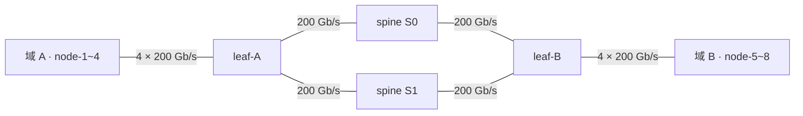
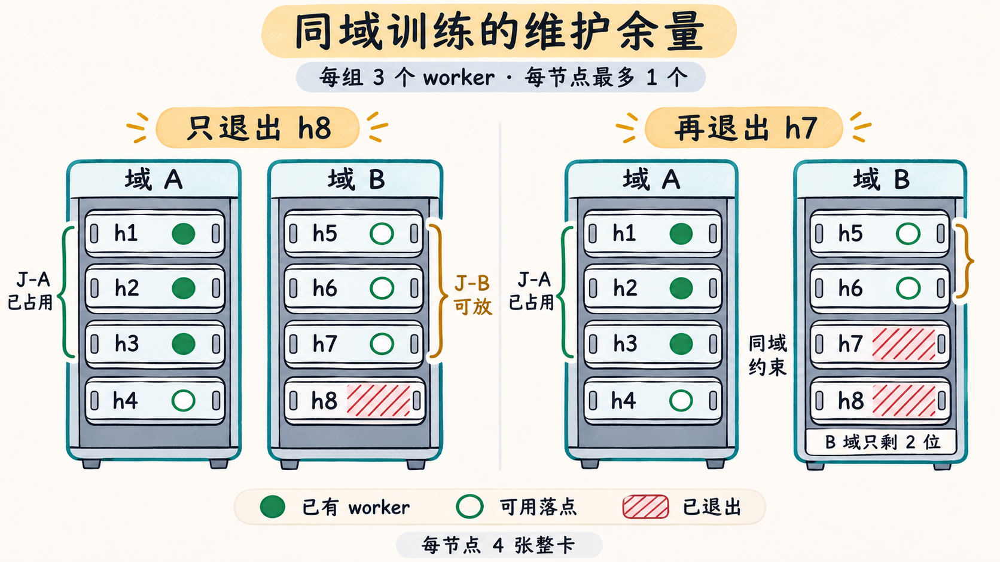

# 机架约束、作业容量与维护余量

两座机架一共装着 8 台 8 卡 H100 服务器（64 张 GPU），监控面板上还挂着 16 张空闲卡，为什么一份只申请 12 张卡的训练作业依然卡在 `Pending`？为什么刚把一台节点抽出来做内核维护，在线推理的 P99 延迟就拉响了告警？

原因在于：**集群容量绝不是把全池 GPU 张数简单相加。** 机架配电（kW）、网络割面（Gb/s）、共享存储窗口（GiB/s）和同域节点落点（Slot）各自在不同维度上掐着喉咙，任何一项先触顶，就会锁死整套集群的可承诺容量。

本篇承接前面已全部验收合格的双机架 8 节点集群，按“机房物理上限 → 网络割面 → 存储并发 → 训推双池节点落点与维护余量”的顺序，逐层算出平台真正敢对外承诺的持续算力。

## 一、单路供电冗余与持续散热限定机架装机上限

规划高密 GPU 机架时，第一道硬门槛不是机位 U 数，而是**单路失电工况下的供电上限与持续排热能力**。

按标准 8 卡 HGX H100 整机规格（参考 DGX H100 满载交流输入约 `10.2 kW`），我们为每台节点预留 `10 kW` 交流输入预算，机架内接入交换机与带外管理杂项合计预留 `2 kW`。高密机架配 A/B 双路供电，正常时均分负载；失一路电时，剩余一路须独立兜住全机架连续运行，单路可用上限为 `44 kW`，机架持续散热上限（液冷+风冷协同）为 `46 kW`：

$$N_{\text{供电上限}} = \left\lfloor \frac{44 - 2}{10} \right\rfloor = 4\text{ 台}, \qquad N_{\text{散热上限}} = \left\lfloor \frac{46 - 2}{10} \right\rfloor = 4\text{ 台}$$

把 4 台与追加第 5 台的功率账摊开对照，结论一目了然：

| 每机架 8 卡节点数 | 整架总功率预留 | 正常每路负载 | 失一路后剩余单路（限 `44 kW`） | 持续散热需求（限 `46 kW`） |
| ---: | ---: | ---: | --- | --- |
| **4 台** | `4 × 10 + 2 = 42 kW` | `21.0 kW` | `42 kW`（余 `2 kW`，**合规**） | `42 kW`（余 `4 kW`，**合规**） |
| **5 台** | `5 × 10 + 2 = 52 kW` | `26.0 kW` | `52 kW`（**超限 `8 kW`**） | `52 kW`（**超限 `6 kW`**） |

即使机架物理空间和交换机端口还有富余，也不能硬塞第 5 台节点。算账时务必避开两个典型误区：一是不能把 A/B 两路相加的 `88 kW` 当作冗余容量；二是必须用**整机交流输入**（含 CPU、内存、网卡、风扇与电源转换损耗），绝不能只把 8 张 GPU 的 TDP 简单相加。

> [!note] 异构机型对照：传统风冷机架与 4 卡直连节点
> 若某业务线使用传统风冷机架（单路冗余 `18 kW`、持续排热 `19 kW`、机架杂项 `1 kW`）部署 **4 卡直连 NVLink 节点**（整机交流预算 `4 kW/台`），遵循的是完全相同的下取整公式：$\lfloor(18 - 1)/4\rfloor = 4$ 台，装第 5 台同样会以 `21 kW` 同时击穿供电与排热预算。液冷机型上线前还须额外核对供液温度、流量与剩余风冷占比。

## 二、网络域与单向割面限定跨机架服务

在高速计算网平面上，机架 A（`node-1`–`node-4`）与机架 B（`node-5`–`node-8`）分别接入 `leaf-A` 与 `leaf-B`，构成两个独立网络域。每台节点以一条 `200 Gb/s` 全双工 RoCEv2 链路接本域 Leaf，每台 Leaf 再各以一条 `200 Gb/s` 全双工上联分别接往 `spine S0` 和 `spine S1`：



*图 19-04-01：双机架 RoCEv2 计算网逻辑拓扑。每台 Leaf 下联汇总 `800 Gb/s`、上联汇总 `400 Gb/s`（收敛比 `2:1`）；核算 A→B 单向割面容量时，只取每条物理链路在该方向上的速率。*

所谓**单向割面**，就是把源域和目的域切开后，所有跨越切口且指向同一方向的物理链路之和。在忽略协议开销与背景流量时，从域 A 到域 B 的单向结构上界受四道关口共同制约：

$$C_{\text{A}\to\text{B, 正常}} = \min(800,\; 400,\; 400,\; 800) = 400\text{ Gb/s}$$

一旦任意一条 Leaf↔Spine 上联失效，路由收敛后只剩一条完整的跨域通路，单向上界腰斩为：

$$C_{\text{A}\to\text{B, 单上联失效}} = 200\text{ Gb/s}$$

用这把尺子去评审一项**跨机架服务需求**（例如跨机架 PD 分离 KV Cache 迁移或跨机架数据同步，两个独立端点对同时各需 `120 Gb/s` 单向有效载荷，合计 `240 Gb/s`），立刻能分出两种不同强度的工程裁定：

- **单上联失效工况（直接否决）**：`240 Gb/s` 高于线路物理上界 `200 Gb/s`，不经实测即可一票否决，必须降级承诺或扩增上联冗余。
- **双上联正常工况（未否决，尚待压测）**：`240 Gb/s` 低于 `400 Gb/s` 上界，但若按流散列的 **ECMP** 碰巧把两条 `120 Gb/s` 巨流哈希进同一条 `200 Gb/s` 上联，依然会触发拥塞丢包。因此低于上界只是“拿到入场券”，能否兑现仍须按真实端点并发压测。

同域训练作业的集合流量不出本机架 Leaf，不消耗跨域上联；但也绝不能把 `400 Gb/s` 跨域上界误读为单组训练的可用带宽——单台 Leaf 故障时，整座机架的 RoCE 计算面会同时失联。

## 三、存储并发窗口：训练检查点错峰与推理权重拉取冲击

双机架上的两组主力训练作业共用一套外部并行存储后端。经实测，该后端在混合读写比例下的聚合有效载荷能力为 `10 GiB/s`，平台预留 `1 GiB/s` 系统缓冲，留给计算池的可用预算为 **`9 GiB/s`**。

每组训练持续读取训练样本需 `2 GiB/s`；每次写入 `96 GiB` 有效检查点载荷时，扣除序列化与元数据提交后留给纯数据落盘的窗口为 `24 s`，单组写入速率需求为：

$$R_{\text{ckpt}} = \frac{96\text{ GiB}}{24\text{ s}} = 4\text{ GiB/s}$$

把两组训练的读写需求叠加到同一时间窗上，差异立刻显现：

- **稳态纯读**：两组训练合计持续读 $2 \times 2 = 4\text{ GiB/s}$，余量充裕。
- **检查点完全重叠**：总需求冲高至 $4 + 2 \times 4 = 12\text{ GiB/s}$，**击穿 `9 GiB/s` 预算 `3 GiB/s`**，直接拖慢训练步或导致写入超时。
- **检查点错峰调度**：任一时刻至多一组落盘，峰值为 $4 + 4 = 8\text{ GiB/s}$，保留 `1 GiB/s` 余量。

> [!warning] 训推共存隐患：推理扩容拉取权重如何击穿存储预算
> 看起来错峰后还留了 `1 GiB/s` 余量，但在训推共存集群里，如果在线推理池在流量高峰同时弹性拉起 3 个新副本，并且直接从同一套共享存储并发读取 `70 GiB` 大模型权重，瞬间就会叠加上数 `GiB/s` 的突发读流量，把原本安全的检查点窗口打爆。
>
> **架构对策**：第 03 篇把**本地 NVMe 模型权重预热**写入推理池准入门槛，正是为了把推理弹性扩容的高频权重读取彻底消化在节点本地盘，避免与共享存储上的训练检查点正面撞车。

## 四、从节点四维落点到训推双池维护余量

物理与共享瓶颈全部过关后，最后要把容量压回具体节点的 Kubernetes 资源账本，分别核算**训练资源池的同域落点**与**推理资源池的高可用冗余**。

### 1. 训练资源池：节点落点公式与同域维护余量

在每台 8 卡 HGX H100 节点（`8 GPU / 32 CPU / 192 GiB / 2 VF`）上，扣除划归在线推理池的半机配额（`4 GPU / 16 CPU / 96 GiB / 1 VF`）后，余量用于承接 `train-12` 的训练 worker。

每只 worker 请求 `4 GPU、16 CPU、96 GiB、1 VF`（且每节点限 1 只）。设节点四维余量为 $(g, c, m, v)$，则单节点能贡献的训练落点数上限为：

$$s = \min\!\left(\left\lfloor\frac{g}{4}\right\rfloor,\;\left\lfloor\frac{c}{16}\right\rfloor,\;\left\lfloor\frac{m}{96}\right\rfloor,\;v,\;1\right)$$

只要任意一维卡壳——例如余量 `(4, 12, 128, 1)` 缺 CPU，或 `(4, 16, 96, 0)` 缺 VF，或节点内 GPU 与 VF 无法满足 NUMA 亲和对齐——该节点贡献的落点数就是 `0`。（若专供整机 8 卡训练作业，只需把分母替换为 `(8, 32, 192, 2)`，下方域级公式完全不变。）

设域 A 有 $n_A$ 个完整落点、域 B 有 $n_B$ 个完整落点，由于 `train-12` 要求 3 个 worker 严格落在**同一网络域**，全集群总承载组数必须按域分别向下取整再相加：

$$J_{\max} = \left\lfloor\frac{n_A}{3}\right\rfloor + \left\lfloor\frac{n_B}{3}\right\rfloor$$

| 节点撤出工况 | 域 A / 域 B 完整落点 | 全池可组成的同域训练组数 | 运维含义 |
| --- | :---: | --- | --- |
| **全池 8 节点合格** | `4 / 4` | $\lfloor 4/3\rfloor + \lfloor 4/3\rfloor = 2$ 组 | 两域各有 1 台本地备用落点 |
| **域 B 撤出 1 台** | `4 / 3` | 仍支持 `2` 组 | 域 B 失去本地替换余量，不能再承受故障 |
| **域 B 撤出 2 台** | `4 / 2` | **仅剩 `1` 组**（仅域 A） | 域 B 的 2 位与域 A 的 1 空位跨了域，无法拼组 |
| **A、B 各撤出 1 台** | `3 / 3` | 仍支持 `2` 组 | 两域均处于零故障余量状态 |



*图 19-04-02：双机架同域约束下的维护余量推演。当域 B 同时失去两台节点时，即便域 A 仍有空闲节点，也因同域规则无法拼成完整训练组（图中旧简标 `h1–h8` 对应 `node-1–node-8`，底部的“每节点 4 张整卡”对应每台 8 卡节点上划归训练池的 4 卡槽位）。*

由此推出单域内的**维护余量与故障余量守恒不等式**：设某域当前有 $N$ 个健康完整落点，需保留 $J$ 组 3 节点训练恢复容量，同时要求维护窗口内还能额外承受 $F$ 台节点突发故障，则允许同时计划维护的节点数 $M$ 必须满足：

$$M \le N - 3J - F$$

代入域 B 的数值（$N=4, J=1$）：如果业务接受维护期间无额外故障缓冲（$F=0$），最多允许同时维护 $M = 1$ 台；如果要求维护期间再坏一台也不能断训练（$F=1$），则 $M = 0$，当前根本没有计划维护余量！若某节点已经因故障隔离，必须先把 $N$ 减 1 再套公式，切忌重复计算。

### 2. 在线推理资源池：峰值 SLO、跨机架分布与 PDB 维护余量

与训练的“同域成组硬凑齐”不同，在线推理资源池（`infer-svc-1`）的维护余量由**峰值并发 QPS、KV Cache 安全水位与跨机架高可用**共同决定。

假设主力推理服务 `infer-svc-1` 每副本占用 `2` 张 H100（TP=2），在 8 台节点上通过跨主机与跨机架均匀散布，共部署 `8` 个副本（每节点 1 个核心主力副本，另 2 卡承载 MIG 小模型池）。业务核算表明：早晚高峰至少需要 **`6` 个健康副本**才能把 KV Cache 利用率稳在 `80%` 以下并守住 TTFT/TPOT P99 SLO。

于是推理池的维护余量公式直接落在了可用副本数上：

$$R_{\text{总副本}} - M_{\text{维护节点数}} - F_{\text{故障节点数}} \ge R_{\text{SLO 最低副本}}$$

代入 $8 - M - F \ge 6$：允许最多撤出 1 台节点维护并同时保留 1 台故障容错（$M=1, F=1$）；如果把 2 台节点同时排空，虽然刚好压线剩 6 副本，但只要此时再发生单卡异常，整个在线服务就会因 KV Cache 过载发生延迟雪崩。

在生产集群中，运维一方面通过命令实时核算各域四维余量，另一方面通过 `topologySpreadConstraints` 与 `PodDisruptionBudget`（PDB）把推理维护余量写进硬约束：

```bash
# 实时核查域 B 各节点 GPU/CPU/内存/VF 可分配容量与域标签，杜绝只看全局总卡数
$ kubectl get nodes -l topology.infra/domain=rack-b \
  -o custom-columns='NODE:.metadata.name,TAINT:.spec.taints[*].key,GPU:.status.allocatable.nvidia\.com/gpu,VF:.status.allocatable.example\.com/rdma-vf,MEM:.status.allocatable.memory'
NODE     TAINT                         GPU   VF   MEM
node-5   <none>                        8     2    192Gi
node-6   <none>                        8     2    192Gi
node-7   <none>                        8     2    192Gi
node-8   <none>                        8     2    192Gi
```

```yaml
# 在线推理服务 infer-svc-1 的高可用分布与维护余量保护配置
apiVersion: policy/v1
kind: PodDisruptionBudget
metadata:
  name: infer-svc-1-pdb
  namespace: infer-prod
spec:
  minAvailable: 7                     # 计划排空至多允许同时下线 1 个副本，守住高峰 SLO 与故障余量
  selector:
    matchLabels:
      app: infer-svc-1
---
# Deployment.spec.template.spec 中配合双层拓扑均衡，防止单机架失联打掉过半副本
topologySpreadConstraints:
  - maxSkew: 1
    topologyKey: topology.infra/domain        # 跨机架均匀打散（A/B 域各 4 副本）
    whenUnsatisfiable: DoNotSchedule
    labelSelector:
      matchLabels:
        app: infer-svc-1
  - maxSkew: 1
    topologyKey: kubernetes.io/hostname       # 跨节点反亲和（每台节点至多 1 副本）
    whenUnsatisfiable: DoNotSchedule
    labelSelector:
      matchLabels:
        app: infer-svc-1
```

> [!tip] 训推双池容量与维护余量核对清单
> - **分维单算**：供电（kW）、散热（kW）、跨域单向割面（Gb/s）、存储错峰（GiB/s）各自独立核算，任何一维触顶即截断承诺。
> - **训练看域内落点**：永远按域分别下取整 $\lfloor n_A/3\rfloor + \lfloor n_B/3\rfloor$，并用 $M \le N - 3J - F$ 锁定单域并发维护上限。
> - **推理看峰值与 PDB**：用跨机架分布约束防单点集聚，用 `PDB minAvailable` 强制卡住排空节奏，本地 NVMe 兜住扩容权重读。

容量账本算清了“最多能拿走几台节点、空出多少落点”。但光有空位还远远不够——如果节点坏掉或者升级回滚时，原镜像已被仓库清理、检查点只写了一半、交换机配置只留在故障工程师的笔记里，再多空位也救不活业务。下一篇，我们先备齐可重建的恢复资料与恢复时间预算。

> [!info]- 参考资料
> - **服务器供电冗余与高密机架约束**：[NVIDIA DGX H100 · 电源冗余与持续运行规格](https://docs.nvidia.com/dgx/dgxh100-user-guide/introduction-to-dgxh100.html#support-for-psu-redundancy-and-continuous-operation)
> - **Spine-Leaf 拓扑与 ECMP 流量分担**：[NVIDIA HGX AI Factory · Spine-Leaf 逻辑网络架构](https://docs.nvidia.com/enterprise-reference-architectures/hgx-ai-factory-h100-h200-b200/latest/network-logical-architecture.html)、[Cumulus Linux 5.11 · ECMP 按流负载分担](https://docs.nvidia.com/networking-ethernet-software/cumulus-linux-511/Layer-3/Routing/Equal-Cost-Multipath-Load-Sharing/)
> - **分布式检查点与存储并发**：[PyTorch 2.9 · Distributed Checkpoint 文档](https://docs.pytorch.org/docs/2.9/distributed.checkpoint.html)
> - **Kubernetes GPU 放置与 PDB 保护**：[Kubernetes v1.36 · GPU 资源调度与放置](https://v1-36.docs.kubernetes.io/docs/tasks/manage-gpus/scheduling-gpus/)、[Kubernetes v1.36 · 自愿中断与 PodDisruptionBudget](https://v1-36.docs.kubernetes.io/docs/concepts/workloads/pods/disruptions/)
