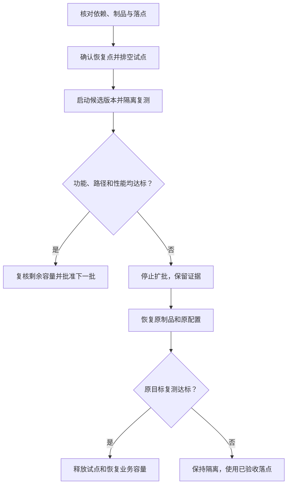

# 版本升级的试点、作业排空与回滚

**滚动升级**让节点分批退出、变更、复测和返回。每批退出会改变可放置容量，返回后还会形成新旧版本混跑。回滚需要另一条可执行的路径，将受影响的输入和运行能力恢复到批准状态。这里评审第 01 篇的 `B0 → B1`，即节点镜像和内核变更。硬件、NIC 固件、网络、Operator 与应用制品在变更单中固定，模块须适配各自的启动内核。以下是教学变更窗口。

## 按整组容量选试点和影响范围

机架 A 保留运行中的训练组 `J-A`，占 `h1/h2/h3`。B 原有训练组 `J-B`，占 `h5/h6/h7`，允许在约定时段完成一次有检查点的停启，`h8` 为 B 域的备用节点。试点先改 `h8`。退出后 B 仍有三个合格落点。若再提前拿走 `h7`，即使 A 还有 `h4`，B 仍只剩两个落点，不能按硬性同域规则恢复 `J-B`。本窗口要求每域保留 3 个可恢复落点，故 B 同时退出上限为 1。预留落点包含本域的 CPU、内存、4 张同型整卡与 VF，并核对队列额度以及节点内设备能否按策略交付。

变更单先比较目标和原镜像摘要及包清单，核对启动模块、签名、实际 GPU 驱动和同机互联、NIC 驱动与显存注册，确认原制品仍可独立取到。再记录新旧节点之间要共同通过的测试，因为升级期间一组 Rank 可以同时运行在 `B0` 与 `B1` 节点。某个新节点单独通过只覆盖一部分。测试 `h5/h6/h8` 要占用 B 域同一批 GPU，提前纳入维护窗口，等 `J-B` 按策略退出后才排入试点测试。

## 先保证训练能恢复，再移除节点上的驱动使用者

把生产放置和实际使用分别确认。对要维护的节点，`cordon` 设置不可调度，已有 Pod 可继续运行。按应用约定等待或请求生成完整检查点，核查读取方可用的提交记录与必需状态。对固定三 worker 的 `J-B`，单独终止一个成员会让全组失去参与者。由作业控制器或维护操作协调停止和恢复，记录退出、队列或请求释放以及实际替换位置。本例依赖作业方在约定窗口有序停止，后续启动使用指定完整状态。若仅重启容器，原有 Pod 和设备分配可能继续存在。 [Kubernetes v1.36 · 安全排空](https://v1-36.docs.kubernetes.io/docs/tasks/administer-cluster/safely-drain-node/) · [PyTorch 2.9 · Worker Group 故障行为](https://docs.pytorch.org/docs/2.9/elastic/run.html)

`drain` 会驱逐或按适用路径删除节点上的 Pod。正常使用 Eviction API 的排空受 PodDisruptionBudget（PDB，自愿中断预算）约束。用各 Pod 的控制器、PDB、临时本地数据和宽限期判断能否安全退出。DaemonSet 管理的 Pod 不由 `drain` 删除，带容忍的新 Pod 与直绑 `nodeName` 也需要另外控制。执行维护之前，核查实际 Pod 和主机进程，确认厂商要求退出的 GPU 客户端已经退出，涉及的本地状态已获处置。重启后用验收隔离限制新放置。遇到 PDB 阻塞，要查预算和可调度余量，或重排窗口。如果恢复所需的检查点或落点还未准备好，继续等待所需条件。 [Kubernetes v1.36 · drain 的行为及限制](https://v1-36.docs.kubernetes.io/docs/reference/kubectl/generated/kubectl_drain/) · [Kubernetes v1.36 · 自愿中断与预算](https://v1-36.docs.kubernetes.io/docs/concepts/workloads/pods/disruptions/)

## 用同一条路径决定停批或扩批

维护前，先用 `h5/h6/h8` 在 `B0` 上做一组当天参考。更换 `h8` 镜像后，用只允许验收负载通过的机制放置测试。若已解除 cordon 以供验收，仍保留独立的验收污点及受控容忍。沿第 02 篇重走设备、同机互联、Pod 计算、跨机路径、集合和代表负载。以下是在同样的 12 Rank、64 MiB、FP32 求和、独立缓冲区和空载条件下的教学记录，其他测试配置保持一致。三轮各取平均每次操作时间，再求中位数。 [nccl-tests v2.17.9 · 测试参数与计时](https://raw.githubusercontent.com/NVIDIA/nccl-tests/v2.17.9/README.md)

| 阶段 | 平均操作时间的三轮读数 | 其他证据 |
| --- | --- | --- |
| 变更前，`h5/h6/h8` 均为 `B0` | 5.96、6.05、6.14 ms | 计算校验与预期显存路径通过。 |
| 试点后，只有 `h8` 为 `B1` | 6.73、6.80、6.86 ms | 设备、单卡计算、RDMA 数据校验和全组结果正确。保留传输日志、实际放置、端口指标与时钟。 |
| `h8` 恢复 `B0` 后 | 5.98、6.06、6.15 ms | 路径与校验通过，代表性作业窗口达标且完整提交。 |

相对当天参考的门槛为 `6.05 × 1.10 = 6.655 ms`，不在比较前舍入。试点中位数 6.80 ms，比 6.05 ms 高约 12.4%，触发事先约定的停批。对照三轮与回滚结果可以将影响缩小到这次变更涉及的范围，仍要检查两端显存路径、CPU/GPU 位置、时钟、计数和同窗干扰，才能进一步定位。功能和性能各有证据，功能正确的试点仍可能让同步训练因通信变慢而丢失进展速率。

*图 19-04-01｜试点通过才考虑扩批，失败则停批并保留证据。沿回滚路径重新验收原目标，通过后可释放试点，失败时继续隔离，业务使用事先核实的合格落点。*

本例回滚以原摘要的 `node-B0` 重新启动，恢复对应内核、驱动模块和用户态配套。核对同启动周期的版本、设备身份、运行时、网络与实际路径，确认 6.06 ms 的中位数及代表性窗口符合原有目标，才撤去验收隔离。此时 `J-B` 可按已提交的检查点恢复，观察全组加载和有效推进。若需要先恢复 `J-B`，可在原组 `h5/h6/h7` 上启动，`h8` 继续隔离，稍后再预约共享对端做回滚验收。训练恢复与试点节点复归可以在不同时间完成。

## Operator 管理的版本变更有自己的作用范围

若驱动由 Operator 安装，升级控制器需要协调 GPU 客户端退出、卸载模块、安装加载和验证。v26.7 对 ClusterPolicy 或按池的 NVIDIADriver 有不同的配置作用范围，`maxParallelUpgrades` 限并行数，`maxUnavailable` 还约束适用集合中已有的不可用节点。应把这两个数转回每个网络域的可恢复落点，检查升级控制器的等待、驱逐与节点复归条件是否符合业务约定。本例使用预装驱动，主机镜像流程负责切换。 [NVIDIA · v26.7 驱动升级状态机与策略作用域](https://docs.nvidia.com/datacenter/cloud-native/gpu-operator/26.7/gpu-driver-upgrades.html)

若变更的是 GPU Operator 本身，先核对官方支持的升级跨度、CRD 及 Helm hook、现有对象与新控制器的兼容性。v26.7 文档允许同主版本或升到下一主版本，主版本以 `YY.MM` 计。控制器、CRD、组件镜像与节点有效状态各有版本。Helm 回到旧发布版本也要核对 CRD 和现存对象能否被旧控制器读取、主机配置如何恢复。若涉及固件且平台不支持降级，事前需要确定换件、留用旧节点或向前修复的恢复路径。 [NVIDIA · v26.7 升级跨度](https://docs.nvidia.com/datacenter/cloud-native/gpu-operator/26.7/platform-support.html#nvidia-gpu-operator-life-cycle) · [NVIDIA · v26.7 Operator 与 CRD 升级](https://docs.nvidia.com/datacenter/cloud-native/gpu-operator/26.7/upgrade.html)
