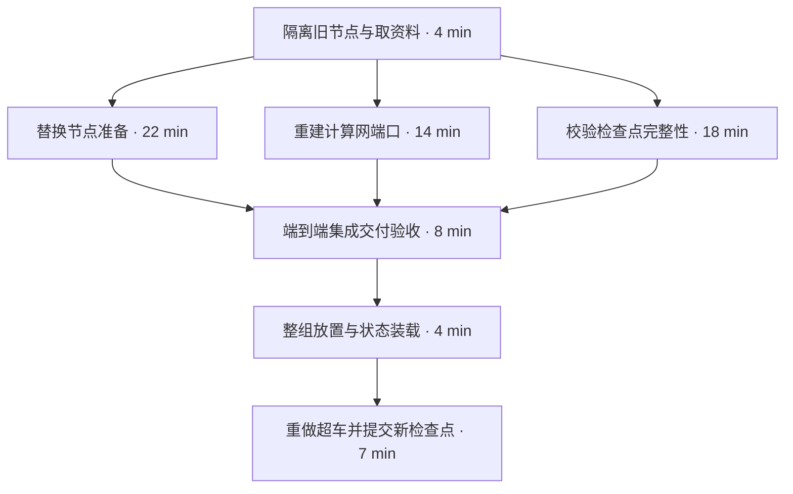

# 恢复资料、检查点与恢复时间预算

深夜一台主力 GPU 节点突然掉电无法启动，运维长舒一口气：“别慌，我们有备用节点、有镜像仓库，训练目录里还有 5 分钟前刚生成的最新检查点！”——结果真动手恢复时，发现最新检查点缺了 2 个 Rank 的分片、老驱动镜像早被仓库清理策略删了、交换机端口配置找不回原样，原本计划 45 分钟恢复的训练拖了整整 6 个小时。

容量账本只能证明“机房里还有空位”，真正决定事故能不能扛过去、升级能不能退回来的，是**完整可读的业务状态、可独立取回的重建资料，以及算得清关键路径的恢复时间预算**。

先区分两个常被混用的动作：**回滚**是把计划变更触及的软件与配置退回原基线；**恢复演练**则是验证在原节点或部分环境丢失时，仅凭留存资料、制品与持久化数据能否按期重建能力。

下面以一次节点损毁重建场景展开推演：域 B 的 `node-8` 宕机报废且计算网接入端口待重建，控制面、`node-5 / node-6` 及外部存储完好（`node-7` 另有保留），需接入替换节点 `node-8-r` 恢复 `train-12`。

## 一、检查点如何成为真正可用的恢复点

分布式训练的**检查点**不仅包含模型参数，通常还包括优化器状态、全局步数、随机种子与数据加载器偏移量。在 12-Rank 同步训练中，3 个 worker 并行向共享存储写分片——**目录修改时间最新、总容量接近 `96 GiB`、或者 Rank 0 已经落盘，都绝不等于整组状态可以恢复。**

判断一份检查点真正可用，必须依赖应用层的**原子提交协议**：

1. **写入暂存版本**：所有参与 Rank 在同一全局步冻结状态，各自把分片写入该步专属的暂存目录。
2. **协调原子发布**：协调节点核验全部必需分片（例如 12 份状态分片 + 元数据）落盘且校验无误后，才以存储系统支持的原子操作写入一份提交清单（如 `_commit_manifest.json`）并更新最新指针。
3. **恢复端前置校验**：装载前先认清单、再核分片数量与校验和、最后确认读取端框架版本与检查点格式兼容（PyTorch `2.9` 的 Distributed Checkpoint 支持并行加载与跨拓扑重分片，但仍须固定匹配的框架大版本）。

下面是一份提交清单样例以及恢复前的自动化校验命令：

```json
{
  "job": "train-12",
  "global_step": 48000,
  "framework": "pytorch-2.9",
  "world_size": 12,
  "total_bytes": 103079215104,
  "status": "COMMITTED",
  "shards": [
    { "rank": 0, "file": "rank_00.distcp", "sha256": "8a4f...91c2" },
    { "rank": 11, "file": "rank_11.distcp", "sha256": "e21d...40b8" }
  ]
}
```

```bash
# 恢复选版脚本：仅检索存在 COMMITTED 清单的目录，自动跳过半成品目录（如 step_48100）
$ ls -1d /mnt/shared-fs/ckpt/train-12/step_* | while read dir; do
    if [ -f "$dir/_commit_manifest.json" ] && jq -e '.status == "COMMITTED"' "$dir/_commit_manifest.json" >/dev/null; then
      echo "VALID:   $dir"
    else
      echo "PARTIAL: $dir (missing commit manifest, DO NOT USE)"
    fi
  done
VALID:   /mnt/shared-fs/ckpt/train-12/step_48000
PARTIAL: /mnt/shared-fs/ckpt/train-12/step_48100 (missing commit manifest, DO NOT USE)
```

如果训练开启了**异步检查点**（主循环继续跑，后台线程写盘），更要把“后台任务已触发”与“原子提交清单已发布”彻底分开：在新版本确认完整可读前，绝不能覆盖或清理上一份已提交的稳定版本。

## 二、留存无循环依赖的重建资料

备份最致命的漏洞，是把开锁的钥匙锁在了打不开的房间里。如果新替换的节点需要从内网私有仓库拉取驱动与容器镜像，而该仓库的 DNS 解析、TLS 信任根或拉取凭据竟然只保存在已经挂掉的故障集群里，整条恢复链路就会在第一步陷入死循环。

一套经得起演练的恢复台账，必须能沿着“**基线编号 → 制品 SHA-256 摘要与配置版本 → 独立可访入口 → 恢复实态验收**”走完全程，覆盖以下四层对象：

| 恢复层级 | 必须留存的权威输入 | 恢复现场必须独立可取的外部依赖 |
| --- | --- | --- |
| **物理节点与系统镜像** | 机型、机位、端口与供电台账；BIOS/BMC/NIC 固件；按摘要固化的节点镜像、内核模块与签名公钥 | 带外 BMC 管理网、备机硬件、内网镜像/包仓库、引导服务与安全启动信任根 |
| **K8s 与 GPU 交付层** | GPU Operator Helm Chart 与值文件、CRD、`ClusterPolicy`、组件/探针镜像摘要、节点池标签与污点规则 | API 访问入口、DNS、TLS 证书、镜像仓库拉取凭据（由独立密钥管理系统托管） |
| **网络与安全策略层** | 默认网与 Multus NAD 定义、IPAM 地址池与保留段、SR-IOV PF/VF 映射、交换机完整配置备份（MTU/VLAN/QoS/ACL） | 网络带外管理入口、IPAM 租约状态（先清理旧故障节点的地址占用冲突） |
| **业务、数据与基线层** | 训练/推理镜像摘要、作业队列定义、数据集版本、完整检查点清单、性能基线条件与历史对照读数 | 共享存储挂载凭据、模型权重仓库与本地 NVMe 预热源、独立外部监控与日志库 |

> [!tip] 在线推理池的恢复资料差异
> 在线推理服务无须保存训练优化器检查点，但它的恢复速度高度依赖三项独立制品：**不可变的模型权重摘要（含量化配置）、推理引擎容器镜像摘要，以及可高速回源的对象存储或预热缓存节点**。若权重仓库被清理或量化权重与推理引擎版本失配，在线服务同样无法快速拉起。

### 控制面快照不是万能备份

很多团队误以为“定期做了一份 etcd 快照，整个集群就高枕无忧了”。图 19-05-02 清晰划出了控制面快照与外部依赖的硬边界：


*图 19-05-02：集群恢复材料的存放边界。`etcd` 快照仅保存 Kubernetes API 对象声明，无法替代外部制品仓库、物理交换机配置、共享存储中的完整检查点，以及独立托管的恢复入口凭据。*

在本场景中，控制面本身完好，只需按台账重建替换节点与受损端口。若遭遇控制面整体丢失，自管集群需借助 `etcd` 快照与独立保存的静态数据加密密钥恢复 API 状态（在 `etcd v3.6` 环境下恢复 Kubernetes 数据时，须遵循官方修订号提升与压缩指引，防止控制器缓存因旧版本号停滞）。

演练时必须真正去仓库把旧摘要拉下来核验，而不能只看纸面台账：

```bash
# 1. 控制面 etcd 快照备份与状态核验（独立于节点故障，按周期异地留存）
$ ETCDCTL_API=3 etcdctl snapshot save /backup/etcd/snap-20261120.db \
  --endpoints=https://127.0.0.1:2379 --cacert=/etc/kubernetes/pki/etcd/ca.crt \
  --cert=/etc/kubernetes/pki/etcd/server.crt --key=/etc/kubernetes/pki/etcd/server.key
$ ETCDCTL_API=3 etcdctl snapshot status /backup/etcd/snap-20261120.db --write-out=table

# 2. 在独立恢复环境核实基线 v1 镜像摘要依然存在且可被拉取（防 GC 误删旧制品）
$ skopeo inspect docker://registry.example.com/infra/gpu-node@sha256:7a8c...e910 \
  | jq '{Digest, Created, Architecture}'
```

## 三、沿关键路径定量核算 RTO 与 RPO

制定恢复预算前，必须先把**验收终点**钉死——是“节点能 SSH 登录”、还是“Pod 显示 Running”、抑或是“训练进度真正超过故障前并提交了新检查点”？终点不同，耗时天差地别。

- **RTO（恢复时间目标）**：从中断发生到达到约定业务恢复终点所允许的最长时间上限。
- **RPO（恢复点目标）**：允许回退丢失的最大数据窗口；对于同步训练，通常直接折算为**最大可接受重做步数**。

来看本次恢复演练的硬指标与现场状态：

- **目标预算**：**RTO $\le 50\text{ min}$**（终点为在替换节点上**超过**故障前步数并完成一次新的完整检查点提交）；**RPO $\le 150\text{ 步}$**。
- **中断前进度**：已完成第 `48,120` 步。存储中存在 `48,000` 步（完整已提交）和 `48,100` 步（缺提交清单的半成品）。

先核验 **RPO 步数预算**：剔除不可用的 `48,100` 步半成品后，只能从 `48,000` 步恢复，重做步数为：

$$\text{重做步数} = 48{,}120 - 48{,}000 = 120\text{ 步} \le 150\text{ 步（RPO 达标）}$$

要达到“超过旧进度”的终点，恢复后至少要跑到第 `48,121` 步并成功提交新清单。假设如果当时最早的完整版只有 `47,900` 步，重做量将飙升到 `220` 步——哪怕 30 分钟就恢复跑起来，RPO 依然判定不达标。

再核验 **RTO 关键路径**。先统一完成故障定位、旧节点隔离与资料取用（`4 min`），随后三支独立团队并行推进准备：

- **系统组**：走完好的管理网部署并注册替换节点 `node-8-r`（`22 min`）；
- **网络组**：重建域 B 计算网接入端口配置（`14 min`）；
- **存储组**：核验存储挂载与检查点完整性（`18 min`）。

三路齐备后，再依次串行完成端到端集成验收（`8 min`）、整组放置与权重装载（`4 min`），以及重做超车与新检查点提交（`7 min`）。



*图 19-05-01：节点替换与作业恢复的并行依赖图。由于集成验收必须等待三个并行准备分支全部到齐，耗时最长的节点准备分支（`22 min`）构成了当前的瓶颈段。*

把决定总时长的最长依赖链——**关键路径（Critical Path）**——代入计算：

$$\text{RTO}_{\text{总计}} = 4 + \max(22,\; 14,\; 18) + 8 + 4 + 7 = 45\text{ min} \le 50\text{ min（留有 5 min 余量）}$$

这个公式直接指导我们如何做性能优化、又该如何防范超期风险：

1. **优化非关键路径毫无收益**：把重建端口从 `14 min` 压缩到 `10 min`，因为节点准备仍需 `22 min`，总时长纹丝不动，依旧是 `45 min`。
2. **压缩关键路径直到切换瓶颈**：把节点准备从 `22 min` 加速到 `16 min` 后，关键分支转移到 `18 min` 的数据校验，总 RTO 随之降至 `41 min`。
3. **关注分支延期外溢**：一旦检查点校验多花了 `10 min`（升至 `28 min`），关键路径瞬间翻盘，总耗时冲至 `51 min`，直接突破 `50 min` 红线。
4. **核对装载下界与现实损耗**：以 `2 GiB/s` 有效读速率装载 `96 GiB` 检查点，纯数据读入下界为 $96 / 2 = 48\text{ s}$；演练预留 `4 min` 正是把最慢 Rank、元数据解析、反序列化和 H2D 搬运的时间一并兜了进来。

> [!warning] 常见误区：纸面并行假设被真实资源争用打破
> 只有当三个并行分支**人员独立、带宽独立、外部服务无争用**时，$\max(22, 14, 18)$ 才成立。如果现场只有一位值班工程师轮流干完三件事，或者节点拉镜像与检查点校验挤在同一条管理网带宽上，并行分支就会退化成串行叠加（总耗时飙升至 `77 min`），演练记录必须如实计入排队与人工审批等待。

恢复演练的最终签字，必须同时闭合四份现场证据：旧节点已撤出且不再被调度、替换节点与交换机端口资产映射已刷新、端到端路径符合基线、训练已越过 `48,120` 步并完成新检查点提交。如果现场先借用空闲备用节点拉起业务，则须把“业务恢复时间”和“替换节点入池时间”分开建档。

容量余量、完整检查点和可独立取回的旧基线制品如今都已齐备。下一篇，我们终于可以放心踏入计划变更窗口——动手执行**驱动与内核的版本升级排空、推理无损摘流、混版本试点与安全回滚**。

> [!info]- 参考资料
> - **分布式检查点与一致性恢复**：[PyTorch 2.9 · Distributed Checkpoint 官方文档](https://docs.pytorch.org/docs/2.9/distributed.checkpoint.html)
> - **离线制品留存与凭据安全**：[NVIDIA · GPU Operator v26.7.2 离线环境镜像与包仓库指南](https://docs.nvidia.com/datacenter/cloud-native/gpu-operator/26.7/install-gpu-operator-air-gapped.html)、[Kubernetes v1.36 · Secrets 安全管理最佳实践](https://v1-36.docs.kubernetes.io/docs/concepts/security/secrets-good-practices/)
> - **控制面快照与静态加密恢复**：[Kubernetes v1.36 · etcd 备份与恢复指南](https://v1-36.docs.kubernetes.io/docs/tasks/administer-cluster/configure-upgrade-etcd/)、[Kubernetes v1.36 · API 静态数据加密](https://v1-36.docs.kubernetes.io/docs/tasks/administer-cluster/encrypt-data/)、[etcd v3.6 · 快照恢复与修订号提升](https://etcd.io/docs/v3.6/op-guide/recovery/)
> - **RTO 与 RPO 灾备度量口径**：[AWS Well-Architected · RTO 与 RPO 定义](https://docs.aws.amazon.com/wellarchitected/latest/reliability-pillar/disaster-recovery-dr-objectives.html)
