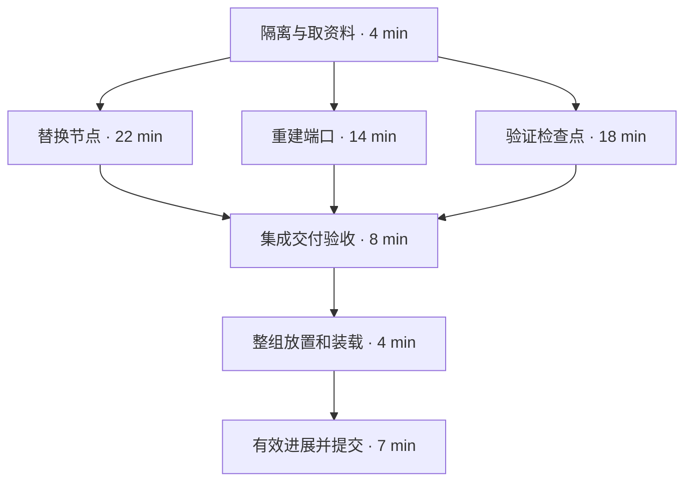
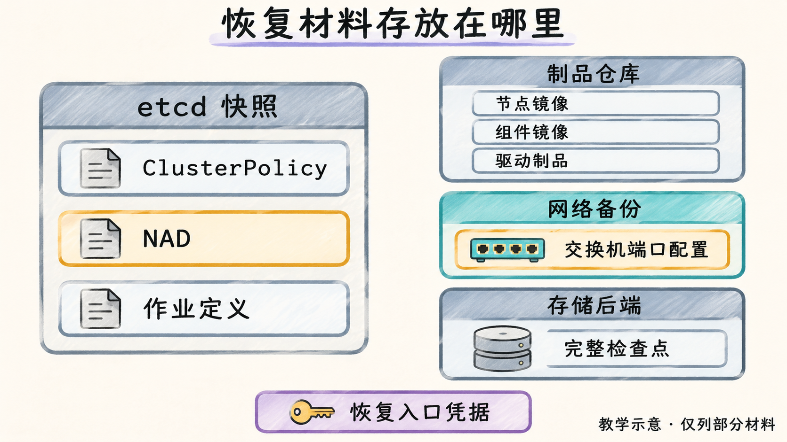

# 恢复资料、检查点与恢复时间预算

容量账本只能证明“有位置可以重新放置”，恢复还需要把软件、连接和训练状态一同找回。**回滚**是将一次变更涉及的状态恢复到此前认可的版本；**恢复演练**则检验原节点或部分环境已经不可用时，能否从留存资料、可取得的制品和完整数据重建能力。两者都会用到本篇的准备，但恢复范围不一定相同：换回旧节点镜像，并不会把训练状态也自动恢复。

本篇采用一次独立教学窗口。B 域的 `h8` 无法继续使用，计算网接入端口的配置也需重建。Kubernetes 控制面、A 域和 B 域的 `h5/h6` 可用，`h7` 已另有保留。要求替换节点 `h8-r` 接到原 B 域，在 `h5/h6/h8-r` 上恢复三 worker 作业。训练状态保存在仍可访问的外部存储中；此前两租户隔离探针已结束。

## 检查点如何成为可用的恢复点

**检查点**保存重新推进训练所需的状态。除模型参数外，可能还包括优化器状态、进度、随机状态和数据读取位置；具体集合由应用的恢复协议决定。三个 worker 正在写入同一个训练步，并不表示其中任意一个先写完的文件都可单独恢复整组。恢复端需要知道这一版本有哪些必需分片、它们是否属于同一状态，以及当前应用能否读取它们。

本章用下面的应用级协议解释“完整提交”，它是教学约定，不是所有检查点库都有同名提交文件：

1. 作业先确定一个一致的训练状态与版本标识，各成员把所需分片写入该版本的暂存位置。
2. 协调方确认所有必需分片及元数据写入成功，按存储系统支持的方式发布可恢复版本。失败或仍在写入的版本不进入可恢复清单。
3. 恢复端核对清单、分片、权限和可读性，用匹配的应用与数据版本装载，再检查全组恢复的步数及状态。

因此“目录时间最新”“对象总大小够大”和“某一个 Rank 已保存”都不能独自证明可恢复。PyTorch 2.9 的 Distributed Checkpoint 支持多 Rank 并行保存、加载和加载时重分片；应用仍需按实际保存/加载接口确认完成状态，并保留匹配的应用版本，不能假定不同 PyTorch 版本的检查点天然兼容。[PyTorch 2.9 · Distributed Checkpoint](https://docs.pytorch.org/docs/2.9/distributed.checkpoint.html)

若保存是异步的，还要区分“后台保存已启动”和“可恢复版本已经发布”。在完整新版本确认可读前保留上一个可用版本，可以使下一篇的计划停机有明确退路。一次读取验证只覆盖被验证的版本与恢复环境，不能替代以后每次保存的完成判定。

## 留存能重建期望状态的配置和制品

节点能注册到集群之前，启动镜像、签名信任、管理访问与网络必须可用。节点注册之后，控制面才会为它部署组件并公开设备。作业恢复还依赖数据、权限和检查点。每项留存应该可通过版本或摘要找回，能从恢复环境独立读取，并标明生成或管理的主体。

| 恢复对象 | 所需输入 | 恢复者需要查到的外部依赖 |
| --- | --- | --- |
| 物理节点与镜像 | 机型、槽位、端口与供电记录，BIOS/BMC/NIC 固件及设置，节点镜像、模块与签名材料，安装源和适配当前机型的驱动 | BMC 管理网、备用硬件、镜像和包仓库、信任根、引导与节点注册路径。启用签名校验时，恢复出的模块仍要由目标主机信任。 |
| Kubernetes 与 GPU 交付 | 原 chart 和 Helm 值、CRD、自定义资源、Operator 策略、组件及验收镜像摘要、节点池标签与污点规则、运行时配置来源 | API、DNS、证书、镜像仓库与拉取授权。用配置重建 CDI 和设备库存，再按当前节点与设备身份复核产物。 |
| 网络与策略 | 主/附加网配置、NAD、地址池和保留地址、VF 资源键与 PF 映射、交换机版本及端口、MTU、路由、流量分类与隔离规则 | 网络管理访问、交换机备份、IP 地址分配服务和其必要状态、仍可用的物理路径。先解决旧端点和新端点的重复地址或租用。 |
| 应用、数据与证据 | 作业镜像、启动与队列定义、数据版本、完整检查点及清单、基准条件与历史结果、告警规则和关键日志 | 存储服务、挂载凭据、数据密钥、可读的完整备份、时间源和可独立访问的记录系统。按实际恢复布局核对应用、优化器与必要的进度状态。 |

第 12 章已经区分 chart、初始与生成的组件镜像、驱动所需的包。恢复时再问一次谁会去取它们。恢复机如果需要从内网仓库取镜像，镜像仓库的 DNS、TLS 信任和可用凭据就必须先能取得。只在不可用集群内保存其引导凭据会形成循环依赖。按授权渠道留存恢复用的信任与访问方式，并演练在替代环境取用。配置和日志可保留引用及校验信息，密钥本体由独立受控的系统保管。 [NVIDIA · 离线安装的镜像与包仓库](https://docs.nvidia.com/datacenter/cloud-native/gpu-operator/26.7/install-gpu-operator-air-gapped.html) · [Kubernetes v1.36 · Secrets 最佳实践](https://v1-36.docs.kubernetes.io/docs/concepts/security/secrets-good-practices/)

一条可重建的记录应能沿“基线编号 → 制品摘要及配置版本 → 可用访问入口 → 恢复后的观测”走完。镜像标签只负责方便查找，摘要负责固定内容；摘要本身又不保证仓库仍保存着该对象。演练要在恢复环境实际取得对应内容，并核对完整性与使用权限。这样才能发现标签被覆盖、旧镜像被清理或凭据只存在于故障节点等缺口。

### 控制面快照与应用数据各有恢复范围

本例控制面仍可用，按已知良好配置重建受影响节点与端口。若控制面也丢失，则先按发行版或托管平台的恢复流程保护并恢复 Kubernetes API 需要的状态。自管环境的 etcd 快照保存 Kubernetes 的 API 数据，外部卷数据、镜像和物理交换配置依赖各自的备份。独立保存 API 访问、证书以及启用加密时所需的解密配置和密钥。若使用 etcd v3.6 从快照重建 Kubernetes 所用的 etcd，官方文档要求关注快照恢复后的版本修订与控制器缓存，提供修订提升和标记压缩的做法。具体步骤以发行版和实际拓扑为准。 [Kubernetes v1.36 · etcd 备份恢复](https://v1-36.docs.kubernetes.io/docs/tasks/administer-cluster/configure-upgrade-etcd/) · [Kubernetes v1.36 · API 静态数据加密](https://v1-36.docs.kubernetes.io/docs/tasks/administer-cluster/encrypt-data/) · [etcd v3.6 · 从快照恢复与修订提升](https://etcd.io/docs/v3.6/op-guide/recovery/)

## 按最长依赖路径估算恢复时间

**RTO**（Recovery Time Objective，恢复时间目标）给出从中断到约定能力恢复的时间上限。**RPO**（Recovery Point Objective，恢复点目标）通常用允许回退的时间跨度表达；训练还可另定最大可重做步数来衡量进度损失。本章按业务明确给出的步数预算评审，不把步数直接当作分钟。评审时先约定终点：是 API 可访问、作业开始运行，还是有效进度超过事故前？不同终点对应不同恢复时间。[AWS Well-Architected · RTO 与 RPO 定义](https://docs.aws.amazon.com/wellarchitected/latest/reliability-pillar/disaster-recovery-dr-objectives.html)

本演练要求 50 min 内在指定替换节点超过中断前的进度并完成一次完整检查点；进度损失上限为 150 个已完成训练步。中断前已完成 48,120 步。恢复端找到完整的 48,000 步版本，另有 48,100 步的部分分片，缺少本应用的提交记录。故从 48,000 恢复，重做 `48,120 − 48,000 = 120` 步，满足步数预算。若只剩 47,900 步，损失为 220 步，即使按时重新启动，恢复点条件也未满足。要**超过**旧进度，恢复后至少还要完成第 48,121 步，并完成目标要求的新提交。

以下为教学演练时段。先定位、隔离旧端点并取得恢复权限与资料索引（4 min）。从此可以并行准备替换节点（22 min，含取得镜像、启动和注册）、重建网络端口（14 min）、验证存储访问与检查点完整性（18 min）。假定三个专业组和所需外部服务彼此独立，准备阶段可同时进行。节点启动和注册走可用的管理网与默认网，受损的是 B 域的计算网端口。此后依次做端到端交付验收（8 min，包括三路汇合的验证）、按原需求放置和恢复应用（4 min）、重做、超过旧进度并提交新检查点（7 min）。

图 19-05-01｜三个准备分支均完成才开始集成交付验收。其余区间按箭头串行，22 min 的节点分支是本例最长的并行准备任务。

按这个依赖关系，耗时为 `4 + max(22, 14, 18) + 8 + 4 + 7 = 45 min`，留 5 min。如果存储验证多花 10 min，最长的准备分支变为存储的 28 min，全程变为 51 min。应用装载阶段假设读取 96 GiB、聚合有效速率 2 GiB/s，纯载荷读取的模型下界为 48 s。还要考虑最慢 Rank、元数据、解码和向设备装载。4 min 是演练给定的整段记录。若同时在运行别的作业，应重新用第 04 篇的混合负载口径验证读速率与错峰。

取 `max` 的原因是验收要等三个分支全部到齐，完成最晚的分支决定下一步何时开始。这条决定总时长的依赖链称为**关键路径**。把端口准备从 14 min 缩到 10 min，在其他条件不变时不会缩短 45 min；把节点准备从 22 min 缩到 16 min 后，18 min 的数据验证变成最长分支，全程降为 41 min。若三项工作实际争用同一位工程师、仓库带宽或网络路径，就不能继续套用互相独立的并行假设。

还要检查每个时间区间是否包含等待。若 7 min 只是“开始重做”之前的准备，或 4 min 装载省略了排队，就尚未覆盖规定终点。这里按教学记录给定：7 min 已包含至少 121 个新执行步和完整新提交。现场演练须按实际开始、结束与等待记录复核这个假设。

恢复完成时应有如下证据：旧节点身份停止交付，新节点和端口映射已更新，验收用的设备和真实通信路径符合基线，训练恢复到 48,120 步以上且新版本能完整提交。将申请、等待和实际完成时间对回图中的依赖，才能知道下一次需要改善制品访问、端口重建，还是状态装载。若在 `h7` 可以接管时先恢复了业务，应分别记录业务恢复与替换节点能力恢复的时间。

图 19-05-02｜演练中的控制面仍可用。etcd 快照框用于说明控制面需要恢复时可取回的 Kubernetes API 对象。替换节点还需要独立取得制品、交换机端口备份和完整训练检查点，并能在恢复环境中访问所需凭据与信任材料。

本篇把“有备份”分解为可找到、可取得、可读取、能按依赖重建并恢复有效进度。计划变更可以更早验证这些条件：在原节点仍可用时确认旧制品和恢复点，在停机之前算清恢复时间。下一篇据此决定升级何时开始、何时停批，以及回滚成功究竟要看到什么。
