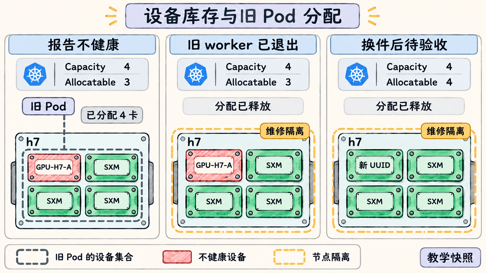

# 故障设备撤回、维修与复归

计划升级知道什么时候拿走一台节点。设备故障可能先让正在运行的计算中断，随后才被设备插件、kubelet 和调度器观察到。平台需要同时处理物理设备、原分配、可供新作业使用的库存和训练进度。**撤回**是停止向新工作负载交付受影响的资源，**复归**是维修后用证据重新开放交付。

本篇是新的教学窗口。B 域已经恢复到四台合格的 `B0` 节点。固定三 worker 的 `J-B` 位于 `h5/h6/h7`，每个 worker 用 4 张整卡与 1 个 VF。`h8` 有一个完整备用落点。随后 `h7` 的 `GPU-H7-A` 发生问题，插件将该设备报告为 Unhealthy。例中直接给定插件报告，实际设备插件是否会针对某条故障记录发出报告，需查当前实现和现场观测。

## 不健康标记先改变新库存

在 Kubernetes v1.36 的 Device Plugin 路径中，插件向 kubelet 报设备健康，kubelet 降低该资源的 `Allocatable`，`Capacity` 在这个健康状态变化中保持不变。已经分配给 Pod 的设备仍留在该分配中。可用 PodResources 将坏卡对到旧 Pod 的设备 ID，再看应用是否受到影响。v1.36 中 `ResourceHealthStatus` 为默认启用的 Beta，启用时可在容器状态查看已分配设备健康。现场仍需核对实际开关、报告详情和采样时间。 [Kubernetes v1.36 · Device Plugin 与不健康设备](https://v1-36.docs.kubernetes.io/docs/concepts/extend-kubernetes/compute-storage-net/device-plugins/#device-plugin-and-unhealthy-devices)

| 教学时点 | `h7` GPU Capacity / Allocatable | 旧分配或新容量 |
| --- | ---: | --- |
| 正常运行 | 4 / 4 | 旧 worker 已占 4 张，其中有 `GPU-H7-A`。 |
| 插件报告坏卡，kubelet 已更新 | 4 / 3 | 原 worker 的分配仍指向原 4 张卡。新的四卡 worker 无法使用 `h7`。 |
| 节点隔离，旧组已终止 | 4 / 3（此刻快照） | 原分配已释放，`h7` 仍不可用于正常放置。`h8` 加上 `h5/h6` 提供三个同域落点。 |
| 换件重启，插件报告四卡健康 | 4 / 4 | 新设备进入库存，`h7` 保持维修验收隔离。 |
| 维修复测通过并开放 | 4 / 4 | `h7` 在可分配资源和队列条件同时满足时恢复为可选落点。 |

*图 19-05-01｜设备不健康时，Allocatable 降为 3，旧 Pod 的四卡分配仍在。旧 Pod 退出后释放分配，换件后健康库存恢复为四张。中、右栏机壳外的琥珀色虚线标出维修隔离，节点仍需通过复归验收才能重新开放。*

即使旧 worker 已释放，`h7` 的三张健康卡也无法满足这个四卡 worker。若有一个只申请单卡的任务，资源数可能允许它使用其他卡，但前提是故障和修复都已确认限于相关单卡，且平台能可信地撤回那一张卡。GPU 上游 PCIe 分支、同机互联或整机供电影响范围不明时，本例先按整节点隔离。资源撤回的信息可能异步到达调度器和 kubelet，交接时要同时核对隔离动作、实际绑定和节点更新。

## 按维修的影响域隔离节点和恢复作业

发现异常时保存当前启动 ID、设备 UUID、PCI BDF（总线、设备、功能地址）、Pod UID、Rank、错误时间窗和互联状态。将节点设为不可调度，并按需启用受控隔离策略。读取活跃工作负载、主机进程和相关组件的设备使用，确认维修影响范围。热插拔、复位、断电换件按对应平台支持的流程决定。诊断输出中的错误码用于缩小范围，是否换件还要结合设备、链路以及厂商处置条件。 [NVIDIA · Xid 及故障分类](https://docs.nvidia.com/deploy/xid-errors/latest/index.html) · [NVIDIA · DCGM 诊断](https://docs.nvidia.com/datacenter/dcgm/latest/user-guide/dcgm-diagnostics.html)

本例固定成员的原尝试已无法继续。作业方读取完整检查点，确认其训练步与必需分片，控制器按配置恢复整组。新 worker 放到 `h5/h6/h8`，并重新记录 Pod UID、Rank 和实际 GPU/VF。以全组加载及训练推进确认作业恢复。若此时 `h8` 正在升级，B 只剩 `h5/h6` 两个合格落点，同域规则阻断恢复，即使 A 的 `h4` 空闲也无效。这解释了为何维护余量要把已隔离节点和同域故障计在同一账本中。

## 以新设备身份验收维修后的能力

更换 GPU 后，即使同一槽位的 BDF 保持一致，GPU UUID 仍可能改变。用资产与本次枚举更新 GPU、槽位、链路和指标关联，保存旧记录的终止时间。依照第 02 篇在维修隔离区验证全部受影响的卡、同机互联、Pod 分配与 CUDA 计算。跨机路径曾受影响或无法排除影响时，用原方向与对端复测主机及显存 RDMA、同域集合和代表负载，并检查新启动周期的错误增量。 [NVIDIA SMI · 设备标识、拓扑与互联查询](https://docs.nvidia.com/deploy/nvidia-smi/index.html)

安排正式入池前的试流量时，先留验收隔离，明确专用 Pod 如何获取已修复设备。记录覆盖的 UUID、对端、并发和时间窗。若发现链路退化或同类错误复现，保持隔离并将新增证据交回维修方。教学例中 `h7` 通过验收，之后可充当 B 域替换位，`J-B` 继续在 `h5/h6/h8` 运行。调度器可用的新容量和作业当前位置是两份需要同时保留的证据。
