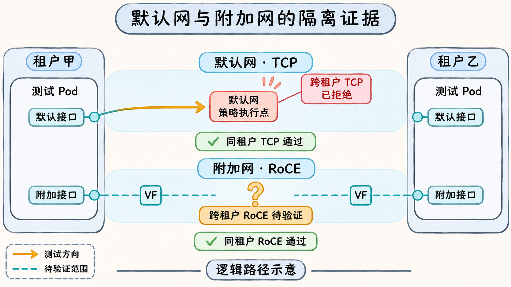

# GPU 管理权限与租户隔离

机架 B 已有可交付的 GPU。平台还要给两个租户开通训练，二者可使用同一计算池中的不同整卡，允许各自的 worker 通信，并要求它们的两张 Pod 网络相互隔离。**租户隔离**在这里包括三个可观察的边界：谁能修改平台或创建有主机权限的 Pod，Pod 实际能访问哪些设备，以及哪些流量能穿过对应的网络执行点。

## 管理组件为什么能影响宿主机

读第 01 篇的配置归属时，沿 GPU Operator 生成的容器追踪职责。Toolkit 要配置节点容器运行时，特定管理组件要访问宿主的文件、进程或设备。以 v26.7.2 的 Toolkit DaemonSet 模板为例，检查 `hostPID`、容器 `securityContext`、主机挂载和 ServiceAccount，再对照实际生成的对象。Operator 的 API 权限可让它创建或更新组件，运行中容器对主机的权限由 Pod 配置、挂载和运行时共同决定。管理组件镜像与配置属于应受平台管理和审计的交付输入。 [NVIDIA · GPU Operator 安全说明](https://docs.nvidia.com/datacenter/cloud-native/gpu-operator/26.7/security.html) · [v26.7.2 Toolkit DaemonSet 模板](https://raw.githubusercontent.com/NVIDIA/gpu-operator/v26.7.2/assets/state-container-toolkit/0500_daemonset.yaml)

Kubernetes 的 **RBAC**（基于角色的访问控制）决定某个身份可对哪些 API 对象执行什么操作。**Pod Security Admission**（PSA，Pod 安全准入）依命名空间设置检查 Pod 是否符合相应安全标准。本例平台在独立的管理命名空间部署所需的高权限组件，只让运维自动化和指定管理身份能在那里创建或修改工作负载。还要核对租户能否修改命名空间的安全标签、平台 ServiceAccount 上的权限绑定和节点池策略。对租户命名空间，采用满足作业要求的受限策略并检查模板最终生成的 Pod，例如要求拒绝 `privileged` 和宿主路径挂载。管理命名空间允许高权限模板通过准入，现实中能否创建这类 Pod 继续受 API 权限约束。 [Kubernetes v1.36 · RBAC 最佳实践](https://v1-36.docs.kubernetes.io/docs/concepts/security/rbac-good-practices/) · [Kubernetes v1.36 · Pod 安全标准](https://v1-36.docs.kubernetes.io/docs/concepts/security/pod-security-standards/) · [NVIDIA · Operator 的 PSA 部署前提](https://docs.nvidia.com/datacenter/cloud-native/gpu-operator/26.7/getting-started.html#prerequisites)

## 从整卡请求追踪实际设备权限

普通训练 Pod 请求 `nvidia.com/gpu`，由 Device Plugin 与 kubelet 完成分配，再通过 CDI 把设备交给运行时。按 PodResources 和容器内 UUID 验证两租户实际使用不同物理卡。本例可用命名空间 ResourceQuota 中的 `requests.nvidia.com/gpu` 限制整卡总请求，并用队列策略控制组的准入。配额约束的是 Kubernetes 接受的请求，若设备交付存在另外的访问路径，仍须检查该路径的准入和运行时。 [Kubernetes v1.36 · 扩展资源的配额](https://v1-36.docs.kubernetes.io/docs/concepts/policy/resource-quotas/#quota-for-extended-resources) · [Kubernetes v1.36 · Device Plugin 的分配与监控](https://v1-36.docs.kubernetes.io/docs/concepts/extend-kubernetes/compute-storage-net/device-plugins/)

例如 GPU Operator v26.7 的 CDI 模式下，NRI 关闭时，以 `NVIDIA_VISIBLE_DEVICES` 请求直接访问设备的 GPU 管理容器使用 `runtimeClassName: nvidia`。该路径由平台管理。实施租户边界时，应在租户准入中限制可用的 RuntimeClass 及管理式设备访问配置，再用实际容器确认访问范围。PSA 的安全标准并未为这个 NVIDIA 路径提供专门的 RuntimeClass 策略。不同物理 GPU 仍可能共用节点、驱动、供电和网络。若需求是节点级故障隔离，应加放置约束。若改成第 14 章的时分共享，还需另行核对显存可用空间与故障传播范围。 [NVIDIA · CDI 下的 GPU 管理容器](https://docs.nvidia.com/datacenter/cloud-native/gpu-operator/26.7/cdi.html#cdi-and-gpu-management-containers) · [NVIDIA · GPU 时分共享的隔离边界](https://docs.nvidia.com/datacenter/cloud-native/gpu-operator/26.7/gpu-sharing.html)

## 在默认网络与 RoCE 附加网络分别验证

默认 Pod 网络由实现 Kubernetes NetworkPolicy 的网络插件执行策略。Multus v4.2.4 开启命名空间隔离后会检查 Pod 可引用的 NAD，还应核对允许跨命名空间引用的例外。RoCE 附加网络使用映射到 PF 的 VF 通信，执行边界由网络设计决定。例如可把两个租户放在经平台验证互不可达的网络段，并在实际转发位置实施隔离。对于在硬件内转发的报文，需要确认执行点覆盖该路径。策略对象和附加网接入记录只说明规则已声明、接口已交付，数据面的拒绝需要实测。 [Kubernetes v1.36 · NetworkPolicy 的前提和范围](https://v1-36.docs.kubernetes.io/docs/concepts/services-networking/network-policies/) · [Multus v4.2.4 · NAD 命名空间隔离](https://raw.githubusercontent.com/k8snetworkplumbingwg/multus-cni/v4.2.4/docs/configuration.md)

以下是开通第二租户前的隔离验收记录。测试在授权的测试租户和预先部署的对端进行，同租户允许与跨租户拒绝使用相同测试应用与受控条件。按网络固定源与目的接口、地址、传输协议、监听或 RDMA 接收条件，并用数据面执行点的日志或计数判读策略是否覆盖实际路径。

| 路径 | 期望允许的同租户试验 | 期望拒绝的跨租户试验 | 本轮结论 |
| --- | --- | --- | --- |
| 默认网 TCP | 连接成功，服务响应 | 连接被默认网络执行点拒绝，命中相应规则 | 本次 TCP 对照覆盖两个指定端点。 |
| 附加网 RoCE | 使用指定 VF 的双端 RDMA 测试成功 | 启用了仅作用于附加网 TCP 的规则。双端 RoCE 验证尚未执行 | 有附加网正常传输证据，跨租户的 RoCE 拒绝待验证。 |
| 引用他租户的 NAD | 本租户 NAD 能接入 | 他租户 NAD 被接入校验拒绝 | 附加网选择的边界已验证。 |

*图 19-06-01｜跨租户的默认网 TCP 在执行点被拒绝。跨租户的附加网 RoCE 尚未测试，两张绿色卡分别记录同租户的 TCP 和 RoCE 成功对照。表中的 NAD 引用拒绝只验证附加网选择的边界，RoCE 转发还需单独验证。*

本轮暂缓开放这项共享计算池能力。要满足 RoCE 隔离，先检查两个租户的实际转发域、VF 与执行点，并确认该执行点能约束目标 RDMA 流量。再观察同租户成功及跨租户按预期被拒绝的结果。跨租户试验单独超时还可能来自监听、路由或设备准备失败，需要结合有效的允许对照及执行证据。完成后保留有效规则、版本、测试条件和结果，供下一次节点或网络更换后的复验。
