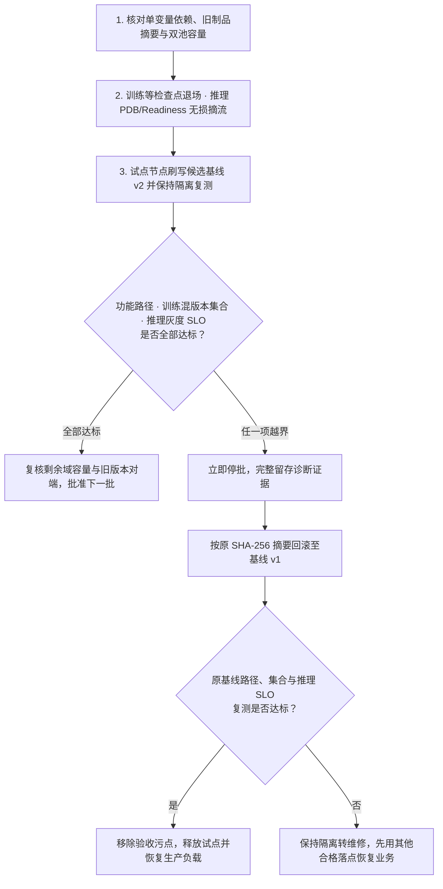

# 版本升级的排空、试点与回滚

运维团队拿到一份“微调升级”工单：只把节点的 Linux 内核从 `6.8.0-52-generic` 升到 `6.8.0-53-generic`，GPU 驱动版本 `595.91.07` 保持不变。

工程师按常规 K8s 经验直接执行了一句 `kubectl drain`——几分钟后告警炸锅：正在落盘检查点的 12-Rank 训练整组崩溃回退，同节点上在线大模型推理的长流式连接也被强杀，向线上抛出一连串 `502/504` 超时报错。

**滚动升级**能缩小单次变更的物理爆炸半径，但它既不会自动替分布式训练保存检查点，也不会自动保护在线推理正在生成的流式长连接；而且在升级过渡期，新旧版本的节点还会混跑在同一个集合通信组里，暴露出单机测试根本看不到的跨机性能退化。

本篇沿用前文已备齐的容量账本与恢复底牌，完整演练一次**基线 v1 → 候选基线 v2**（节点内核微升、驱动版本固定）的安全升级：如何选试点、如何分别排空训练与无损摘流推理、如何用双池门槛果断停批，以及如何按摘要干净回滚。

## 一、变更单与试点选择：锁死单变量、算清同域余量

一份能真正落地执行的变更单，不能只写“将节点内核升到 `6.8.0-53-generic`”，必须提前锁定四项硬约束：

1. **精确制品摘要**：固化基线 v1（`node-v1`）与候选基线 v2（`node-v2`）的 SHA-256 镜像摘要，确认新内核对应的驱动模块、Fabric Manager 与安全启动签名随镜像齐备，且旧摘要仍可从内网仓库独立拉回。
2. **单变量范围**：固定硬件、NIC 固件、交换机配置、GPU Operator 与业务镜像不变，只变更节点系统镜像与内核。把多个耦合变更硬塞进同一窗口，一旦性能回退，根本无法定位罪魁祸首（确需耦合升级时须整体立项并扩大验证范围）。
3. **试点节点与容量核算**：域 A 正在运行 `train-12-a`（占 `node-1/2/3`，`node-4` 备用）；域 B 运行 `train-12-b`（占 `node-5/6/7`，`node-8` 训练槽位空闲），同时两域 8 台节点均承载 1 个在线推理主力副本（`infer-svc-1`，`PDB minAvailable: 7`）。选定 `node-8` 为试点：
   - **训练池账本**：域 B 中 $N=4, J=1$，本次窗口接受零额外故障缓冲（$F=0$），满足 $M \le 4 - 3 \times 1 - 0 = 1$，故允许撤出 `node-8`，但**绝不能同时把 `node-7` 也拿出来排空**；
   - **推理池账本**：总副本 `8`，撤出 1 台试点节点后保留 `7` 副本，严格满足 `PDB minAvailable: 7` 与高峰 SLO。
4. **混版本影响与停批红线**：虽然 `node-8` 当前没有运行训练 worker，但后续混版本集合测试必须占用 `node-5 / node-6 / node-8`，因此仍需在维护窗口协调 `train-12-b` 先完成检查点并有序退出；提前写死停批红线——**任意功能/路径异常，或训练集合中位耗时增幅 $> 10\%$，或推理灰度 TTFT/TPOT P99 增幅 $> 10\%$ / 出现 5xx，立即停批回滚**。

## 二、双轨排空实操：训练等检查点，推理无损摘流

在 8 卡训推共存节点上，同一台物理机同时跑着两类生命周期完全相反的负载。执行排空前，必须把 `cordon`、`drain` 与驱动客户端清理三条线彻底拆开，并对训练与推理走两条截然不同的退场轨道。

### 1. 轨道 A：训练作业安全退场与节点排空

对固定三节点 12-Rank 的 `train-12-b` 而言，直接干掉单个 worker 只会触发全组通信超时与无效重试。标准排空顺序是：**暂停新尝试 → 核实完整检查点 → 有序停止整组 → `cordon/drain` → 确认宿主机与容器 GPU 驱动客户端彻底清空**。

```bash
# 1. 隔离试点节点（仅阻止新 Pod 调度，不影响已有 Pod 继续收尾）
$ kubectl cordon node-8
node/node-8 cordoned

# 2. 协调训练侧暂停自动重试，核查最新已提交的原子检查点清单（见第 05 篇）
$ jq '{step: .global_step, status: .status, shards: (.shards | length)}' \
  /mnt/shared-fs/ckpt/train-12-b/latest/_commit_manifest.json
{ "step": 52400, "status": "COMMITTED", "shards": 12 }

# 3. 确认恢复点无误后，有序停止整个 train-12-b 作业组并核查 GPU/VF 请求归零
$ kubectl delete volcanojob train-12-b -n ai-demo
$ kubectl get pods -n ai-demo -l volcano.sh/job-name=train-12-b
No resources found in ai-demo namespace.

# 4. 通过 Eviction API 排空试点节点上的常规与推理 Pod（严格遵守 PDB 约束）
$ kubectl drain node-8 --ignore-daemonsets --delete-emptydir-data --timeout=180s

# 5. 重启或驱动卸载前，登录节点核查是否仍有残留 GPU 客户端进程（含 DaemonSet/宿主进程）
$ nvidia-smi --query-compute-apps=pid,process_name --format=csv,noheader
(empty)
$ sudo fuser -v /dev/nvidia* /dev/nvidia-uvm 2>&1 || echo "NO_GPU_CLIENTS"
NO_GPU_CLIENTS
```

### 2. 轨道 B：在线推理服务的无损摘流（零 5xx、不掉 SLA）

大模型在线推理的单个流式 Decode 请求往往持续 `10–45 秒`。如果节点执行 `kubectl drain` 后 kubelet 直接发 `SIGTERM` 且进程秒退，客户端正在接收的半截回复就会立刻断开；即便进程等了一会儿，如果网关还没来得及把该 Pod 从上游列表摘除，新请求依然会被发往即将关闭的实例，造成批量 `502` 错误。

要让 `node-8` 上的 `infer-svc-1` 在升级排空期间实现**业务零感知无损摘流**，必须把四项配置严丝合缝地扣在一起：

1. **PDB 限流（`minAvailable: 7`）**：确保 `kubectl drain` 调用 Eviction API 时，全集群同一时刻至多摘除 1 个推理副本；若前一个副本尚未在其他节点就绪，驱逐会自动阻塞等待。
2. **就绪探针（`readinessProbe`）**：推理服务内部维护排空标志位；进入关闭流程时立即让 `/health/ready` 返回 `503`，同步通知 EndpointSlice 与负载均衡器摘流。
3. **优雅前置钩子（`preStop`）**：收到终止信号时先触发引擎进入排空态，并留出足够缓冲（例如 `10–15 s`）等待 kube-proxy / Ingress / API 网关完成路由刷新，同时拒绝新连接、让所有在途流式 Decode 请求自然生成完毕。
4. **充足宽限期（`terminationGracePeriodSeconds`）**：必须严格大于“路由刷新缓冲 + 最长在途请求生成耗时”（如设为 `90 s`），绝不让 kubelet 在收尾中途下发 `SIGKILL`。

```yaml
# infer-svc-1 无损摘流核心配置片段（配合前文 minAvailable: 7 的 PDB 使用）
apiVersion: apps/v1
kind: Deployment
metadata:
  name: infer-svc-1
  namespace: infer-prod
spec:
  replicas: 8
  template:
    spec:
      terminationGracePeriodSeconds: 90    # 覆盖“路由摘流等待 + 最长在途流式 Decode 耗时”
      containers:
        - name: llm-engine
          image: registry.example.com/infer/vllm:0.9@sha256:6b21...9f04
          ports:
            - containerPort: 8000
          readinessProbe:
            httpGet:
              path: /health/ready          # 收到排空指令后立即返回 503，通知网关摘流
              port: 8000
            periodSeconds: 2
            failureThreshold: 1            # 2 秒内迅速标记 NotReady，缩小流量漂移窗口
          lifecycle:
            preStop:
              exec:
                command:
                  - /bin/sh
                  - -c
                  - |
                    curl -s -X POST http://127.0.0.1:8000/internal/drain || true
                    sleep 15               # 等待 EndpointSlice 与网关完成路由摘除，再放行 SIGTERM
```

把排空链路上三个极易混淆的动作放进同一张对照表，就能一眼看清“做完一步之后，还差什么证据”：

| 运维动作 | 直接改变的系统状态 | 仍必须单独核实的残留风险 |
| --- | --- | --- |
| **`kubectl cordon`** | 禁止默认调度器把新 Pod 放上该节点 | 既有 Pod、宿主机进程及直绑 `nodeName` 的特殊 Pod 仍在使用设备 |
| **Eviction API 排空（`drain`）** | 在 PDB 许可内通知常规 Pod 优雅退出 | 训练检查点是否已原子提交、推理在途长连接是否零报错、整组是否已释放配额 |
| **清空驱动客户端** | 释放 `/dev/nvidia*` 占用，满足驱动卸载/重启条件 | 被 `--ignore-daemonsets` 跳过的监控/设备插件与宿主机后台进程是否全部退出 |

> [!warning] 常见误区：把 PDB 当成训练作业的保护伞
> PDB 只负责在自愿驱逐时卡住“可用 Pod 数量下限”，它既不会替训练框架生成检查点，也听不懂“杀掉 3 个 worker 中的 1 个会导致整组同步训练报废”。遇到 PDB 阻塞 `drain` 时，正确做法是核对冗余副本与维护窗口，绝不能靠 `--force --disable-eviction` 一删了之。

## 三、混版本试点、双池停批门禁与回滚验收

`train-12-b` 完成检查点并有序退出、`infer-svc-1` 在 `node-8` 上零报错摘流后，正式进入**同物理节点组三轮对照试点**。

操作顺序严格锁定为三步：

1. **采集当天参照**：在 `node-5 / node-6 / node-8` 全部处于**基线 v1** 时采集同口径空载基准。
2. **刷写并隔离试点**：将 `node-8` 切换为**候选基线 v2** 重启，保持验收污点（`NoSchedule`），先验 8 卡绑定、Fabric Manager 与 GDR 通路。
3. **双池混跑验证**：同步执行**训练混版本 12-Rank AllReduce**（每 Rank `64 MiB`、FP32 求和、out-of-place、`#wrong=0`）与**推理金丝雀灰度观测**（导入 5% 流量，紧盯 TTFT/TPOT P99、本地盘冷启动与错误率）。

以下是三轮完整对照记录：

| 试点阶段 | 12-Rank AllReduce 三轮平均耗时 | 推理金丝雀与基础路径观测 |
| --- | --- | --- |
| **变更前**（`node-5/6/8` 均基线 v1） | `5.96`、`6.05`、`6.14 ms`（中位数 **`6.05 ms`**） | 显存 GDR 路径与计算校验通过；推理 TTFT P99 `342 ms`、TPOT P99 `32 ms` |
| **混版本试点**（仅 `node-8` 升至候选基线 v2） | `6.73`、`6.80`、`6.86 ms`（中位数 **`6.80 ms`**） | 8 卡绑定、单卡计算、RDMA 校验与 `#wrong=0` 全通过；推理灰度延迟平稳、0 报错；**但集合通信显著变慢** |
| **回滚复测**（`node-8` 退回基线 v1） | `5.98`、`6.06`、`6.15 ms`（中位数 **`6.06 ms`**） | 显存路径、代表训练 20 min 窗口与推理 SLO 全部恢复至原基线水平 |

对照不提前舍入的停批红线复算本次试点结果：

$$T_{\text{停批门槛}} = 6.05 \times (1 + 10\%) = 6.655\text{ ms}, \qquad \Delta = \frac{6.80 - 6.05}{6.05} \approx +12.4\% > 10\%$$

结果清晰触发了**停批条件**！哪怕所有功能校验全绿、推理灰度也没有掉 SLA，只要训练集合通信中位耗时突破红线，就必须立即叫停扩批。反过来也同样成立——如果训练集合未退化，但推理灰度出现 TPOT P99 飙升超 10%、本地盘冷启动超时或产生 5xx 错误，同样触发一票停批并立刻切回旧流。

> [!summary] 核心结论：**停批是为了止损，不等于已经定位根因**
> 触发停批后，不要试图在生产维护窗口里现场盲调内核参数。正确动作是立刻打包保留候选基线 v2 的 NCCL 日志、NUMA/PCI 绑定、交换机端口计数与 GPU 频率快照，果断回滚试点节点恢复业务容量，再把问题带回离线实验环境做深度根因分析。



*图 19-06-01：双池试点与回滚决策闭环。任何维度触发停批红线后，回滚同样必须走完原基线复测验收，确认能力彻底恢复后才能撤销隔离。*

回滚不是“把旧镜像刷回去就万事大吉”，同样必须核验运行实态与性能复归：

```bash
# 回滚后实态核查：确认内核、驱动、Fabric Manager 回到基线 v1，再跑完复测并开放节点
$ uname -r && nvidia-smi --query-gpu=driver_version --format=csv,noheader | uniq
6.8.0-52-generic
595.91.07

$ systemctl is-active nvidia-fabricmanager
active

# 确认同组 AllReduce 中位数回落至 6.06 ms 且代表训练与推理 SLO 复测达标后，放开节点
$ kubectl taint nodes node-8 node-role.infra/acceptance:NoSchedule-
$ kubectl uncordon node-8
```

如果急需先恢复 `train-12-b`，完全可以先在 `node-5 / node-6 / node-7` 上从第 `52,400` 步完整检查点拉起训练，让 `node-8` 继续留在隔离区，等下一个空闲窗口再预约对端做回滚复测——**业务恢复与试点节点复归可以解耦推进。**

## 四、GPU Operator 托管升级与不可逆变更边界

本章主线采用主机镜像预装驱动；如果集群采用 **GPU Operator 托管驱动** 模式，驱动升级将由 Operator 的升级控制器自动编排（驱逐客户端 → 卸载旧模块 → 加载新驱动 → 验证）。配置自动升级策略时，务必警惕两个“自动化的陷阱”：

1. **全局并发数 ≠ 域内安全上限**：GPU Operator `v26.7.2` 支持在 `ClusterPolicy` 或 `NVIDIADriver` 对象中设置 `maxParallelUpgrades` 与 `maxUnavailable`。
   - 即便全局仅设 `maxParallelUpgrades: 2`，只要这两台升级节点恰好同处域 B，该域训练落点就会掉到 2 台并打穿同域恢复容量——必须按网络域分池配置并发上限。
2. **Operator `upgrade-done` ≠ 生产准入放行**：升级控制器只验证单机驱动模块加载与本地基础就绪，它既不跑跨机 GDR/NCCL 性能对照，也不验证推理池冷启动与尾延迟。生产环境应配合独立验收污点，防止控制器自动 `uncordon` 把未经跨机复测的节点过早推回生产池。

升级 **GPU Operator 本身**时，须先核对官方支持的版本跨度（`v26.7` 允许同主版本小升或升至下一 `YY.MM` 主版本）以及 CRD 与 Helm Hook 兼容性——因为 Helm 回滚旧版 Chart 时，已被新版本改写的 CRD 未必能被旧控制器正常解析。

面对**不可降级的硬件固件**（如特定 BMC/NIC/GPU 固件更新后禁止回退），评审前就必须定死替代退路：留用未升级节点兜底、备件替换，或向前修复方案。

> [!tip] 版本升级窗口执行核对清单
> - **单变量与旧退路**：仅改单一依赖边，变更前实测旧基线 SHA-256 摘要可独立拉取。
> - **双轨安全退场**：训练侧先验原子检查点并整组停止；推理侧靠 `PDB + Readiness + preStop + terminationGracePeriodSeconds` 无损摘流。
> - **红线与回滚验收**：训练混版本集合与推理灰度 SLO 双门禁把关；停批回滚后须复测原基线达标方可 `uncordon`。

计划升级的好处，是我们可以从容决定“先止血退场、再动底层”；可一旦遭遇突发硬件故障，物理坏卡会先把运行中的业务直接击穿，倒逼运维逆序应急。下一篇我们就沿同一套容量与验收规则，走完故障设备撤回、作业恢复与节点复归的全闭环。

> [!info]- 参考资料
> - **Kubernetes 节点排空、PDB 与优雅终止**：[Kubernetes v1.36 · 安全排空节点](https://v1-36.docs.kubernetes.io/docs/tasks/administer-cluster/safely-drain-node/)、[Kubernetes v1.36 · `kubectl drain` 行为与参数](https://v1-36.docs.kubernetes.io/docs/reference/kubectl/generated/kubectl_drain/)、[Kubernetes v1.36 · 自愿中断与 PDB 预算](https://v1-36.docs.kubernetes.io/docs/concepts/workloads/pods/disruptions/)、[Kubernetes v1.36 · Pod 生命周期与优雅终止](https://v1-36.docs.kubernetes.io/docs/concepts/workloads/pods/pod-lifecycle/)
> - **分布式训练退场与集合基准**：[PyTorch 2.9 · Worker Group 故障与重启行为](https://docs.pytorch.org/docs/2.9/elastic/run.html)、[nccl-tests v2.17.9 · 参数与计时口径](https://raw.githubusercontent.com/NVIDIA/nccl-tests/v2.17.9/README.md)
> - **GPU Operator 驱动升级与版本跨度**：[NVIDIA · GPU Operator v26.7.2 驱动升级状态机与作用域](https://docs.nvidia.com/datacenter/cloud-native/gpu-operator/26.7/gpu-driver-upgrades.html)、[NVIDIA · GPU Operator v26.7.2 升级跨度与生命周期](https://docs.nvidia.com/datacenter/cloud-native/gpu-operator/26.7/platform-support.html#nvidia-gpu-operator-life-cycle)、[NVIDIA · GPU Operator 与 CRD 升级流程](https://docs.nvidia.com/datacenter/cloud-native/gpu-operator/26.7/upgrade.html)
