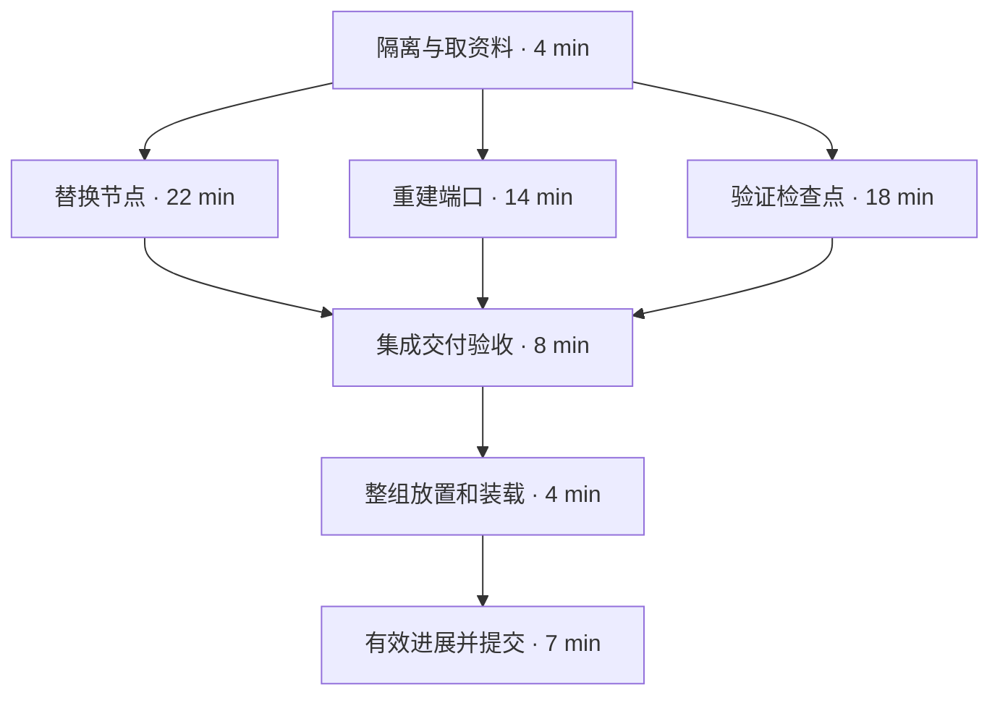
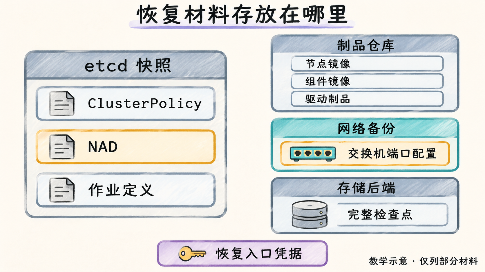

# 集群配置留存与恢复依赖

回滚利用仍可访问的旧制品和运行环境。**恢复演练**检验当某些原环境已经丢失时，能否从留存的资料、可取得的制品和可信的数据重建能力。本篇采用一次独立的教学演练。B 域的 `h8` 无法继续使用，接入端口的配置也需要重建。Kubernetes 控制面、A 域和 B 域的 `h5/h6` 可用，`h7` 已另有保留。演练要求用替换节点 `h8-r` 接到原 B 域，跑回 `h5/h6/h8-r` 的同域训练，共三 worker。目标应用依赖仍存在于存储后端的检查点。

## 留存能重建期望状态的配置和制品

节点能注册到集群之前，启动镜像、签名信任、管理访问与网络必须可用。节点注册之后，控制面才会为它部署组件并公开设备。作业恢复还依赖数据、权限和检查点。每项留存应该可通过版本或摘要找回，能从恢复环境独立读取，并标明生成或管理的主体。

| 恢复对象 | 所需输入 | 恢复者需要查到的外部依赖 |
| --- | --- | --- |
| 物理节点与镜像 | 机型、槽位、端口与供电记录，BIOS/BMC/NIC 固件及设置，节点镜像、模块与签名材料，安装源和适配当前机型的驱动 | BMC 管理网、备用硬件、镜像和包仓库、信任根、引导与节点注册路径。启用签名校验时，恢复出的模块仍要由目标主机信任。 |
| Kubernetes 与 GPU 交付 | 原 chart 和 Helm 值、CRD、自定义资源、Operator 策略、组件及验收镜像摘要、节点池标签与污点规则、运行时配置来源 | API、DNS、证书、镜像仓库与拉取授权。用配置重建 CDI 和设备库存，再按当前节点与设备身份复核产物。 |
| 网络与策略 | 主/附加网配置、NAD、地址池和保留地址、VF 资源键与 PF 映射、交换机版本及端口、MTU、路由、流量分类与隔离规则 | 网络管理访问、交换机备份、IP 地址分配服务和其必要状态、仍可用的物理路径。先解决旧端点和新端点的重复地址或租用。 |
| 应用、数据与证据 | 作业镜像、启动与队列定义、数据版本、完整检查点及清单、基准条件与历史结果、告警规则和关键日志 | 存储服务、挂载凭据、数据密钥、可读的完整备份、时间源和可独立访问的记录系统。按实际恢复布局核对应用、优化器与必要的进度状态。 |

第 12 章已经区分 chart、初始与生成的组件镜像、驱动所需的包。恢复时再问一次谁会去取它们。恢复机如果需要从内网仓库取镜像，镜像仓库的 DNS、TLS 信任和可用凭据就必须先能取得。只在不可用集群内保存其引导凭据会形成循环依赖。按授权渠道留存恢复用的信任与访问方式，并演练在替代环境取用。配置和日志可保留引用及校验信息，密钥本体由独立受控的系统保管。 [NVIDIA · 离线安装的镜像与包仓库](https://docs.nvidia.com/datacenter/cloud-native/gpu-operator/26.7/install-gpu-operator-air-gapped.html) · [Kubernetes v1.36 · Secrets 最佳实践](https://v1-36.docs.kubernetes.io/docs/concepts/security/secrets-good-practices/)

### 控制面快照与应用数据各有恢复范围

本例控制面仍可用，按已知良好配置重建受影响节点与端口。若控制面也丢失，则先按发行版或托管平台的恢复流程保护并恢复 Kubernetes API 需要的状态。自管环境的 etcd 快照保存 Kubernetes 的 API 数据，外部卷数据、镜像和物理交换配置依赖各自的备份。独立保存 API 访问、证书以及启用加密时所需的解密配置和密钥。若使用 etcd v3.6 从快照重建 Kubernetes 所用的 etcd，官方文档要求关注快照恢复后的版本修订与控制器缓存，提供修订提升和标记压缩的做法。具体步骤以发行版和实际拓扑为准。 [Kubernetes v1.36 · etcd 备份恢复](https://v1-36.docs.kubernetes.io/docs/tasks/administer-cluster/configure-upgrade-etcd/) · [Kubernetes v1.36 · API 静态数据加密](https://v1-36.docs.kubernetes.io/docs/tasks/administer-cluster/encrypt-data/) · [etcd v3.6 · 从快照恢复与修订提升](https://etcd.io/docs/v3.6/op-guide/recovery/)

## 按最长依赖路径估算恢复时间

**RTO**（Recovery Time Objective，恢复时间目标）是业务允许从中断到约定能力恢复的时间。**RPO**（Recovery Point Objective，恢复点目标）界定可以接受的状态损失。实际评审先约定口径。本演练要求 50 分钟内在指定替换节点超过中断前的进度并完成一次完整检查点。恢复点目标折算为最多丢失 150 个已完成训练步。中断前已完成 48,120 步。恢复端找到完整的 48,000 步版本，另有 48,100 步的部分分片，缺少本应用的提交记录。故从 48,000 恢复，重做 120 步，满足恢复点预算。若备份只剩 47,900 步，差值会增到 220，即使服务能在时间内重启，恢复点也已超出目标。 [PyTorch 2.9 · Distributed Checkpoint](https://docs.pytorch.org/docs/2.9/distributed.checkpoint.html)

以下为教学演练时段。先定位、隔离旧端点并取得恢复权限与资料索引（4 min）。从此可以并行准备替换节点（22 min，含取得镜像、启动和注册）、重建网络端口（14 min）、验证存储访问与检查点完整性（18 min）。假定三个专业组和所需外部服务彼此独立，准备阶段可同时进行。节点启动和注册走可用的管理网与默认网，受损的是 B 域的计算网端口。此后依次做端到端交付验收（8 min，包括三路汇合的验证）、按原需求放置和恢复应用（4 min）、重做、超过旧进度并提交新检查点（7 min）。

*图 19-07-01｜三个准备分支均完成才开始集成交付验收。其余区间按箭头串行，22 min 的节点分支是本例最长的并行准备任务。*

按这个依赖关系，耗时为 `4 + max(22, 14, 18) + 8 + 4 + 7 = 45 min`，留 5 min。如果存储验证多花 10 min，最长的准备分支变为存储的 28 min，全程变为 51 min。应用装载阶段假设读取 96 GiB、聚合有效速率 2 GiB/s，纯载荷读取的模型下界为 48 s。还要考虑最慢 Rank、元数据、解码和向设备装载。4 min 是演练给定的整段记录。若同时在运行别的作业，应重新用第 03 篇的混合负载口径验证读速率与错峰。

恢复完成时应有如下证据：旧节点身份停止交付，新节点和端口映射已更新，验收用的设备和真实通信路径符合基线，训练恢复到 48,120 步以上且新版本能完整提交。将申请、等待和实际完成时间对回图中的依赖，才能知道下一次需要改善制品访问、端口重建，还是状态装载。若在 `h7` 可以接管时先恢复了业务，应分别记录业务恢复与替换节点能力恢复的时间。

*图 19-07-02｜演练中的控制面仍可用。etcd 快照框用于说明控制面需要恢复时可取回的 Kubernetes API 对象。替换节点还需要独立取得制品、交换机端口备份和完整训练检查点，并能在恢复环境中访问所需凭据与信任材料。*
