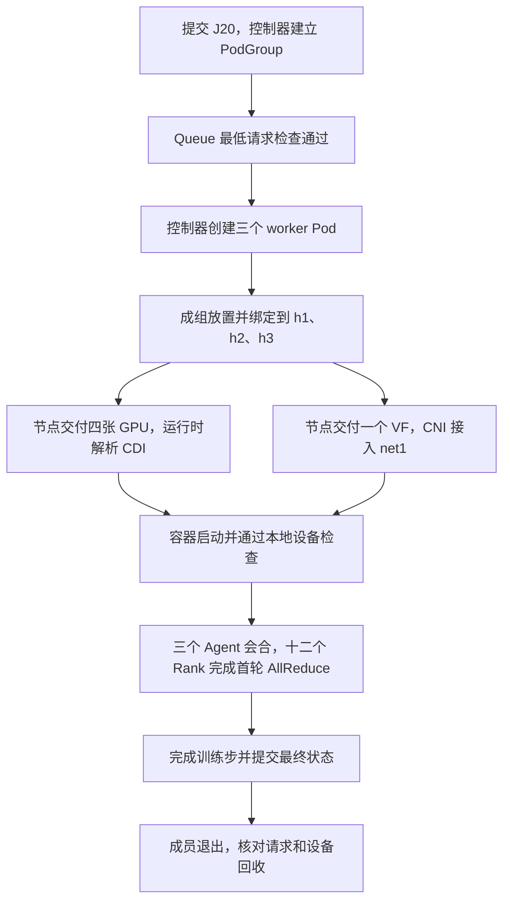
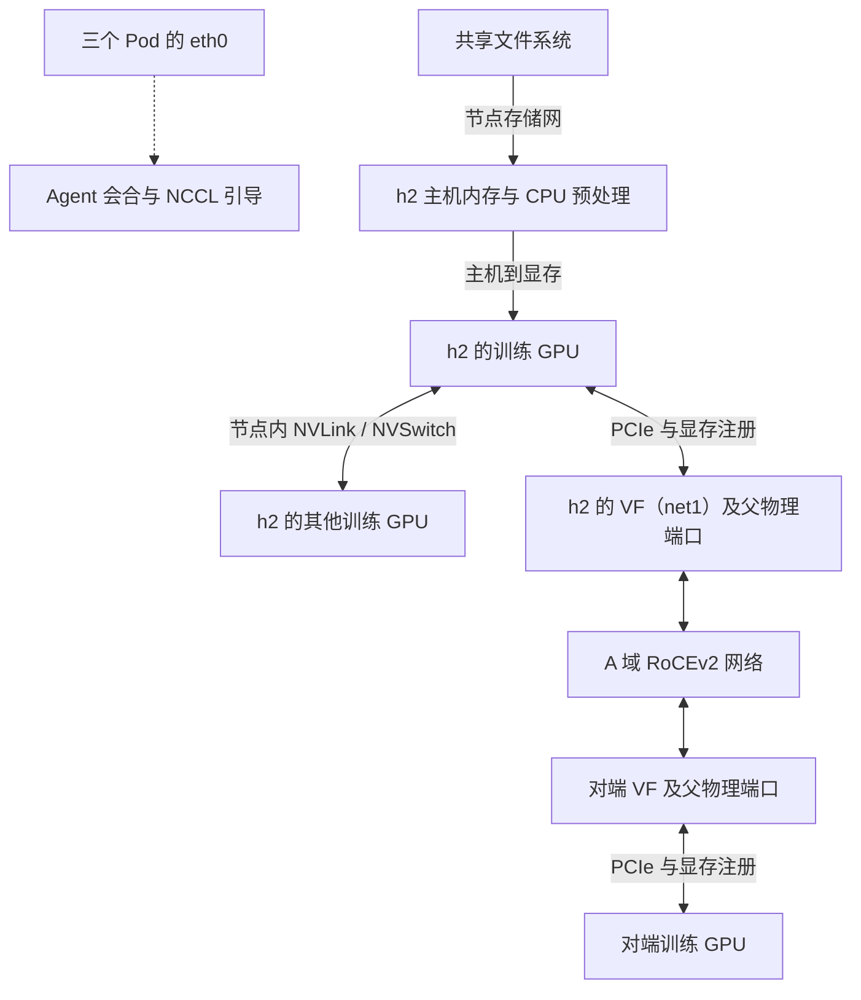
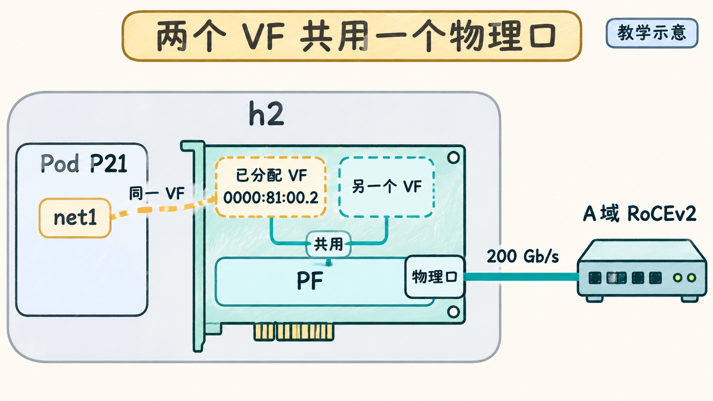

# 三节点 GPU 作业的生命周期与数据路径

`ai-demo/train-12` 要在三台服务器上完成 3,000 个全局训练步。工单的作业 UID 简记为 `J20`，第一次运行尝试记为 `R1`。每台运行一个 **worker Pod**，其中的启动器启动四个训练进程。**Rank** 是训练进程在本轮通信组内的全局编号，每个进程使用一张整卡。同步训练的一步需要全组交换结果。缺一个必需成员时，即使另外十一张卡都能计算，这个固定规模的作业也无法完成该步。

本章使用构造的工单、配置摘要、事件和测量。时间是同一天的本地钟点，带时长的记录另注明统计范围。各组件版本用于解释行为，实际装机需要按平台重新验证。

## 作业请求与集群拓扑

| 约束 | 每个 worker | 三个 worker 合计或共同要求 |
| --- | --- | --- |
| GPU | 4 张 H100 SXM 80 GB 整卡 | 12 张。80 GB 是单卡显存规格。 |
| Kubernetes CPU、主机内存 | 16 CPU、96 GiB | 48 CPU、288 GiB |
| RDMA 网卡 | 1 个支持 RDMA 的 SR-IOV VF | 3 个，分别来自所在节点。 |
| 位置 | H100 整卡池、A 网络域 | 三个不同主机，同在 A 域。 |

A 域的 `h1/h2/h3/h4` 采用 HGX H100 八卡底板，节点内以 NVLink 和 NVSwitch 提供 GPU 间互联。B 域另有八卡 H100 节点 `h5` 和八卡 A100 40 GB 节点 `a1`。每台有 32 CPU、192 GiB 主机内存及两个 VF 可供 Pod 请求。**网络域**是平台根据实际布线和可用路径划出的节点范围。工单固定选择 A 域，因为该域内路径已按训练负载验收。节点标签表达这个选择，实际布线、地址和端口的证据负责验证标签对应的能力。 [NVIDIA · HGX H100 八卡底板与互联](https://docs.nvidia.com/enterprise-reference-architectures/hgx-ai-factory-h100-h200-b200/latest/components.html)

RDMA（Remote Direct Memory Access，远程直接内存访问）让网卡在已注册的缓冲区之间传输数据。SR-IOV（Single Root I/O Virtualization，单根 I/O 虚拟化）让网卡向操作系统呈现可分别分配的 **VF**（Virtual Function，虚拟功能）。本例每节点的两个 VF 来自同一 **PF**（Physical Function，物理功能），共用一条 200 Gb/s 的 RoCEv2 物理端口。RoCE（RDMA over Converged Ethernet）是以太网上的 RDMA，RoCEv2 使用可路由的 IP/UDP 封装。两个 VF 是两个分配单位，遇到并发时仍受同一物理端口及上游路径的容量约束。 [Linux PCIe SR-IOV](https://docs.kernel.org/PCI/pci-iov-howto.html) · [NVIDIA RoCE 文档](https://networking-docs.nvidia.com/mlnxofedswum/24.10-5.1.6.1lts/rdma-over-converged-ethernet-roce)

## Volcano 准入、绑定与节点设备交付

用户提交的 VolcanoJob 由 Kubernetes API 保存。Volcano 负责组织多 Pod 作业及其调度。Job Controller 为本作业创建 **PodGroup**，即调度器用于一起考虑这些成员的组对象。**Queue** 是各组共用的准入与用量账本。主例用 Volcano v1.16.0 的 `enqueue, allocate`，启用 `capacity`、`predicates` 和 `gang`。Job 与唯一 worker 角色的最低成员都为 3。通过 `enqueue` 后，组进入 `Inqueue`，控制器可以建立 worker Pod。`allocate` 再按节点余量、标签、反亲和等条件找节点，`gang` 检查能否满足该组的成组门槛。控制器创建成员、调度器绑定成员和节点交付设备是不同的交接。 [Volcano v1.16.0 · Actions](https://volcano.sh/docs/v1.16.0/scheduler/actions/) · [Volcano v1.16.0 · PodGroup](https://volcano.sh/docs/v1.16.0/concepts/podgroup/) · [v1.16.0 成员创建条件](https://github.com/volcano-sh/volcano/blob/v1.16.0/pkg/controllers/job/job_controller_actions.go#L400-L414)

09:00，三个 Pod 已绑定到 `h1/h2/h3`。以 `h2` 上的 Pod `P21` 为例，两个扩展资源请求分别是 `nvidia.com/gpu: 4` 和 `example.com/rdma-vf: 1`。调度阶段处理的是节点及资源数量。kubelet 的设备管理器在已绑定的节点上选择具体设备，并向相应 Device Plugin 发出 `Allocate`。本例选择启用了 `cdi-cri` 的 NVIDIA Device Plugin v0.20.1 与启用了原生 CDI 的 containerd v2.1.5。**CDI**（Container Device Interface，容器设备接口）让运行时按 `Allocate` 响应经容器运行时接口（CRI）交付的设备全名查本地规格，完成设备与所需配置的注入。请求的 4 个单位最终对应四个 GPU UUID。设备可见之后，应用还需在所选卡上完成计算和结果校验。 [Kubernetes v1.36 · Device Plugins](https://v1-36.docs.kubernetes.io/docs/concepts/extend-kubernetes/compute-storage-net/device-plugins/) · [NVIDIA Device Plugin v0.20.1 · 设备列表策略](https://raw.githubusercontent.com/NVIDIA/k8s-device-plugin/v0.20.1/README.md) · [containerd v2.1.5 · CDI 配置](https://github.com/containerd/containerd/blob/v2.1.5/docs/cri/config.md)

另一条交付把一个 VF 接到 Pod。Pod 的附加网络选择指向 `roce-a`，一个 **NAD**（NetworkAttachmentDefinition，附加网络定义），其资源名与 Pod 请求一致。Multus v4.2.4 调用默认和附加的 CNI（Container Network Interface，容器网络接口）插件，从 kubelet 的本地分配信息取得 VF 的 PCI 地址，再把它交给 SR-IOV CNI。后者按本例的内核网卡模式接入 `net1` 并按配置分配地址。核对 `P21` 分到的 VF `0000:81:00.2`，以及 `net1`、RDMA 设备和物理口的映射，可以把应用端看到的设备追到交换机。VF 有余量时，仍要满足地址池、驱动和 Pod 网络配置等接入条件。 [Multus v4.2.4 · 资源名与设备索引](https://raw.githubusercontent.com/k8snetworkplumbingwg/multus-cni/v4.2.4/pkg/k8sclient/k8sclient.go) · [SR-IOV CNI · 设备和网络配置](https://github.com/k8snetworkplumbingwg/sriov-cni#sriov-cni)

*图 20-01-01｜固定三 worker 作业的正常交接。两条支路表达本地交付的依赖。各节点并行准备，各容器的启动时间可不同。图中的放置来自 `R1` 的教学记录。作业在后续尝试中完成时仍用末端两项验收。*

## 会合、集合通信与存储的实际路径

`torchrun` Agent 是每个 Pod 内负责组织本地训练进程的启动器。三个 Agent 使用相同的端点和本轮标识进行 **会合**（Rendezvous），借此确认同一批成员和启动信息。根据固定的三节点、每节点四进程设置，应用得到 `WORLD_SIZE=12`。记录中 `h1/P11` 对应 Rank 0–3、`h2/P21` 对应 Rank 4–7、`h3/P31` 对应 Rank 8–11。每个进程用 `LOCAL_RANK` 选择容器可见序列中的设备，并记录所用 UUID。`R1` 的 Rank 5 在 `h2/P21` 内为本地序号 1，实际使用 `GPU-h2-02`，其 PCI 地址（BDF，Bus、Device、Function）为 `0000:65:00.0`。短写的 UID 和 UUID 用于本章教学对照，重新启动后按新记录关联。 [PyTorch 2.9 · torchrun 的成员变量与重启语义](https://docs.pytorch.org/docs/2.9/elastic/run.html)

训练框架用 **NCCL**（NVIDIA Collective Communications Library）组织 GPU 间通信。**AllReduce** 将每个 Rank 的输入按指定运算归约，再让每个 Rank 都得到同一结果。本例用一轮 FP32（32 位浮点数）加和校验首轮结果。第 `r` 个 Rank 把缓冲区元素都设为 `r + 1`，十二个 Rank 的每个输出元素应为 `1 + 2 + … + 12 = 78`。应用核对同一调用序号、组成员、设备完成及校验结果。NCCL 的接口返回可表示操作已经提交到 CUDA 流，应用在对应流完成后读取并校验输出。NCCL 2.27.3 允许首轮操作时动态建立连接，因此引导和通信组初始化之后仍需检查首轮。 [NCCL 2.27.3 · 概览](https://docs.nvidia.com/deeplearning/nccl/archives/nccl_2273/user-guide/docs/overview.html) · [CUDA Stream 语义](https://docs.nvidia.com/deeplearning/nccl/archives/nccl_2273/user-guide/docs/usage/streams.html) · [NCCL_RUNTIME_CONNECT](https://docs.nvidia.com/deeplearning/nccl/archives/nccl_2273/user-guide/docs/env.html#nccl-runtime-connect)

本例从应用和网络记录确认了四条路径。`eth0` 上的会合与 NCCL 引导传递成员和连接信息。GPU 间的数据段按实际传输方式经过节点内 NVLink/NVSwitch 或跨节点 RoCE。此处启用了 **GPUDirect RDMA**，网卡可按注册的显存缓冲区直接搬运这部分载荷，取决于实际选卡、PCIe 路径和驱动等条件。应用输入通过节点已挂载的共享文件系统读取，节点存储网卡传给主机内存，经 CPU 预处理再拷入 GPU 显存。保存状态在本例中经主机暂存后写回存储。 [NCCL 2.27.3 · Socket 接口、RDMA 设备与 GDR 配置](https://docs.nvidia.com/deeplearning/nccl/archives/nccl_2273/user-guide/docs/env.html) · [NVIDIA · GPUDirect RDMA](https://docs.nvidia.com/cuda/gpudirect-rdma/)

*图 20-01-02｜`h2` 与 `h1` 或 `h3` 的一段逻辑路径。虚线表达引导依赖，实线表达本例的载荷路径，双向线表示可双向交换。图展示存储读入方向，检查点写回经过节点存储网。两侧只画参与该段通信的设备。*

*图 20-01-03｜`h2/P21` 中的 `net1` 对应 `0000:81:00.2`。两个 VF 可以分别分配，流量仍可能争用同一个 200 Gb/s 物理端口及其上游路径。*

## 从首个训练步到资源归账

| 时刻（教学记录） | 观察到的结果 | 该结果确认的交接 |
| --- | --- | --- |
| 08:45 | API 返回作业 UID `J20`，控制器随后写入组对象。 | 声明已接受，组准备参加准入。 |
| 08:50 | PodGroup 进入 `Inqueue`，随后出现三个未绑定成员。 | 队列门槛通过，节点放置尚待完成。 |
| 09:00 | 三个 Pod 各有一个节点绑定结果。 | 组级落点已经落实，节点侧开始交付。 |
| 09:01:20 | 三个训练容器已启动，分配快照与容器内 GPU、VF 身份对应。 | 运行时、设备和网络的本地交接有证据。 |
| 09:02:10 | 三个 Agent 进入同一次会合，十二个 Rank 均记录本轮身份。 | 应用成员齐全。 |
| 09:02:35 | 首轮 AllReduce 在十二个 Rank 上完成，校验值均为 78。 | 本次调用的通信和设备完成已验证。用选路记录确认它经过预期 RoCE 路径。 |
| 09:03 | 全组完成第 1 个训练步。 | 输入、计算、通信和优化在这一步已走通。 |

正常收尾要看到应用完成目标步并发布最终输出，三个 worker 成功退出后再看 Job 终态。其后分别核对 kubelet 上的旧分配清理、附加网络与地址回收、Queue 以及节点请求归账。只有再次观察到健康设备交给新 Pod，才有实际再分配的证据。三张账的更新时间可不同，应按旧 Pod UID 和当前快照对账。第 04 篇给出 `J20` 在 `R2` 上的最终记录。 [Volcano v1.16.0 · 终态判断](https://raw.githubusercontent.com/volcano-sh/volcano/v1.16.0/pkg/controllers/job/state/running.go) · [Kubernetes v1.36 · Pod 终止](https://v1-36.docs.kubernetes.io/docs/concepts/workloads/pods/pod-lifecycle/#pod-termination) · [kubelet v1.36.0 · 设备分配清理](https://github.com/kubernetes/kubernetes/blob/v1.36.0/pkg/kubelet/cm/devicemanager/manager.go)

从提交到第一步用了十八分钟，其中五分钟等入队，十分钟等成组放置，三分钟用于绑定后的交付和启动。前两段都表现为尚未运行，准入与节点两张账可以辨认各自的阻塞条件。
