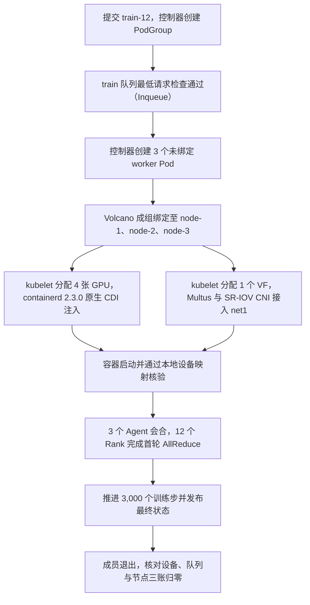
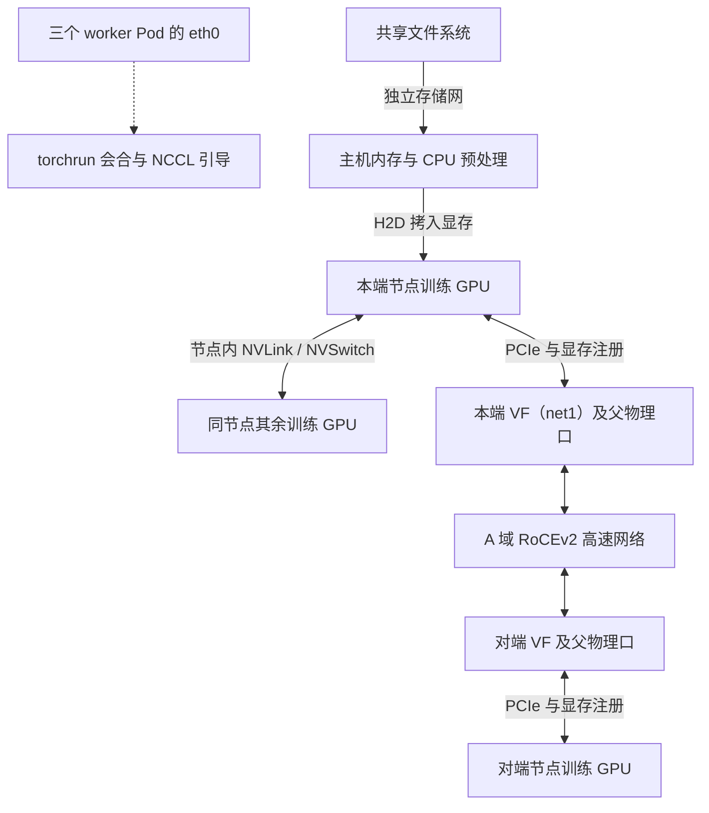

# 三节点 GPU 作业的生命周期与数据路径

早高峰 08:45，运维团队向一座训推共存的生产集群提交了一份三节点、12 卡同步训练作业 `ai-demo/train-12`，目标是跑完 3,000 个全局优化步。从提交请求到跑通第 1 个训练步，整整花了 18 分钟：前 5 分钟卡在队列准入，接着 10 分钟卡在成组放置，最后 3 分钟完成节点设备交付、进程会合与首轮集合校验。

如果只盯 `kubectl get pod`，前 15 分钟全是一片毫无波澜的等待，后 3 分钟又瞬间跳成 `Running`。想在生产环境一眼看穿每分钟到底卡在哪一层，必须先把这套集群的拓扑角色、控制面交接和真实数据通路完整串起来。

## 训推共存集群与实战角色总览

这座生产集群按实际物理布线划出两个网络域，同时承载**高优先级在线大模型推理（`infer` 队列）**与**多节点分布式训练（`train` 队列）**：

- **A 网络域（主力训推池）**：4 台标准 8 卡 HGX H100 80 GB 节点，卡间经 NVLink 与 NVSwitch 全互联，域内 RoCEv2 链路已按多机训练吞吐验收。
- **B 网络域（跨域扩展与推理缓冲池）**：1 台 8 卡 H100 80 GB 节点与 1 台 8 卡 A100 40 GB 节点，承接常规训练及跨域弹性的在线推理副本。

每台节点向 Kubernetes 暴露 8 张整卡、32 CPU、192 GiB 主机内存与 2 个支持 RDMA 的 SR-IOV VF。两个 VF 切自同一物理网卡 PF，共用一条 `200 Gb/s` RoCEv2 物理端口，集群另设独立存储网承载共享文件系统读写。

为避免后文在原理推演中被一堆短代号反复打断，本章叙述机制时优先使用**语义角色**，具体节点、Pod、设备与配图标签统一收敛到下面这张总览表，需要核对日志或手绘插画时按表回查即可：

| 实战语义角色 | 集群实例名（括号为既有插画简标） | 本章承担的关键事件 |
| --- | --- | --- |
| **主训练作业与尝试轮次** | `ai-demo/train-12`（图标 `J20`；首轮 `R1` / 重试 `R2`） | 固定 3 节点 12 卡同步训练，目标 3,000 步 |
| **同集群在线推理服务** | `infer-llm`（独立高优先级 `infer` 队列） | 4 卡 TP 在线推理，受反亲和与 PDB 保护，守住 TTFT/TPOT SLO |
| **A 域常规训练节点** | `node-1`（`h1`；首轮/重试 worker 图标 `P11`/`P12`） | 两轮均承接 Rank 0–3，并在试点期担任对端 |
| **A 域故障与复归节点** | `node-2`（`h2`；首轮 worker `P21`；卡 `GPU-node2-02` / 图标 `GPU-h2-02`，`0000:65:00.0`） | 拆解 VF `0000:81:00.2` 交付；第 04 篇遭遇 PCIe 硬故障并复归 |
| **A 域混部与慢步节点** | `node-3`（`h3`；首轮/重试 worker 图标 `P31`/`P32`） | 常驻 1 个 4 卡在线推理副本；第 03 篇出现 Rank 9 读取慢步 |
| **A 域备用与升级试点节点** | `node-4`（`h4`；重试 worker `P41`；`基线 v1`/`候选基线 v2` 图标 `I0`/`I1`） | 08:50 因 VF 占满受阻；第 04 篇承接重试；第 05 篇执行内核升级试点 |
| **B 域对照节点** | `node-5`（`h5`，8× H100 80 GB）、`node-a1`（`a1`，8× A100 40 GB） | 检验跨域限制、显存规格过滤及在线推理无损漂移落点 |

主训练作业的规格固定为 3 个 worker Pod、每 Pod 启动 4 个训练进程，硬性锁定 A 域 H100 池并按主机名反亲和分散到三台不同节点：

| 资源与位置维度 | 单个 worker Pod 请求 | 整组 3 个 worker 合计 / 共同约束 |
| --- | --- | --- |
| **GPU 整卡** | 4 张 H100 SXM 80 GB | 12 张同型整卡（单卡 80 GB 显存规格） |
| **CPU 与主机内存** | 16 CPU、96 GiB | 48 CPU、288 GiB |
| **高速 RDMA 网卡** | 1 个 SR-IOV VF（`example.com/rdma-vf: 1`） | 3 个，每节点各取 1 个 |
| **网络域与拓扑** | A 域 H100 整卡池 | 同处 A 域，且分占 3 台不同物理主机 |

反映到提交给集群的 `VolcanoJob` 声明中，成组门槛、队列绑定、附加网络与硬件选择都在同一个模板里落盘：

```yaml
# 主训练作业 ai-demo/train-12 关键声明片段（Volcano v1.16.0）
apiVersion: batch.volcano.sh/v1alpha1
kind: Job
metadata:
  name: train-12
  namespace: ai-demo
spec:
  minAvailable: 3                    # 整组成组门槛：缺任意 1 个 worker 都不绑定
  queue: train                       # 归入独立训练队列，与高优先级 infer 队列隔离
  tasks:
    - name: worker
      replicas: 3
      minAvailable: 3
      template:
        metadata:
          annotations:
            k8s.v1.cni.cncf.io/networks: roce-a   # 经 Multus 接入 A 域 RoCEv2 附加网
        spec:
          nodeSelector:
            gpu.pool/model: h100-80gb             # 锁定 80 GB H100 整卡池
            network.domain: domain-a              # 硬绑定已验收的 A 网络域
          affinity:
            podAntiAffinity:
              requiredDuringSchedulingIgnoredDuringExecution:
                - topologyKey: kubernetes.io/hostname  # 强制三个 worker 分落三台主机
                  labelSelector:
                    matchLabels: { volcano.sh/job-name: train-12 }
          containers:
            - name: trainer
              resources:
                limits:
                  cpu: "16"
                  memory: 96Gi
                  nvidia.com/gpu: "4"
                  example.com/rdma-vf: "1"
```

## 从提交到容器启动的三段控制交接

一份多卡作业从 YAML 落库到容器真正拉起进程，并不是一次原子操作，而是跨越三道彼此独立的控制交接：

1. **队列准入（Volcano `enqueue` + `capacity`）**：作业落库后，Volcano Job Controller 自动创建 `PodGroup`。只有当 `train` 队列的可用配额能装下整组最低请求（12 GPU、48 CPU、288 GiB、3 VF），`PodGroup` 才进入 `Inqueue`，控制器这才开始创建三个尚未绑定节点的 worker Pod。
2. **成组放置（Volcano `allocate` + `predicates` + `gang`）**：调度器逐节点核算型号、网络域、多维余量与反亲和，并在 `gang` 约束下确认三台候选主机全部凑齐，随后一次性写入三个 Pod 的 `spec.nodeName`（本例于 09:00 绑定到 `node-1`、`node-2`、`node-3`）。
3. **节点双路本地交付（GPU CDI + SR-IOV VF）**：Pod 落到具体主机后，调度器已经退场，改由目标节点的 kubelet 接棒，同时推进两条本地设备交付支路。

在 GPU 交付支路上，kubelet 设备管理器从本机健康池挑出 4 张物理卡，调用启用 `cdi-cri` 的 NVIDIA Device Plugin `v0.20.1` 完成 `Allocate`，再经 CRI 把设备全名交给 **containerd `2.3.0`**。

按 [第 10 章](../10_GPU如何进入容器/00_内容大纲.md) 介绍的原生 CDI 路径，containerd 解析本地规格文件，将 4 张卡的设备节点与驱动库注入容器，每张卡均锚定唯一物理 UUID。

在高速网络支路上，Multus `v4.2.4` 根据 Pod 注解指向的附加网络定义 `roce-a`，先从 kubelet 的本地分配快照取出该 Pod 获批的 VF PCI 地址，再交由 SR-IOV CNI 在容器网络命名空间内挂载为 `net1` 并分配 RoCE 地址。只有两条支路同时就绪，训练容器才会启动。



*图 20-01-01：固定三节点作业从提交到退出归账的控制交接。绑定后 GPU 与 VF 两条本地交付并行推进，全部就绪后才进入应用会合与集合通信。*

容器变成 `Running` 后，运维不能仅凭状态字样就默认交付无误，而应立刻把节点分配快照与容器内视图对上号。以首轮运行节点 `node-2` 上的成员（`train-worker-1`）为例，下面这组核验把逻辑请求直接锚定到物理芯片与交换机链路：

```text
# 09:01:20 节点 node-2（train-worker-1）本地交付核验摘录
[PodResources API]  nvidia.com/gpu      -> [GPU-node2-01, GPU-node2-02, GPU-node2-03, GPU-node2-04]
[PodResources API]  example.com/rdma-vf -> [0000:81:00.2]   # 所属 PF 对应 200 Gb/s 物理口
[Container View]    LOCAL_RANK=1 (Rank 5) -> GPU-node2-02 (PCI BDF 0000:65:00.0)
[Container Net]     net1 (roce-a)         -> VF 0000:81:00.2 -> mlx5_0 (RoCEv2 Active)
```

> [!tip] 工程直觉：把“身份快照”留在出事之前
> 只要把 `Pod UID → Rank → GPU UUID / PCI BDF → VF / 物理口` 这张对应关系在启动瞬间落盘，后续无论是慢步查拥塞还是硬故障追 Xid，都能在几十秒内穿透容器边界，直接锁定宿主机物理链路。

## 四条运行路径与共享物理口边界

容器内由 `torchrun` Agent 承担本地进程启动与会合。三台节点上的 Agent 指向同一会合端点完成对齐后，各自拉起 4 个训练进程，顺次组成 `Rank 0–11` 通信组（各节点分占 4 个连续 Rank，具体映射见上表）。

由于 `NCCL 2.27.3` 默认在首次集合操作时按需动态建连（`NCCL_RUNTIME_CONNECT`），且调用返回仅代表指令提交到 CUDA Stream，启动后必须跑一轮 FP32 求和 AllReduce 做端到端验真。

令第 $r$ 个 Rank（$r = 0, 1, \dots, 11$）把缓冲区全部填为 $r + 1$，则全组规模与每个输出元素的理论校验值为：

$$
\text{World Size} = 3 \text{ 节点} \times 4 \text{ 进程/节点} = 12
$$

$$
\text{Checksum} = \sum_{r=0}^{11} (r + 1) = 1 + 2 + \cdots + 12 = 78
$$

只有 12 个 Rank 在各自 CUDA Stream 同步完成后全部读出 `78`，且选路日志确认跨机流量走了预期 RoCEv2 设备，才算真正跑通了全栈数据通路。从运行日志与拓扑映射可以清楚拆出四条各司其职的路径：

1. **控制与引导路径（`eth0`）**：承担 `torchrun` 成员会合与 NCCL 建连信息交换，流量极小但决定通信组能否建立。
2. **节点内高速互联（NVLink / NVSwitch）**：承接同机 4 个本地 Rank 之间的显存直连交换。
3. **跨节点集合通信（RoCEv2 + GPUDirect RDMA）**：借 `net1` 对应的 VF 绕开主机内存，让网卡经 PCIe 直接搬运已注册的 GPU 显存缓冲区（原理见 [第 06 章](../06_从普通网络通信走向RDMA/00_内容大纲.md)）。
4. **训练数据与检查点路径（独立存储网）**：样本批次经共享文件系统和节点存储网卡读入主机内存，由 CPU 预处理后再拷入 GPU 显存；检查点同样经主机暂存写回持久存储。



*图 20-01-02：节点间四条核心路径分工。虚线为控制引导依赖，实线为数据载荷路径，存储写回检查点同样沿独立存储网回写。*

在训推共存集群里，跨节点网络有一条极易被忽视的物理边界：**SR-IOV 切分出来的两个 VF 只是两个独立的调度分配名额，底层依然共用同一块物理网卡 PF 与同一根 `200 Gb/s` 光模块链路**。当一台节点一半卡跑训练、另一半卡跑 PD 分离的在线推理副本时，双方各自拿着“独占”的 VF，出口流量却会在物理口与上游交换机队列里正面相遇。


*图 20-01-03：训练成员所在节点 `node-2` 上 `net1` 映射到 VF `0000:81:00.2`（图中 `h2` / `P21` 对应 `node-2` / 首轮 `train-worker-1`）。两个 VF 可分别交付给不同 Pod，但底层共用同一 PF 与 `200 Gb/s` 物理口，并发流量仍受单一链路容量约束。*

> [!warning] 常见误区：拿到独占 VF ≠ 拥有独占 200 Gb/s 带宽
> SR-IOV 隔离了硬件队列与地址空间，却没有把一根物理光纤变成两根。第 03 篇排查网络尾延迟时，必须始终记得同机另一个 VF 上的邻近业务（例如在线推理 KV Cache 迁移）可能正在共享这根链路。

## 从首个训练步到退出三账归零

把 `08:45` 提交到 `09:03` 首步完成压缩到一张里程碑表里，每一步对应哪层交接一目了然：

| 时刻 | 集群与作业观察到的事件 | 确认完成的交接层 |
| --- | --- | --- |
| **08:45** | API 返回作业对象并生成 `PodGroup` | 声明落库，进入队列准入评审 |
| **08:50** | `PodGroup` 转为 `Inqueue`，控制器建出 3 个未绑定 Pod | `train` 队列配额放行，转入节点放置 |
| **09:00** | 3 个 worker Pod 一次性获得节点绑定结果 | Volcano 成组放置落实，交棒给节点 kubelet |
| **09:01:20** | 3 个训练容器启动，PodResources 快照与容器内 GPU/VF 对齐 | 原生 CDI 注入与 SR-IOV 附加网交接闭环 |
| **09:02:10** | 3 个 Agent 完成同轮会合，12 个 Rank 落盘各自设备身份 | 应用进程组成员齐备 |
| **09:02:35** | 首轮 12-Rank AllReduce 在设备侧完成，输出全员等于 `78` | 跨机 GPUDirect RDMA 实际路径与计算验真 |
| **09:03** | 全组完成第 1 个全局优化步 | 供数、计算、集合通信与参数更新全线打通 |

同样地，当作业最终跑完 3,000 步正常收尾时，也不能只看 `Job Completed` 就宣布资源已经回来，必须分别核对三本更新节奏并不完全同步的账：

1. **节点本地账**：kubelet 设备管理器清理旧 Pod UID 的 GPU/VF 分配，CNI 回收附加网络接口与 IPAM 地址。
2. **调度节点账**：3 台主机上的 12 GPU、48 CPU、288 GiB 内存与 3 VF 调度请求归还给集群剩余量。
3. **队列配额账**：Volcano `train` 队列的已用额度扣除本作业请求。三张账对账时都应锚定旧 Pod UID，而设备是否真的恢复可再交付，最终以新 Pod 成功拿到并运行为准（本作业的最终收尾记录将在第 04 篇完整呈现）。

> [!summary] 核心结论
> 从提交到第 1 步完成的 18 分钟里，真正花在设备注入与启动上的只有 3 分钟，整整 15 分钟耗在“等队列”和“等成组放置”。集群明明还空着几十张卡，为什么前面 15 分钟却一步也动不了？下一篇我们把时钟拨回 `08:45`，打开早高峰训推共存集群的资源账本一探究竟。

> [!info]- 参考资料
> - **HGX H100 节点架构**：[NVIDIA HGX H100 参考架构组件说明](https://docs.nvidia.com/enterprise-reference-architectures/hgx-ai-factory-h100-h200-b200/latest/components.html)
> - **Volcano 队列、成组调度与终态**：[Volcano v1.16.0 Actions](https://volcano.sh/docs/v1.16.0/scheduler/actions/)、[Volcano v1.16.0 PodGroup](https://volcano.sh/docs/v1.16.0/concepts/podgroup/)、[Volcano v1.16.0 成员创建条件源码](https://github.com/volcano-sh/volcano/blob/v1.16.0/pkg/controllers/job/job_controller_actions.go#L400-L414)、[Volcano v1.16.0 运行终态判断源码](https://raw.githubusercontent.com/volcano-sh/volcano/v1.16.0/pkg/controllers/job/state/running.go)
> - **Kubernetes 设备交付与容器运行时**：[Kubernetes v1.36 Device Plugins](https://v1-36.docs.kubernetes.io/docs/concepts/extend-kubernetes/compute-storage-net/device-plugins/)、[Kubernetes v1.36 Pod 终止与回收](https://v1-36.docs.kubernetes.io/docs/concepts/workloads/pods/pod-lifecycle/#pod-termination)、[kubelet v1.36.0 设备分配清理源码](https://github.com/kubernetes/kubernetes/blob/v1.36.0/pkg/kubelet/cm/devicemanager/manager.go)、[NVIDIA Device Plugin v0.20.1 README](https://raw.githubusercontent.com/NVIDIA/k8s-device-plugin/v0.20.1/README.md)、[containerd 2.3.0 CRI CDI 配置](https://github.com/containerd/containerd/blob/v2.3.0/docs/cri/config.md)
> - **SR-IOV 与 Multus 附加高速网**：[Linux Kernel PCIe SR-IOV HOWTO](https://docs.kernel.org/PCI/pci-iov-howto.html)、[NVIDIA RoCE 文档](https://networking-docs.nvidia.com/mlnxofedswum/24.10-5.1.6.1lts/rdma-over-converged-ethernet-roce)、[Multus v4.2.4 设备索引实现](https://raw.githubusercontent.com/k8snetworkplumbingwg/multus-cni/v4.2.4/pkg/k8sclient/k8sclient.go)、[SR-IOV CNI 配置参考](https://github.com/k8snetworkplumbingwg/sriov-cni#sriov-cni)
> - **PyTorch 会合与 NCCL GPUDirect RDMA**：[PyTorch 2.9 torchrun 指南](https://docs.pytorch.org/docs/2.9/elastic/run.html)、[NCCL 2.27.3 概览](https://docs.nvidia.com/deeplearning/nccl/archives/nccl_2273/user-guide/docs/overview.html)、[NCCL 2.27.3 CUDA Stream 语义](https://docs.nvidia.com/deeplearning/nccl/archives/nccl_2273/user-guide/docs/usage/streams.html)、[NCCL 2.27.3 环境变量与动态建连](https://docs.nvidia.com/deeplearning/nccl/archives/nccl_2273/user-guide/docs/env.html#nccl-runtime-connect)、[NVIDIA GPUDirect RDMA 文档](https://docs.nvidia.com/cuda/gpudirect-rdma/)
