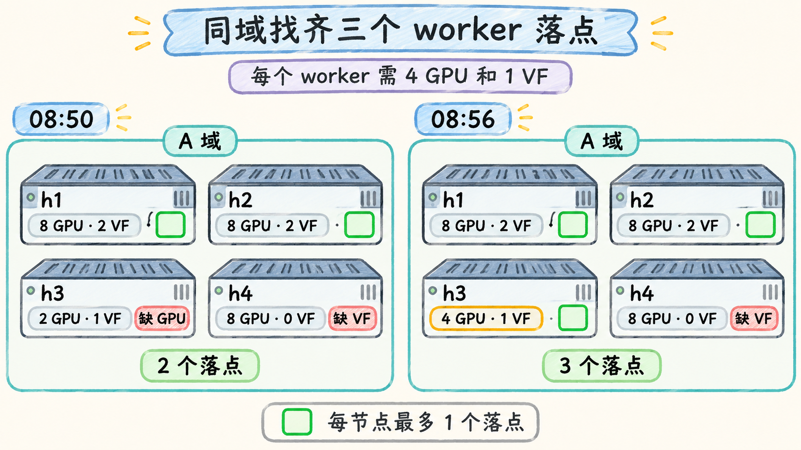

# 队列上限、GPU 碎片与同域放置

08:45，`J20` 已有作业对象。全表还有 34 个整卡资源单位，三只 worker 一共请求 12 张，调度却没有开始。要解释等待，先看 `train` 队列是否能接纳三份请求，再看有没有三台同时满足条件的节点。本例要求 A 域内的不同 H100 80 GB 主机，每台至少能交付 4 张整卡、16 CPU、96 GiB 主机内存和 1 个 RDMA VF。

## 用 PodGroup 的最低请求复算入队

`train` 的 GPU 有效上限为 16，作业的 PodGroup 最低请求包含 12 GPU、48 CPU、288 GiB 和 3 VF。这个平级队列处于开放状态，其他资源维度充足，没有专属保留。在本例的快照里，没有需另计的在途用量或弹性扣减。Volcano v1.16.0 的 `capacity` 对各资源维度做入队检查，本例 GPU 项可以写成 `已分配 + 本组最低请求 ≤ 16`。实地读取队列状态时，还应查在途组和调度器会话的有效上限。 [Volcano v1.16.0 · Queue 字段](https://volcano.sh/docs/v1.16.0/concepts/queue/) · [v1.16.0 · capacity 入队检查](https://github.com/volcano-sh/volcano/blob/v1.16.0/pkg/scheduler/plugins/capacity/capacity.go#L1621-L1667)

| 时间 | 当时的队列和组 | 判断 |
| --- | --- | --- |
| 08:45 | `train` 有两个旧 Pod，分别在 `h1` 与 `h5`，各计入 4 GPU。 | `8 + 12 = 20`，超过 16。组保持 `Pending`，按主例配置还没有 worker 可供调度。 |
| 08:50 | `h1` 的旧 Pod 已退出并归账，`h5` 的用量仍为 4 GPU。 | `4 + 12 = 16`。组进入 `Inqueue`，随后生成三个 worker，它们的 `spec.nodeName` 仍为空。 |
| 09:00 | 节点余量也已满足，调度器提交三个绑定。 | 收敛后 `train` 的 GPU 用量为 `4 + 12 = 16`。 |

入队表回答的是队列能否接下这一组请求。处于 `Inqueue` 的三只 Pod 还要竞争具体落点。读现场时按作业和 PodGroup 的 UID 对齐 Queue 用量、组条件和成员状态。组已入队且成员未绑定时，下一项证据是该轮调度的节点筛选结果。 [Volcano v1.16.0 · Enqueue 与 Allocate](https://volcano.sh/docs/v1.16.0/scheduler/actions/) · [v1.16.0 · 成员创建条件](https://github.com/volcano-sh/volcano/blob/v1.16.0/pkg/controllers/job/job_controller_actions.go#L400-L414)

## 用型号、同域和逐节点余量找落点

以下 08:50 快照是节点可用于新请求的**调度余量**，即该资源的 `Allocatable` 扣除已被调度器计入的请求。监控里计算活动为零的卡仍可能已分配。现场还需注意调度缓存可能计入绑定中的请求。

| 节点 | 域 | 池内整卡规格 | GPU 余量 | CPU 余量 | 主机内存余量（GiB） | VF 余量 | 本工单可放 worker |
| --- | --- | --- | ---: | ---: | ---: | ---: | ---: |
| `h1` | A | H100 80 GB | 8 | 32 | 192 | 2 | 1 |
| `h2` | A | H100 80 GB | 8 | 32 | 192 | 2 | 1 |
| `h3` | A | H100 80 GB | 2 | 24 | 168 | 1 | 0 |
| `h4` | A | H100 80 GB | 8 | 24 | 160 | 0 | 0 |
| `h5` | B | H100 80 GB | 4 | 16 | 96 | 1 | 0 |
| `a1` | B | A100 40 GB | 8 | 32 | 192 | 2 | 0 |

先应用型号与域的硬条件。主例的 GPU 池按节点保持同质，模板用 `nodeSelector` 选择 H100 整卡和 A 域，并用基于 `kubernetes.io/hostname` 的硬性 Pod 反亲和将同组的 worker 分开。这个同域限制来自模板明确选择 A 域。读到同一个 `nvidia.com/gpu` 键时，还要核对实际资源策略。如果池内混用整卡、共享名额或不同显存规格，应先查资源名、标签与具体设备的对应关系。`a1` 的 40 GB 卡不满足单卡规格。加总更多 40 GB 卡也无法让一个使用单卡的进程得到所需显存。`h5` 的资源向量足够，但在 B 域。 [Kubernetes v1.36 · 节点选择和反亲和](https://v1-36.docs.kubernetes.io/docs/concepts/scheduling-eviction/assign-pod-node/) · [NVIDIA Device Plugin v0.20.1 · GPU 共享](https://raw.githubusercontent.com/NVIDIA/k8s-device-plugin/v0.20.1/README.md)

再判断合格节点能否提供一整份资源。给四种资源分别做整数除法，再取最小值，表示被最紧的一项限制的副本数。在本例，主机反亲和又把每台的结果封顶在 1。

- `h1/h2` 资源各够两份，反亲和使它们各贡献一个落点。
- `h3` 的 GPU 商为 `⌊2 ÷ 4⌋ = 0`，该节点无法提供一份四卡请求。
- `h4` 的两个 VF 被网络测试 Pod 使用。即使仍有 8 张 GPU，VF 的商为 `⌊0 ÷ 1⌋ = 0`。把 GPU 放在 `h4`、把 VF 放在 `h3` 无法满足同一 Pod 的本地交付。

08:50 全表余量合计 `38`，A 域 H100 余量合计 `26`，A 域完整落点只有 `2`。本例没有已绑定的同组成员，也没有允许依赖即将释放资源的候选。`allocate` 即使暂选 `h1` 和 `h2`，该轮也凑不齐 `gang` 所需的三个成员。现场可从队列已经放行、成员已经创建但 `nodeName` 为空，结合组和节点筛选记录，定位在成组放置。 [Volcano v1.16.0 · 分配提交](https://github.com/volcano-sh/volcano/blob/v1.16.0/pkg/scheduler/actions/allocate/allocate.go) · [v1.16.0 · Gang 组和任务门槛](https://github.com/volcano-sh/volcano/blob/v1.16.0/pkg/scheduler/plugins/gang/gang.go#L175-L196)

## 释放哪一份资源会改变本轮结果

08:56，`h3` 的一只批处理 Pod 结束并归账，净释放 2 GPU、4 CPU 和 8 GiB 主机内存，它原先未请求 VF。`h3` 的余量变成 `4 GPU / 28 CPU / 176 GiB / 1 VF`，因此新增一个落点。09:00 成组放置到 `h1/h2/h3`。这里的第三个落点来自释放在正确的节点，且该节点其余条件已满足。

*图 20-02-01｜数字是调度余量，两次快照的 CPU 和主机内存均满足请求。08:56，`h3` 归还 2 GPU 后凑出第三个合格落点，`h4` 仍缺 VF。空心方框表示候选，实际绑定在 09:00 发生。*

在 08:50 快照上，下面三种改动各自独立，队列额度仍满足。

| 只改变这一项 | 本组能否成组放置 | 推理 |
| --- | --- | --- |
| 在 `h5` 释放 2 GPU | 仍等待 | A 域的落点还是 `h1/h2`。 |
| `h4` 的网络测试释放 1 VF，CPU 与内存继续满足 | 可放 | `h4` 给出第三个 A 域落点，卡数总和无需增加。 |
| 只把调度器的组门槛降低 | 固定规模应用仍需要三个成员 | 即使配置允许两只先绑定，两个 Agent 会等第三个。应用需要支持改变规模和恢复分工，才能在两机运行。 |

放置通过后，再由 kubelet 以本地健康和已有分配状态交付具体 GPU 与 VF。若 `h3` 在绑定之后丢失 VF 或未能取得附加网络地址，应从节点交付与 CNI 的证据入手。主例的三只 Pod 随后完成首步，观察目标随之转到持续运行中每一步的进展。 [Kubernetes v1.36 · Device Plugin 与设备健康](https://v1-36.docs.kubernetes.io/docs/concepts/extend-kubernetes/compute-storage-net/device-plugins/#device-plugin-and-unhealthy-devices) · [PyTorch 2.9 · 固定规模与弹性规模](https://docs.pytorch.org/docs/2.9/elastic/run.html)
