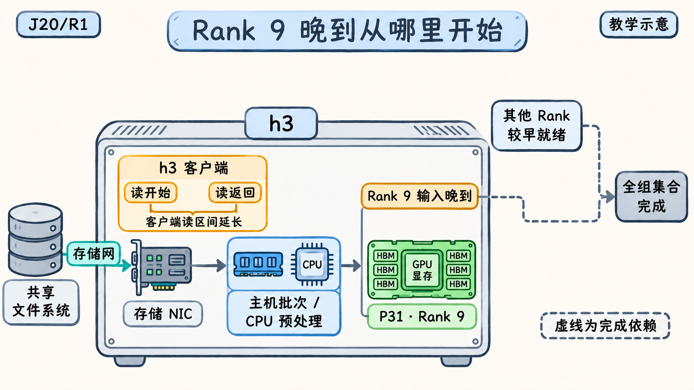

# 训练步退化的跨层证据

`J20/R1` 在 `h1/h2/h3` 上运行，三台各四个 Rank。09:36 后，全组仍在完成优化步，监控却显示每分钟的有效进展减少，几张卡的计算活动也降低。同步训练中，先完成本地工作的 Rank 也可能因另一个 Rank 迟到而出现空档。要解释这种变化，需要把同一全局步中的输入、设备计算和集合完成放回一条时间轴。

## 用最晚就绪和全组完成拆开慢步

以下是教学追踪。健康窗为 09:27–09:29，异常窗为 09:36–09:38，各取一个具有代表性的完整步来推演，所列数值是具体事件的相对时刻。两步的节点、容器、版本、十二个 Rank、全局批量（1,200 样本）和训练 AllReduce 消息（每 Rank 512 MiB）一致。简化负载每步先计算、再做一次 AllReduce，最后完成优化。该模型省略跨步流水和本步通信与计算重叠。各 Rank 的事件已对齐到本步共同原点，跨节点时钟误差在 2 ms 内。这里的**就绪**指本地输入缓冲区可供本轮集合消费，**完成**指结果在设备上可用，均由应用与设备事件组合标记。 [NCCL 2.27.3 · CUDA Stream 语义](https://docs.nvidia.com/deeplearning/nccl/archives/nccl_2273/user-guide/docs/usage/streams.html)

| 从步开始起算的事件 | 第 1,200 步，健康（ms） | 第 1,630 步，异常（ms） |
| --- | ---: | ---: |
| `h3/P31/Rank 9` 所需批次的客户端读开始 | 20 | 20 |
| Rank 9 客户端读返回，CPU 开始处理 | 80 | 500 |
| Rank 9 主机批次就绪 | 180 | 600 |
| Rank 9 设备上的批次就绪 | 260 | 680 |
| 最早 Rank 的集合输入就绪 | 880 | 880 |
| 最晚 Rank 的集合输入就绪（均为 Rank 9） | 940 | 1,360 |
| 全组最后一个 Rank 的集合结果在设备上可用 | 1,100 | 1,520 |
| 全组完成优化步 | 1,200 | 1,620 |

- **就绪跨度**是最晚减最早。健康步为 `940 − 880 = 60 ms`，慢步为 `1,360 − 880 = 480 ms`。最早与最晚就绪之间多出 420 ms。
- **完成尾部**是全组最后完成减最晚就绪。两步均为 `160 ms`。这个余量包含最晚成员就绪后仍需完成的通信与设备依赖。部分传输可能在最晚到达前已发生，因而这个区间不能当作单向链路延迟。
- Rank 9 的计算段都是 `680 ms`，主机到设备都是 `80 ms`，CPU 处理都是 `100 ms`。多出来的 `420 ms` 与这批输入的客户端读取延长同量。这个简化步的优化收尾仍为 `100 ms`。

两个步的时长分别为 1.20 s 和 1.62 s，增加 `420 ÷ 1,200 = 35%`。单步等效样本速率分别为 `1,200 ÷ 1.20 = 1,000` 和 `1,200 ÷ 1.62 ≈ 741` 样本/s。要得到两分钟窗口的真实吞吐，应把该窗口的有效样本数除以实际观察时长，另外标记保存、评估或暂停。

## 拼接 GPU、CPU、RoCE 与存储的证据

| 证据来源与对齐方式 | 同窗教学记录 | 目前能支持的判断 |
| --- | --- | --- |
| GPU 遥测，以 Pod UID、Rank、实际 GPU UUID 对齐 | 早到成员的 GPU SM 活动率下降，工作段时钟与正常记录相近。追踪里 Rank 9 的本地计算没有延长。 | 计算空档可以由输入延后解释。SM（Streaming Multiprocessor，流式多处理器）活动率反映采样窗口内至少有一个活跃线程束的时间占比，并在各 SM 间取平均。等待访存的线程束也可计为活跃。 |
| `h3` CPU 与批次标识，同一批次、同一 worker | 读取返回即开始 CPU 处理，处理耗时 100 ms。主机到卡的区间 80 ms。 | 这条追踪的额外时间出现在客户端读返回前。CPU 仍参与数据通路，后续应检查发起线程是否在读区间内被长时间延迟。 |
| RoCE 设备与端口映射，以 VF 对回父物理口，再对回交换机 | 两窗口采样的相关端口出方向队列深度和拥塞通知增量未见相对于健康窗的持续抬升。集合完成尾部相近，记录的传输后端与所选端口相同。 | 当前记录优先支持晚到。采样分辨率有限，瞬时排队可能落在采样点之间。 |
| 存储读，以 `h3` 挂载、批次与客户端请求对应 | 该批客户端读区间由 60 ms 变为 480 ms，其他 Rank 的输入就绪没有成批后移。没有同请求的服务端分段时序。 | 可追到该批次的读取交接。客户端缓存、存储网往返、后端排队和线程调度仍需区分。 |

*图 20-03-01｜额外等待出现在 `h3/P31/Rank 9` 从客户端发起读到读返回的区间。最晚就绪随之后移，两步的集合完成尾部均为 160 ms。仍需同一请求的分段证据才能定位读区间内部的等待。*

端口比较要考虑方向。比如交换机连接 `h3` 的端口的**出**方向是发往 `h3`，它覆盖该方向共用端口的流量。VF、物理口和交换端口的计数不必同口径，也可能包含其他 Pod。采集到的拥塞通知是范围证据，要结合端口、流量类别、重置和采样窗。GPU 活动字段也有采样区间和设备范围，不能直接给每个训练输入定位。 [NVIDIA DCGM · 指标与采样](https://docs.nvidia.com/datacenter/dcgm/latest/user-guide/feature-overview.html#profiling)

## 用受控回放缩小输入路径

09:39–09:41 在同一次尝试中做短窗口教学回放。团队预先把第 1,630 步涉及的批次副本填入 `h3` 的节点本地缓存。回放使用相同内容、CPU 预处理、GPU 放置与集合参数，并将回放记录排除在正式训练进度之外。记录中的 Rank 9 客户端读约 60 ms，最晚就绪回到约 940 ms，完成尾部仍约 160 ms。恢复常规数据源后，后续窗口的远端读取与步时也回到健康范围。

对照支持**该慢步由输入读取交接延长驱动**，具体失速点仍要靠同一请求的客户端发起和返回、线程运行记录、存储网延迟及服务端排队证据来拆分。热缓存改变了被访问的路径，结果既不足以确认服务器故障，也不足以确认先前是缓存未命中造成。若换一个记录，最晚就绪仍为 940 ms 而全组设备完成推迟到 1,520 ms，完成尾部会增至 580 ms。此时优先核对同消息、方向和并发下的实际 GPU–VF 选路、端口队列与设备流依赖，并用受控 RDMA 及全组集合对照检验。

这段慢步最终仍有正确输出。后来 `h2` 的另一个 Rank 突然失去设备，产生的是全组停止推进的事件。两段记录要分别按节点、Rank 和时间窗建立证据链。
