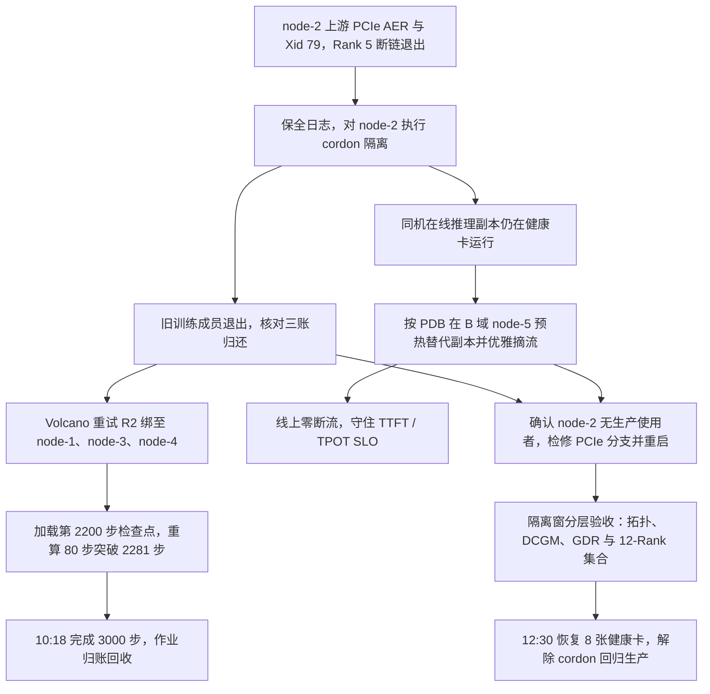
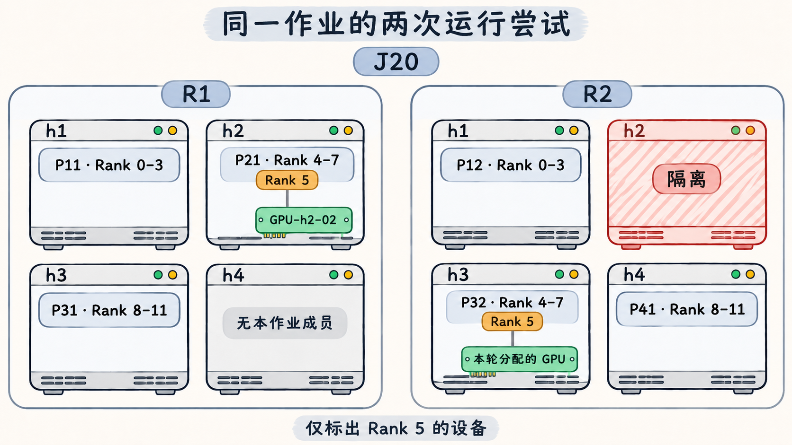

# GPU 故障、整组重试与容量恢复

`09:52`，主训练作业刚跑完第 2,280 步，下一次集合通信突然僵死，紧接着整组进程报错退出。更棘手的是，就在 `09:30` 早高峰扩容时，故障节点另一半空闲的 4 张 H100 刚刚接住了一个高优先级在线推理副本 `infer-llm`。

此刻运维台前同时摆着三条必须分头跑通的战线：**怎么保住同机在线推理用户的零断流？** **怎么让 12 卡同步训练以最小重算代价续跑完 3,000 步？** 以及 **出事的服务器什么时候才配重新放回生产池？**

## 从 PCIe 硬件报错追到断链的训练 Rank

沿用第 01 篇启动瞬间落盘的“身份快照”，我们可以把故障节点（`node-2`）同一启动周期里的内核日志、驱动告警和训练日志严丝合缝地钉在同一条秒级时间线上：

```text
# 故障节点 node-2（同一 boot 周期）内核、驱动与 Kubernetes 状态摘录
[09:52:07] kernel: pcieport 0000:40:01.0: AER: Fatal error received: id=6500
[09:52:08] kernel: NVRM: Xid (PCI:0000:65:00.0): 79, GPU has fallen off the bus.
[09:52:09] train-worker-1/rank-5: CUDA error: devices-side failure on GPU-node2-02 (0000:65:00.0), exiting
[09:52:25] worker-0/worker-2: NCCL communicator aborted due to peer rank 5 disconnect

$ kubectl describe node node-2 | grep -E "Taints|nvidia.com/gpu"
Taints:            node.kubernetes.io/unschedulable:NoSchedule   # 运维已执行 cordon
Capacity:          nvidia.com/gpu: 8                             # 物理槽位总数不变
Allocatable:       nvidia.com/gpu: 7                             # Device Plugin 摘除 1 张不健康卡
```

逐层对表，每一步因果边界清清楚楚：

| 时刻 | 跨层日志与锚定身份 | 确认的故障传播边界 |
| --- | --- | --- |
| **09:52:07** | 内核在 `0000:65:00.0` 上游根端口报 fatal PCIe AER | 严重 PCIe 链路错误发生于该卡分支，需保留分支拓扑与错误详情 |
| **09:52:08** | 驱动在同一启动周期对 `0000:65:00.0` 记录 **Xid 79** | 驱动经 PCIe 已彻底失联该 H100（对应快照里的 `GPU-node2-02`） |
| **09:52:09–09:52:25** | `node-2` 上 Rank 5 失败退出，其余 11 个 Rank 集合失败并退出 | 单卡失联穿过容器边界拖停全组；其余成员通信超时纯属缺员引发的次生症状 |

需要格外冷静的一点是：**切忌把时间临近的两起事件强行拼成一条因果链**。15 分钟前的慢步发生在另一台混部节点的共享存储读取上，本起事故则是当前故障机的单卡 PCIe 访问路径硬断链，两者互不相关，后续硬件排查应直接聚焦故障机的 GPU、PCIe 槽位/链路与供电。

## 节点隔离与训推分道处置：无损漂移 vs 整组重试

保留故障前后的设备分配与内核日志后，运维第一步对故障节点执行 `kubectl cordon` 阻断新调度。

这里要分清两笔独立的容量变化：**Device Plugin 把掉线卡标为不健康，只让该机 GPU `Allocatable` 从 8 降到 7（`Capacity` 保持 8）；而运维 `cordon` 整机，是把整台节点从生产放置池里整体撤出。**

随后，跑在同一台物理机上的两类负载展现出截然不同的抗故障韧性：

| 同机负载类型 | 单卡 PCIe 掉线后的现场状态 | 排空与恢复处置路径 | 业务影响 |
| --- | --- | --- | --- |
| **在线推理副本**（占 `node-2` 另 4 张健康卡） | 未用到故障卡 `0000:65:00.0`，推理请求仍在正常响应 | 遵循 `PDB` 先在 **B 域空闲 H100（`node-5`）** 拉起替代副本并完成权重加载与就绪探针，再从 Service 摘除 `node-2` 副本，待在途 token 生成完毕优雅退出 | **零断流、零 TTFT/TPOT 违约**，且借 B 域落点不挤占 A 域训练资源 |
| **同步训练 worker**（`train-worker-1`，Rank 5 所在） | 固定 12-Rank 通信组缺一不可，Agent 直接退出，Pod 进入 `Failed` | 走 Volcano `RestartJob` 整组重建，切至 A 域备用节点加载最近完整检查点续跑 | 中断并重算部分未落盘训练步 |

之所以让训练作业走控制器级整组重建，而不是在原 Pod 里原地硬重启，是因为作业显式设置了 `torchrun --max-restarts=0`、容器 `restartPolicy: Never`，并在 `VolcanoJob` 里绑定了成组失败策略：

```yaml
# ai-demo/train-12 重试策略片段：任一 worker 失败即由 Volcano 整组重建
spec:
  maxRetry: 3
  policies:
    - event: PodFailed
      action: RestartJob
```

当旧尝试的三个 Pod 全部退出并归还账本后，我们来重新盘点 A 域的可用落点。原本占着备用节点两个 VF 的 RoCE 链路巡检 Pod 已在 `09:45` 正常完工退出，释放了全部 CPU、内存与 2 个 VF。

此时 `train` 队列其余用量仅剩 B 域的 4 GPU，整组重试所需的 12 GPU 配额再次顺利通过 `4 + 12 = 16` 队列检查：

| A 域节点 | 旧训练成员退出后的可用余量 | 对重试轮次 `R2` 的落点贡献 |
| --- | --- | ---: |
| `node-1` | 8 GPU / 32 CPU / 192 GiB / 2 VF | **1** |
| `node-2` | 7 张健康 GPU，但整机 `cordon` 隔离待修 | **0** |
| `node-3` | 4 GPU / 28 CPU / 176 GiB / 1 VF（常驻在线推理保留） | **1** |
| `node-4` | 8 GPU / 32 CPU / 192 GiB / 2 VF（巡检已于 09:45 结束） | **1** |

A 域正好凑齐 3 个完整落点，重试轮次顺利改绑到备用节点组合。反过来推演一步：如果备用节点的巡检还在占着 2 个 VF，那么即便队列配额充裕、B 域也有空卡，重试组依然会卡死在 A 域成组放置阶段。

把训练重试、在线推理无损漂移与故障节点检修放到同一张流程图里，三条并行闭环的前置依赖一目了然：



*图 20-04-01：单卡硬故障触发的三条并行闭环。业务恢复（训练重试 + 推理无损漂移）与硬件复归拥有各自独立的完成判据，箭头代表前置依赖而非同一时刻。*

## 跨重试身份重置与检查点重算核算

进入第二轮重试后，作业对象仍是同一个，但三个 worker 的 Pod UID 与底层宿主机已经彻底换血。虽然 `Rank 0–11` 这套逻辑编号被完整复用，但首轮与重试轮次的同一个 `Rank 5` 早已指向完全不同的节点与物理卡：

| 尝试轮次 | 三个 worker 节点 | `Rank 5` 实际落点与物理设备 |
| --- | --- | --- |
| **首轮尝试（`R1`）** | `node-1`、`node-2`、`node-3` | 故障机 `node-2` 上的 `GPU-node2-02` |
| **重试轮次（`R2`）** | `node-1`、`node-3`、`node-4`（`node-2` 隔离） | 混部机 `node-3` 上本轮新分配的健康 GPU |



*图 20-04-02：同一作业的两次运行尝试复用逻辑编号 `Rank 5`，但底层宿主机、Pod UID 与物理 GPU 均已更换（图中 `h1`–`h4` 对应 `node-1`–`node-4`，`P11`–`P41` 为首轮/重试 worker 简标，`GPU-h2-02` 对应 `GPU-node2-02`）。跨重试归因必须绑定“尝试轮次 + Pod UID + GPU UUID”。*

> [!warning] 常见误区：只看到容器重启，却没核对 Pod UID 有没有换
> 如果现场配置误开了容器原地重启，旧 Pod UID 纹丝不动，新拉起的进程很可能会再次撞上同一台节点的同一块故障卡。确认“是否真的换掉了问题硬件”，必须核对新 Pod UID 对应的节点名与 PodResources 分配记录。

接下来核算持久化进度。故障前全组已完成第 `2,280` 步，而持久存储上第 `2,250` 步的目录缺少必需分片与提交完成标记，属于半成品；最近一个完整可读的版本是第 `2,200` 步。

新成员必须从第 `2,200` 步加载模型、优化器与数据进度，重算步数与稳态追平耗时为：

$$
\Delta S_{\text{rework}} = 2280 - 2200 = 80\text{ 步}
$$

$$
T_{\text{catch-up}} = 80\text{ 步} \times 1.20\text{ s/步} = 96\text{ s}
$$

恢复后的首个完成步是 **第 2,201 步**（`10:00:00` 上报），直到完成 **第 2,281 步**才首次真正超过故障前进度。按稳态步时 `1.20 s` 计算（从第 2,201 步完成起算，不含旧成员退出、排队启动、会合与加载时间），第 `2,281` 步在 `10:01:36` 达标。

随后监控在预期窗口捕捉到第 `2,300` 步的完整新检查点落盘。**只有“突破旧进度”与“成功写出新完整检查点”两项同时到位，才标志着作业恢复真正闭环。**

## 作业收尾归账与故障节点的独立复归

重试后的训练再无波折，`10:18` 跑完第 `3,000` 步并发布最终产物，三个新 Pod 正常退出，Job 进入 `Completed`。

按第 01 篇确立的三账归零口径核验：三个新 Pod 在各节点的 GPU/VF 分配与附加网地址全部清空，节点调度账归还 `12 GPU / 48 CPU / 288 GiB / 3 VF`，`train` 队列 GPU 用量在无新竞争者时从 `16` 回落到 `4`。

与此同时，故障节点正在另一条完全独立的运维时间线上推进复归。确认节点上所有训练与在线推理使用者均已优雅退出后，硬件团队按整机规程检修该 PCIe 分支并重启主机。

节点拉起后绝不能直接 `uncordon` 放回生产，而是在隔离验收窗内逐层重走准入红线：

1. **硬件与互联重建**：核对重启后新的启动周期、PCIe 分支链路状态、8 张卡的 BDF/UUID 拓扑、DCGM 诊断与 NVLink 健康。
2. **容器交付与显存直达**：用隔离窗测试 Pod 验证 4 卡计算、VF 接入与跨机 GPUDirect RDMA 显存读写。
3. **全组集合与负载复测**：与同域健康对端按原基线口径跑通 12-Rank AllReduce 与代表性训练负载，确认验收窗内无同类 PCIe AER 或 Xid 复现。

`12:30`，确认故障机恢复满额 `8` 张健康 GPU 且原路径性能达标后，运维解除隔离，将节点重新开放给生产池。

> [!summary] 核心结论
> 同一台服务器掉了一张卡，却同时考出三种截然不同的运维基本功：**在线推理靠 PDB 与跨域预热摘流守住零中断，同步训练靠完整检查点与备用节点把重算压缩到 96 秒，故障节点靠隔离窗分层复测守住生产池质量底线。**

`12:30` 之后，A 域四台 8 卡 H100 再次满血归位。趁着主训练作业已经收尾、容量账本最宽裕的午后窗口，平台团队启动了早有计划的节点镜像内核升级——而真正的暗礁，正藏在看似绿灯全亮的试点测试里。

> [!info]- 参考资料
> - **PCIe AER 与 NVIDIA Xid 故障诊断**：[Linux Kernel PCIe AER HOWTO](https://docs.kernel.org/6.18/PCI/pcieaer-howto.html)、[NVIDIA H100 Xid 错误目录分析](https://docs.nvidia.com/deploy/xid-errors/latest/analyzing-xid-catalog.html)、[NVIDIA DCGM 诊断级别与覆盖条件](https://docs.nvidia.com/datacenter/dcgm/latest/user-guide/dcgm-diagnostics.html)
> - **Kubernetes 不健康设备与安全排空**：[Kubernetes v1.36 不健康设备上报](https://v1-36.docs.kubernetes.io/docs/concepts/extend-kubernetes/compute-storage-net/device-plugins/#device-plugin-and-unhealthy-devices)、[Kubernetes v1.36 安全排空节点](https://v1-36.docs.kubernetes.io/docs/tasks/administer-cluster/safely-drain-node/)、[kubelet v1.36.0 设备管理器源码](https://github.com/kubernetes/kubernetes/blob/v1.36.0/pkg/kubelet/cm/devicemanager/manager.go)
> - **Volcano 重试策略与状态机**：[Volcano v1.16.0 Job Policy 指南](https://volcano.sh/docs/v1.16.0/userguide/user_guide_how_to_use_job_policy/)、[Volcano v1.16.0 Running 状态源码](https://raw.githubusercontent.com/volcano-sh/volcano/v1.16.0/pkg/controllers/job/state/running.go)、[Volcano v1.16.0 Restarting 状态源码](https://raw.githubusercontent.com/volcano-sh/volcano/v1.16.0/pkg/controllers/job/state/restarting.go)
> - **PyTorch 分布式重启与检查点**：[PyTorch 2.9 Worker 重启与 Rank 变化](https://docs.pytorch.org/docs/2.9/elastic/run.html)、[PyTorch 2.9 Distributed Checkpoint](https://docs.pytorch.org/docs/2.9/distributed.checkpoint.html)
