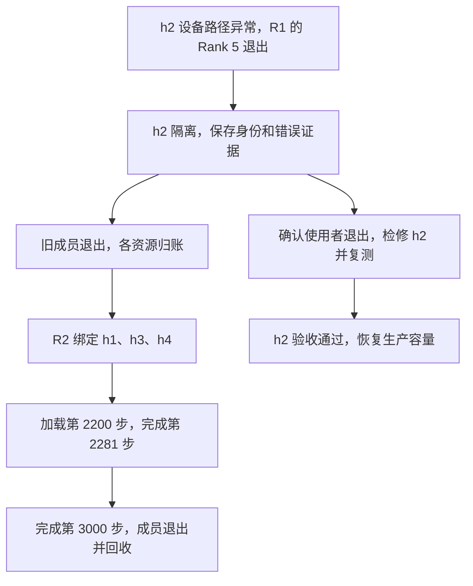

# GPU 故障、整组重试与容量恢复

09:52，`J20/R1` 已完成全局第 2,280 步，下一次集合通信未能完成。此时需要同时回答两个问题。训练能否用别的设备继续，以及 `h2` 何时能再次承接作业。两项工作起于同一事件，完成条件各自有证据。

## 从 PCIe 路径追到受影响的 Rank

按节点、启动周期和 PCI 地址对齐以下教学记录。`h2` 的 GPU `0000:65:00.0` 在分配快照中为 `GPU-h2-02`，属于 `P21`。应用将本地序号 1、该 UUID 和 `R1` 的 Rank 5 记在同一行。

| 时刻 | 记录与身份 | 能够推到哪里 |
| --- | --- | --- |
| 09:52:07 | `h2` 内核在该 GPU 所在的上游 PCIe 路径报告 fatal AER。 | **AER**（Advanced Error Reporting，PCIe 高级错误报告）说明该路径出现严重的 PCIe 错误，需保留上游端口、分支拓扑与错误详情。 |
| 09:52:08 | 同一启动周期中，GPU 驱动为该 PCI 设备记录 Xid 79。 | **Xid** 是 NVIDIA 驱动报告的事件编号。79 在此 H100 场景说明驱动经 PCIe 访问时已无法访问该 GPU。 |
| 09:52:09–09:52:25 | `P21` 的 Rank 5 设备操作失败并退出，其他成员报告同一次集合未完成。`P21` 的 Agent 随后以非零码退出。 | 故障穿过设备、进程与集合依赖。其他 Rank 的通信失败有共同的缺员解释。 |

这条证据链把优先调查范围收窄到 `h2` 的 GPU 访问路径。根因仍需平台侧检查 GPU、连接、PCIe 分支及供电等，再结合现场维修与复测确定。前一篇慢步来自 `h3` 在另一个窗口的输入读取延长，现有记录没有证据将两次现象连成一条因果链。 [Linux 6.18 · PCIe AER 与恢复](https://docs.kernel.org/6.18/PCI/pcieaer-howto.html) · [NVIDIA · H100 Xid 目录](https://docs.nvidia.com/deploy/xid-errors/latest/analyzing-xid-catalog.html)

## 容量上报、节点隔离与旧分配

保留故障前的分配与启动周期证据后，运维在新一轮放置之前对 `h2` 做 `cordon`，将其标为不可调度。原 Pod 可继续存在，直绑等绕过通常放置路径的入口和受容忍的工作负载要另行核查。设备插件在本例也将这张卡标成不健康，kubelet 将 GPU `Allocatable` 从 8 改为 7，`Capacity` 仍为 8。原 `P21` 仍持有旧卡的分配记录，旧分配的清理要等节点处理成员终止等状态。设备库存减少一个单位和生产放置失去整台节点是两笔变化。 [Kubernetes v1.36 · 不健康设备处理](https://v1-36.docs.kubernetes.io/docs/concepts/extend-kubernetes/compute-storage-net/device-plugins/#device-plugin-and-unhealthy-devices) · [Kubernetes v1.36 · 安全排空](https://v1-36.docs.kubernetes.io/docs/tasks/administer-cluster/safely-drain-node/)

假设 `R1` 已退出归账，先从第 02 篇的节点余量重新算一遍。本例中 `h3` 的另一个批处理作业仍在，原本占用 `h4` 的网络测试已在 09:45 正常结束并释放 CPU、内存和两个 VF。没有新的竞争者进入。`train` 其余用量仍是 `h5` 上的 4 GPU，重试的最低 12 GPU 可重新通过队列检查。

| A 域节点 | 旧训练成员释放后的情况 | 对 `R2` 的贡献 |
| --- | --- | ---: |
| `h1` | 8 GPU / 32 CPU / 192 GiB / 2 VF | 1 |
| `h2` | 设备插件上报 7 个可供请求的整卡单位，生产节点隔离中。 | 0 |
| `h3` | 4 GPU / 28 CPU / 176 GiB / 1 VF | 1 |
| `h4` | 网络测试结束，8 GPU / 32 CPU / 192 GiB / 2 VF | 1 |

整组必须改绑到 `h1/h3/h4`。若 `h4` 的网络测试仍占两个 VF，同域落点只剩两个。队列即使有足够额度，重建的 Pod 也会等在成组放置。增加 B 域空卡也无法满足本工单锁定的 A 域规则。

## 从整组重试到有效训练进展

主例设置 `torchrun --max-restarts=0`，以便由作业控制器处理组级重建。Pod 的 `restartPolicy: Never` 适用于本例唯一的训练容器。Agent 退出后 `P21` 进入 `Failed`，Volcano 收到其成员失败事件。以下为本作业 `spec` 的教学节录，省略 Task、队列和 Pod 模板，保留与重试有关的部分。

```yaml
maxRetry: 3
policies:
  - event: PodFailed
    action: RestartJob
```

本例首次失败执行 `RestartJob`，计数变为 1，仍低于该版本状态机的终止阈值。控制器处理旧组和旧成员，新组重新经历入队、成组放置和设备交付。记录到 `J20` 仍是同一个作业，三个 worker 的 Pod UID 已换成 `P12/P32/P41`，分别在 `h1/h3/h4`。`R2` 的应用日志将 Rank 0–3、4–7、8–11 对应到这三个新 Pod。Rank 5 这次出现在 `h3/P32`。如果现场只看到容器重启或 Agent 重建进程而 Pod UID 仍相同，继续核查节点和设备分配，才能知道是否换了设备。 [Volcano v1.16.0 · Job Policy](https://volcano.sh/docs/v1.16.0/userguide/user_guide_how_to_use_job_policy/) · [v1.16.0 · Running](https://raw.githubusercontent.com/volcano-sh/volcano/v1.16.0/pkg/controllers/job/state/running.go) · [v1.16.0 · Restarting](https://raw.githubusercontent.com/volcano-sh/volcano/v1.16.0/pkg/controllers/job/state/restarting.go) · [PyTorch 2.9 · Worker 重启与 Rank 变化](https://docs.pytorch.org/docs/2.9/elastic/run.html)

**检查点**是应用写入持久存储的可恢复状态。本例包含同一步的模型、优化器、已完成步号与数据进度，由框架写入各分片，再由应用按存储契约发布完整记录。`2,250` 的目录已出现，但缺一份必需分片及完成记录。最近完整版本为 `2,200`，新成员能从存储读取并加载该版本的全部必需状态。恢复点按已完成优化步编号，因而 `2,280 − 2,200 = 80` 步要重做。首个完成步是 2,201，到 2,281 才首次超过事故前进度。 [PyTorch 2.9 · Distributed Checkpoint](https://docs.pytorch.org/docs/2.9/distributed.checkpoint.html)

10:00:00，`R2` 报告全组完成 2,201。如果随后各步都是 1.20 s 且没有保存或评估暂停，完成 2,281 还需 `80 × 1.20 = 96 s`。这段时长从首个恢复步完成算起，整个故障恢复还包含旧成员退出、新组排队和启动、会合及加载。教学记录在 10:01:36 看到 2,281，并在后续窗看到第 2,300 步的完整检查点，用这两项确认有效进度和保存链均已恢复。

## 作业完成与原节点复归的验收

`R2` 最终完成 3,000 步并发布最终状态。10:18，三只成员成功退出，Job 进入 `Completed`。随后核对 `P12/P32/P41` 在节点侧的 GPU 和 VF 分配已清理，附加网络与地址完成回收。Queue 的 GPU 用量从 16 回到 4，期间没有新分配。原先 12 GPU、48 CPU、288 GiB 与 3 VF 的请求也从相应节点账本归还。旧 UID 可能仍留作查询，实际再交付要从新 Pod 的分配和运行记录取得证据。 [Volcano v1.16.0 · 终态判断](https://raw.githubusercontent.com/volcano-sh/volcano/v1.16.0/pkg/controllers/job/state/running.go) · [kubelet v1.36.0 · 设备管理器](https://github.com/kubernetes/kubernetes/blob/v1.36.0/pkg/kubelet/cm/devicemanager/manager.go)

`h2` 在独立维护窗按对应整机规程处置 PCIe 分支，重新启动。教学记录中，验收团队在允许测试且限制普通放置的窗口重建设备身份和拓扑，检查原分支的 PCIe 状态、GPU 诊断与 NVLink，再用实际 Pod 检验四卡计算、VF 接入、显存 RDMA 和 `h1/h2/h3` 的十二 Rank 集合通信。按原基线的消息、放置、端口与计时口径复查，并运行代表负载，验收窗内未再出现同类错误。12:30，确认 8 GPU 的健康库存、原路径性能和可持续进展后开放 `h2`。短验收窗能支持复归决定，后续运行仍需保留错误和进度观测。 [NVIDIA DCGM · 诊断级别与覆盖条件](https://docs.nvidia.com/datacenter/dcgm/latest/user-guide/dcgm-diagnostics.html)



*图 20-04-01｜故障后沿着旧成员与新成员追踪作业恢复，沿隔离、维修和隔离窗测试追踪 `h2` 复归。箭头表示依赖，左右支路的同一高度不表示同一时刻。*


*图 20-04-02｜作业 `J20` 的两次尝试复用 Rank 5 这个编号。`R1` 的 Rank 5 属于 `h2/P21`，`R2` 的 Rank 5 属于 `h3/P32`。右栏取 `h2` 复归前的快照，设备异常和遥测按各自的运行尝试与分配记录关联。*

`h2` 复归后，A 域再次具备四个合格节点。下一篇用这份账本评审 `h4` 的计划变更，判断试点时还能保住多少可用落点。
