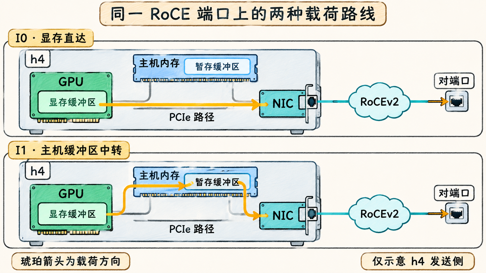

# 节点镜像变更的试点与回滚

午后，故障节点已复归满血，A 域重新握齐 4 台健康 H100 服务器。平台计划将 A 域节点镜像从旧基线升级到包含新内核的候选版本，先挑选备用节点做单机试点。

节点升级最容易踩的坑，是 **“单机绿灯、全组翻车”** ：试点机能进系统、能跑 CUDA、主机内存 RDMA 带宽也跑满 21 GB/s，于是贸然全量推开，结果当天晚上的多机训练集体变慢、PD 分离推理的首字延迟直接穿顶。

本篇复盘这场试点—停批—回滚闭环，讲清为什么必须用跨机显存直达和真实负载守住变更闸门。

## 变更依赖评审：盯紧内核升级背后的 DMA-BUF 接缝

本次升级只变动节点镜像与启动内核（旧基线 `基线 v1` 对应内核 `6.8.0-52-generic`；候选版本 `候选基线 v2` 对应内核 `6.8.0-53-generic`），其余组件全部锁定。动手前先把变更边界与核对项收进评审表：

| 变更范围与固定项 | 试点必须核对的生效状态与证据 |
| --- | --- |
| **变动项**：试点机 `node-4` 从`基线 v1` 切至`候选基线 v2` | 归档两份不可变镜像摘要、目标内核与模块清单；GPU/NIC 驱动归节点镜像管理，需核对内核模块 ABI、安全启动签名与实际加载版本 |
| **固定项**：固件、Kubernetes `v1.36`、**containerd `2.3.0`**、Device Plugin `v0.20.1`、Multus `v4.2.4` 与作业镜像 | 在候选机重新核对原生 CDI 规格与设备插件上报，确认 VF、IPAM 地址池与 GPU–VF 物理拓扑未发生漂移 |
| **跨版本对端**：`node-1`、`node-2` 保持 `基线 v1` 与 `node-4` 混跑，要求 RoCEv2 载荷走 GPUDirect RDMA | 必须实测混跑下实际选中的 RDMA 后端、DMA-BUF 显存注册与设备完成，不可用单机 CUDA 或主机 RDMA 替代 |
| **业务与持久契约**：检查点格式、共享存储挂载与训练镜像不变 | 试点与回滚后均需加载预存完整检查点、推进若干步并写出新完整检查点，验证读写契约完整 |

为什么哪怕 GPU 计算通过、主机内存 RDMA 也通过，升级内核依然最容易折在显存直达上？关键就在 [第 06 章](../06_从普通网络通信走向RDMA/00_内容大纲.md) 剖析过的 **DMA-BUF 跨驱动交接**。

GPU 驱动负责把显存导出为文件描述符，RDMA 驱动负责把这份句柄导入并注册给网卡。只要新内核与任一侧驱动模块在导出/导入接口上出现细微失配，两端单跑依然全绿，一碰跨机显存直传就会当场失效——而 `NCCL 2.27.3` 往往静默退回主机内存中转，掩盖故障却把性能拖垮。

## 同域维护余量与训推差异化排空

动手前，先用容量账本核算这次变更会不会击穿生产底线。此时 A 域四台机器都能各自贡献一个完整训练落点（混部节点虽常驻 4 卡在线推理，但余量 `4 GPU / 28 CPU / 176 GiB / 1 VF` 刚好满足一份训练 worker），`train` 队列现占 4 GPU，仍可接纳一组 12 卡作业。

把试点节点隔离退出后，A 域刚好还剩三个完整落点，**恰好守住一组三节点训练的最低底线**。这说明本集群 A 域的并发维护上限就是 **最多同时退出 1 台**——倘若上一篇的故障节点尚未复归，这次升级就必须无条件延后。

同时还要算进**测试对端占用的隐性账**：三节点混跑压测需要连同两台旧基线对端一起独占排空，排除邻居干扰。团队因此提前与业务对齐，为试点和可能的回滚复测各预约了短时独占测试窗，期间暂停新提交生产训练。

> [!tip] 训推共存排空清单：训练与在线推理绝不能用同一套粗暴驱逐
> 若待升级节点上仍有在跑负载，必须先摸清 Pod、主机进程与可恢复状态，再分道排空：
> - **同步训练作业**：禁止直接 `kubectl drain` 单独驱逐某一个 worker（那样会白白打断整组、损耗未保存进度），应等待作业落盘完整检查点后整组退出（本例试点节点上的训练已自然完结）。
> - **在线推理服务**：严格遵循 `PDB`（自愿中断预算），先在非试点健康节点拉起替代副本并完成百 GB 权重预热与就绪探针，再从负载均衡摘除该节点副本、等待在途 token 生成完毕退出，保证线上 TTFT/TPOT 零抖动。
> - **系统与宿主机残留**：普通排空之外，还需单独核对 DaemonSet 与宿主机侧直接占卡/占驱动的客户端进程全部释放。

## 分层对标实测：三轮证据触发停批红线

试点节点切到候选镜像并在隔离验收态重启后，团队按完全一致的口径执行三轮对照验证：

- **单向 RDMA Write 基准（`perftest 26.07.8`）**：固定试点机发往同一旧基线对端（`node-4 → node-1`）的同一端口与地址，消息 `4 MiB`、单连接、队列深度 `64`、空载独占，以十进制 `GB/s` 记有效载荷速率；显存轮启用 CUDA 与 DMA-BUF 参数把两端缓冲区切为 GPU 显存。
- **全组集合通信基准（`nccl-tests v2.17.9`）**：固定三台混跑节点（`node-1/node-2/node-4`）各 4 Rank、相同 GPU–VF 配对，消息 `256 MiB`、FP32 求和、独立收发缓冲区，取三轮单次平均耗时的中位数，同步归档 NCCL 实际传输与注册日志。

```bash
# 1) 显存直达单向 RDMA Write 验证（perftest 26.07.8，在候选机 node-4 侧发起）
ib_write_bw -d mlx5_0 -s 4194304 -q 1 -l 64 --use_cuda=0 --use_cuda_dmabuf <node-1-roce-ip>
# 候选基线 v2 实测输出摘要：
# GPU memory exported via dmabuf fd, ibv_reg_dmabuf_mr() failed (errno=EOPNOTSUPP)

# 2) 三节点 12-Rank AllReduce 混跑验证（nccl-tests v2.17.9，记录实际路径）
NCCL_DEBUG=INFO NCCL_DEBUG_SUBSYS=NET,INIT mpirun -np 12 -H node-1:4,node-2:4,node-4:4 \
  all_reduce_perf -b 256M -e 256M -f 2 -g 1 -d float -o sum -c 1
```

把变更前、试点混跑与回滚复测三轮同口径数据并排摆开，问题一眼见底：

| 分层验证项目 | 变更前（全为`基线 v1`） | 试点混跑（仅 `node-4` 为`候选基线 v2`） | 回滚复测（`node-4` 回到`基线 v1`） |
| --- | --- | --- | --- |
| **`node-4` 容器 GPU 交付与计算回读** | 通过 | 通过 | 通过 |
| **主机内存 RDMA Write（4 MiB / QD 64）** | `21.2 GB/s` | `21.0 GB/s` | `21.1 GB/s` |
| **显存 RDMA Write（DMA-BUF）** | 两端注册与传输完成 | `node-4` 显存已导出，**RDMA 侧导入失败，未提交 Write** | 两端注册与传输完成 |
| **12-Rank AllReduce（256 MiB，门槛 $\le 27\text{ ms}$）** | `24 ms`，校验通过 | **`36 ms`，校验通过（超限）** | `25 ms`，校验通过 |
| **NCCL 实际观测传输路径** | 预期显存直达（GPUDirect RDMA） | 仍走 RoCE，但 `node-4` 连接退回**主机缓冲区中转** | 恢复预期显存直达 |

本次变更评审事先锁定了四条放行门槛：结果正确、显存直达路径通过、12-Rank AllReduce 中位数不超过 `27 ms`、且具备代表性训练加载与新检查点证据。候选升级镜像已经双项触碰红线：

$$
\text{集合时延增幅} = \frac{36 - 24}{24} = +50\% \qquad (36\text{ ms} > 27\text{ ms 放行门槛})
$$



*图 20-05-01：试点节点 `node-4` 发送侧的两条 RoCE 载荷路线（图中 `h4` 对应 `node-4`，`I0` / `I1` 对应`基线 v1` / `候选基线 v2`）。`基线 v1` 走显存直达；`候选基线 v2` 涉及该节点的连接退回主机暂存中转。*

> [!warning] 常见误区：结果全对 + 主机 RDMA 满速 ≠ 可以放行（训推双重杀伤）
> 退回主机缓冲区中转后，数学归约结果依然 100% 正确，很容易在粗放验收里蒙混过关。可一旦放进生产集群，它将同时打击两类核心负载：不仅让多机训练的集合通信耗时飙升 50%，更会击穿 **PD 分离在线推理** 的 KV Cache 跨机直传通路，迫使百 MB 级 KV 块绕道主机内存，直接拉爆线上 `TTFT` 尾延迟与主机内存带宽。

结论毫无悬念：**立即停止扩批，将试点节点维持在隔离状态启动回滚**。至于候选镜像内部具体是哪个模块版本、权限还是导入接口发生了变化，留给研发离线比对模块信息与返回码，绝不把生产节点当作排障实验台。

## 安全回滚与“带业务进度”的放回验收

之所以敢在几分钟内果断回滚，是因为动工前团队已逐项核实了**可独立执行的回滚前提**：可从独立制品库拉回旧基线的不可变摘要（含匹配内核、GPU/NIC 驱动模块、containerd/CDI、VF 策略与附加网络定义），并保留带外启动恢复与存储挂载凭据。

同时确认本次变更不涉及固件降级或存储格式迁移等不可逆状态，旧版本制品能够无障碍读取现有检查点。

试点节点保持隔离并切回旧基线重启后，先逐项校验生效内核、已加载驱动模块与设备实态，再按原预约窗口重跑分层基准——上表最后一列显示，主机 RDMA（`21.1 GB/s`）、显存 DMA-BUF 直达与 12-Rank AllReduce（`25 ms <= 27 ms`）全部过关。

但做到这一步还差临门一脚：**绝不能只看到节点 `Ready` 或跑完微基准就匆忙 `uncordon`**。团队继续用同一组三台机器执行了一次代表性训练恢复演练：

- 12 个 Rank 加载同一份预存完整检查点；
- 按约定批量与输入连续跑完 30 个优化步，测得步时中位数 `1.22 s`（低于 `1.30 s` 放行门槛，保存耗时另计）；
- 成功落盘并验证一份新的完整检查点。

链路、性能、业务进度与持久保存四重证据全部闭环后，运维才解除试点节点隔离，将其重新开放回 A 域生产池，并将变更前、试点与回滚三轮完整记录归档留痕。

> [!summary] 核心结论
> 一次真正安全的 GPU 集群升级，靠的不是“重启后 `kubectl get node` 变 `Ready`”，而是三道刚性护栏：**上线前算清同域维护余量与训推差异化排空，试点中用跨机显存直达与集合时延拦截静默退化，回滚后补齐带真实检查点读写的应用演练才放回容量。**

至此，我们已经完整走完了一座训推共存 GPU 集群从提交运行、资源博弈、跨层排障、故障自愈到安全升级的一整天实战。接下来，请合上正文，进入章末综合检验，用一套全新的集群快照独立演练全书 20 章的核心功底。

> [!info]- 参考资料
> - **GPUDirect RDMA 与 DMA-BUF 注册**：[NVIDIA GPUDirect RDMA 路径与限制](https://docs.nvidia.com/cuda/gpudirect-rdma/)、[NCCL 2.27.3 DMA-BUF 注册配置](https://docs.nvidia.com/deeplearning/nccl/archives/nccl_2273/user-guide/docs/env.html#nccl-dmabuf-enable)
> - **RDMA 与集合通信基准工具**：[perftest 26.07.8 CUDA 与 DMA-BUF 说明](https://raw.githubusercontent.com/linux-rdma/perftest/26.07.8/README)、[nccl-tests v2.17.9 多机测试与计时参数](https://raw.githubusercontent.com/NVIDIA/nccl-tests/v2.17.9/README.md)
> - **节点排空与容器运行时**：[Kubernetes v1.36 安全排空节点](https://v1-36.docs.kubernetes.io/docs/tasks/administer-cluster/safely-drain-node/)、[Kubernetes v1.36 kubectl drain 参考](https://v1-36.docs.kubernetes.io/docs/reference/kubectl/generated/kubectl_drain/)、[containerd 2.3.0 CRI CDI 配置](https://github.com/containerd/containerd/blob/v2.3.0/docs/cri/config.md)
