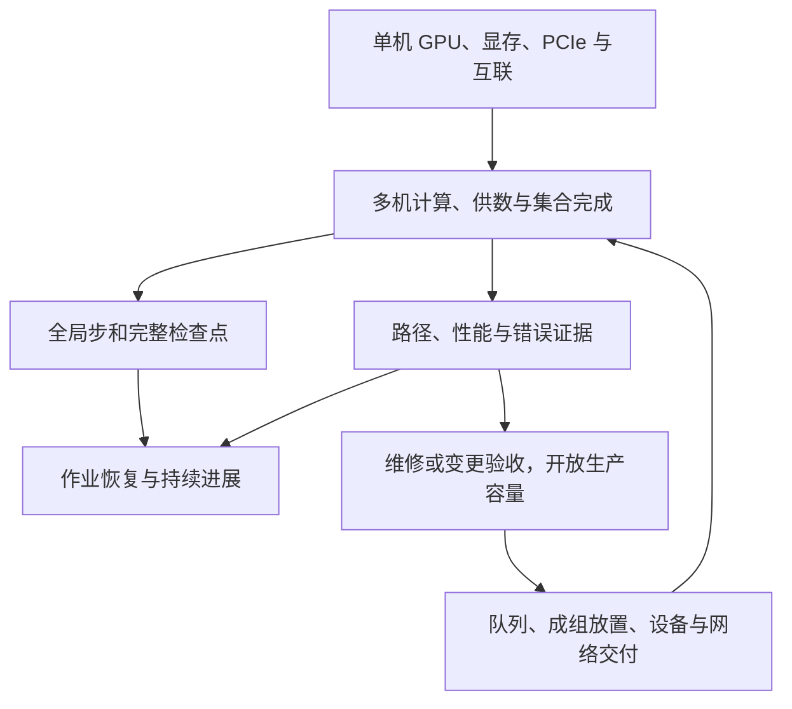

# GPU 集群运行全流程的综合检验

以下是一份独立的教学工单。纸笔或文本编辑器即可完成。每项判断请写出用到的记录、该判断的适用范围，以及下一项可以区分候选解释的证据。

## 工单与资源快照

工单 `J20-E` 请求三个相同的 worker。每个请求 4 张 H100 80 GB 整卡、16 CPU、96 GiB 主机内存和 1 个支持 RDMA 的 VF。三个 worker 必须同在 A 域、分居不同主机，每个启动四个 GPU 进程。Volcano v1.16.0 使用 `enqueue, allocate`、`capacity`、`predicates` 和 `gang`，Job 与 worker 角色的最低成员均为 3。`train` 的 GPU 有效上限为 16，只有 B 域 `y1` 上的另一个 Pod 已占 4 GPU，其余维度充足，无在途占用或弹性扣减。表中是扣除已有请求后的余量，未列出的条件均满足。

| 节点 | 域 | GPU 池 | GPU 余量 | CPU 余量 | 主机内存余量（GiB） | VF 余量 |
| --- | --- | --- | ---: | ---: | ---: | ---: |
| `x1` | A | H100 80 GB | 8 | 32 | 192 | 1 |
| `x2` | A | H100 80 GB | 4 | 16 | 96 | 1 |
| `x3` | A | H100 80 GB | 4 | 16 | 96 | 0 |
| `x4` | A | H100 80 GB | 2 | 24 | 144 | 2 |
| `y1` | B | H100 80 GB | 4 | 16 | 96 | 1 |
| `a5` | A | A100 40 GB | 8 | 32 | 192 | 2 |

1. 求整卡余量、队列准入结果和 A 域合格落点。比较在 `x1` 多出 1 个 VF 与在 `x3` 归还 1 个 VF 的结果。若队列原有用量变成 6 GPU，而节点快照仍相同，作业会停在哪里？
2. 主例由 `x3` 归还 VF，作业绑定 `x1/x2/x3`。三个 Pod 使用 `eth0` 会合，`net1` 的 VF 支持 RoCEv2。节点内使用 NVLink/NVSwitch，训练数据经独立存储网进入主机内存，随后送入卡。画出从提交到首次校验和最终归账的管理关系，以及两节点的集合载荷路径。在预期用 GPUDirect RDMA 的环境中，三个 Pod Running 且会合成功后，还要观察什么才能确认首轮走通？

## 训练慢步与 GPU 不可访问

初次尝试的健康窗与慢窗保持十二个 Rank、各自设备和消息大小一致。下表是各选一步的设备追踪，以全局步起点为共同原点，时钟误差低于 2 ms。两步的输入就绪和 GPU 本地计算相近。异常窗中，发往 `x3` 的 RoCE 交换端口出方向队列在相关窗口持续升高，所选 RDMA 设备及传输方式记录相同。相反方向在同窗没有相应升高。

| 事件 | 健康步（ms） | 慢步（ms） |
| --- | ---: | ---: |
| 最早集合输入就绪 | 700 | 705 |
| 最晚集合输入就绪 | 760 | 765 |
| 最后一个 Rank 的集合结果在设备上可用 | 900 | 1,105 |

3. 算两步的就绪跨度和完成尾部。提出优先调查的路径，选一个测试条件能够区分端口共享拥塞与仅在全组出现的慢完成。指出端口计数为何不足以确认是哪一个 Pod 产生了排队。

稍后，`x2` 的同一启动周期内，故障 GPU 的上游 PCIe 分支记录 fatal AER，GPU 驱动记录 Xid 79，`R1` 的 Rank 6 退出。分配快照给出了对应的 GPU UUID、PCI 地址和旧 Pod UID。作业配置为 Agent 不自行重试、容器不重启，`PodFailed` 触发 `RestartJob`，且仍有预算。团队隔离 `x2` 并确认旧成员退出。此前 `x4` 已释放 2 张卡，`x3` 归还的 VF 仍可用于新一轮，其他余量保持。最后的全组完成步为 980，第 970 步有未完成的检查点，第 950 步的完整版本已经过读取验证。

4. 给出隔离后的同域落点、应加载的步号、重做量与首次超过故障前进度的步号。列出作业恢复和 `x2` 复归各需要的证据。后来新尝试完成并终止，其状态更新期间另一个训练 Pod 计入 4 GPU，队列从 16 降至 8。这个净变化与释放了多少旧请求相符？

## 试点和回滚的证据

训练收尾后，计划隔离 `x4` 做节点镜像试点。`x1/x3/x4` 各可贡献一份合格资源，`x2` 尚未通过复归测试。业务要求在试点期间保留三个生产落点。`x2` 通过复归后，变更方又提交了下表，声称可以完成试点并立即扩批。测试使用同一组旧对端、相同的十二 Rank、消息与计时口径，采用预留的独立窗口。本次放行要求路径恢复、集合时间比初始基线至多高 10%，以及代表性应用能从完整检查点加载、推进并再保存。

| 教学证据 | 初始基线 | 试点结果 | 从原摘要启动后的复测 |
| --- | --- | --- | --- |
| 容器 GPU 计算、主机内存 RDMA | 通过 | 通过 | 通过 |
| 预期显存直达路径 | 通过 | 注册失败 | 通过 |
| 十二 Rank 集合时间与校验 | 18 ms，正确 | 21 ms，正确 | 18.2 ms，正确 |
| 代表性应用 | 加载、推进和再保存通过 | 未执行 | 未执行 |

5. 判断 `x2` 尚隔离时能否试点。若 `x2` 已复归，如何安排试点用的对端与生产容量？计算性能边界，判断是否扩批及回滚后能否开放节点。列出回滚前应核对的制品和有效状态证据。

## 参考推理

### 1. 从队列最低量算到具体主机

整卡余量为 `8 + 4 + 4 + 2 + 4 + 8 = 30`，A 域 H100 余量为 18。队列账面 `4 + 12 = 16`，达到但未超过有效上限。当前只有 `x1/x2` 合格。`x3` 卡数足够但缺 VF，`x4` 不足四卡，`y1` 在 B 域，`a5` 的卡型及单卡显存不符。主机反亲和使 `x1` 已经只能贡献一个落点，因此再增加它的 VF 无法凑齐。`x3` 归还一份 VF 后新增第三个落点。如果队列已有 6 GPU，则 `6 + 12 = 18 > 16`，该组停在准入，需核对 `PodGroup`、Queue 和控制器状态。此时即使释放 `x3` 的 VF，队列仍未放行。

### 2. 管理交接与真实数据路径

管理关系可画为 `API 接收 Job → 控制器建 PodGroup → Queue 通过 → 控制器建 Pod → 成组绑定 → kubelet 分配 GPU 与 VF → GPU 设备注入和 CNI 接入 → 容器启动 → 三个 Agent 会合 → 十二 Rank 首轮校验 → 正式训练 → 成员退出和归账`。归账需要查看旧 Pod UID 对应的节点设备、网络回收和调度请求。

在这个例子里，`eth0` 负责成员协调，实际集合的跨节点一段可画为 `源 GPU 显存 → PCIe → 源 VF 所属物理端口 → A 域 RoCEv2 → 对端物理端口与 VF → PCIe → 对端 GPU 显存`。几个本地 Rank 间的数据可经节点内 NVLink/NVSwitch 交换。输入经存储网和主机内存到显存。查十二个 Rank 的实际设备与通信后端、端口和显存注册路径，再查同一调用的设备完成及结果校验。只看到通信组初始化时，还缺首轮执行证据。

### 3. 先查完成尾部内的实际传输和依赖

就绪跨度均为 `60 ms`。完成尾部分别为 `900 − 760 = 140 ms` 和 `1,105 − 765 = 340 ms`，增加 `200 ms`。输入和计算段近似稳定，证据将调查收窄到集合后段。发往 `x3` 的端口出方向排队支持优先查共享路径。可先核对应用使用的 VF、父端口、交换机队列和负载方向，再按同样的消息、放置、并发与时钟条件重复全组测试，只移开该端口上的一项共有流量。若尾部和队列一起恢复，支持共享拥塞解释。若全组仍慢，留取设备流依赖和调用时序，并用同端点显存 RDMA 对照分出路径局部与全组效应。单对、低并发测试通过只覆盖该对的条件。物理端口指标汇总经过该端口的流量，归因到某 Pod 还需 VF、流量分类和同窗记录。

### 4. 分开恢复业务、维修节点和核算归账

`x2` 隔离后不计入普通生产落点。旧组释放后，`x1/x3/x4` 均符合向量要求，队列允许在原 4 GPU 之上重新计入 12 GPU。新组记录 `R2`、新 Pod UID、Rank 与 GPU 的关系，再用全组实际加载记录确认从 950 继续。`980 − 950 = 30` 步需重做，恢复后第一步为 951，981 才首次超过旧进度。随后还要看到连续进展与新完整检查点。`x2` 需单独按设备和原路径验收 PCIe、GPU 与节点内互联，验证实际 Pod 能计算、VF 接入及显存通信可用，并在代表性负载下复查错误和进度后开放。

新添加的 4 GPU 会抵消一部分下降。根据 `16 − 释放量 + 4 = 8`，旧组应释放 12 GPU。确认时用各自的 Pod UID 查旧组退出、节点设备和网络清理及新出现的请求，避免把队列净减 8 当成旧组释放量。

### 5. 用容量和同口径复测决定变更

`x2` 隔离时，若再隔离 `x4`，只剩 `x1/x3`，达不到三个生产落点。`x2` 通过后，除 `x4` 外表面上还剩三台。若测试必须占用其中的对端并排除业务并跑，应另找对端或增加已验收容量。需要例外测试窗口时，业务须先明确该窗口对容量要求的调整。

集合边界为 `18 × 1.10 = 19.8 ms`。候选的 `21 ms` 超限且预期路径未通过，停止扩批。回滚前要能独立取得原镜像摘要、匹配的启动内核与 GPU/NIC 模块、运行时及网络配置和所需权限，并核对旧制品可读当前状态。回滚后对照有效内核、模块、设备和实走路径。`18.2 ms` 和显存路径均达标，但缺少回滚后的应用加载、有效推进与完整再保存，依照工单门槛应继续隔离，先补这一项证据。

## 从物理设备到可恢复的作业进度

一份训练进度要靠四层证据串起来。单机的计算、显存和互联决定设备能够做什么。多机的通信与供数决定这份计算能否组成同一个步。资源和放置决定这些能力能否交到同一组进程。运维证据决定能力变化时能否隔离影响、恢复训练并重新开放容量。把作业尝试、Pod、设备和时间窗对应起来，才能用同一张图解释运行条件、观测现象与恢复决定。

*图 20-06-01｜物理能力经调度和运行时交给进程，在实际数据路径上形成可完成的训练步。检查点提供进度恢复的输入，路径和性能复测支持节点复归和下一轮资源交付。*
