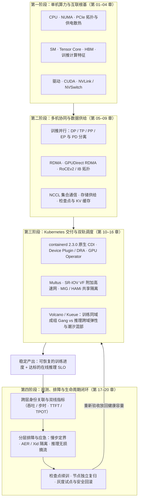

# GPU 集群运行全流程的综合检验

下面五组独立实战推演题无需真实 GPU 集群，纸笔即可完成。它们覆盖了训推共存生产集群的五大核心考题：**队列与多维碎片放置、本地交付与首轮验真、共享物理口拥塞定位、硬故障重试与对账、以及镜像升级试点回滚决策**。

建议每题先写下你的判断依据、关键算式与下一步取证动作，再展开参考推理逐项核对。

---

## 检验一：队列准入、碎片落点与释放位置

某双网络域训推共存集群收到一份固定三节点训练作业 `train-e`：共 3 个相同 worker Pod，每 Pod 请求 **4 张 H100 80 GB 整卡、16 CPU、96 GiB 主机内存与 1 个支持 RDMA 的 VF**，硬绑定 A 域并按主机名反亲和分散，每 Pod 启动 4 个 GPU 进程。

集群采用 Volcano `v1.16.0`（`enqueue, allocate` 与 `capacity / predicates / gang`，作业与任务最低成员均为 3）。`train` 队列 GPU 有效上限为 16，当前仅有 B 域 `y1` 上的 1 个旧训练 Pod 占着 4 GPU，其余资源维度充足。下表为扣除已有在线推理、巡检与训练占用后的节点调度余量：

| 节点 | 网络域 | 整卡池规格 | GPU 余量 | CPU 余量 | 主机内存余量（GiB） | VF 余量 |
| --- | --- | --- | ---: | ---: | ---: | ---: |
| `x1` | A | H100 80 GB | 8 | 32 | 192 | 1 |
| `x2` | A | H100 80 GB | 4 | 16 | 96 | 1 |
| `x3` | A | H100 80 GB | 4 | 16 | 96 | 0 |
| `x4` | A | H100 80 GB | 2 | 24 | 144 | 2 |
| `y1` | B | H100 80 GB | 4 | 16 | 96 | 1 |
| `a5` | A | A100 40 GB | 8 | 32 | 192 | 2 |

请依次推导：

1. 计算全集群整卡余量、A 域 H100 余量、队列准入结果以及 A 域当前合格落点数。
2. 分别比较“在 `x1` 多释放 1 个 VF”与“在 `x3` 归还 1 个 VF”对成组放置的影响。
3. 若节点快照不变，但 `train` 队列原有用量变成 6 GPU，作业会停在哪个阶段？此时如果高优先级 `infer` 队列需要立即扩容 1 个 4 卡 H100 在线推理副本（不限网络域），它会被挡住吗？

> [!example]- 参考推理（点击展开）
> **1. 全局余量、队列准入与逐节点落点核算**
>
> 全集群整卡余量为 $8 + 4 + 4 + 2 + 4 + 8 = 30$ 张，A 域 H100 余量为 $8 + 4 + 4 + 2 = 18$ 张。队列账面核对：
>
> $$
> G_{\text{allocated}} + G_{\text{minReq}} = 4 + 12 = 16 \le 16
> $$
>
> 队列准入通过，`PodGroup` 进入 `Inqueue` 并建出 3 个未绑定 Pod。再按单机短板与主机反亲和（封顶 1）逐台筛查：
> - `x1`（A 域 H100）：四维全够，反亲和封顶 → **1**；
> - `x2`（A 域 H100）：四维恰好凑齐 → **1**；
> - `x3`（A 域 H100）：缺 VF，$\lfloor 0 / 1 \rfloor = 0$ → **0**；
> - `x4`（A 域 H100）：缺 GPU，$\lfloor 2 / 4 \rfloor = 0$ → **0**；
> - `y1`（B 域 H100）：不在 A 域 → **0**；
> - `a5`（A 域 A100 40 GB）：卡型与单卡显存规格不符 → **0**。
>
> A 域当前只有 **2 个**合格落点，小于成组门槛 3，整组停在成组放置等待。
>
> **2. 释放 VF 位置的决定性差异**
> - **`x1` 多释放 1 个 VF**：主机反亲和早已把 `x1` 封顶在 1 个落点，新增落点为 **0**，仍无法放置。
> - **`x3` 归还 1 个 VF**：打通该机唯一短板，A 域合格落点增至 **3 个**（`x1 / x2 / x3`），立刻满足成组放置。
>
> **3. 队列超限与训推隔离反差**
> - 若 `train` 队列已占 6 GPU，则 $6 + 12 = 18 > 16$，作业会直接卡在 **Queue 准入**（`PodGroup` 停在 `Pending`，连 worker Pod 都不会创建）；此时就算 `x3` 释放 VF 也无济于事。
> - 而高优先级 `infer` 队列的 4 卡在线推理副本不受 `train` 队列配额牵制、无需 Gang 等三台也不锁死 A 域，可直接落到 `y1`（或 `x1`、`x2`）立刻扩容。

---

## 检验二：生命周期交接、真实数据路径与首轮验真

接续检验一：`x3` 归还 1 个 VF 后，三个 worker 绑定至 `x1 / x2 / x3`。Pod 使用 `eth0` 完成会合与引导，`net1` 对应的 VF 走 A 域 RoCEv2，节点内为 NVLink/NVSwitch，训练数据经独立存储网进入主机内存再拷入显存。

1. 梳理从 API 提交到首轮校验及最终归账的控制交接链路，指出归账时必须核对哪几本账。
2. 画出跨节点的 GPUDirect RDMA 集合载荷路径；当现场看到“三个 Pod 全部 `Running` 且三个 Agent 会合成功”后，为什么仍不足以宣布通信就绪？下一步还要核对哪些具体证据？

> [!example]- 参考推理（点击展开）
> **1. 控制交接链路与退出三账**
> - 完整交接链：`API 接收作业 → 控制器建 PodGroup → Queue 准入通过（Inqueue）→ 控制器建 3 个 Pod → Volcano 成组绑定 → kubelet 分配 GPU（原生 CDI 注入）与 VF（Multus/SR-IOV 接入）→ 容器启动 → 3 个 Agent 会合 → 12-Rank 首轮校验 → 正式训练 → 成员退出与归账`。
> - 退出归账需按旧 Pod UID 分别核对三本异步更新的账：**节点 kubelet 设备分配与 CNI/IPAM 清理**、**节点调度余量归还**、以及 **Volcano Queue 用量回落**。
>
> **2. 真实载荷路径与首轮验真缺口**
> - 跨节点显存直达载荷路径：`源 GPU 显存 → PCIe → 源 VF 与父物理口 → A 域 RoCEv2 网络 → 对端物理口与 VF → PCIe → 对端 GPU 显存`（同机 Rank 走 NVLink/NVSwitch，样本输入走独立存储网 → 主机内存 → H2D → 显存）。
> - `NCCL 2.27.3` 默认支持首轮调用时按需动态建连，且 API 返回只说明指令已入 CUDA Stream。因此会合之后还必须核对：**12 个 Rank 实际绑定的物理 GPU UUID、实际采用的 RDMA 后端与显存直达路径记录、同一调用的设备侧完成事件以及正确的数值校验结果**。

---

## 检验三：完成尾部飙升与共享物理口拥塞归因

运行一段时间后出现训练慢步。健康窗与慢窗保持相同的 12 个 Rank、设备与消息大小，所有时间戳对齐到全局步起点（时钟误差 $< 2\text{ ms}$），且两步的输入就绪与 GPU 本地计算段基本一致。同窗监控显示：**交换机连向 `x3` 的 RoCE 物理端口出方向（Egress）队列深度持续抬升**，相反方向队列平稳，通信后端与 RDMA 设备未变。

| 关键同步事件 | 健康步（ms） | 慢步（ms） |
| --- | ---: | ---: |
| 最早 Rank 集合输入就绪 | 700 | 705 |
| 最晚 Rank 集合输入就绪 | 760 | 765 |
| 全组最后 1 个 Rank 集合结果在设备上可用 | 900 | 1,105 |

请回答：

1. 分别计算两步的**就绪跨度**和**完成尾部**，说明应优先排查哪一层路径。
2. 设计一项受控对照测试，把“共享物理口被同机其他负载（例如 PD 分离推理 KV 迁移）打满”与“全组集合自身变慢”彻底区分开。
3. 为什么交换机端口队列计数器飙升，并不能直接证明是本训练作业引发了排队？

> [!example]- 参考推理（点击展开）
> **1. 就绪跨度与完成尾部定量拆分**
>
> $$
> \Delta t_{\text{skew, 健康}} = 760 - 700 = 60\text{ ms}, \qquad \Delta t_{\text{skew, 慢步}} = 765 - 705 = 60\text{ ms}
> $$
>
> $$
> \Delta t_{\text{tail, 健康}} = 900 - 760 = 140\text{ ms}, \qquad \Delta t_{\text{tail, 慢步}} = 1105 - 765 = 340\text{ ms} \quad (+200\text{ ms})
> $$
>
> 就绪跨度与本地计算均平稳，延迟增量全部集中在**齐人之后的完成尾部**（`+200 ms`），叠加指向 `x3` 的交换端口出方向持续排队，证据明确将调查锁定在**集合后段经由 `x3` 共享 RoCE 物理口的跨机传输路径**。
>
> **2. 区分共享口拥塞与全组慢完成的受控测试**
> - 先核对应用使用的 VF、父物理口、交换机队列与流量方向；随后在**相同消息大小、节点放置、并发与时钟口径**下重复全组集合测试，**唯一变量是暂时移开该共享物理口上的另一侧并行流量**（如将同机另一 VF 的推理/测试流量切走）。
> - 若移除邻近流量后，交换端口队列与完成尾部同步回落至约 `140 ms`，即验证为共享端口拥塞；若全组依旧偏慢，则进一步抓取设备 CUDA Stream 依赖时序，并辅以同端点单对显存 RDMA 对照，拆分局部链路问题与全组同步问题（注意单对低并发测试通过仅覆盖该单对条件）。
>
> **3. 端口计数器的归因盲区**
> - 物理口与交换机端口指标汇总了经过该端口的**全部 VF 与全部流**。要精确定位到具体哪个 Pod 制造了排队，必须补齐 VF 级计数、DSCP/流量类别映射以及同时间窗内各 Pod（训练与同机推理）的流量记录。

---

## 检验四：硬故障重试、推理无损漂移与队列净变对账

稍后，`x2` 同一启动周期内某张训练卡的上游 PCIe 分支报 fatal AER，驱动紧接着报 Xid 79，首轮尝试的 Rank 6 退出，分配快照已记下对应 GPU UUID、PCI BDF 与旧 Pod UID。

作业配置为 `torchrun --max-restarts=0`、`restartPolicy: Never`，Volcano 策略为 `PodFailed → RestartJob` 且仍有重试额度。

运维立即隔离 `x2` 并确认旧成员退出（若 `x2` 其余健康卡上同时跑着在线推理副本，需按无损方式迁离）。此前 `x4` 已释放 2 张卡，`x3` 归还的 VF 仍可用，其余节点余量不变。故障前全组已完成第 `980` 步；持久化存储上第 `970` 步的检查点未写完，第 `950` 步的完整检查点已经过读取验证。

1. 给出隔离 `x2` 后的同域重试落点、应加载的检查点步号、重算步数与首次超过故障前进度的步号。
2. 分别列出**训练作业恢复**、**同机在线推理迁离**与 **`x2` 节点维修复归**各自的完成判据。
3. 重试轮次最终完成并终止，但在状态收敛期间另一个新训练 Pod 恰好入账占走了 `train` 队列的 4 GPU，导致队列已用 GPU 从 `16` 净降到 `8`。请问这个净变化对应旧作业释放了多少张 GPU？现场如何核实而不被净值误导？

> [!example]- 参考推理（点击展开）
> **1. 重试落点与检查点重算核算**
> - `x2` 隔离退出生产放置；此前 `x4` 补足 2 卡后余量变为 4 GPU（CPU 24、内存 144 GiB、VF 2 均够），`x3` 已有 1 VF，因此重试轮次（`R2`）的新落点为 **`x1 / x3 / x4`**，队列 `4 + 12 = 16` 再次过关。
> - 舍弃不完整的 `970`，加载经验证完整的 **第 950 步**：
>
> $$
> \Delta S_{\text{rework}} = 980 - 950 = 30\text{ 步}
> $$
>
> - 恢复后首个完成步为 **第 951 步**，完成 **第 981 步**才首次超过故障前进度。
>
> **2. 三条闭环的独立验收判据**
> - **训练恢复**：记录新尝试 `R2` 下的新 Pod UID、Rank 与物理 GPU 映射，确认全组从第 `950` 步加载、突破第 `981` 步持续推进，并成功写出新的完整检查点。
> - **同机在线推理迁离**：遵守 `PDB`，先在健康节点（如 B 域或非隔离节点）预热新副本并通过就绪探针，再从 Service 摘除 `x2` 上的旧副本并等在途请求生成完毕，实现零断流与 SLO 零违约。
> - **`x2` 硬件复归**：在独立隔离验收窗检修重启后，重验 PCIe 链路、GPU 诊断与节点内互联，用实际 Pod 验通计算、VF 接入、显存 RDMA、全组集合通信与代表性负载且无同类报错，再解除隔离。
>
> **3. 队列净变化反推与逐 UID 核账**
> 设旧作业释放量为 $R$，新入账 4 GPU 抵消了一部分回落：
>
> $$
> 16 - R + 4 = 8 \implies R = 12\text{ GPU}
> $$
>
> 现场核实时绝不可把“队列净减 8”错当成“旧作业只释放了 8 卡”，而应按各自的 **Pod UID** 分别核对旧作业三个 Pod 的退出与节点设备/网络回收，以及新入账 4 卡 Pod 的绑定记录。

---

## 检验五：维护余量、试点停批与回滚放行红线

训练结束后，团队计划隔离 `x4` 试点新节点镜像。此时 `x1 / x3 / x4` 各可贡献 1 个合格落点，但 `x2` 尚未通过复归测试，而业务要求试点期间至少保留 **3 个可用生产落点**。

待 `x2` 通过复归后，变更方在预约独占窗内用同一组旧对端、相同 12-Rank 消息与计时口径提交了如下对照表，并声称可以推进扩批或立刻放回 `x4`。本次放行门槛为：**显存直达路径通过、12-Rank 集合时间不超过初始基线的 +10%、且代表性应用完成检查点加载、有效推进与再保存**。

| 分层验证项目 | 初始基线 | 候选镜像试点 | 回滚至原摘要复测 |
| --- | --- | --- | --- |
| 容器 GPU 计算与主机内存 RDMA | 通过 | 通过 | 通过 |
| 预期显存直达路径（GPUDirect RDMA） | 通过 | **注册失败** | 通过 |
| 12-Rank 集合时间与结果校验 | `18 ms`，正确 | `21 ms`，正确 | `18.2 ms`，正确 |
| 代表性应用（加载、推进、再保存） | 通过 | 未执行 | **未执行** |

请判断：

1. `x2` 仍隔离时能否启动 `x4` 试点？`x2` 复归后，安排混跑对端节点时还需注意什么容量冲突？
2. 计算集合通信性能门槛，据此判断候选镜像能否扩批，以及回滚复测后此刻能否立刻对 `x4` 执行 `uncordon`？
3. 正式回滚前必须提前核对哪些制品与生效状态前提？

> [!example]- 参考推理（点击展开）
> **1. 维护余量与对端预约冲突**
> - `x2` 未复归时，A 域只有 `x1 / x3 / x4` 三个合格落点；若再隔离 `x4`，仅剩 2 个落点，跌破“保留 3 个生产落点”的业务硬要求，**必须延后试点**。
> - `x2` 复归后，除 `x4` 外表面还剩 `x1 / x2 / x3` 三台，但若混跑测试必须独占其中两台对端并排除生产并跑，就会与生产训练抢占同一批落点；应另选隔离对端、补足验收余量，或事先经业务批准短时独占测试窗。
>
> **2. 性能门槛核算与两项决策**
>
> $$
> T_{\text{limit}} = 18 \times (1 + 10\%) = 19.8\text{ ms}
> $$
>
> - **候选镜像决策（停批）**：试点集合时间 `21 ms > 19.8 ms` 且显存直达路径注册失败，两项核心红线均未通过，**立即停止扩批**。
> - **回滚放行决策（继续隔离，暂不开放）**：回滚后 `18.2 ms <= 19.8 ms` 且显存直达已恢复，但表末**缺少回滚后的代表性应用加载、有效推进与完整再保存证据**，未满足工单全部门槛，必须保持隔离、补跑完业务演练再 `uncordon`。
>
> **3. 回滚前必须落实的制品与状态前提**
> - 确认能从独立制品库取回原镜像不可变摘要、匹配的启动内核与 GPU/NIC 模块、containerd/CDI 及 VF/附加网络配置与所需挂载凭据；
> - 核对是否存在固件降级或存储格式变更等不可逆状态，并确认旧制品能够正常读取当前检查点；回滚重启后再逐项比对生效内核、已加载模块、设备实态与实际数据路径。

---

## 全书收官：从单卡芯片到训推共存集群的知识全景

走到这里，全书二十章的四层知识版图已经完整合拢。回头看今天这一整天的实战，你会发现无论问题最初长成什么模样——“空着 38 张卡却起不来”“多卡 SM 活动齐跌”“单卡掉线拖停整组”还是“升级内核后通信慢了一半”——背后永远逃不出同一套四层因果骨架：

1. **第一阶段（第 01–04 章，单机硬件与计算根基）**：GPU SM 与 HBM 带宽决定算力与访存上限，PCIe 拓扑、NUMA 亲和、NVLink/NVSwitch 与驱动/CUDA 软件栈，划定了单机能跑多快、以及哪条硬件路径在出事时会断链。
2. **第二阶段（第 05–09 章，多机协同与数据供给）**：分布式训练追求高吞吐同步集合通信与完整检查点，在线推理追求低尾延迟、高并发 KV Cache 与 PD 分离迁移；RDMA、RoCEv2/IB 拓扑、NCCL 与多级存储缓存共同决定了它们能否跑出接近线性的扩展效率。
3. **第三阶段（第 10–16 章，Kubernetes 交付与训推双轨调度）**：原生 CDI、Device Plugin/DRA、GPU Operator 与 Multus/SR-IOV 把底层算力与高速网无损送进容器；MIG/HAMi 切分出推理隔离池，Volcano 与 Kueue 用队列、成组放置与差异化策略把训练的“同域聚合”与推理的“跨域弹性”稳稳装进同一座集群。
4. **第四阶段（第 17–20 章，观测、排障与持续运行闭环）**：以“身份锚定（Pod UID → Rank/副本 → GPU UUID → VF/物理口）+ 同时间窗对齐 + 同口径基线对照”为抓手，把性能定位、故障隔离、检查点恢复、在线推理无损漂移与灰度升级回滚拧成永续运转的生产飞轮。

*图 20-99-01：全书 20 章知识收官全景图。底层硬件与通信能力经由 Kubernetes 交付与训推双轨调度转化为业务产出，再通过观测、排障、无损恢复与安全变更验收回流至健康容量池。*

> [!summary] 全书终章寄语
> 真正成熟的 AI 基础设施工程师，不会把任何一个表层指标当作终局真相——**看调度不看全局空卡而看逐机短板，看性能不看单一利用率而看时间轴对齐，看故障不急着原地重启而先保全身份快照，看升级不迷信节点 `Ready` 而死守真实路径与业务进度。** 把这四把尺子带进你的下一座 GPU 集群，你就已经握住了驾驭大模型算力底座的钥匙。

> [!info]- 参考资料
> - **Kubernetes 与容器设备接口**：[Kubernetes v1.36 文档总览](https://v1-36.docs.kubernetes.io/docs/home/)、[containerd 2.3.0 CRI CDI 配置](https://github.com/containerd/containerd/blob/v2.3.0/docs/cri/config.md)
> - **Volcano 批处理调度与队列**：[Volcano v1.16.0 官方文档](https://volcano.sh/docs/v1.16.0/)
> - **PyTorch 与 NCCL 分布式运行时**：[PyTorch 2.9 分布式与弹性训练文档](https://docs.pytorch.org/docs/2.9/elastic/run.html)、[NCCL 2.27.3 用户指南](https://docs.nvidia.com/deeplearning/nccl/archives/nccl_2273/user-guide/docs/overview.html)
> - **NVIDIA 观测、诊断与故障分析**：[NVIDIA DCGM 用户指南](https://docs.nvidia.com/datacenter/dcgm/latest/user-guide/feature-overview.html)、[NVIDIA Xid 错误分析目录](https://docs.nvidia.com/deploy/xid-errors/latest/analyzing-xid-catalog.html)
